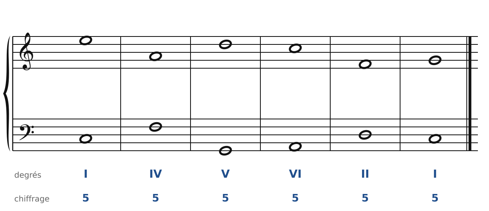
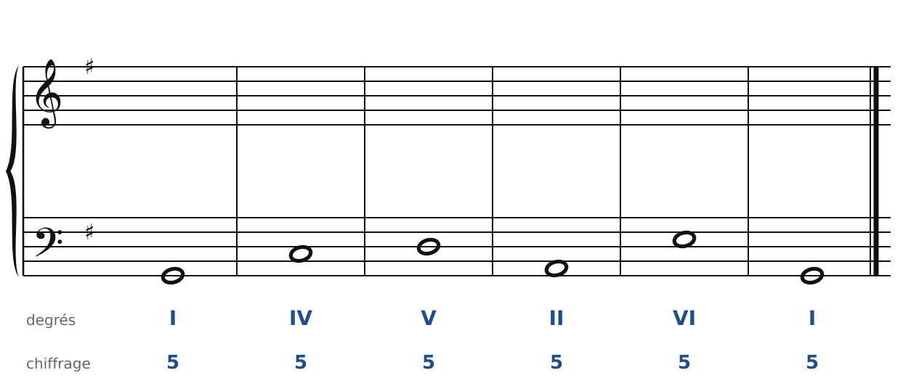
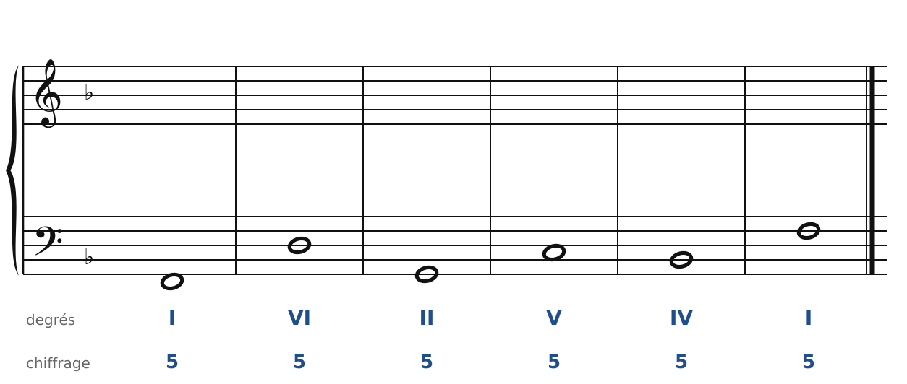
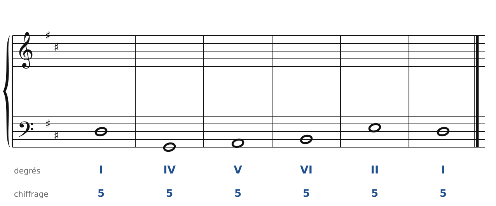
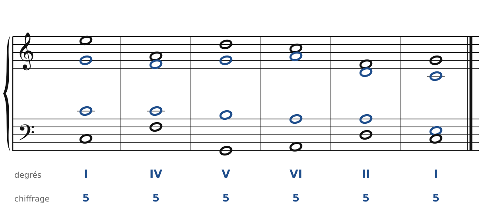
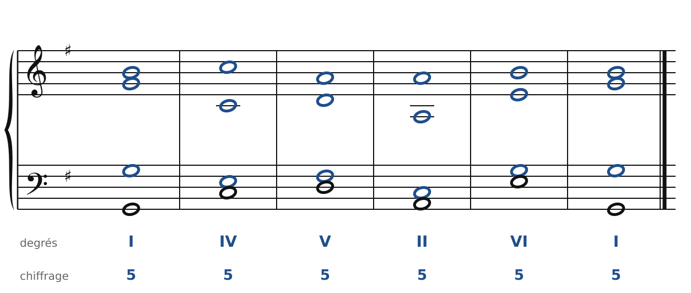
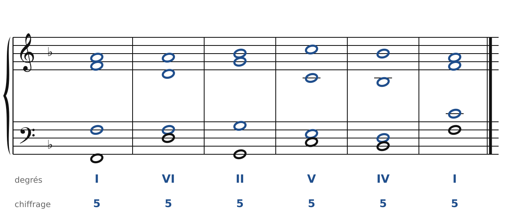
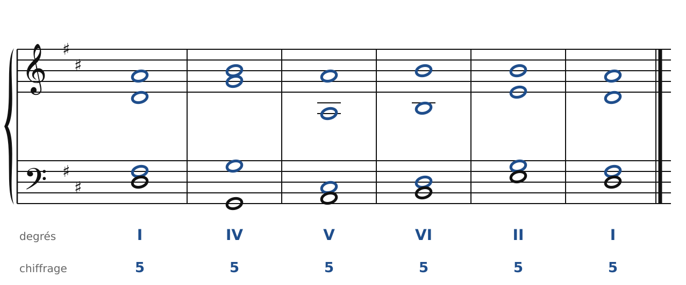

[Sommaire du cahier](README.md) · [Enchaîner les accords →](03-enchainer-deux-accords.md)

## Les quatre voix et l'accord parfait

Ces exercices accompagnent le [chapitre 1](../cours/01-les-quatre-voix.md) et le [chapitre 2](../cours/02-l-accord-parfait-a-quatre-voix.md) du cours.

Dans la version web (`cahier.html`), chaque exercice se fait **directement sur la portée**, avec les corrections au fur et à mesure. Sur papier, recopie l'énoncé et réalise-le au crayon.

### Exercice 1.1 · Accords séparés en Do majeur

Accords séparés (pas d'enchaînement) : le soprano et la basse sont donnés, écris l'alto et le ténor de chaque accord.

### Exercice 1.2 · Accords séparés sur une basse en Sol majeur

Accords séparés (pas d'enchaînement) : sur chaque basse, écris l'accord demandé (soprano, alto, ténor), en doublant la fondamentale.

### Exercice 1.3 · Accords séparés sur une basse en Fa majeur

Accords séparés (pas d'enchaînement) : sur chaque basse, écris l'accord demandé (soprano, alto, ténor), en doublant la fondamentale.

### Exercice 1.4 · Accords séparés sur une basse en Ré majeur

Accords séparés (pas d'enchaînement) : sur chaque basse, écris l'accord demandé (soprano, alto, ténor), en doublant la fondamentale.

### Corrigés

**Exercice 1.1**

🔊 [Écouter](audio/c01-01-c.mp3) · [MIDI](audio/c01-01-c.mid)

**Exercice 1.2** : une solution parmi d'autres.

🔊 [Écouter](audio/c01-02-c.mp3) · [MIDI](audio/c01-02-c.mid)

**Exercice 1.3** : une solution parmi d'autres.

🔊 [Écouter](audio/c01-03-c.mp3) · [MIDI](audio/c01-03-c.mid)

**Exercice 1.4** : une solution parmi d'autres.

🔊 [Écouter](audio/c01-04-c.mp3) · [MIDI](audio/c01-04-c.mid)

---

[Sommaire du cahier](README.md) · [Enchaîner les accords →](03-enchainer-deux-accords.md)
