[← Les quatre voix et l'accord parfait](01-les-voix-et-l-accord-parfait.md) · [Sommaire du cahier](README.md) · [Le premier renversement →](06-le-premier-renversement.md)

## Enchaîner les accords

Ces exercices accompagnent le [chapitre 3](../cours/03-enchainer-deux-accords.md) du cours.

Dans la version web (`cahier.html`), chaque exercice se fait **directement sur la portée**, avec les corrections au fur et à mesure. Sur papier, recopie l'énoncé et réalise-le au crayon.

### Exercice 3.1 · Compléter l'alto et le ténor en Do majeur

Le soprano et la basse sont donnés. Écris l'alto et le ténor : garde les notes communes, va au plus près.

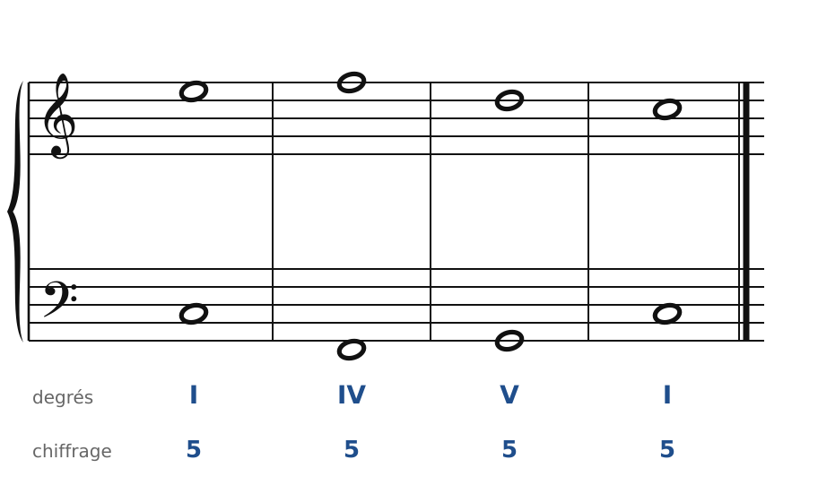

### Exercice 3.2 · Compléter l'alto et le ténor en Sol majeur

Le soprano et la basse sont donnés. Écris l'alto et le ténor : garde les notes communes, va au plus près.

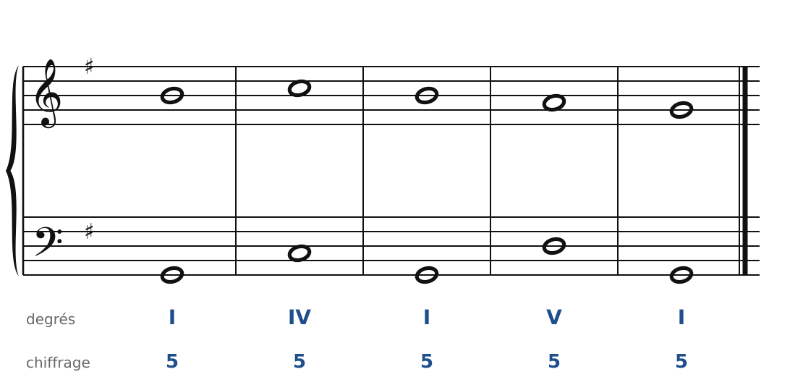

### Exercice 3.3 · Compléter l'alto et le ténor en Fa majeur

Le soprano et la basse sont donnés. Écris l'alto et le ténor : garde les notes communes, va au plus près.

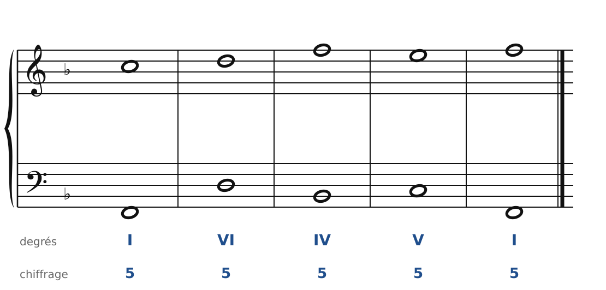

### Exercice 3.4 · Compléter l'alto et le ténor en Ré majeur

Le soprano et la basse sont donnés. Écris l'alto et le ténor : garde les notes communes, va au plus près.

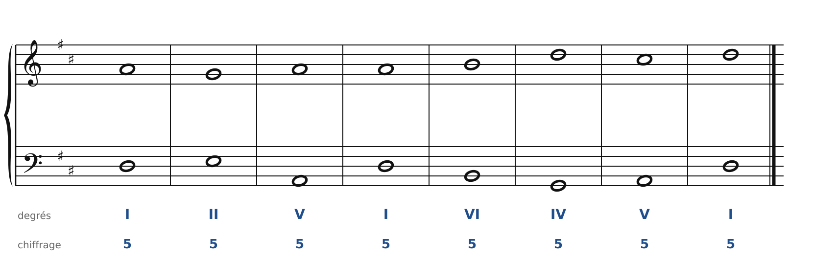

### Exercice 3.5 · Basse donnée en Do majeur

Basse donnée avec ses degrés : écris le soprano, puis l'alto et le ténor.

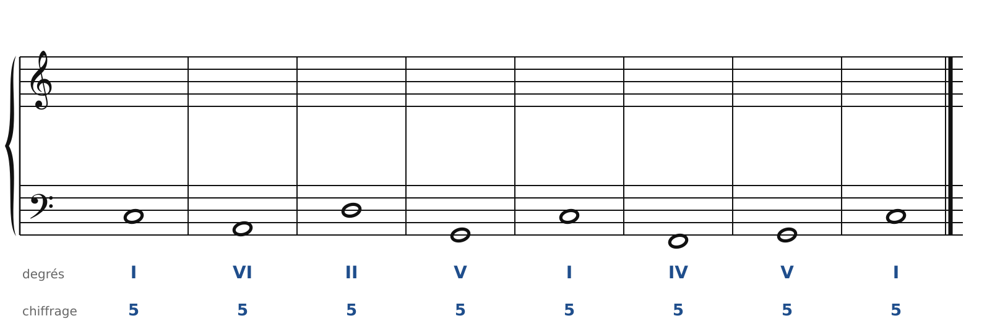

### Exercice 3.6 · Basse donnée en Sol majeur

Basse donnée avec ses degrés : écris le soprano, puis l'alto et le ténor.

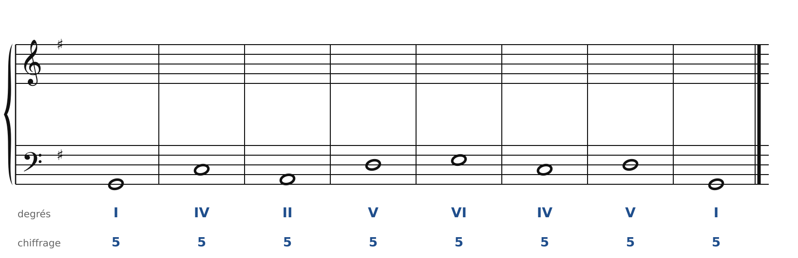

### Exercice 3.7 · Basse donnée en Fa majeur

Basse donnée avec ses degrés : écris le soprano, puis l'alto et le ténor.

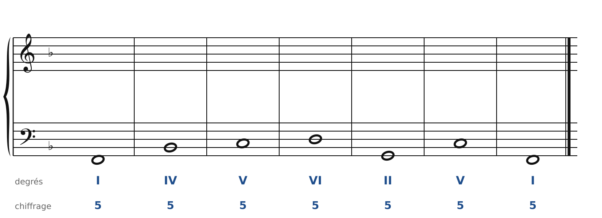

### Exercice 3.8 · Basse donnée en Ré majeur

Basse donnée avec ses degrés : écris le soprano, puis l'alto et le ténor.

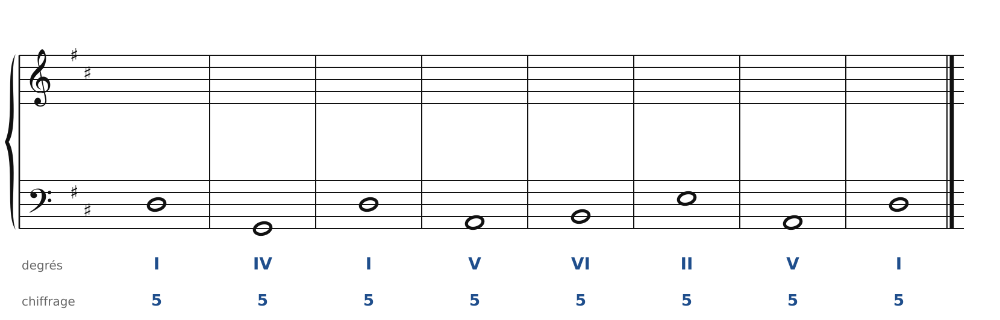

### Exercice 3.9 · Chasse aux fautes en Do majeur

Cet enchaînement contient **trois fautes**. Trouve-les et corrige-les en changeant le moins de notes possible (la basse ne bouge pas).

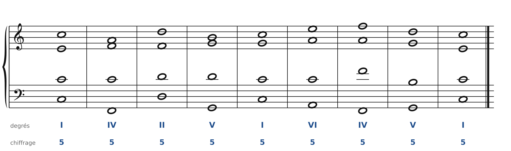

### Exercice 3.10 · Chant donné en Do majeur

Chant donné : choisis les accords, écris la basse, puis l'alto et le ténor.

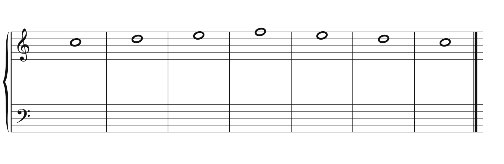

### Exercice 3.11 · Chant donné en Sol majeur

Chant donné : choisis les accords, écris la basse, puis l'alto et le ténor.

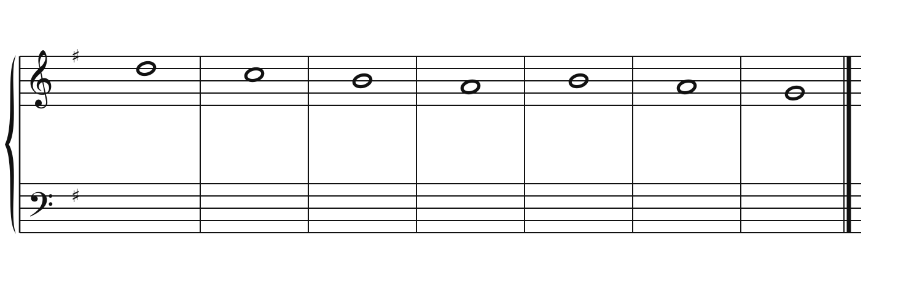

### Corrigés

**Exercice 3.1**

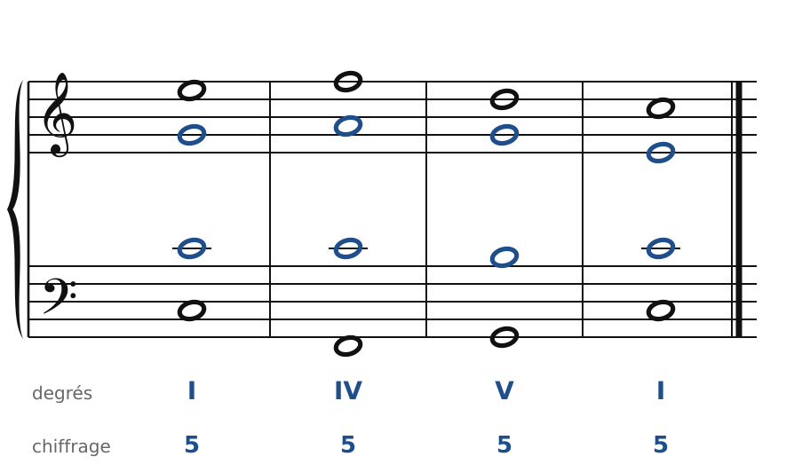

🔊 [Écouter](audio/c03-01-c.mp3) · [MIDI](audio/c03-01-c.mid)

**Exercice 3.2**

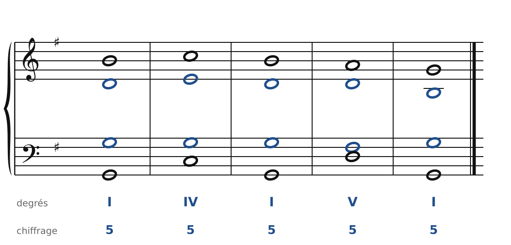

🔊 [Écouter](audio/c03-02-c.mp3) · [MIDI](audio/c03-02-c.mid)

**Exercice 3.3**

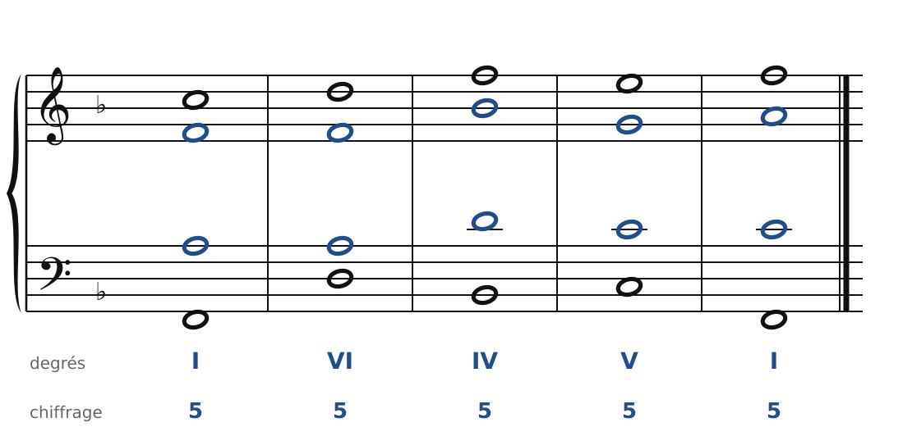

🔊 [Écouter](audio/c03-03-c.mp3) · [MIDI](audio/c03-03-c.mid)

**Exercice 3.4**

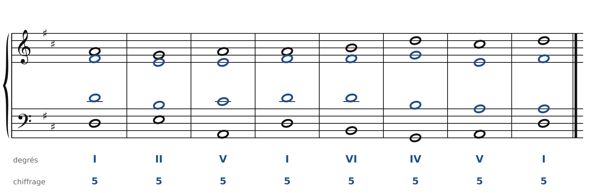

🔊 [Écouter](audio/c03-04-c.mp3) · [MIDI](audio/c03-04-c.mid)

**Exercice 3.5** : une solution parmi d'autres.

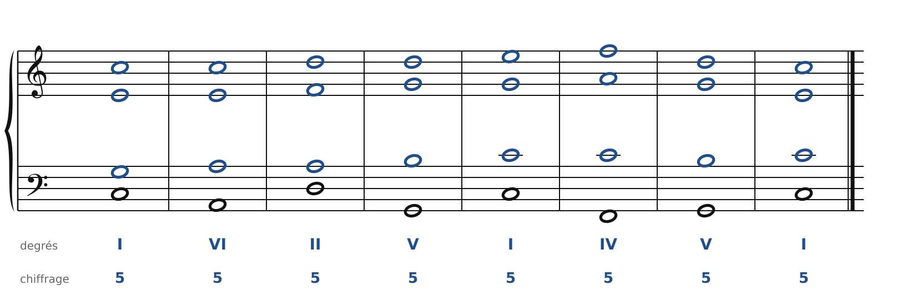

🔊 [Écouter](audio/c03-05-c.mp3) · [MIDI](audio/c03-05-c.mid)

**Exercice 3.6** : une solution parmi d'autres.

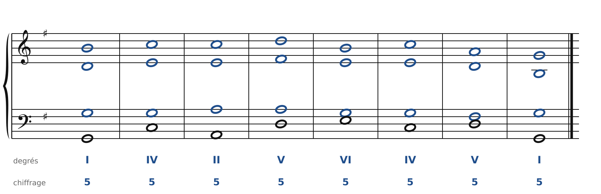

🔊 [Écouter](audio/c03-06-c.mp3) · [MIDI](audio/c03-06-c.mid)

**Exercice 3.7** : une solution parmi d'autres.

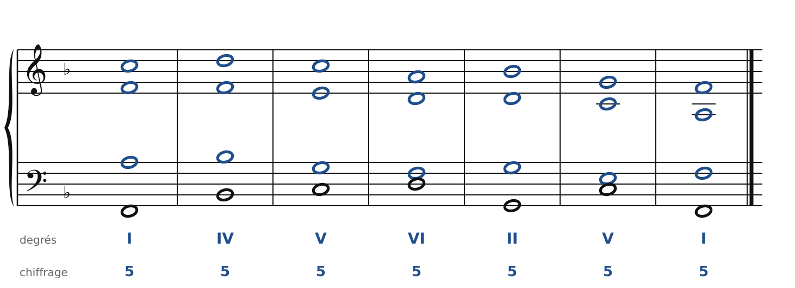

🔊 [Écouter](audio/c03-07-c.mp3) · [MIDI](audio/c03-07-c.mid)

**Exercice 3.8** : une solution parmi d'autres.

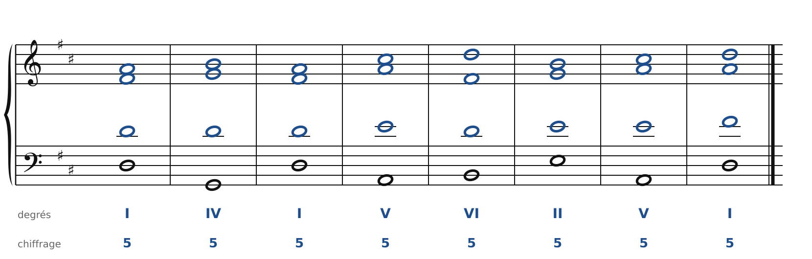

🔊 [Écouter](audio/c03-08-c.mp3) · [MIDI](audio/c03-08-c.mid)

**Exercice 3.9** : Accord 5 · tierce absente ; Accord 7 · écart ténor-basse supérieur à la douzième ; Accords 2-3 · 8ve directe soprano/basse (soprano par saut).

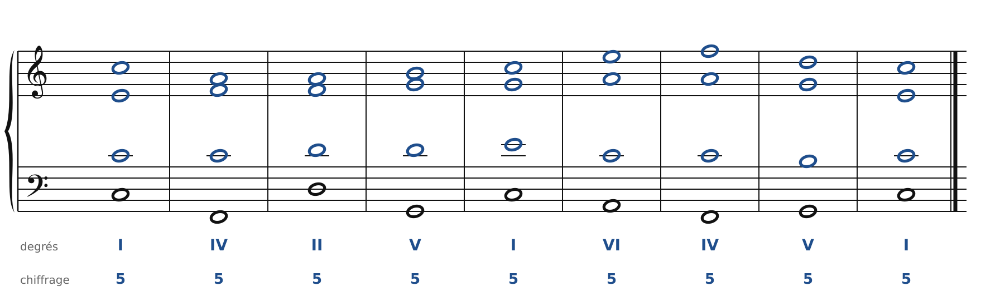

🔊 [Écouter](audio/c03-09-c.mp3) · [MIDI](audio/c03-09-c.mid)

**Exercice 3.10** : une solution parmi d'autres.

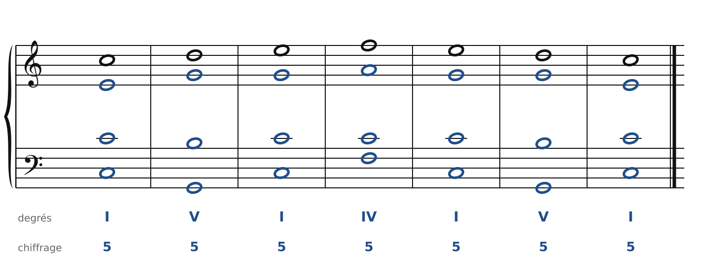

🔊 [Écouter](audio/c03-10-c.mp3) · [MIDI](audio/c03-10-c.mid)

**Exercice 3.11** : une solution parmi d'autres.

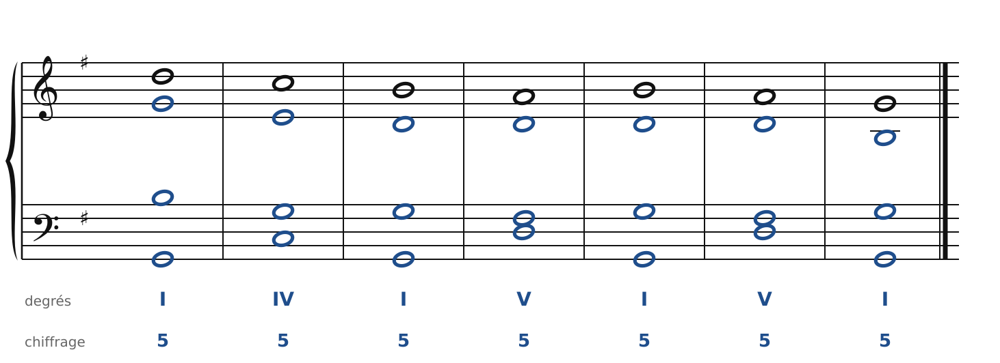

🔊 [Écouter](audio/c03-11-c.mp3) · [MIDI](audio/c03-11-c.mid)

---

[← Les quatre voix et l'accord parfait](01-les-voix-et-l-accord-parfait.md) · [Sommaire du cahier](README.md) · [Le premier renversement →](06-le-premier-renversement.md)
