[← Enchaîner les accords](03-enchainer-deux-accords.md) · [Sommaire du cahier](README.md) · [Les cadences →](07-les-cadences.md)

## Le premier renversement

Ces exercices accompagnent le [chapitre 6](../cours/06-le-premier-renversement.md) du cours.

Dans la version web (`cahier.html`), chaque exercice se fait **directement sur la portée**, avec les corrections au fur et à mesure. Sur papier, recopie l'énoncé et réalise-le au crayon.

### Exercice 6.1 · Basse chiffrée en Do majeur

Basse chiffrée : trouve les degrés, écris le soprano, puis l'alto et le ténor.

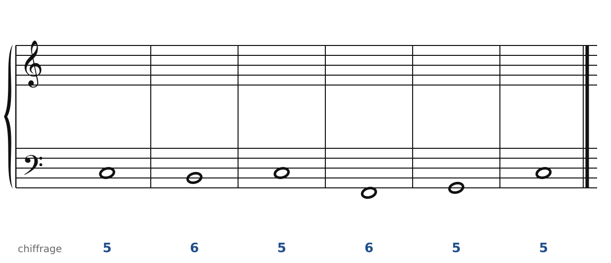

### Exercice 6.2 · Basse chiffrée en Sol majeur

Basse chiffrée : trouve les degrés, écris le soprano, puis l'alto et le ténor.

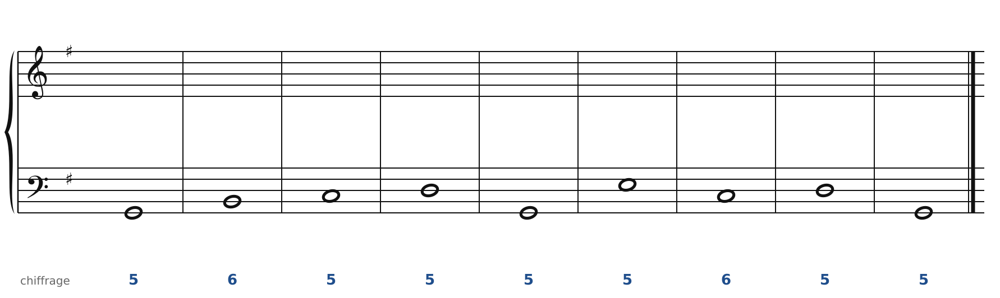

### Exercice 6.3 · Basse chiffrée en Fa majeur

Basse chiffrée : trouve les degrés, écris le soprano, puis l'alto et le ténor.

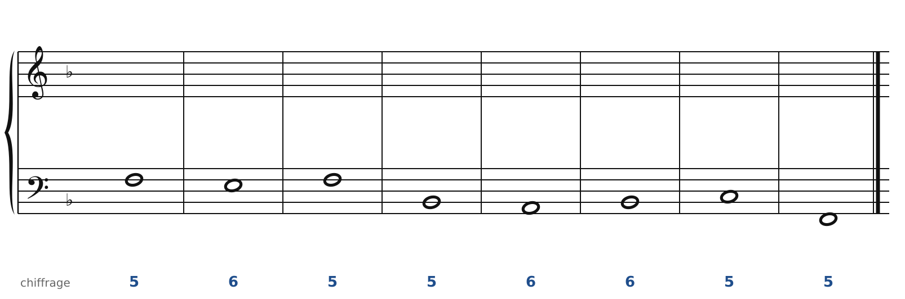

### Exercice 6.4 · Basse chiffrée en Ré majeur

Basse chiffrée : trouve les degrés, écris le soprano, puis l'alto et le ténor.

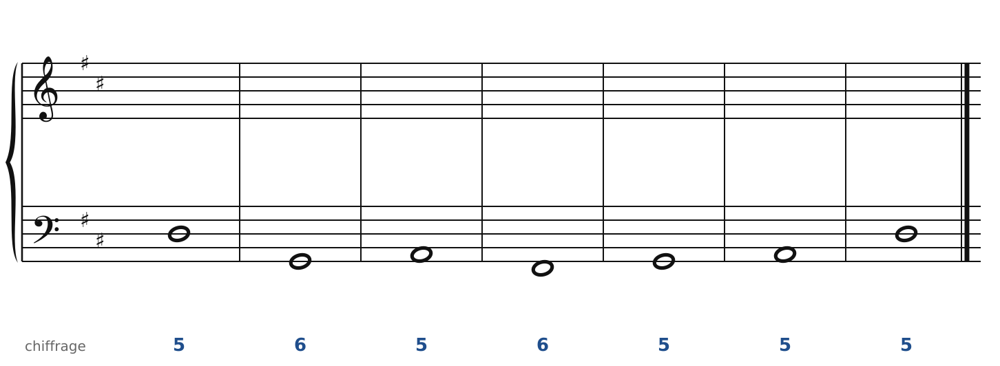

### Exercice 6.5 · Chant donné en Do majeur

Chant donné : choisis les accords, écris la basse, puis l'alto et le ténor.

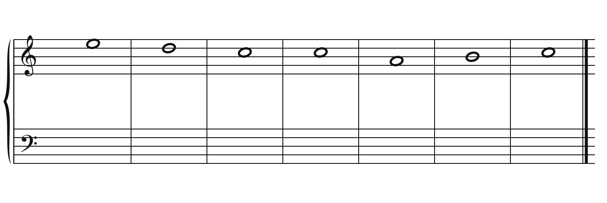

### Exercice 6.6 · Chant donné en Sol majeur

Chant donné : choisis les accords, écris la basse, puis l'alto et le ténor.

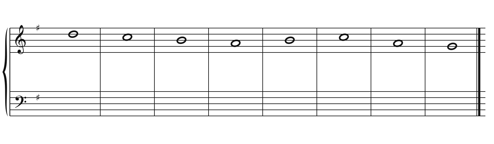

### Corrigés

**Exercice 6.1** : une solution parmi d'autres.

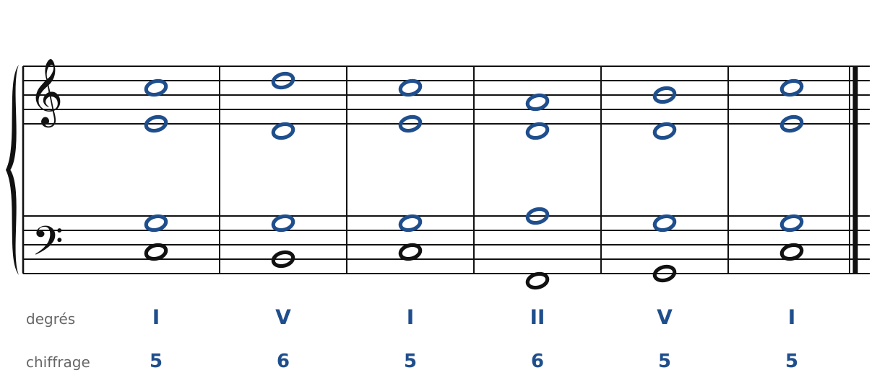

🔊 [Écouter](audio/c06-01-c.mp3) · [MIDI](audio/c06-01-c.mid)

**Exercice 6.2** : une solution parmi d'autres.

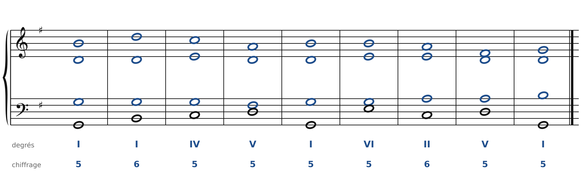

🔊 [Écouter](audio/c06-02-c.mp3) · [MIDI](audio/c06-02-c.mid)

**Exercice 6.3** : une solution parmi d'autres.

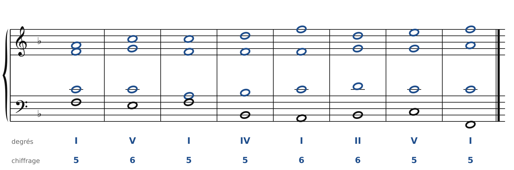

🔊 [Écouter](audio/c06-03-c.mp3) · [MIDI](audio/c06-03-c.mid)

**Exercice 6.4** : une solution parmi d'autres.

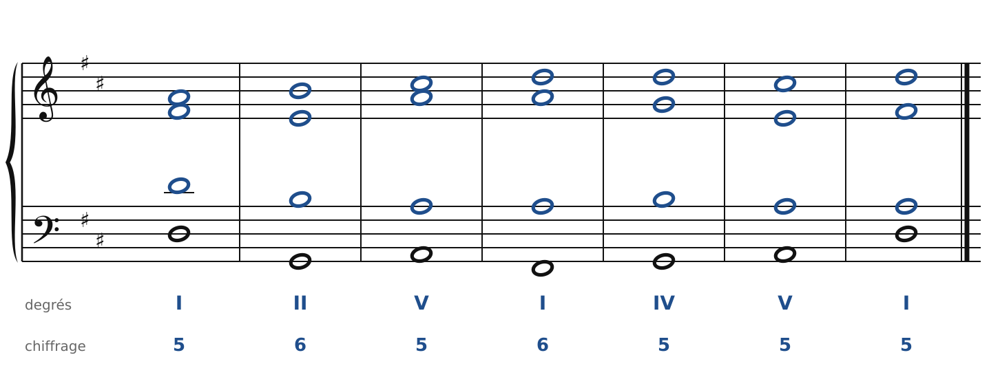

🔊 [Écouter](audio/c06-04-c.mp3) · [MIDI](audio/c06-04-c.mid)

**Exercice 6.5** : une solution parmi d'autres.

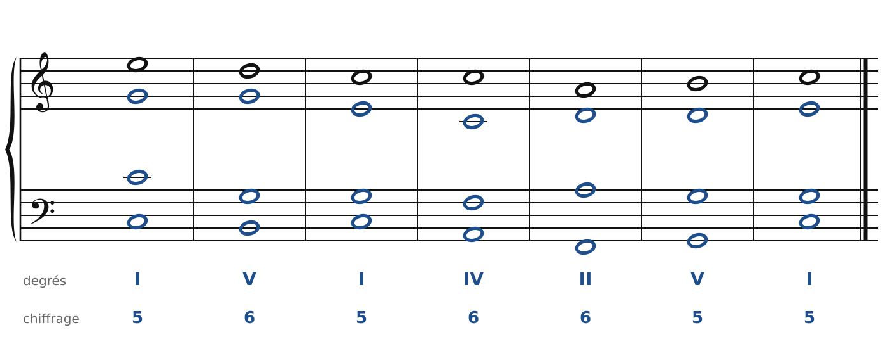

🔊 [Écouter](audio/c06-05-c.mp3) · [MIDI](audio/c06-05-c.mid)

**Exercice 6.6** : une solution parmi d'autres.

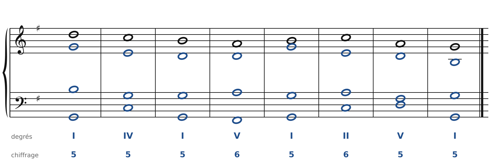

🔊 [Écouter](audio/c06-06-c.mp3) · [MIDI](audio/c06-06-c.mid)

---

[← Enchaîner les accords](03-enchainer-deux-accords.md) · [Sommaire du cahier](README.md) · [Les cadences →](07-les-cadences.md)
