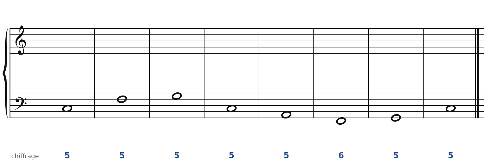
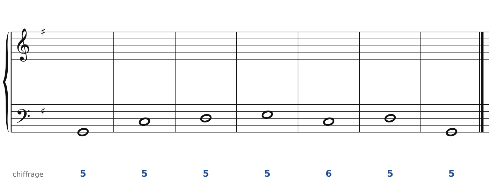
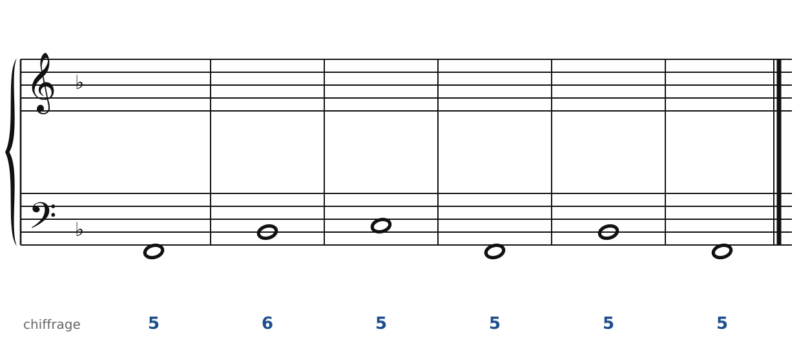
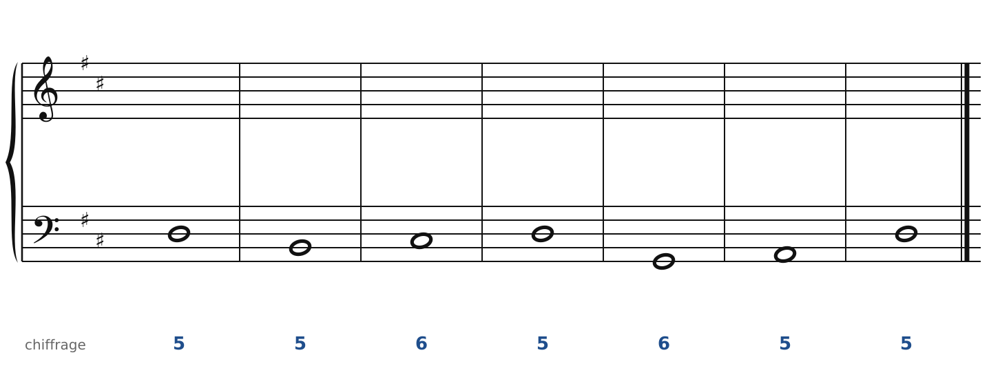
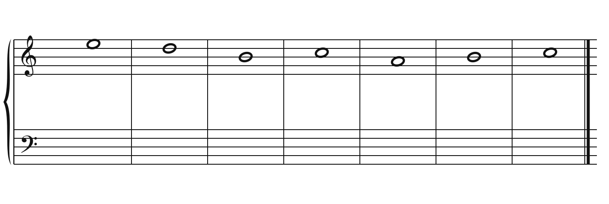
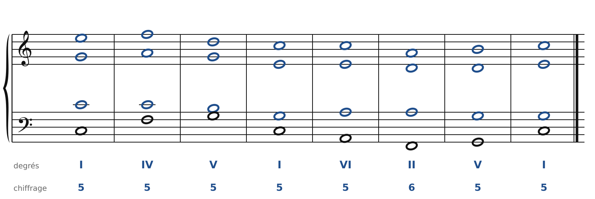
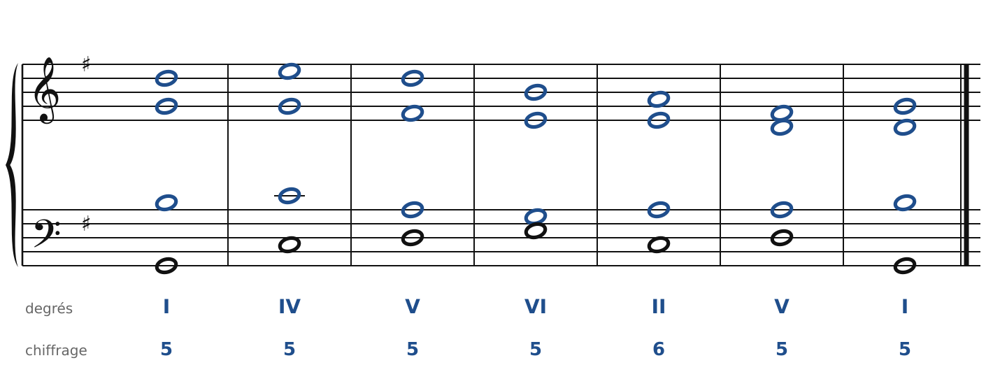
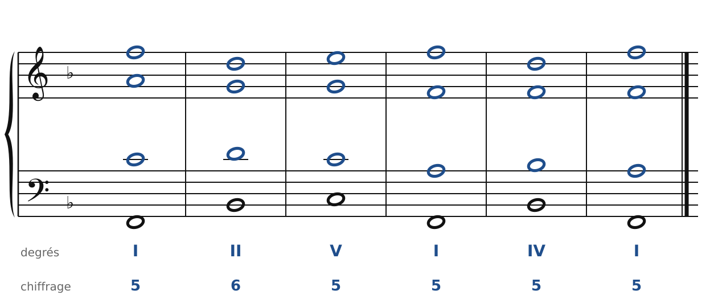
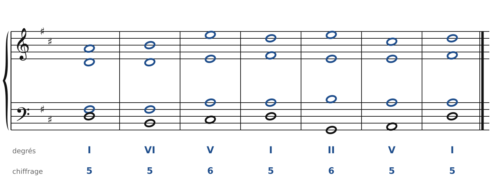
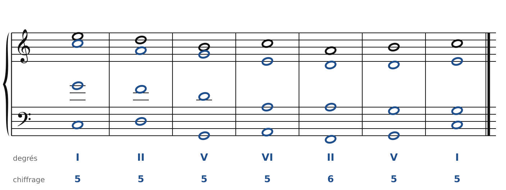

[← Le premier renversement](06-le-premier-renversement.md) · [Sommaire du cahier](README.md) · [La quarte et sixte →](08-la-quarte-et-sixte.md)

## Les cadences

Ces exercices accompagnent le [chapitre 7](../cours/07-les-cadences.md) du cours.

Dans la version web (`cahier.html`), chaque exercice se fait **directement sur la portée**, avec les corrections au fur et à mesure. Sur papier, recopie l'énoncé et réalise-le au crayon.

### Exercice 7.1 · Basse chiffrée en Do majeur (demi-cadence, puis cadence parfaite)

Basse chiffrée : trouve les degrés, écris le soprano, puis l'alto et le ténor.

### Exercice 7.2 · Basse chiffrée en Sol majeur (cadence rompue)

Basse chiffrée : trouve les degrés, écris le soprano, puis l'alto et le ténor.

### Exercice 7.3 · Basse chiffrée en Fa majeur (cadence parfaite, puis plagale)

Basse chiffrée : trouve les degrés, écris le soprano, puis l'alto et le ténor.

### Exercice 7.4 · Basse chiffrée en Ré majeur (cadence imparfaite, puis parfaite)

Basse chiffrée : trouve les degrés, écris le soprano, puis l'alto et le ténor.

### Exercice 7.5 · Chant donné en Do majeur (avec une cadence rompue)

Chant donné : choisis les accords, écris la basse, puis l'alto et le ténor.

### Corrigés

**Exercice 7.1** : une solution parmi d'autres.

🔊 [Écouter](audio/c07-01-c.mp3) · [MIDI](audio/c07-01-c.mid)

**Exercice 7.2** : une solution parmi d'autres.

🔊 [Écouter](audio/c07-02-c.mp3) · [MIDI](audio/c07-02-c.mid)

**Exercice 7.3** : une solution parmi d'autres.

🔊 [Écouter](audio/c07-03-c.mp3) · [MIDI](audio/c07-03-c.mid)

**Exercice 7.4** : une solution parmi d'autres.

🔊 [Écouter](audio/c07-04-c.mp3) · [MIDI](audio/c07-04-c.mid)

**Exercice 7.5** : une solution parmi d'autres.

🔊 [Écouter](audio/c07-05-c.mp3) · [MIDI](audio/c07-05-c.mid)

---

[← Le premier renversement](06-le-premier-renversement.md) · [Sommaire du cahier](README.md) · [La quarte et sixte →](08-la-quarte-et-sixte.md)
