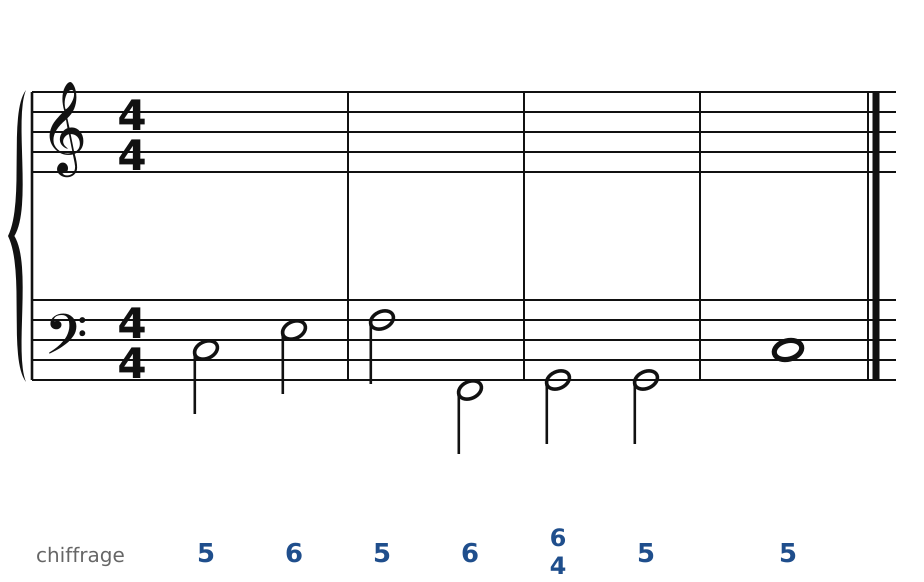
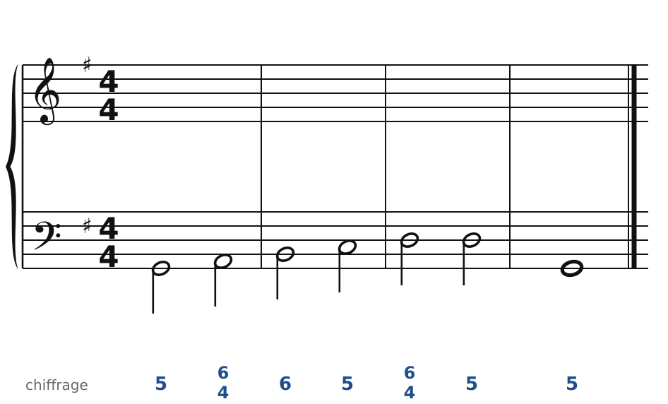
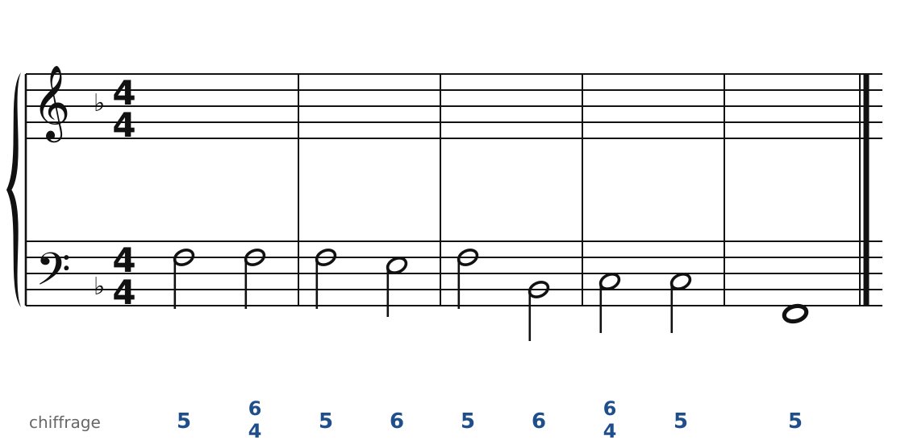
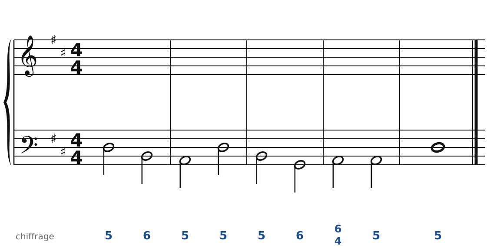
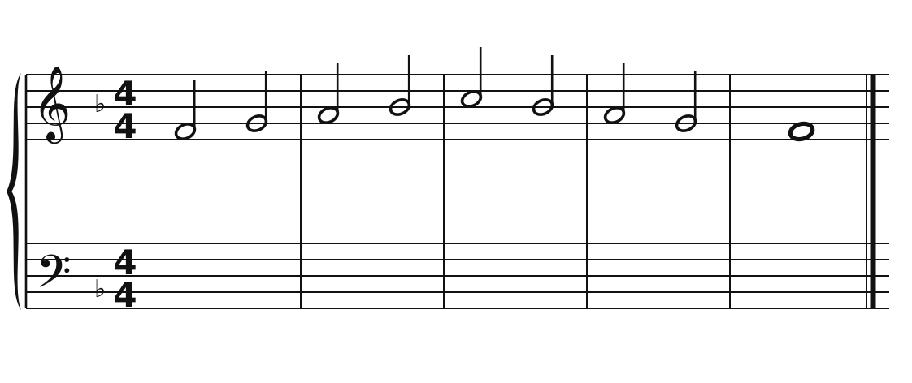
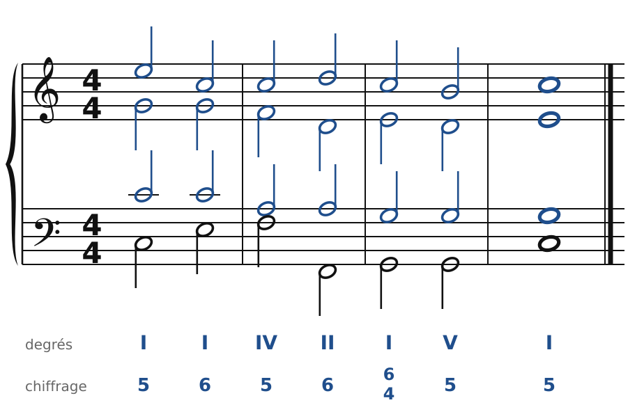
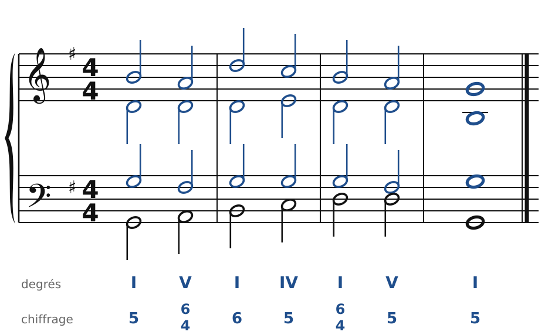
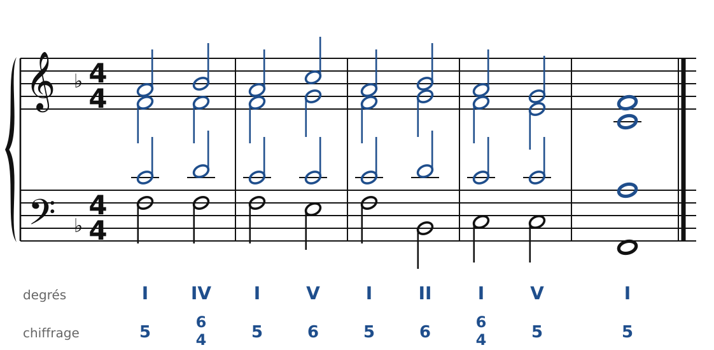
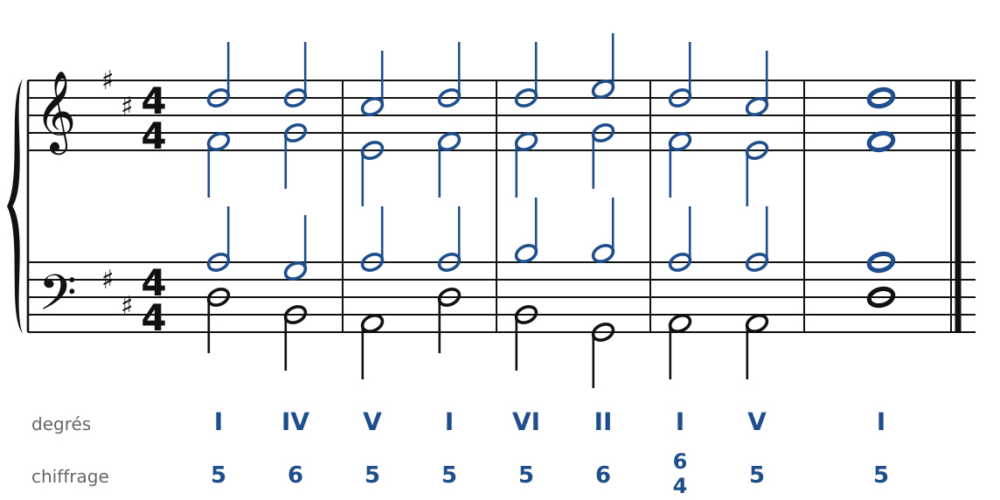
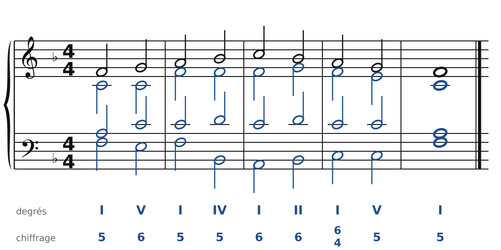

[← Les cadences](07-les-cadences.md) · [Sommaire du cahier](README.md) · [Basses données et chants donnés →](09-basses-donnees-et-chants-donnes.md)

## La quarte et sixte

Ces exercices accompagnent le [chapitre 8](../cours/08-l-accord-de-quarte-et-sixte.md) du cours.

Dans la version web (`cahier.html`), chaque exercice se fait **directement sur la portée**, avec les corrections au fur et à mesure. Sur papier, recopie l'énoncé et réalise-le au crayon.

### Exercice 8.1 · Basse chiffrée en Do majeur (quarte et sixte de cadence)

Basse chiffrée : trouve les degrés, écris le soprano, puis l'alto et le ténor.

### Exercice 8.2 · Basse chiffrée en Sol majeur (de passage et de cadence)

Basse chiffrée : trouve les degrés, écris le soprano, puis l'alto et le ténor.

### Exercice 8.3 · Basse chiffrée en Fa majeur (de broderie et de cadence)

Basse chiffrée : trouve les degrés, écris le soprano, puis l'alto et le ténor.

### Exercice 8.4 · Basse chiffrée en Ré majeur

Basse chiffrée : trouve les degrés, écris le soprano, puis l'alto et le ténor.

### Exercice 8.5 · Chant donné en Fa majeur (avec une quarte et sixte de cadence)

Chant donné : choisis les accords, écris la basse, puis l'alto et le ténor.

### Corrigés

**Exercice 8.1** : une solution parmi d'autres.

🔊 [Écouter](audio/c08-01-c.mp3) · [MIDI](audio/c08-01-c.mid)

**Exercice 8.2** : une solution parmi d'autres.

🔊 [Écouter](audio/c08-02-c.mp3) · [MIDI](audio/c08-02-c.mid)

**Exercice 8.3** : une solution parmi d'autres.

🔊 [Écouter](audio/c08-03-c.mp3) · [MIDI](audio/c08-03-c.mid)

**Exercice 8.4** : une solution parmi d'autres.

🔊 [Écouter](audio/c08-04-c.mp3) · [MIDI](audio/c08-04-c.mid)

**Exercice 8.5** : une solution parmi d'autres.

🔊 [Écouter](audio/c08-05-c.mp3) · [MIDI](audio/c08-05-c.mid)

---

[← Les cadences](07-les-cadences.md) · [Sommaire du cahier](README.md) · [Basses données et chants donnés →](09-basses-donnees-et-chants-donnes.md)
