[← La quarte et sixte](08-la-quarte-et-sixte.md) · [Sommaire du cahier](README.md) · [Le mode mineur →](10-le-mode-mineur.md)

## Basses données et chants donnés

Ces exercices accompagnent le [chapitre 9](../cours/09-basse-donnee-et-chant-donne.md) du cours.

Dans la version web (`cahier.html`), chaque exercice se fait **directement sur la portée**, avec les corrections au fur et à mesure. Sur papier, recopie l'énoncé et réalise-le au crayon.

### Exercice 9.1 · Basse chiffrée en Do majeur

Basse chiffrée : trouve les degrés, écris le soprano, puis l'alto et le ténor.

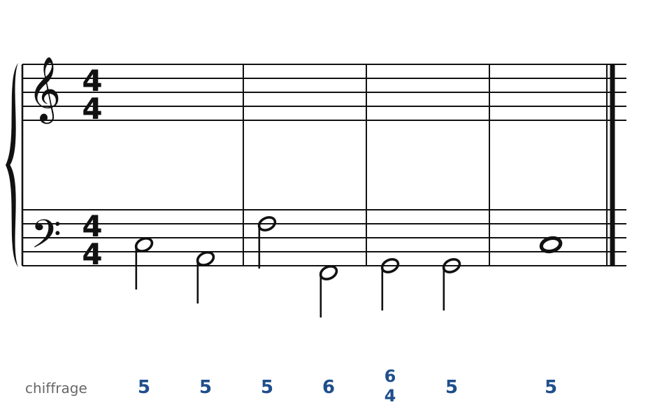

### Exercice 9.2 · Chant donné en Do majeur

Chant donné : choisis les accords, écris la basse, puis l'alto et le ténor.

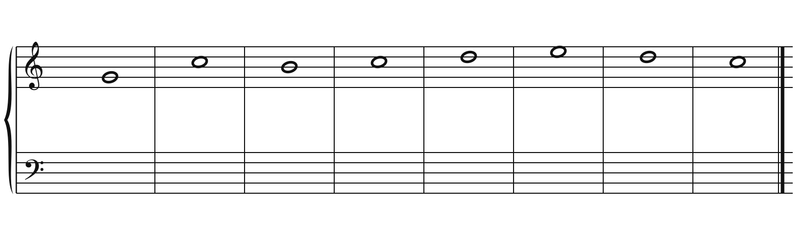

### Exercice 9.3 · Basse chiffrée en Sol majeur

Basse chiffrée : trouve les degrés, écris le soprano, puis l'alto et le ténor.

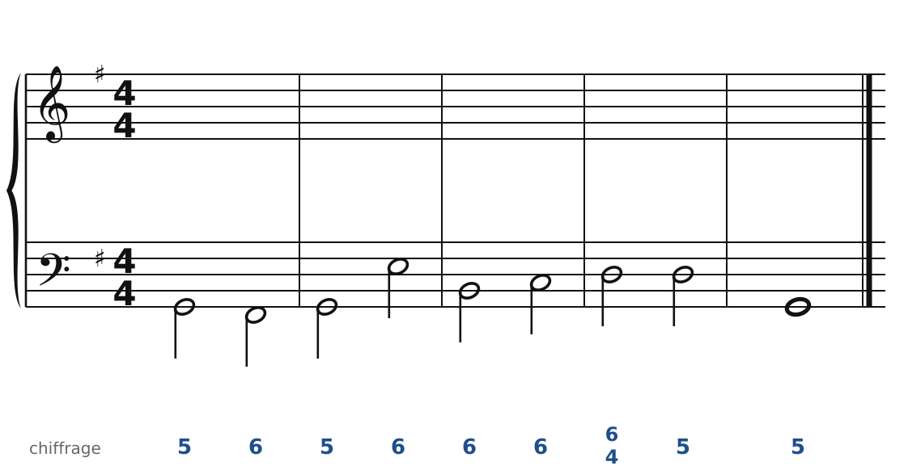

### Exercice 9.4 · Basse chiffrée en Fa majeur

Basse chiffrée : trouve les degrés, écris le soprano, puis l'alto et le ténor.

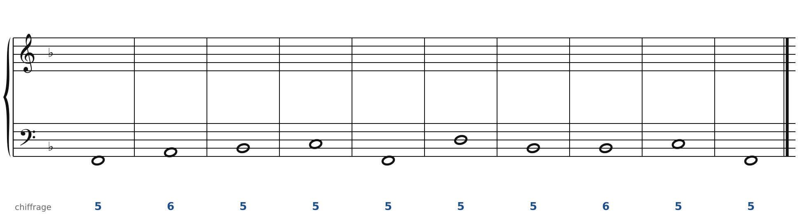

### Exercice 9.5 · Chant donné en Sol majeur

Chant donné : choisis les accords, écris la basse, puis l'alto et le ténor.

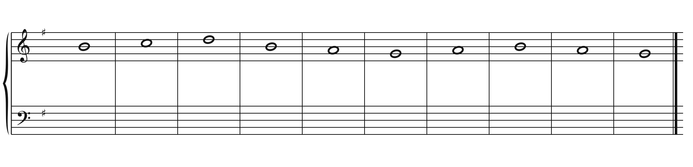

### Exercice 9.6 · Chant donné en Fa majeur

Chant donné : choisis les accords, écris la basse, puis l'alto et le ténor.

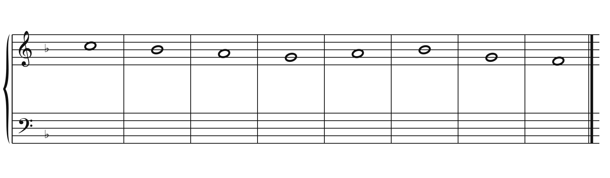

### Exercice 9.7 · Chant donné en Ré majeur

Chant donné : choisis les accords, écris la basse, puis l'alto et le ténor.

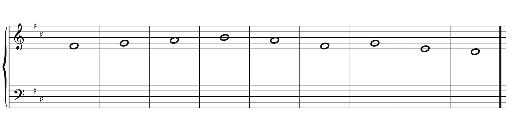

### Corrigés

**Exercice 9.1** : une solution parmi d'autres.

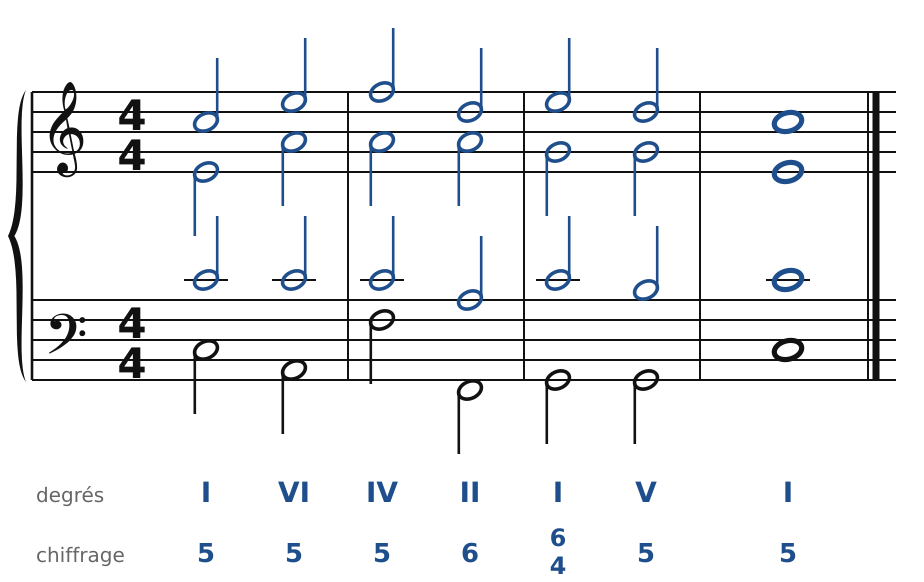

🔊 [Écouter](audio/c09-01-c.mp3) · [MIDI](audio/c09-01-c.mid)

**Exercice 9.2** : une solution parmi d'autres.

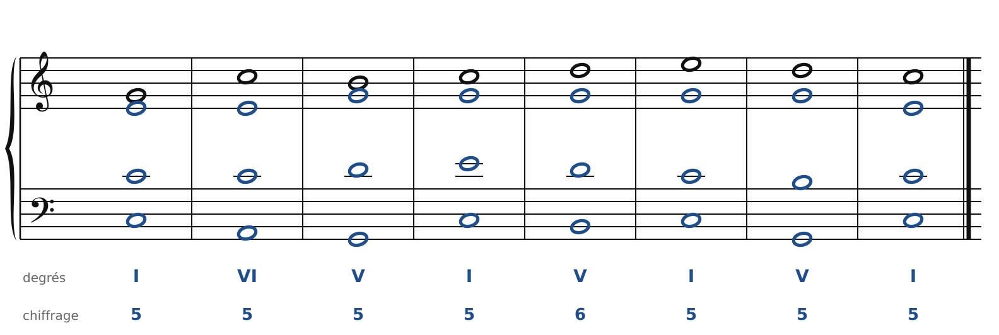

🔊 [Écouter](audio/c09-02-c.mp3) · [MIDI](audio/c09-02-c.mid)

**Exercice 9.3** : une solution parmi d'autres.

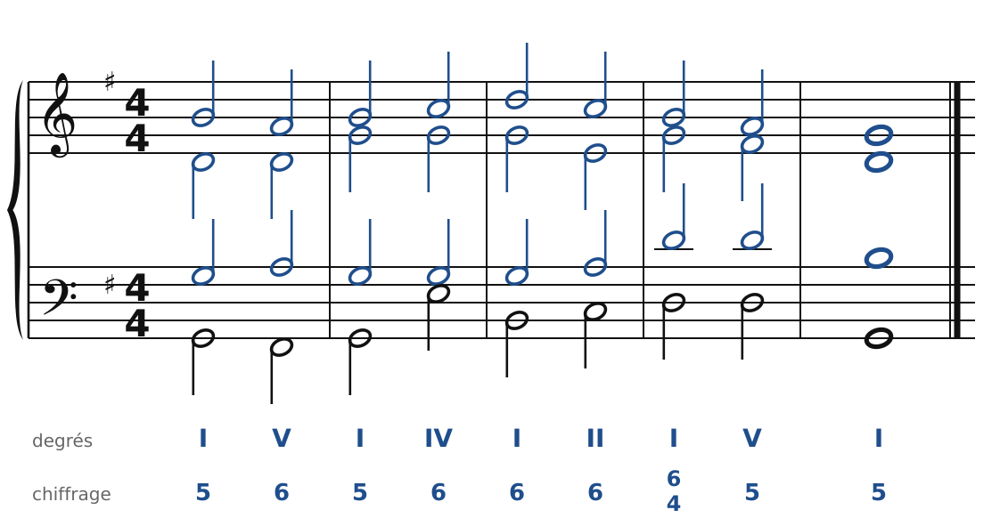

🔊 [Écouter](audio/c09-03-c.mp3) · [MIDI](audio/c09-03-c.mid)

**Exercice 9.4** : une solution parmi d'autres.

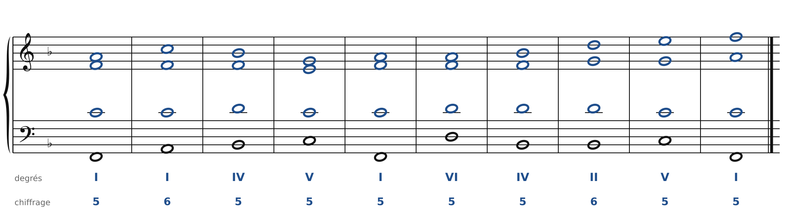

🔊 [Écouter](audio/c09-04-c.mp3) · [MIDI](audio/c09-04-c.mid)

**Exercice 9.5** : une solution parmi d'autres.

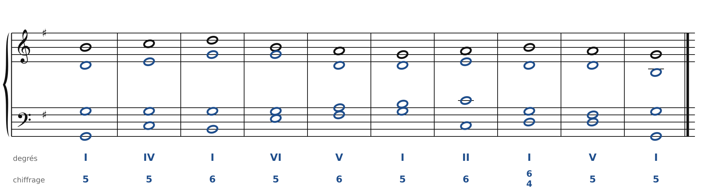

🔊 [Écouter](audio/c09-05-c.mp3) · [MIDI](audio/c09-05-c.mid)

**Exercice 9.6** : une solution parmi d'autres.

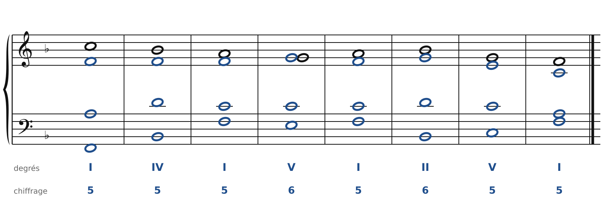

🔊 [Écouter](audio/c09-06-c.mp3) · [MIDI](audio/c09-06-c.mid)

**Exercice 9.7** : une solution parmi d'autres.

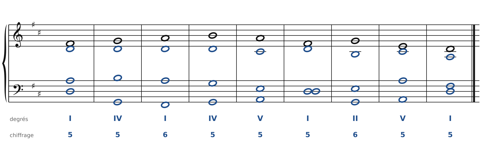

🔊 [Écouter](audio/c09-07-c.mp3) · [MIDI](audio/c09-07-c.mid)

---

[← La quarte et sixte](08-la-quarte-et-sixte.md) · [Sommaire du cahier](README.md) · [Le mode mineur →](10-le-mode-mineur.md)
