[← Basses données et chants donnés](09-basses-donnees-et-chants-donnes.md) · [Sommaire du cahier](README.md) · [Le choral : notes étrangères et harmonisation →](13-le-choral.md)

## Le mode mineur

Ces exercices accompagnent le [chapitre 10](../cours/10-le-mode-mineur.md) du cours.

Dans la version web (`cahier.html`), chaque exercice se fait **directement sur la portée**, avec les corrections au fur et à mesure. Sur papier, recopie l'énoncé et réalise-le au crayon.

### Exercice 10.1 · Basse chiffrée en la mineur

Basse chiffrée : trouve les degrés, écris le soprano, puis l'alto et le ténor.

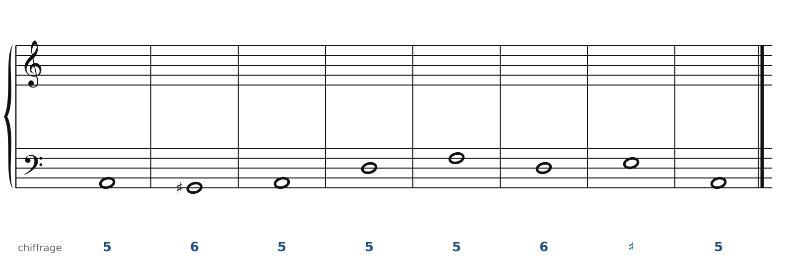

### Exercice 10.2 · Basse chiffrée en mi mineur

Basse chiffrée : trouve les degrés, écris le soprano, puis l'alto et le ténor.

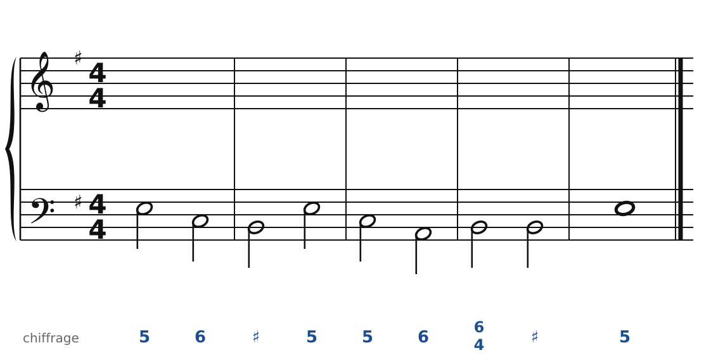

### Exercice 10.3 · Basse chiffrée en ré mineur

Basse chiffrée : trouve les degrés, écris le soprano, puis l'alto et le ténor.

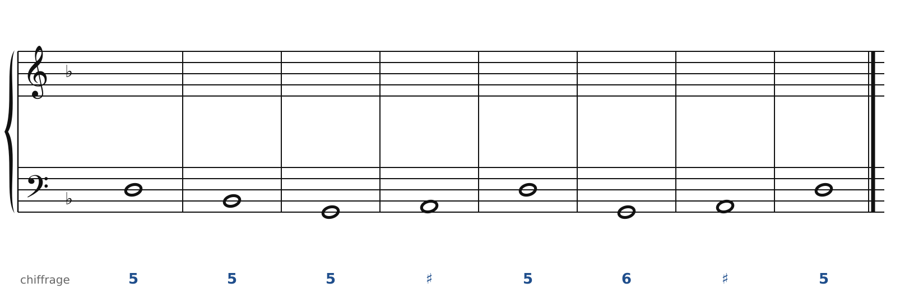

### Exercice 10.4 · Chant donné en la mineur

Chant donné : choisis les accords, écris la basse, puis l'alto et le ténor.

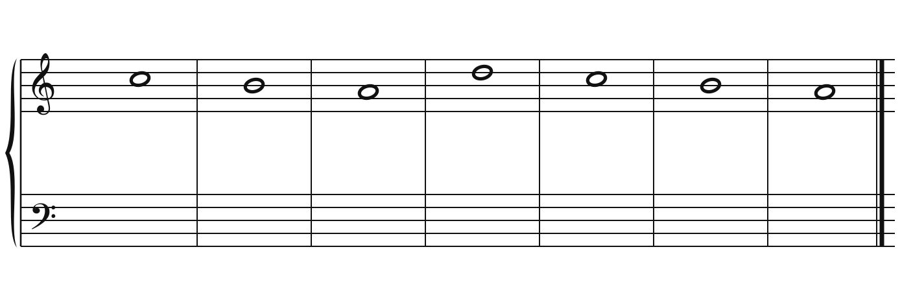

### Exercice 10.5 · Chant donné en sol mineur

Chant donné : choisis les accords, écris la basse, puis l'alto et le ténor.

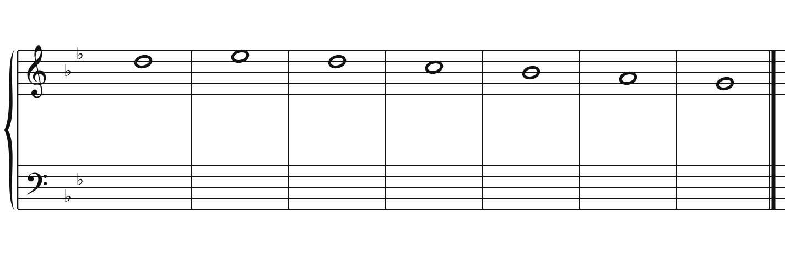

### Exercice 10.6 · Chant donné en mi mineur

Chant donné : choisis les accords, écris la basse, puis l'alto et le ténor.

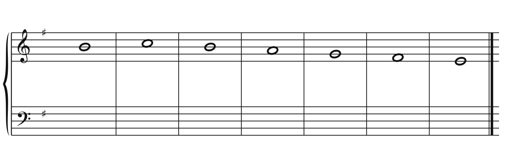

### Corrigés

**Exercice 10.1** : une solution parmi d'autres.

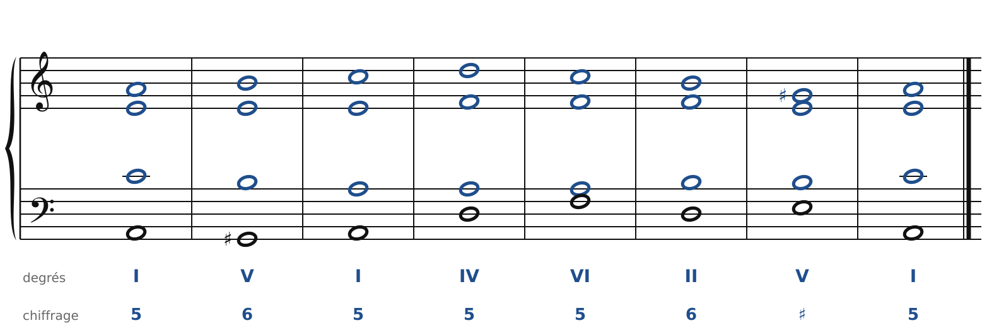

🔊 [Écouter](audio/c10-01-c.mp3) · [MIDI](audio/c10-01-c.mid)

**Exercice 10.2** : une solution parmi d'autres.

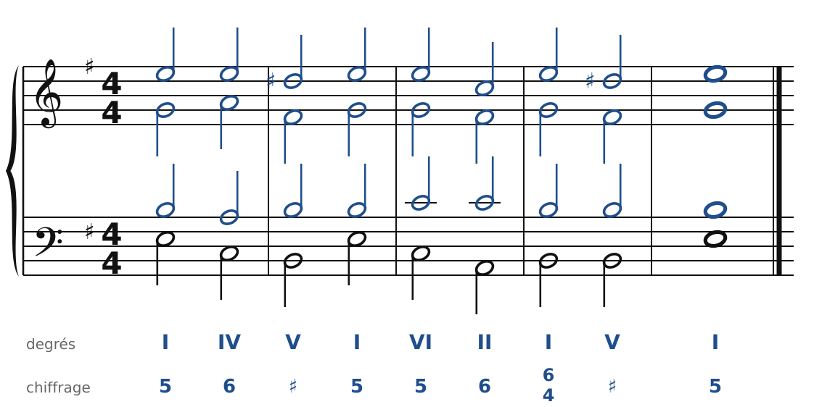

🔊 [Écouter](audio/c10-02-c.mp3) · [MIDI](audio/c10-02-c.mid)

**Exercice 10.3** : une solution parmi d'autres.

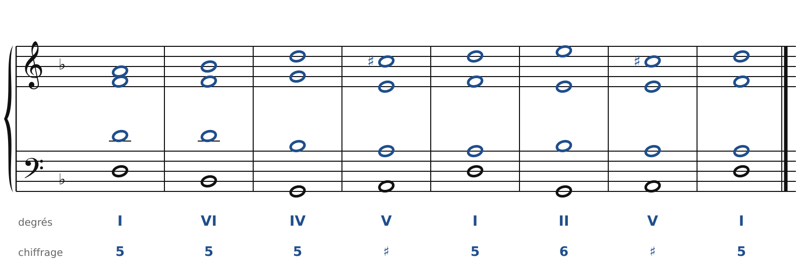

🔊 [Écouter](audio/c10-03-c.mp3) · [MIDI](audio/c10-03-c.mid)

**Exercice 10.4** : une solution parmi d'autres.

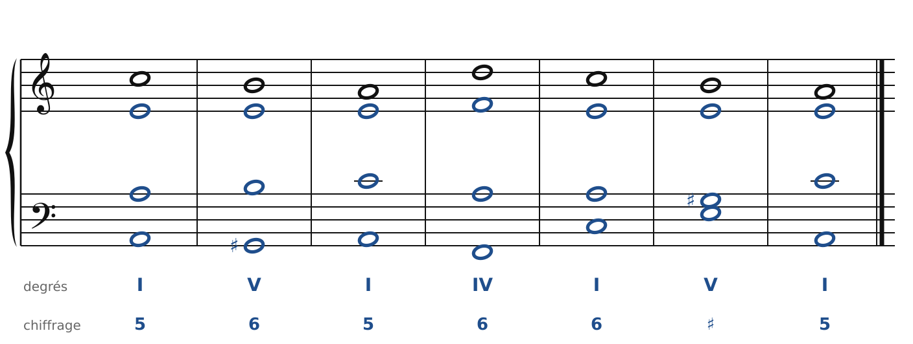

🔊 [Écouter](audio/c10-04-c.mp3) · [MIDI](audio/c10-04-c.mid)

**Exercice 10.5** : une solution parmi d'autres.

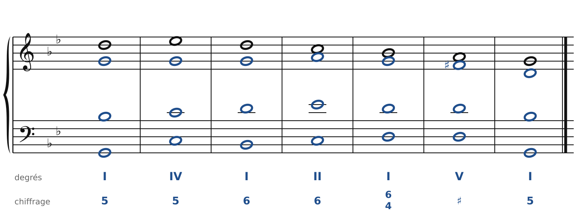

🔊 [Écouter](audio/c10-05-c.mp3) · [MIDI](audio/c10-05-c.mid)

**Exercice 10.6** : une solution parmi d'autres.

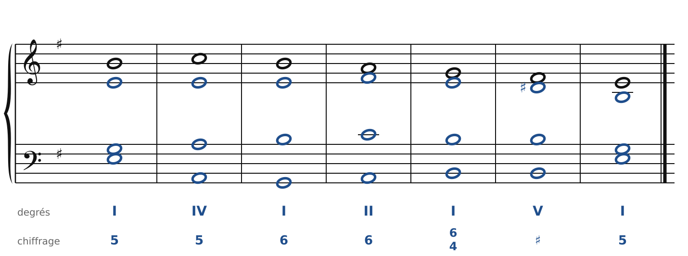

🔊 [Écouter](audio/c10-06-c.mp3) · [MIDI](audio/c10-06-c.mid)

---

[← Basses données et chants donnés](09-basses-donnees-et-chants-donnes.md) · [Sommaire du cahier](README.md) · [Le choral : notes étrangères et harmonisation →](13-le-choral.md)
