[← Le mode mineur](10-le-mode-mineur.md) · [Sommaire du cahier](README.md)

## Le choral : notes étrangères et harmonisation

Ces exercices accompagnent les chapitres [13](../cours/13-les-notes-etrangeres.md), [14](../cours/14-analyse-un-choral-de-bach.md) et [15](../cours/15-harmoniser-une-melodie-de-choral.md) du cours.

Dans la version web (`cahier.html`), on écrit directement sur la portée. Pour écrire deux croches, sélectionne une note et clique sur **♪♪ croches** ; pour préparer un retard, clique sur **⁀ lier**. Les notes étrangères reconnues s'affichent en vert (p, b, r…), celles qui sont mal traitées en rouge.

### Exercice 13.1 · Orner une phrase en Do majeur (notes de passage)

Ajoute des notes étrangères à cette phrase écrite en noires : au moins 3 note de passages. Ne change pas les accords, et ne crée ni quinte ni octave consécutive.

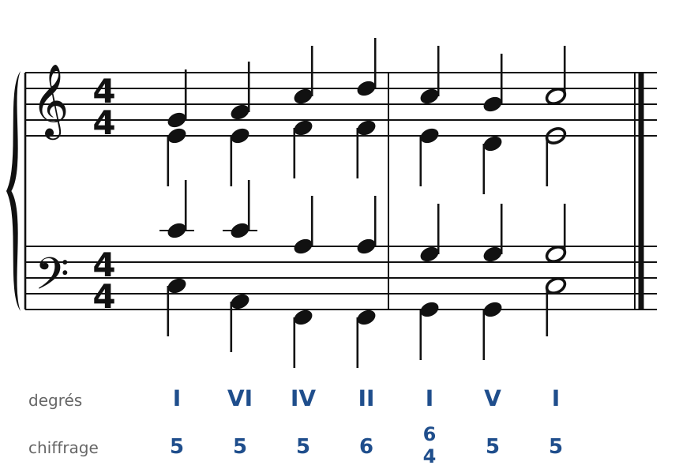

### Exercice 13.2 · Orner une phrase en Ré majeur (passages et broderie)

Ajoute des notes étrangères à cette phrase écrite en noires : au moins 3 note de passages, 1 broderie. Ne change pas les accords, et ne crée ni quinte ni octave consécutive.

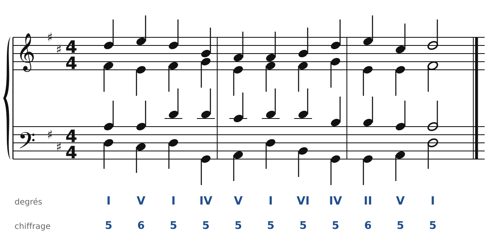

### Exercice 13.3 · Orner une phrase en Fa majeur (un retard à la cadence)

Ajoute des notes étrangères à cette phrase écrite en noires : au moins 1 retard, 3 note étrangères. Ne change pas les accords, et ne crée ni quinte ni octave consécutive.

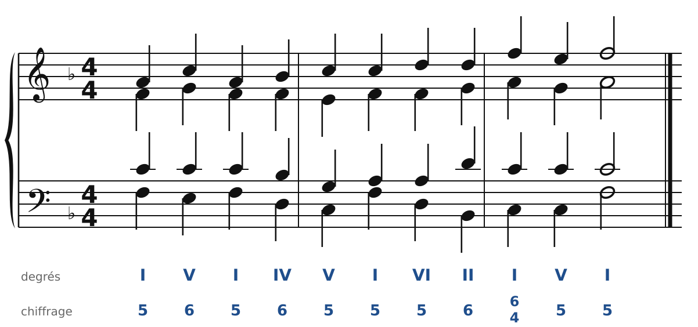

### Exercice 13.4 · Orner une phrase en la mineur (en la mineur)

Ajoute des notes étrangères à cette phrase écrite en noires : au moins 3 note étrangères. Ne change pas les accords, et ne crée ni quinte ni octave consécutive.

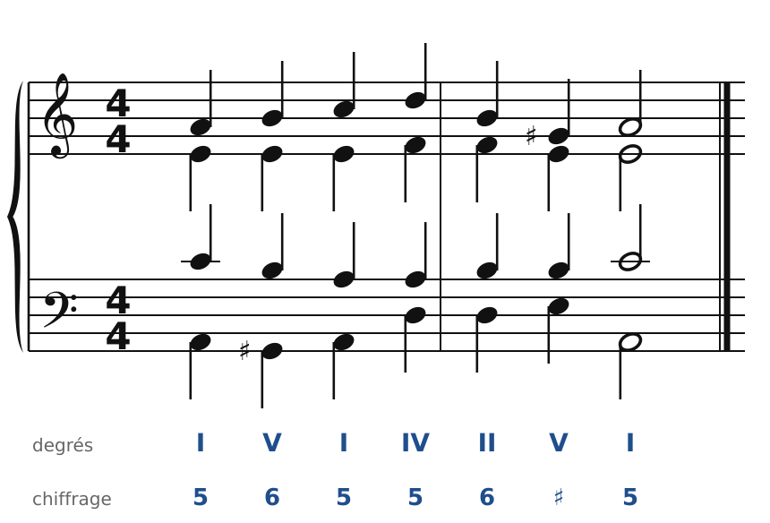

### Exercice 13.5 · Harmoniser une mélodie de choral en Do majeur

Un accord par temps : choisis les accords, écris la basse, puis l'alto et le ténor en noires, puis ajoute au moins deux notes de passage.

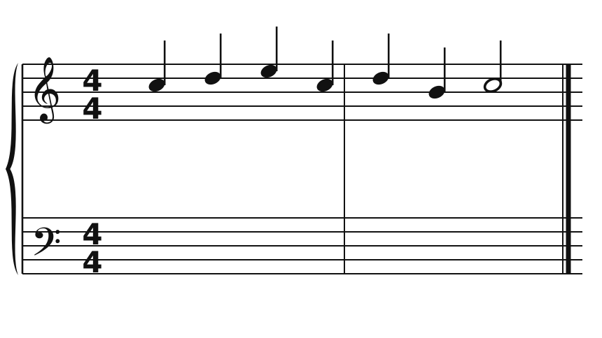

### Exercice 13.6 · Harmoniser une mélodie de choral en Sol majeur

Un accord par temps : choisis les accords, écris la basse, puis l'alto et le ténor en noires, puis ajoute au moins deux notes de passage.

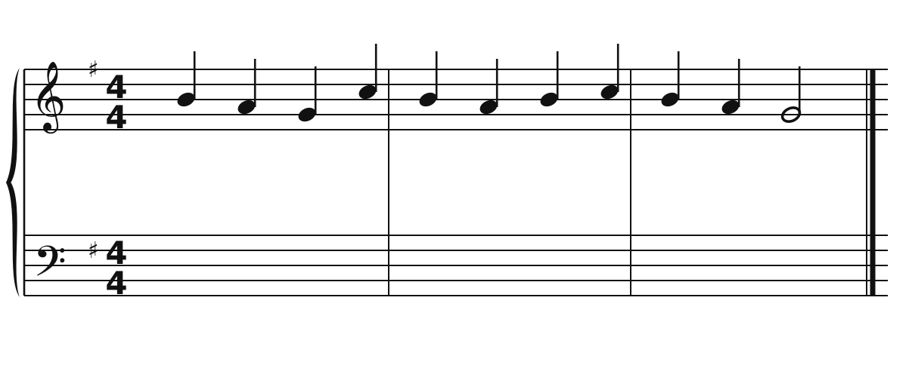

### Exercice 13.7 · Harmoniser une mélodie de choral en Ré majeur

Un accord par temps : choisis les accords, écris la basse, puis l'alto et le ténor en noires, puis ajoute au moins deux notes de passage.

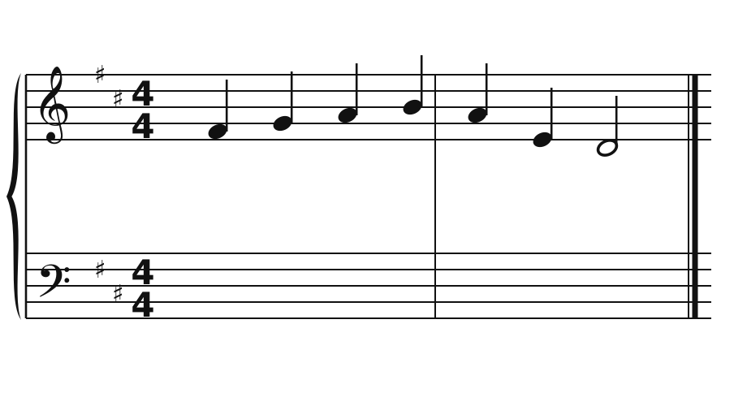

### Exercice 13.8 · Harmoniser une mélodie de choral en Fa majeur

Un accord par temps : choisis les accords, écris la basse, puis l'alto et le ténor en noires, puis ajoute au moins deux notes de passage.

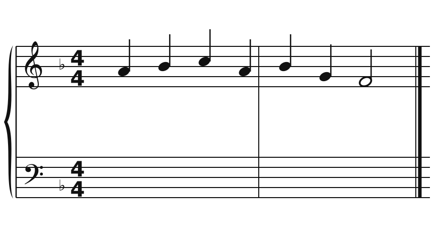

### Exercice 13.9 · Harmoniser une mélodie de choral en la mineur

Un accord par temps : choisis les accords, écris la basse, puis l'alto et le ténor en noires, puis ajoute au moins deux notes de passage.

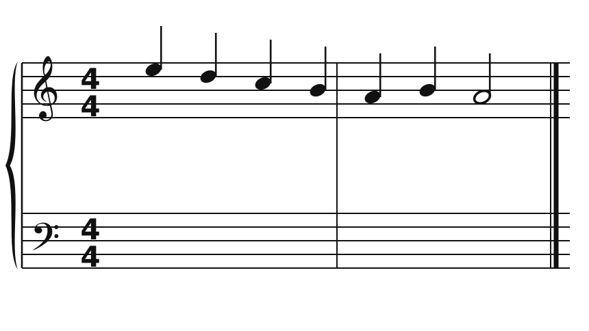

### Exercice 13.10 · Harmoniser une mélodie de choral en ré mineur

Un accord par temps : choisis les accords, écris la basse, puis l'alto et le ténor en noires, puis ajoute au moins deux notes de passage.

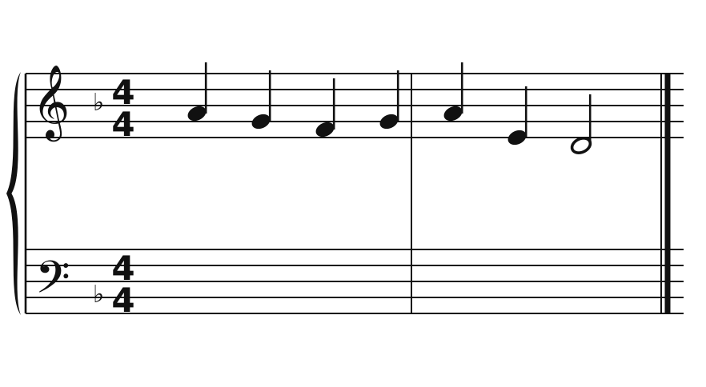

### Corrigés

**Exercice 13.1** : une solution parmi d'autres.

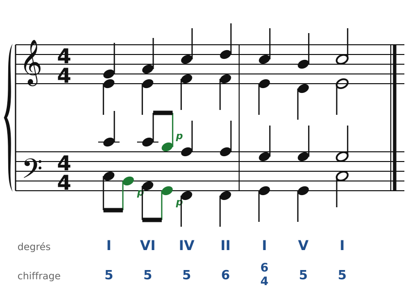

🔊 [Écouter](audio/c13-01-c.mp3) · [MIDI](audio/c13-01-c.mid)

**Exercice 13.2** : une solution parmi d'autres.

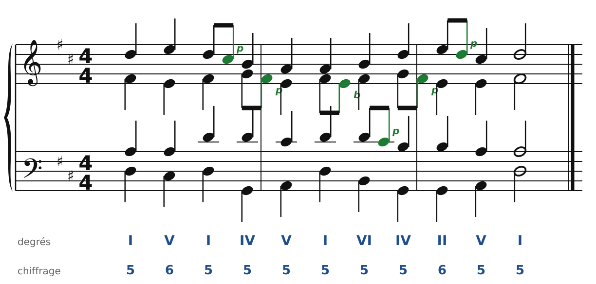

🔊 [Écouter](audio/c13-02-c.mp3) · [MIDI](audio/c13-02-c.mid)

**Exercice 13.3** : une solution parmi d'autres.

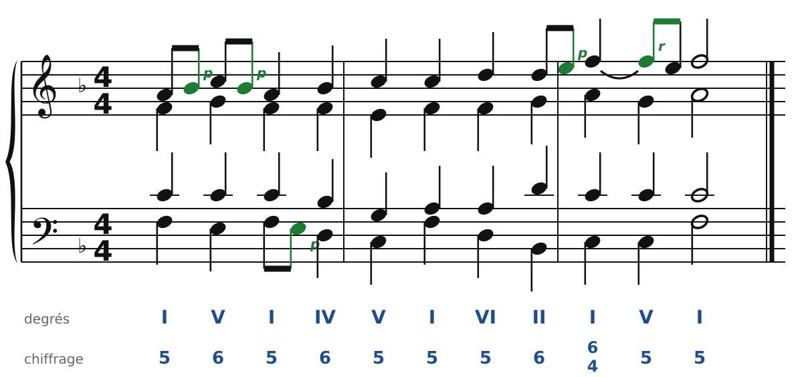

🔊 [Écouter](audio/c13-03-c.mp3) · [MIDI](audio/c13-03-c.mid)

**Exercice 13.4** : une solution parmi d'autres.

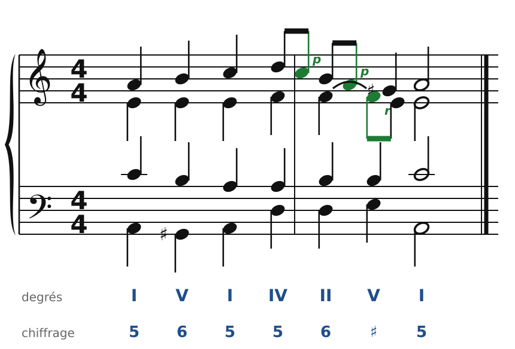

🔊 [Écouter](audio/c13-04-c.mp3) · [MIDI](audio/c13-04-c.mid)

**Exercice 13.5** : une solution parmi d'autres.

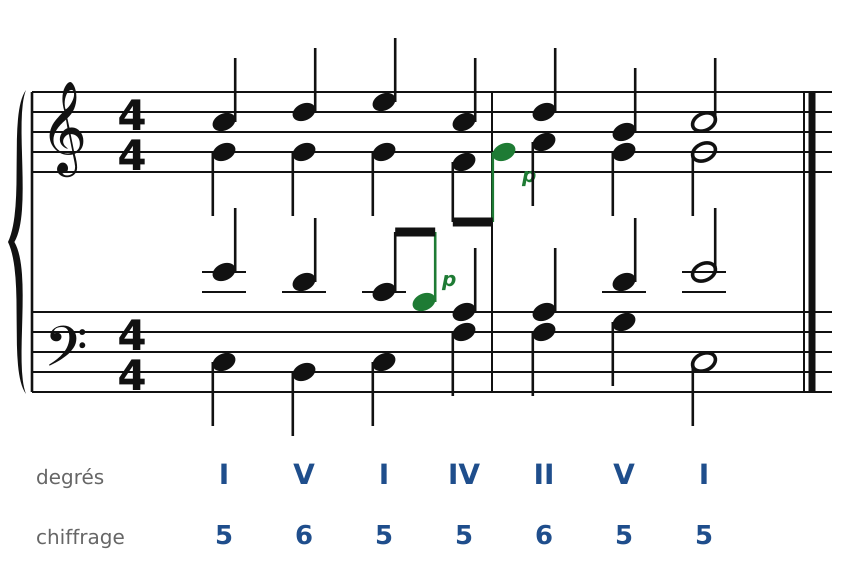

🔊 [Écouter](audio/c13-05-c.mp3) · [MIDI](audio/c13-05-c.mid)

**Exercice 13.6** : une solution parmi d'autres.

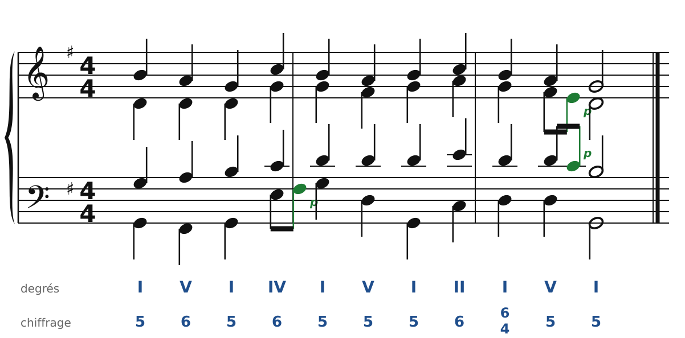

🔊 [Écouter](audio/c13-06-c.mp3) · [MIDI](audio/c13-06-c.mid)

**Exercice 13.7** : une solution parmi d'autres.

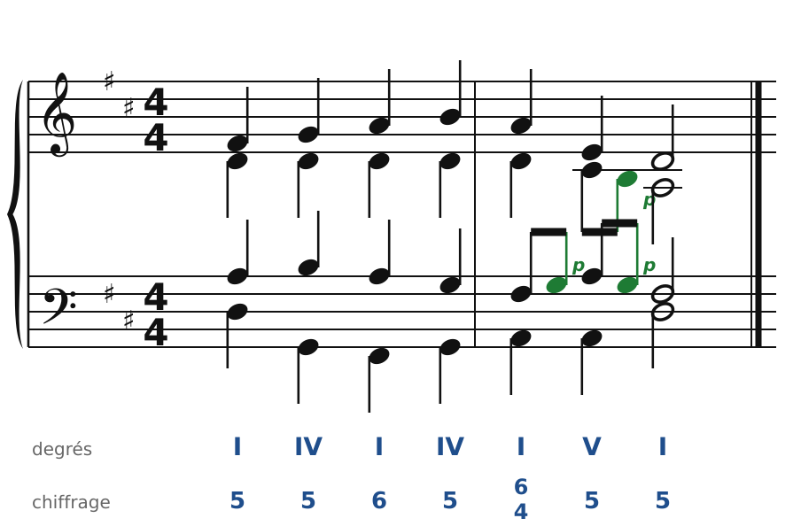

🔊 [Écouter](audio/c13-07-c.mp3) · [MIDI](audio/c13-07-c.mid)

**Exercice 13.8** : une solution parmi d'autres.

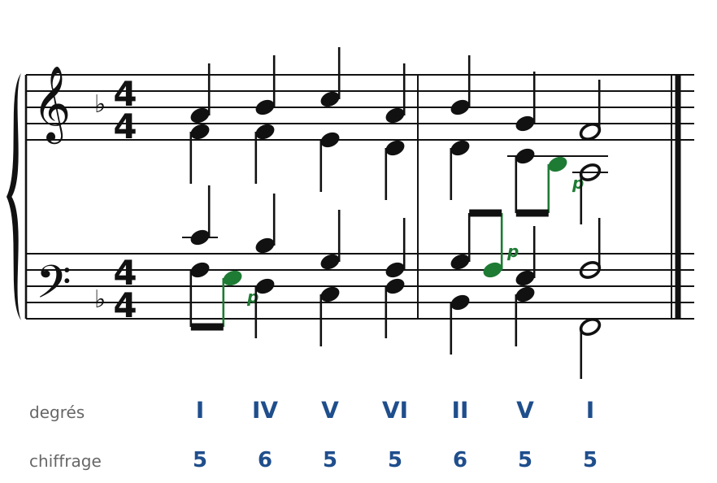

🔊 [Écouter](audio/c13-08-c.mp3) · [MIDI](audio/c13-08-c.mid)

**Exercice 13.9** : une solution parmi d'autres.

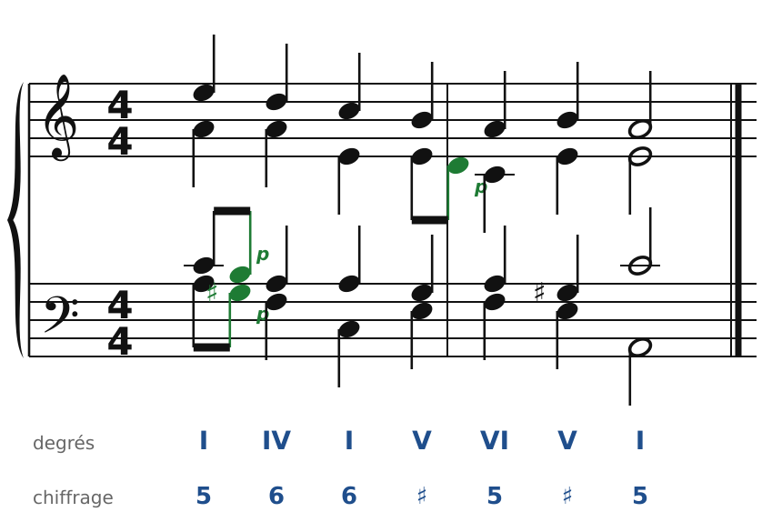

🔊 [Écouter](audio/c13-09-c.mp3) · [MIDI](audio/c13-09-c.mid)

**Exercice 13.10** : une solution parmi d'autres.

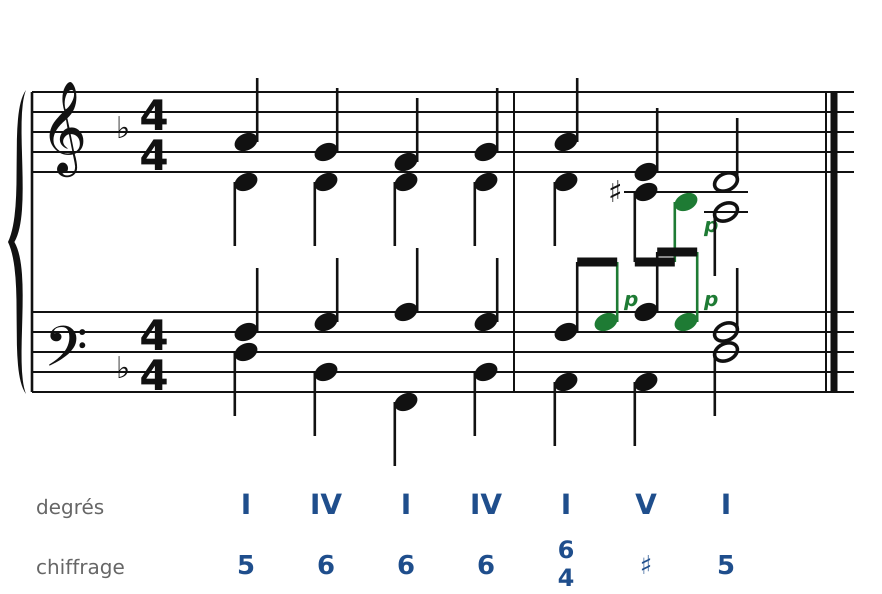

🔊 [Écouter](audio/c13-10-c.mp3) · [MIDI](audio/c13-10-c.mid)

---

[← Le mode mineur](10-le-mode-mineur.md) · [Sommaire du cahier](README.md)
