[← Le choral](13-le-choral.md) · [Sommaire du cahier](README.md) · [Les septièmes d'espèce et les marches →](19-les-septiemes-d-espece.md)

## La septième de dominante

Ces exercices accompagnent le [chapitre 18](../cours/18-la-septieme-de-dominante.md) du cours.

Dans la version web (`cahier.html`), chaque exercice se fait **directement sur la portée**, avec les corrections au fur et à mesure. Dans les basses chiffrées et les chants donnés, le menu propose aussi les accords de 7e : choisis-les d'après la basse et le chiffrage.

### Exercice 18.1 · Compléter l'alto et le ténor en Do majeur (V7 à l'état fondamental)

Le soprano et la basse sont donnés. Écris l'alto et le ténor : la 7e descend, la sensible monte.

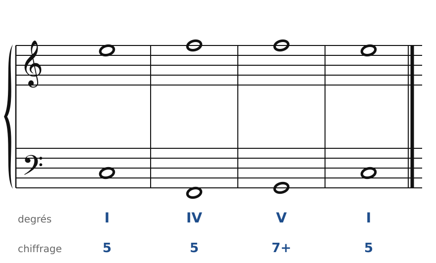

### Exercice 18.2 · Compléter l'alto et le ténor en Sol majeur (V7 et V6/5)

Le soprano et la basse sont donnés. Écris l'alto et le ténor : la 7e descend, la sensible monte.

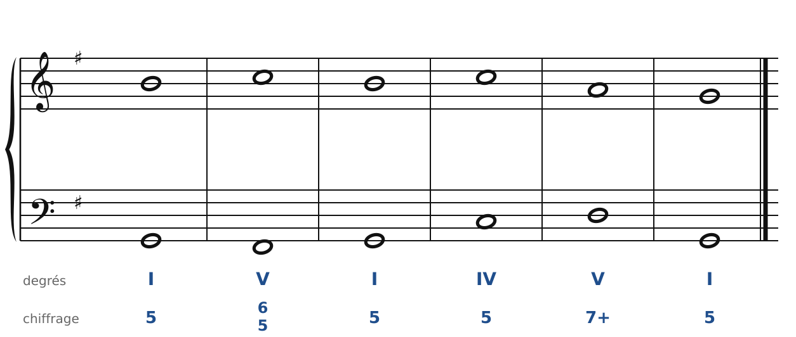

### Exercice 18.3 · Basse chiffrée en Do majeur (le V+6)

Basse chiffrée : trouve les accords, écris le soprano, puis l'alto et le ténor.

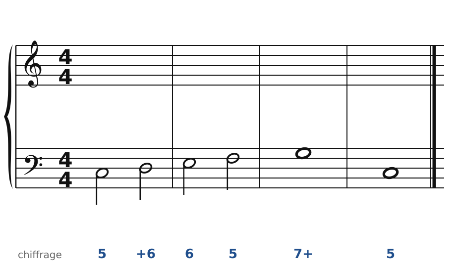

### Exercice 18.4 · Basse chiffrée en Ré majeur (le V+4)

Basse chiffrée : trouve les accords, écris le soprano, puis l'alto et le ténor.

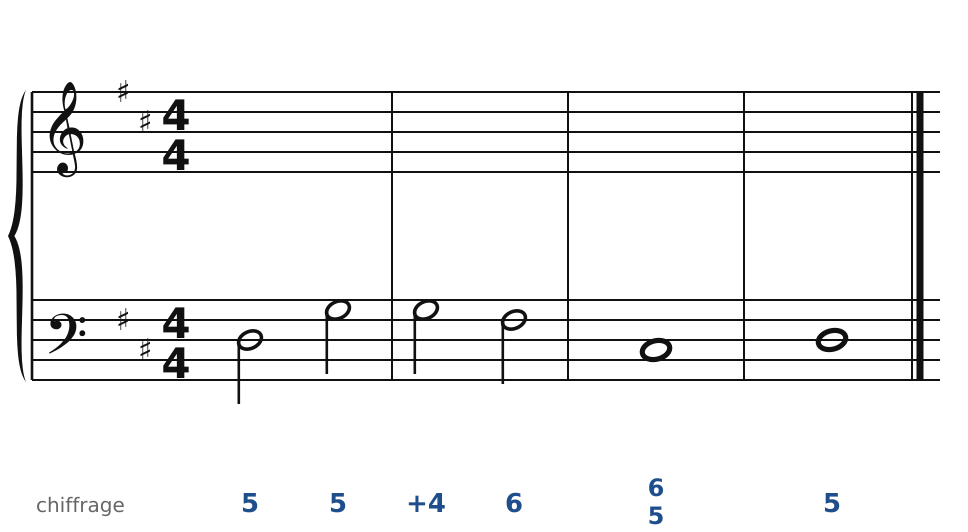

### Exercice 18.5 · Basse chiffrée en Fa majeur (avec une cadence rompue)

Basse chiffrée : trouve les accords, écris le soprano, puis l'alto et le ténor.

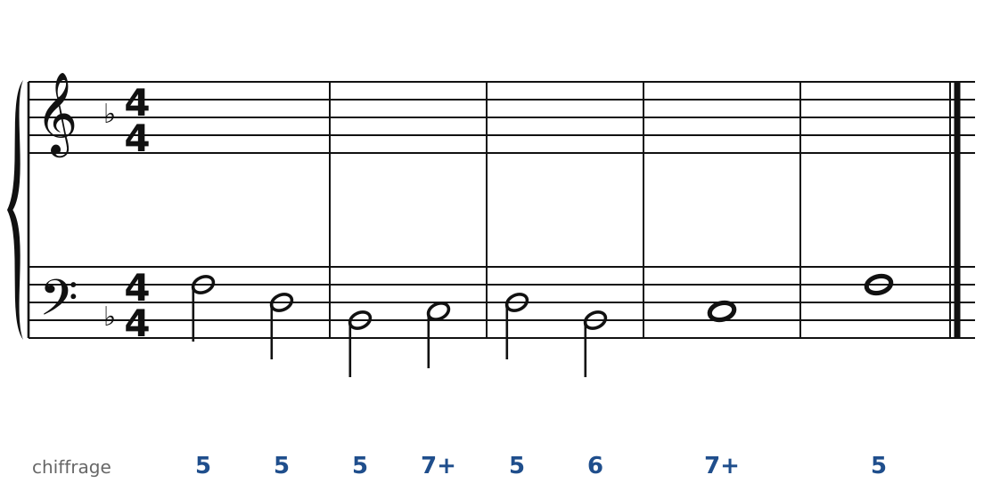

### Exercice 18.6 · Basse chiffrée en la mineur

Basse chiffrée : trouve les accords, écris le soprano, puis l'alto et le ténor.

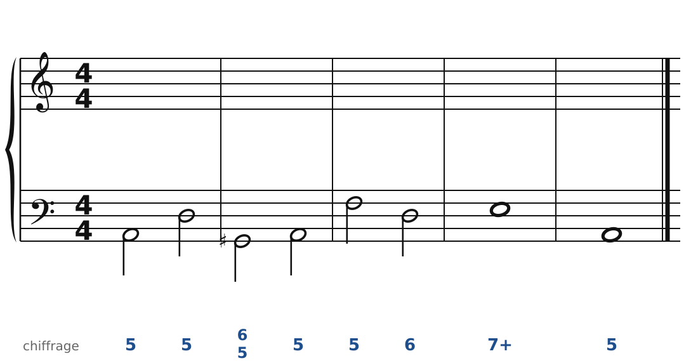

### Exercice 18.7 · Chant donné en Do majeur

Chant donné : choisis les accords, écris la basse, puis l'alto et le ténor.

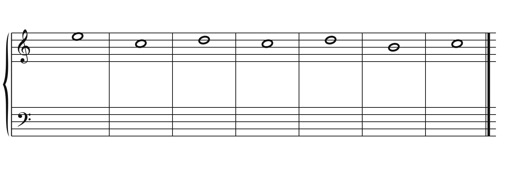

### Exercice 18.8 · Chant donné en ré mineur

Chant donné : choisis les accords, écris la basse, puis l'alto et le ténor.

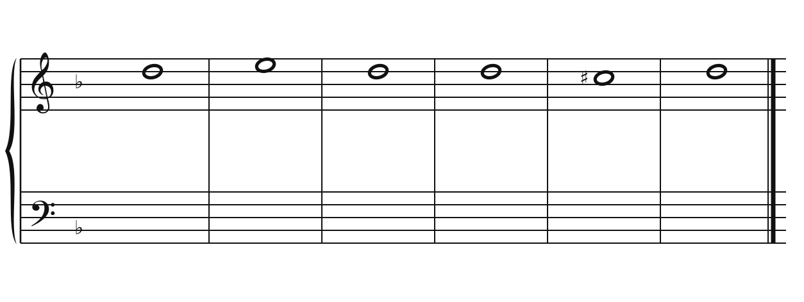

### Corrigés

**Exercice 18.1** : une solution parmi d'autres (septièmes en rouge, sensibles en orange).

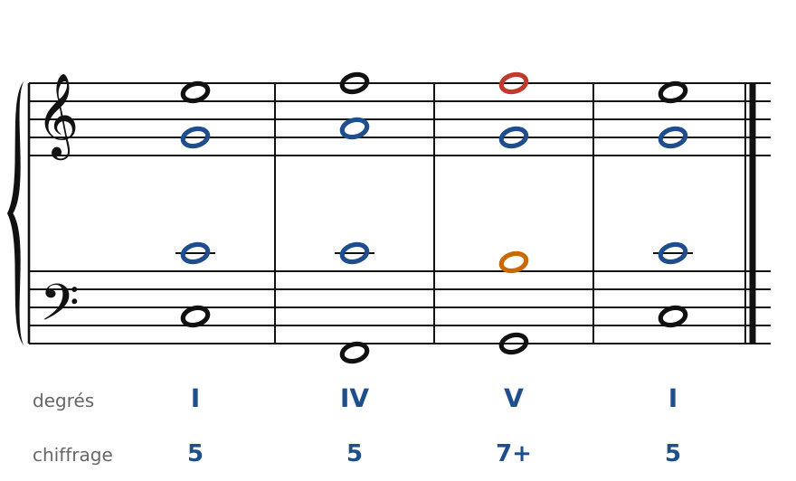

🔊 [Écouter](audio/c18-01-c.mp3) · [MIDI](audio/c18-01-c.mid)

**Exercice 18.2** : une solution parmi d'autres (septièmes en rouge, sensibles en orange).

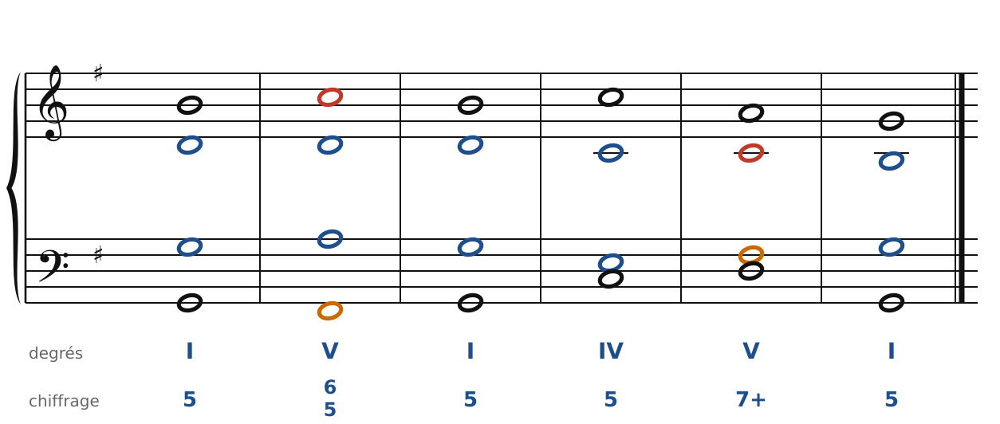

🔊 [Écouter](audio/c18-02-c.mp3) · [MIDI](audio/c18-02-c.mid)

**Exercice 18.3** : une solution parmi d'autres (septièmes en rouge, sensibles en orange).

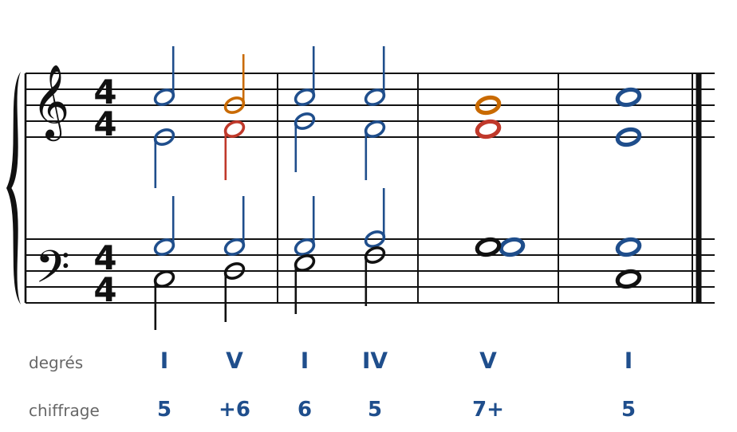

🔊 [Écouter](audio/c18-03-c.mp3) · [MIDI](audio/c18-03-c.mid)

**Exercice 18.4** : une solution parmi d'autres (septièmes en rouge, sensibles en orange).

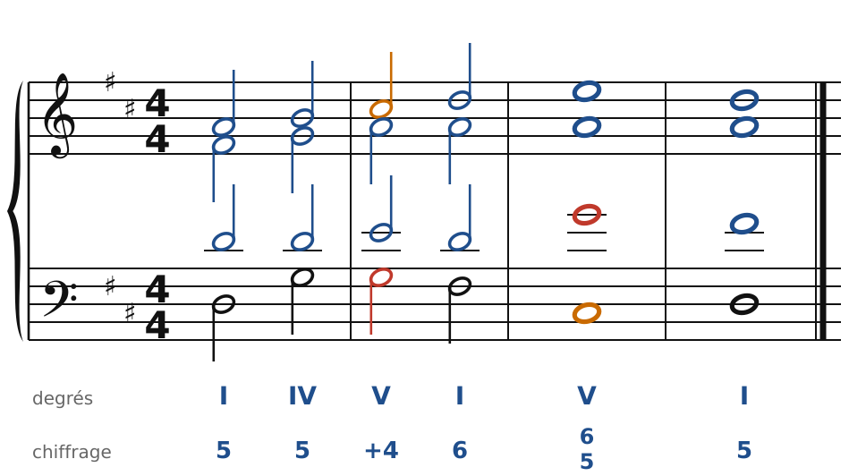

🔊 [Écouter](audio/c18-04-c.mp3) · [MIDI](audio/c18-04-c.mid)

**Exercice 18.5** : une solution parmi d'autres (septièmes en rouge, sensibles en orange).

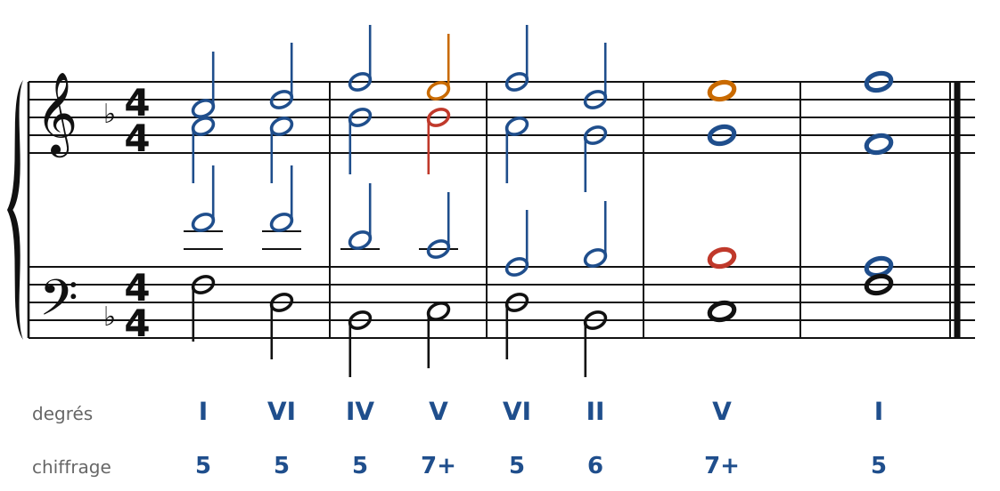

🔊 [Écouter](audio/c18-05-c.mp3) · [MIDI](audio/c18-05-c.mid)

**Exercice 18.6** : une solution parmi d'autres (septièmes en rouge, sensibles en orange).

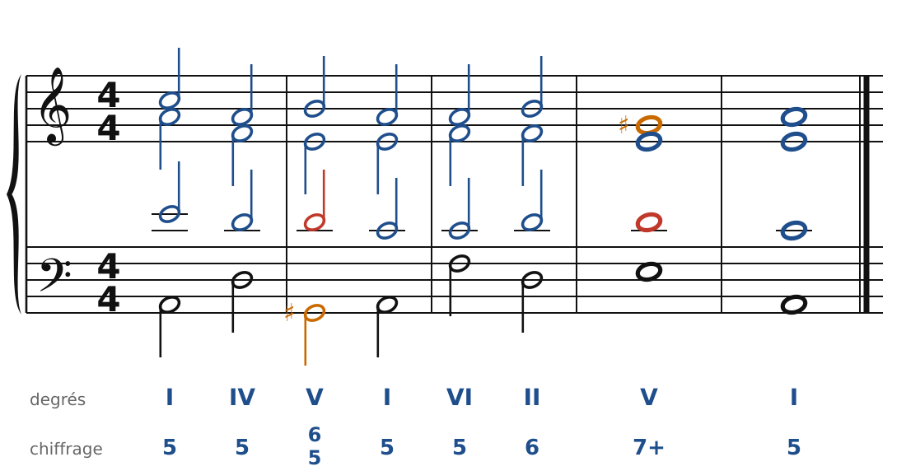

🔊 [Écouter](audio/c18-06-c.mp3) · [MIDI](audio/c18-06-c.mid)

**Exercice 18.7** : une solution parmi d'autres (septièmes en rouge, sensibles en orange).

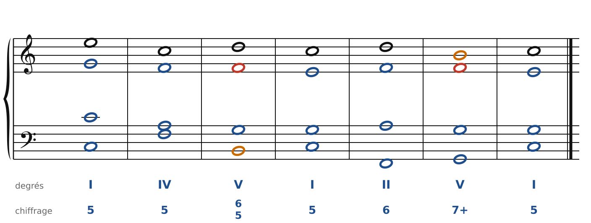

🔊 [Écouter](audio/c18-07-c.mp3) · [MIDI](audio/c18-07-c.mid)

**Exercice 18.8** : une solution parmi d'autres (septièmes en rouge, sensibles en orange).

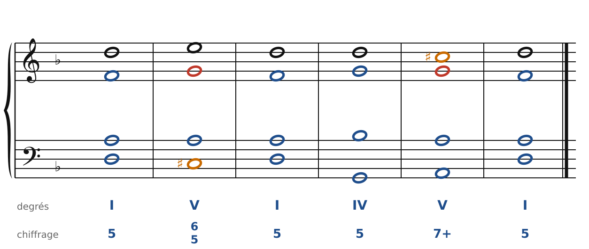

🔊 [Écouter](audio/c18-08-c.mp3) · [MIDI](audio/c18-08-c.mid)

---

[← Le choral](13-le-choral.md) · [Sommaire du cahier](README.md) · [Les septièmes d'espèce et les marches →](19-les-septiemes-d-espece.md)
