[← La septième de dominante](18-la-septieme-de-dominante.md) · [Sommaire du cahier](README.md) · [La septième diminuée et la neuvième →](20-la-septieme-diminuee-et-la-neuvieme.md)

## Les septièmes d'espèce et les marches

Ces exercices accompagnent le [chapitre 19](../cours/19-les-septiemes-d-espece-et-les-marches.md) du cours.

Dans la version web (`cahier.html`), chaque exercice se fait **directement sur la portée**, avec les corrections au fur et à mesure. Dans les basses chiffrées et les chants donnés, le menu propose aussi les accords de 7e : choisis-les d'après la basse et le chiffrage.

### Exercice 19.1 · Basse chiffrée en Do majeur (II7)

Basse chiffrée : trouve les accords, écris le soprano, puis l'alto et le ténor.

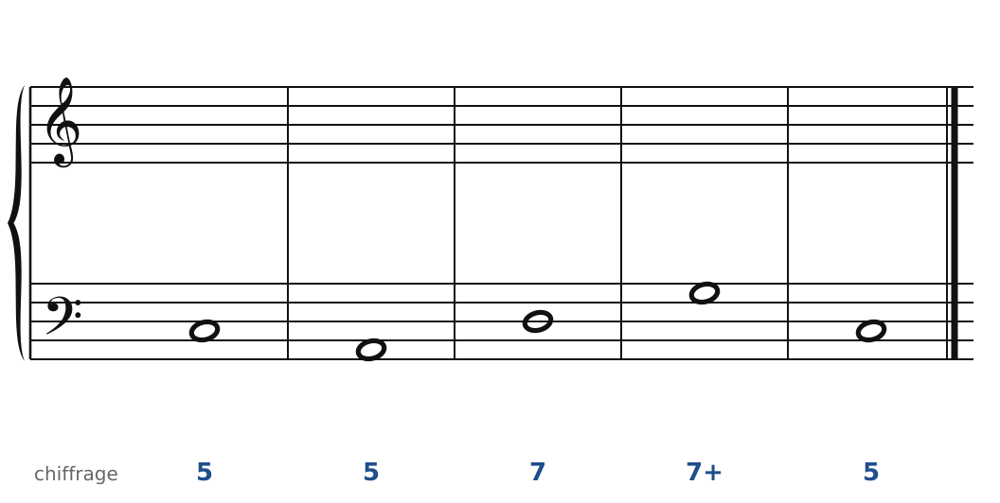

### Exercice 19.2 · Basse chiffrée en Sol majeur (II6/5)

Basse chiffrée : trouve les accords, écris le soprano, puis l'alto et le ténor.

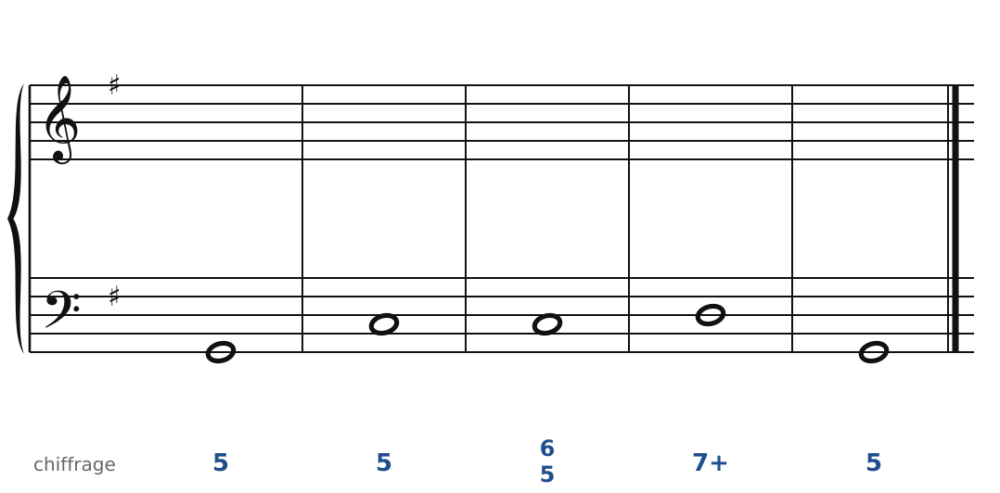

### Exercice 19.3 · Basse chiffrée en Fa majeur (IV7 et II6/5)

Basse chiffrée : trouve les accords, écris le soprano, puis l'alto et le ténor.

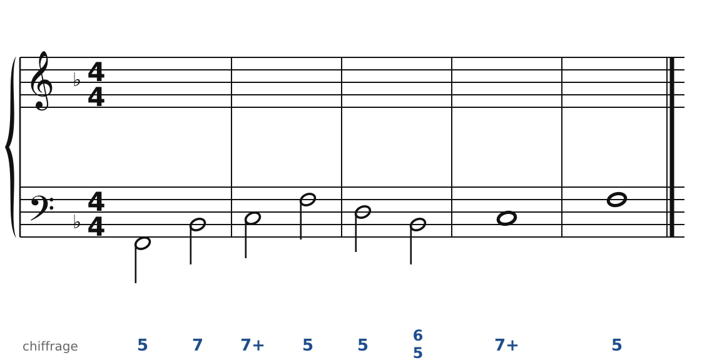

### Exercice 19.4 · Basse donnée en Ré majeur (marche harmonique)

Basse donnée avec ses accords : écris le soprano, puis l'alto et le ténor.

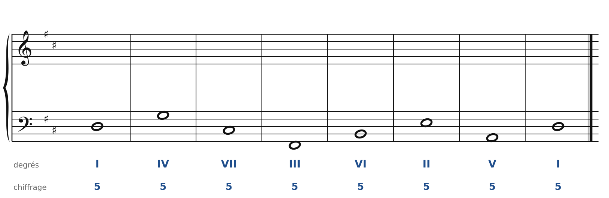

### Exercice 19.5 · Basse donnée en Do majeur (marche de septièmes)

Basse donnée avec ses accords : écris le soprano, puis l'alto et le ténor.

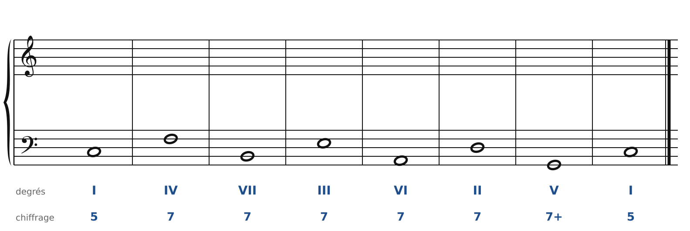

### Exercice 19.6 · Chant donné en Fa majeur

Chant donné : choisis les accords, écris la basse, puis l'alto et le ténor.

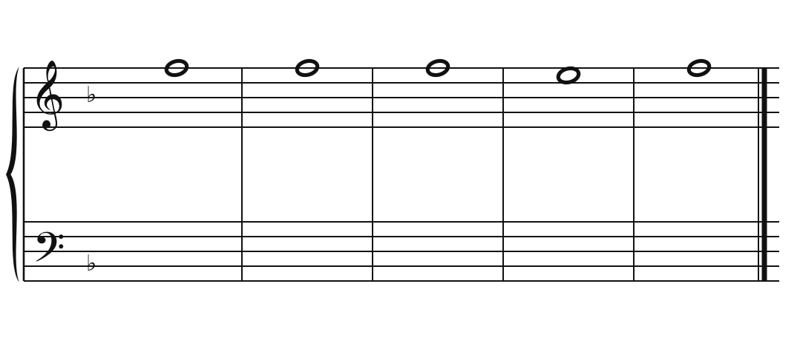

### Exercice 19.7 · Chasse aux fautes en Ré majeur

Cet enchaînement contient **trois fautes**. Trouve-les et corrige-les en changeant le moins de notes possible (la basse ne bouge pas).

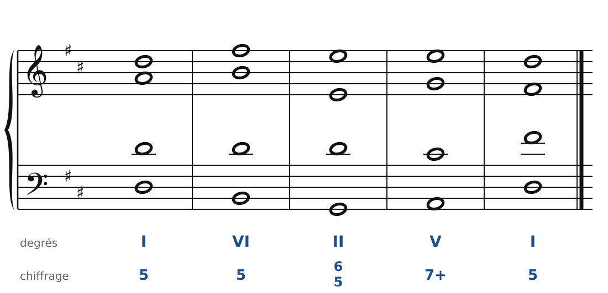

### Corrigés

**Exercice 19.1** : une solution parmi d'autres (septièmes en rouge, sensibles en orange).

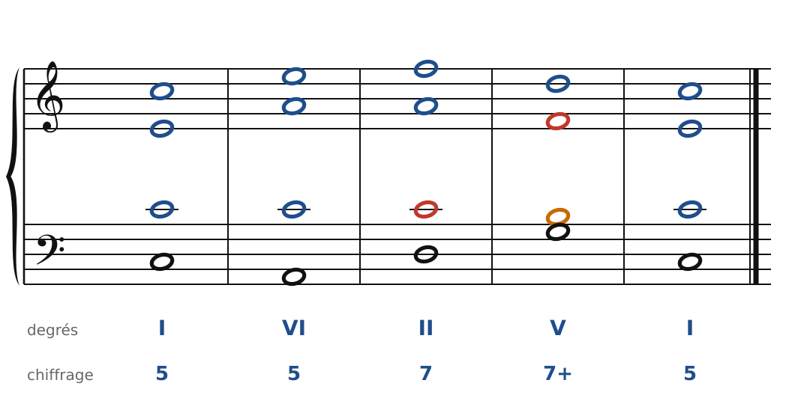

🔊 [Écouter](audio/c19-01-c.mp3) · [MIDI](audio/c19-01-c.mid)

**Exercice 19.2** : une solution parmi d'autres (septièmes en rouge, sensibles en orange).

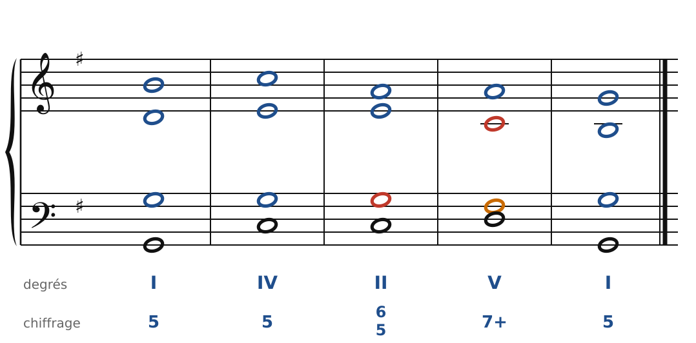

🔊 [Écouter](audio/c19-02-c.mp3) · [MIDI](audio/c19-02-c.mid)

**Exercice 19.3** : une solution parmi d'autres (septièmes en rouge, sensibles en orange).

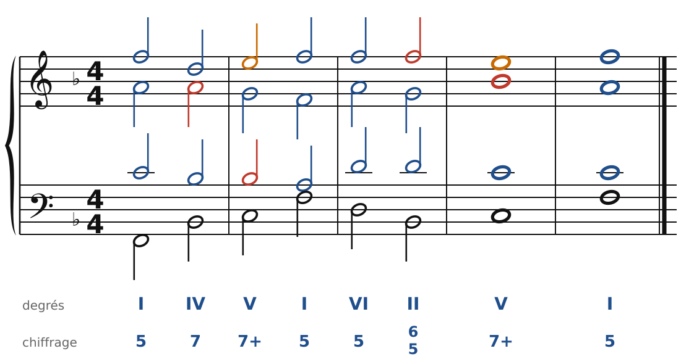

🔊 [Écouter](audio/c19-03-c.mp3) · [MIDI](audio/c19-03-c.mid)

**Exercice 19.4** : une solution parmi d'autres (septièmes en rouge, sensibles en orange).

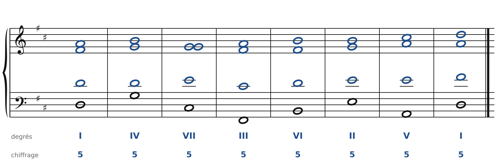

🔊 [Écouter](audio/c19-04-c.mp3) · [MIDI](audio/c19-04-c.mid)

**Exercice 19.5** : une solution parmi d'autres (septièmes en rouge, sensibles en orange).

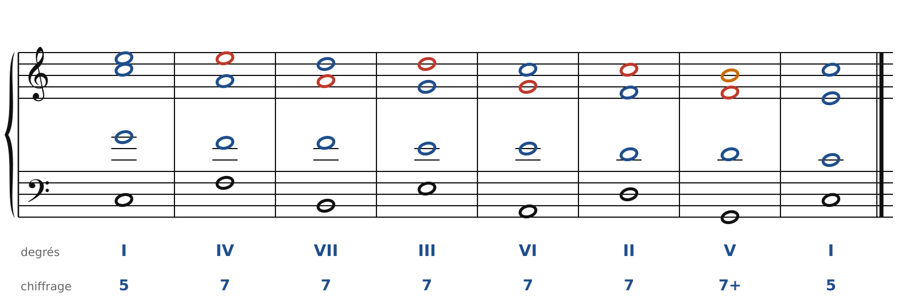

🔊 [Écouter](audio/c19-05-c.mp3) · [MIDI](audio/c19-05-c.mid)

**Exercice 19.6** : une solution parmi d'autres (septièmes en rouge, sensibles en orange).

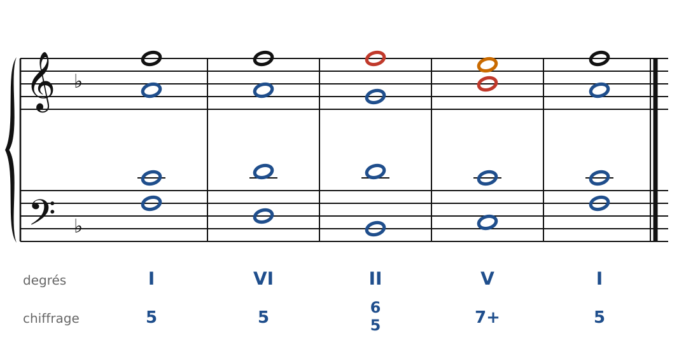

🔊 [Écouter](audio/c19-06-c.mp3) · [MIDI](audio/c19-06-c.mid)

**Exercice 19.7** : une solution parmi d'autres (septièmes en rouge, sensibles en orange).

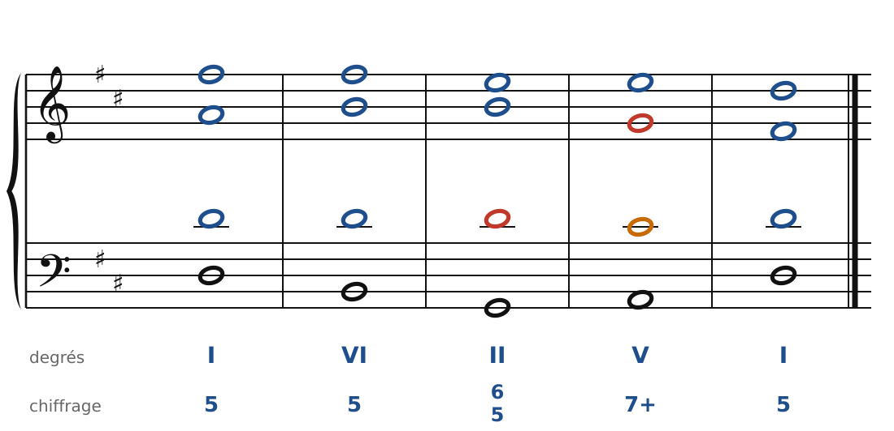

🔊 [Écouter](audio/c19-07-c.mp3) · [MIDI](audio/c19-07-c.mid)

---

[← La septième de dominante](18-la-septieme-de-dominante.md) · [Sommaire du cahier](README.md) · [La septième diminuée et la neuvième →](20-la-septieme-diminuee-et-la-neuvieme.md)
