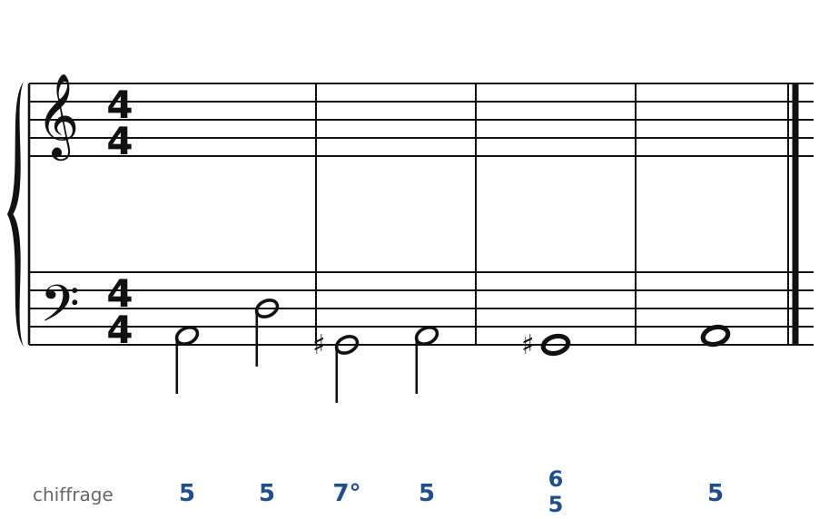
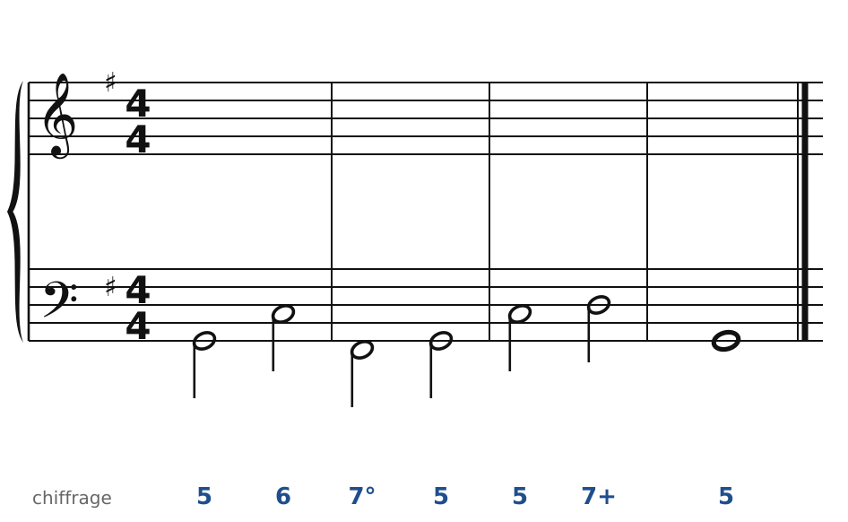
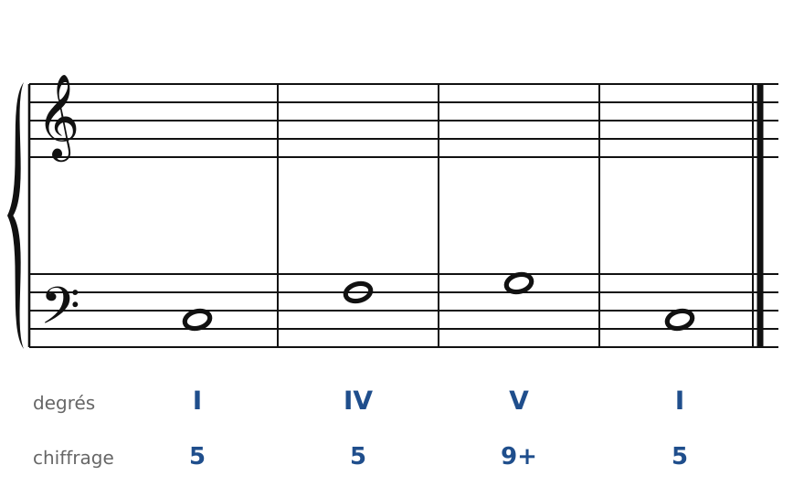
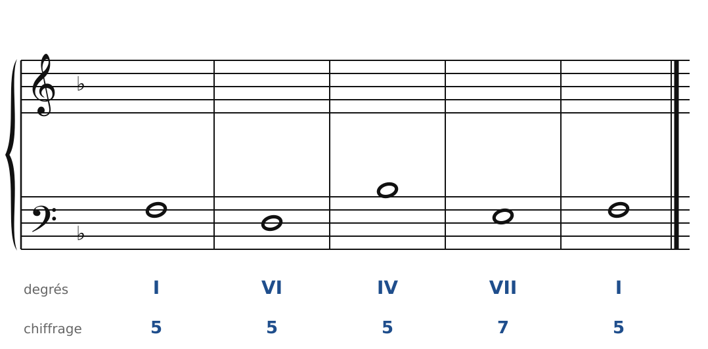
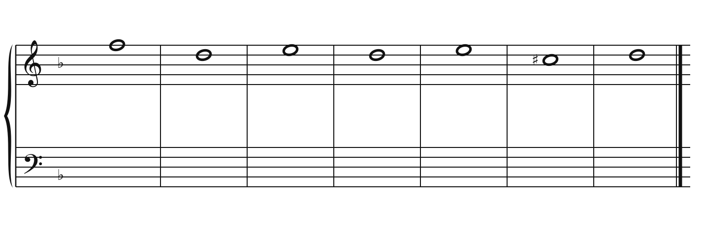
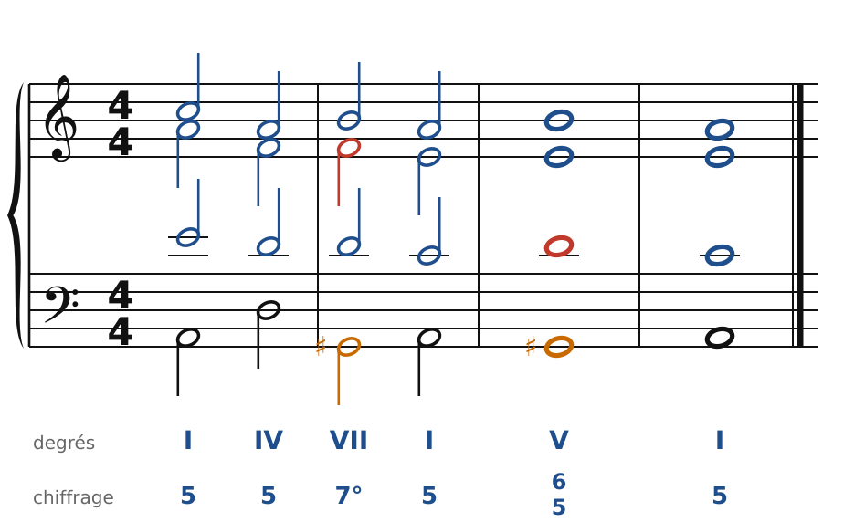
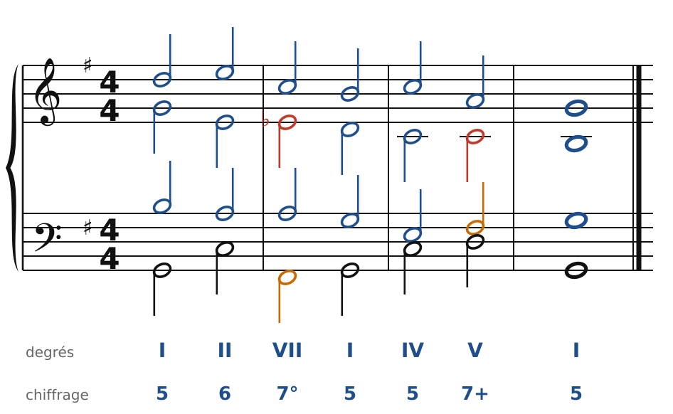
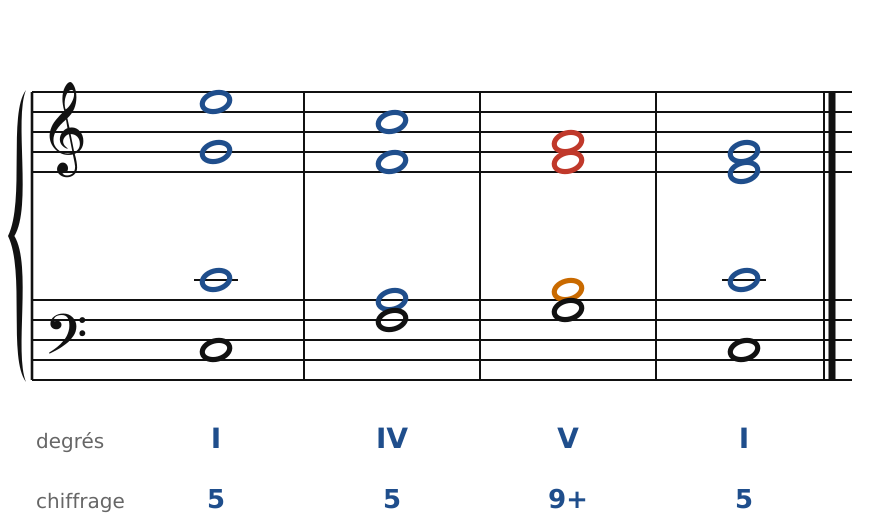
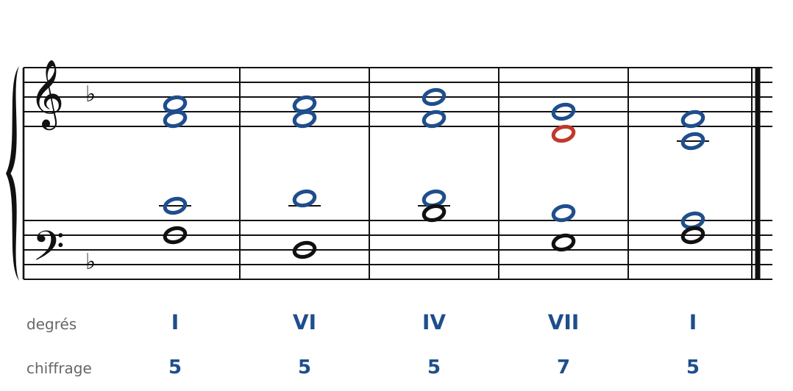
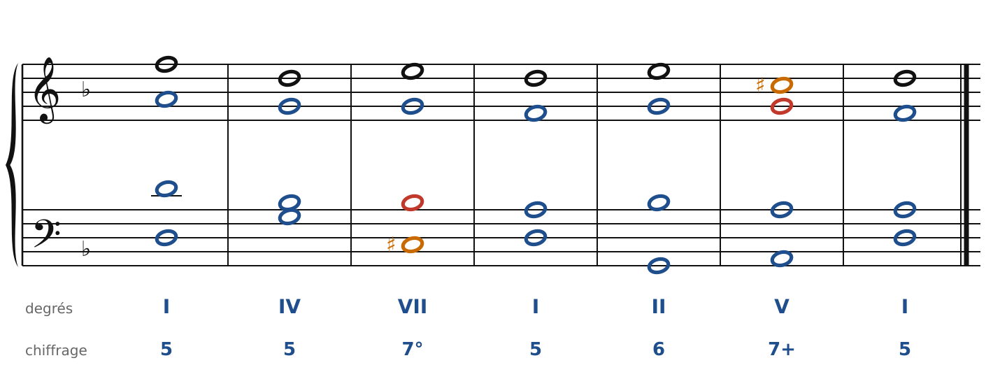

[← Les septièmes d'espèce et les marches](19-les-septiemes-d-espece.md) · [Sommaire du cahier](README.md) · [Dominantes secondaires et modulation →](21-dominantes-secondaires-et-modulation.md)

## La septième diminuée et la neuvième

Ces exercices accompagnent le [chapitre 20](../cours/20-la-septieme-diminuee-et-la-neuvieme.md) du cours.

Dans la version web (`cahier.html`), chaque exercice se fait **directement sur la portée**, avec les corrections au fur et à mesure. Dans les basses chiffrées et les chants donnés, le menu propose aussi les accords de 7e : choisis-les d'après la basse et le chiffrage.

### Exercice 20.1 · Basse chiffrée en la mineur (7e diminuée en la mineur)

Basse chiffrée : trouve les accords, écris le soprano, puis l'alto et le ténor.

### Exercice 20.2 · Basse chiffrée en Sol majeur (7e diminuée en majeur)

Basse chiffrée : trouve les accords, écris le soprano, puis l'alto et le ténor.

### Exercice 20.3 · Basse donnée en Do majeur (9e de dominante)

Basse donnée avec ses accords : écris le soprano, puis l'alto et le ténor.

### Exercice 20.4 · Basse donnée en Fa majeur (7e de sensible)

Basse donnée avec ses accords : écris le soprano, puis l'alto et le ténor.

### Exercice 20.5 · Chant donné en ré mineur

Chant donné : choisis les accords, écris la basse, puis l'alto et le ténor.

### Corrigés

**Exercice 20.1** : une solution parmi d'autres (septièmes en rouge, sensibles en orange).

🔊 [Écouter](audio/c20-01-c.mp3) · [MIDI](audio/c20-01-c.mid)

**Exercice 20.2** : une solution parmi d'autres (septièmes en rouge, sensibles en orange).

🔊 [Écouter](audio/c20-02-c.mp3) · [MIDI](audio/c20-02-c.mid)

**Exercice 20.3** : une solution parmi d'autres (septièmes en rouge, sensibles en orange).

🔊 [Écouter](audio/c20-03-c.mp3) · [MIDI](audio/c20-03-c.mid)

**Exercice 20.4** : une solution parmi d'autres (septièmes en rouge, sensibles en orange).

🔊 [Écouter](audio/c20-04-c.mp3) · [MIDI](audio/c20-04-c.mid)

**Exercice 20.5** : une solution parmi d'autres (septièmes en rouge, sensibles en orange).

🔊 [Écouter](audio/c20-05-c.mp3) · [MIDI](audio/c20-05-c.mid)

---

[← Les septièmes d'espèce et les marches](19-les-septiemes-d-espece.md) · [Sommaire du cahier](README.md) · [Dominantes secondaires et modulation →](21-dominantes-secondaires-et-modulation.md)
