[← La septième diminuée et la neuvième](20-la-septieme-diminuee-et-la-neuvieme.md) · [Sommaire du cahier](README.md)

## Dominantes secondaires et modulation

Ces exercices accompagnent le [chapitre 21](../cours/21-les-dominantes-secondaires-et-la-modulation.md) du cours.

Dans la version web (`cahier.html`), chaque exercice se fait **directement sur la portée**, avec les corrections au fur et à mesure. Dans les basses chiffrées et les chants donnés, le menu propose aussi les accords de 7e : choisis-les d'après la basse et le chiffrage.

### Exercice 21.1 · Basse chiffrée en Do majeur (V7/V)

Basse chiffrée : trouve les accords, écris le soprano, puis l'alto et le ténor.

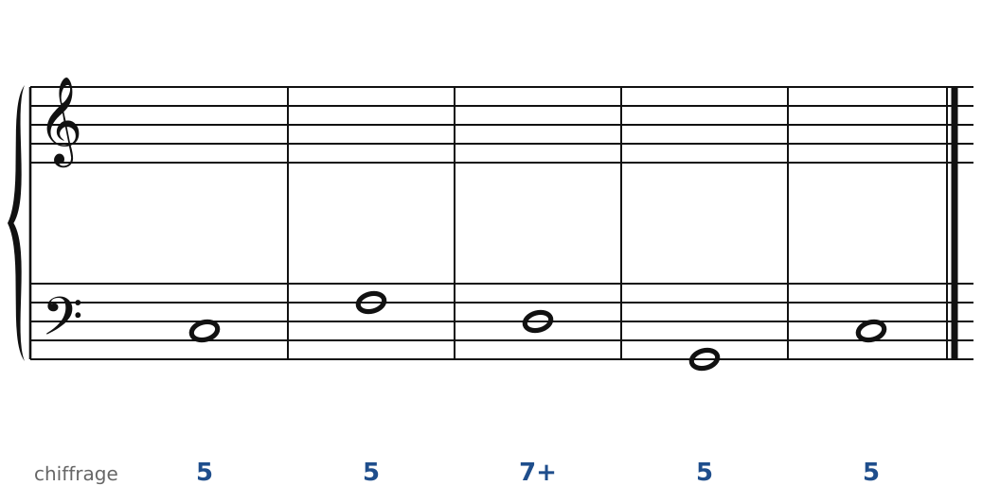

### Exercice 21.2 · Basse chiffrée en Sol majeur (V7/IV et V7/V)

Basse chiffrée : trouve les accords, écris le soprano, puis l'alto et le ténor.

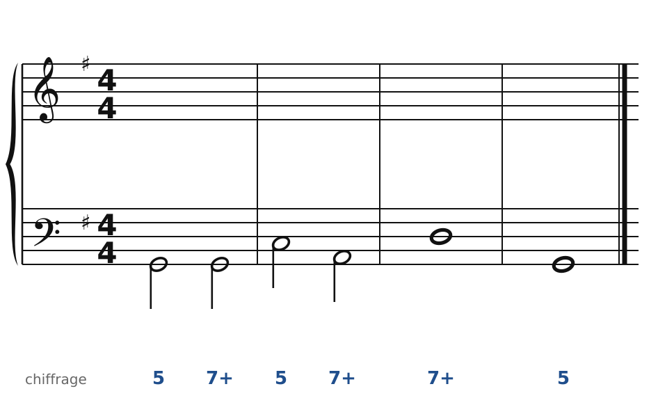

### Exercice 21.3 · Basse chiffrée en Fa majeur (V7/VI et V7/II)

Basse chiffrée : trouve les accords, écris le soprano, puis l'alto et le ténor.

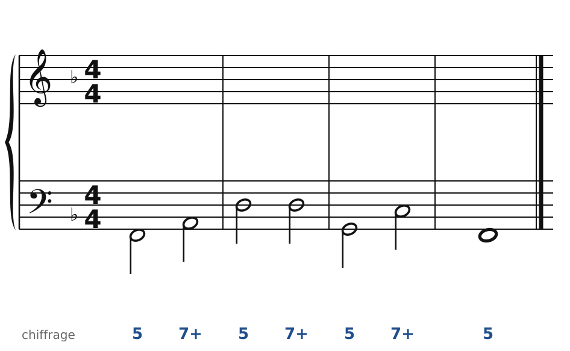

### Exercice 21.4 · Chant donné en Ré majeur

Chant donné : choisis les accords, écris la basse, puis l'alto et le ténor.

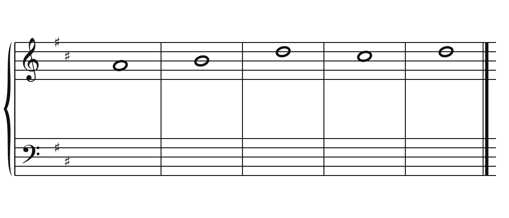

### Exercice 21.5 · Basse donnée en Do majeur (modulation de Do à Sol)

Basse donnée avec ses accords : écris le soprano, puis l'alto et le ténor.

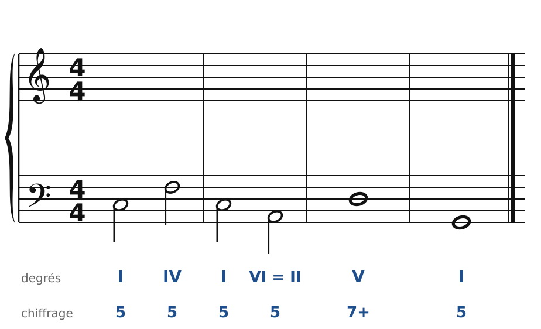

### Exercice 21.6 · Basse donnée en Fa majeur (modulation de Fa à ré mineur)

Basse donnée avec ses accords : écris le soprano, puis l'alto et le ténor.

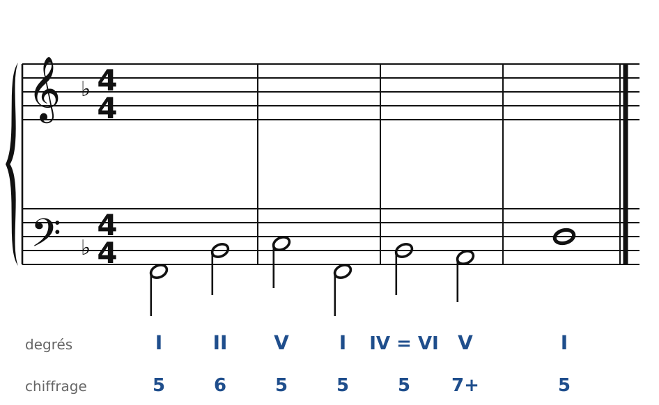

### Corrigés

**Exercice 21.1** : une solution parmi d'autres (septièmes en rouge, sensibles en orange).

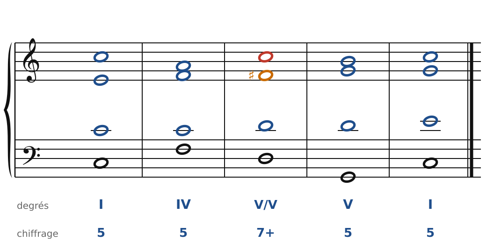

🔊 [Écouter](audio/c21-01-c.mp3) · [MIDI](audio/c21-01-c.mid)

**Exercice 21.2** : une solution parmi d'autres (septièmes en rouge, sensibles en orange).

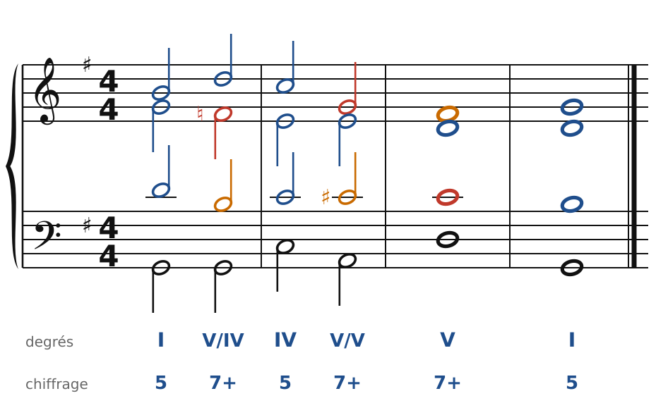

🔊 [Écouter](audio/c21-02-c.mp3) · [MIDI](audio/c21-02-c.mid)

**Exercice 21.3** : une solution parmi d'autres (septièmes en rouge, sensibles en orange).

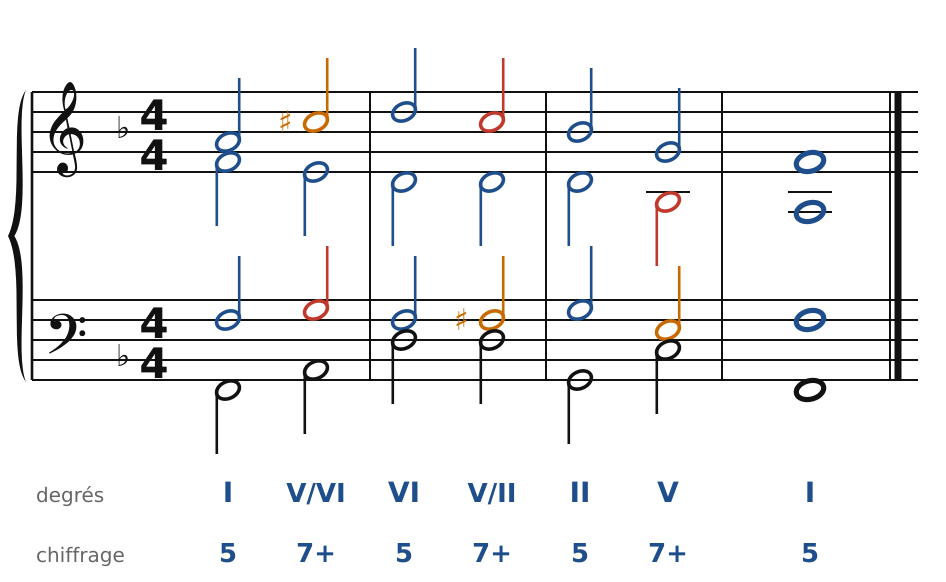

🔊 [Écouter](audio/c21-03-c.mp3) · [MIDI](audio/c21-03-c.mid)

**Exercice 21.4** : une solution parmi d'autres (septièmes en rouge, sensibles en orange).

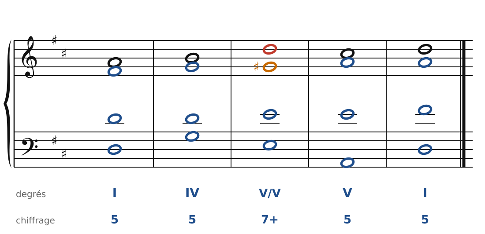

🔊 [Écouter](audio/c21-04-c.mp3) · [MIDI](audio/c21-04-c.mid)

**Exercice 21.5** : une solution parmi d'autres (septièmes en rouge, sensibles en orange).

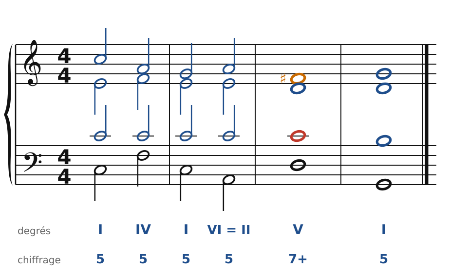

🔊 [Écouter](audio/c21-05-c.mp3) · [MIDI](audio/c21-05-c.mid)

**Exercice 21.6** : une solution parmi d'autres (septièmes en rouge, sensibles en orange).

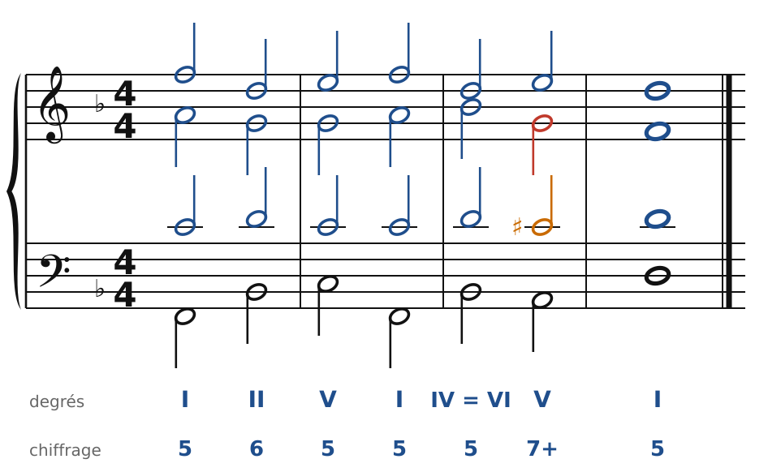

🔊 [Écouter](audio/c21-06-c.mp3) · [MIDI](audio/c21-06-c.mid)

---

[← La septième diminuée et la neuvième](20-la-septieme-diminuee-et-la-neuvieme.md) · [Sommaire du cahier](README.md)
