[← Dominantes secondaires et modulation](21-dominantes-secondaires-et-modulation.md) · [Sommaire du cahier](README.md) · [Pédales et cadences classiques →](25-pedales-et-cadences.md)

## La sixte napolitaine et les sixtes augmentées

Ces exercices accompagnent le [chapitre 24](../cours/24-la-sixte-napolitaine-et-les-sixtes-augmentees.md) du cours.

Dans la version web (`cahier.html`), chaque exercice se fait **directement sur la portée**, avec les corrections au fur et à mesure. Le menu des accords propose aussi la sixte napolitaine (N) et les sixtes augmentées (It+6, Fr+6, Al+6).

### Exercice 24.1 · Basse chiffrée en la mineur (la sixte napolitaine)

Basse chiffrée : trouve les accords, écris le soprano, puis l'alto et le ténor.

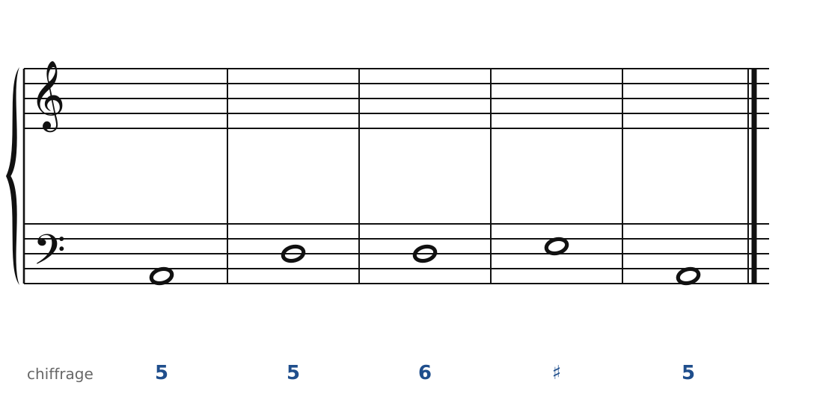

### Exercice 24.2 · Basse chiffrée en ré mineur (napolitaine et quarte et sixte)

Basse chiffrée : trouve les accords, écris le soprano, puis l'alto et le ténor.

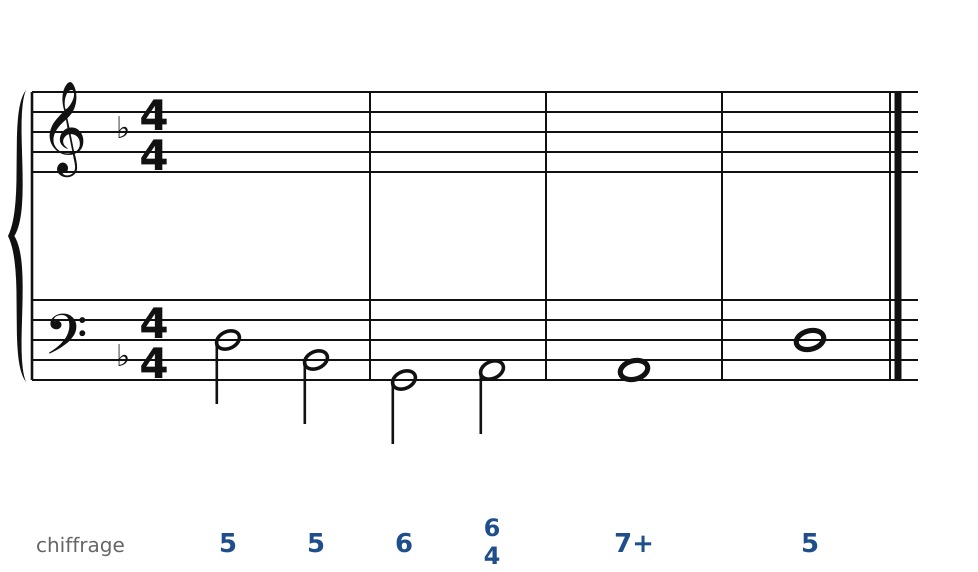

### Exercice 24.3 · Basse chiffrée en Do majeur (napolitaine en majeur)

Basse chiffrée : trouve les accords, écris le soprano, puis l'alto et le ténor.

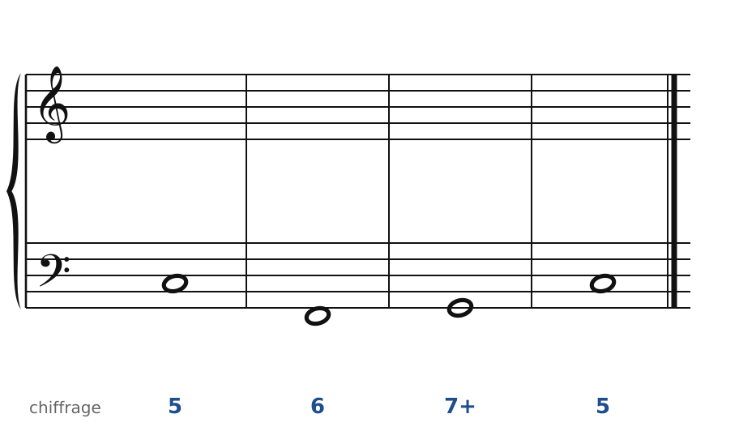

### Exercice 24.4 · Basse chiffrée en mi mineur (sixte italienne)

Basse chiffrée : trouve les accords, écris le soprano, puis l'alto et le ténor.

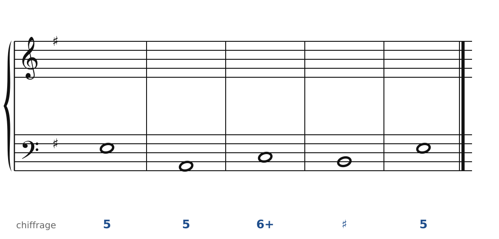

### Exercice 24.5 · Basse chiffrée en la mineur (sixte française)

Basse chiffrée : trouve les accords, écris le soprano, puis l'alto et le ténor.

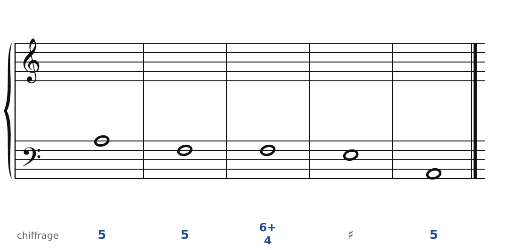

### Exercice 24.6 · Basse chiffrée en ré mineur (sixte allemande)

Basse chiffrée : trouve les accords, écris le soprano, puis l'alto et le ténor.

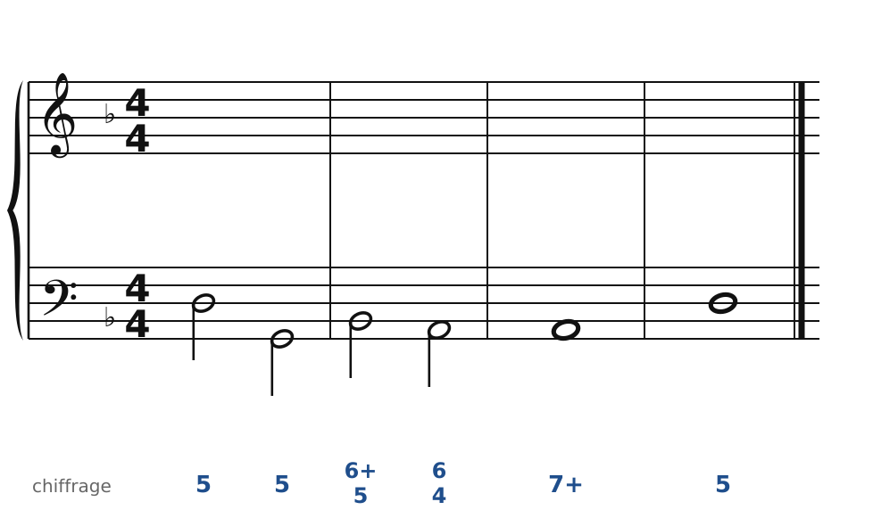

### Exercice 24.7 · Chant donné en la mineur

Chant donné : choisis les accords, écris la basse, puis l'alto et le ténor.

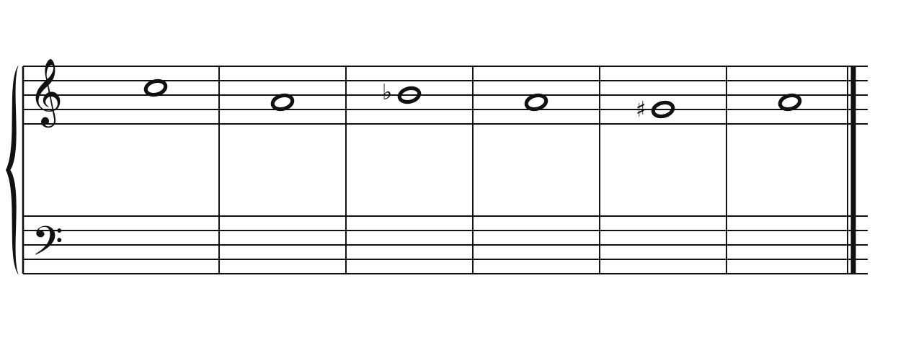

### Corrigés

**Exercice 24.1** : une solution parmi d'autres.

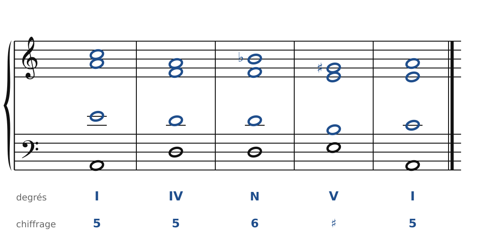

🔊 [Écouter](audio/c24-01-c.mp3) · [MIDI](audio/c24-01-c.mid)

**Exercice 24.2** : une solution parmi d'autres.

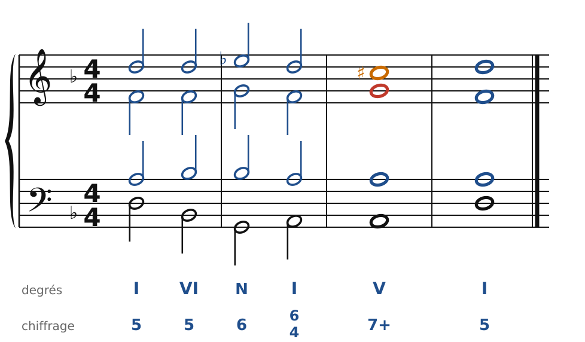

🔊 [Écouter](audio/c24-02-c.mp3) · [MIDI](audio/c24-02-c.mid)

**Exercice 24.3** : une solution parmi d'autres.

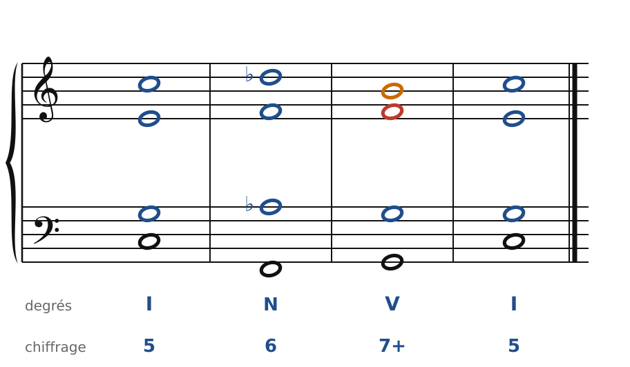

🔊 [Écouter](audio/c24-03-c.mp3) · [MIDI](audio/c24-03-c.mid)

**Exercice 24.4** : une solution parmi d'autres.

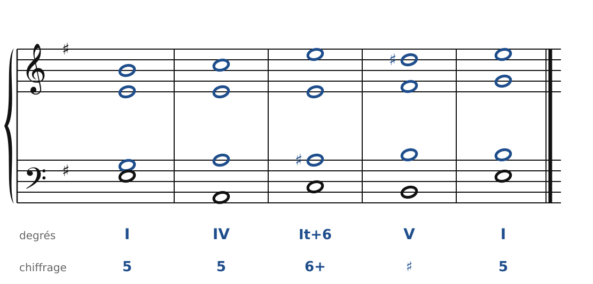

🔊 [Écouter](audio/c24-04-c.mp3) · [MIDI](audio/c24-04-c.mid)

**Exercice 24.5** : une solution parmi d'autres.

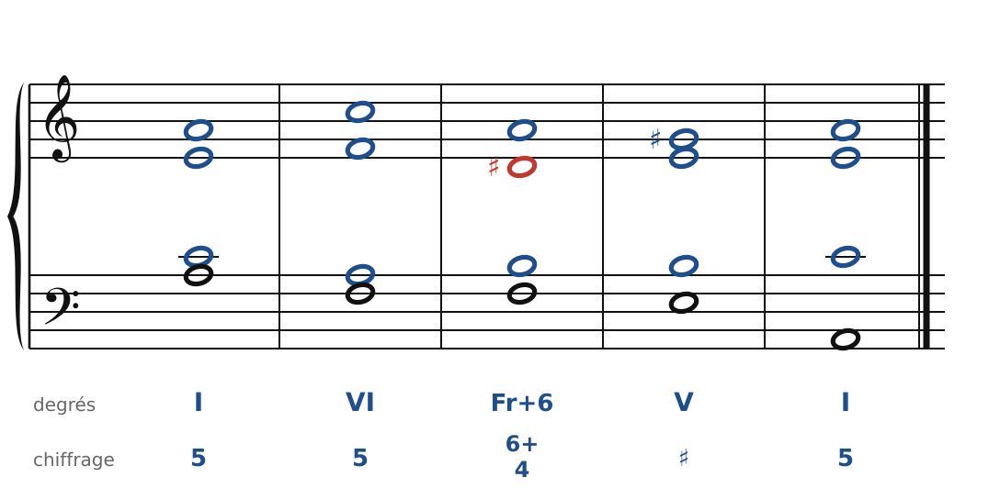

🔊 [Écouter](audio/c24-05-c.mp3) · [MIDI](audio/c24-05-c.mid)

**Exercice 24.6** : une solution parmi d'autres.

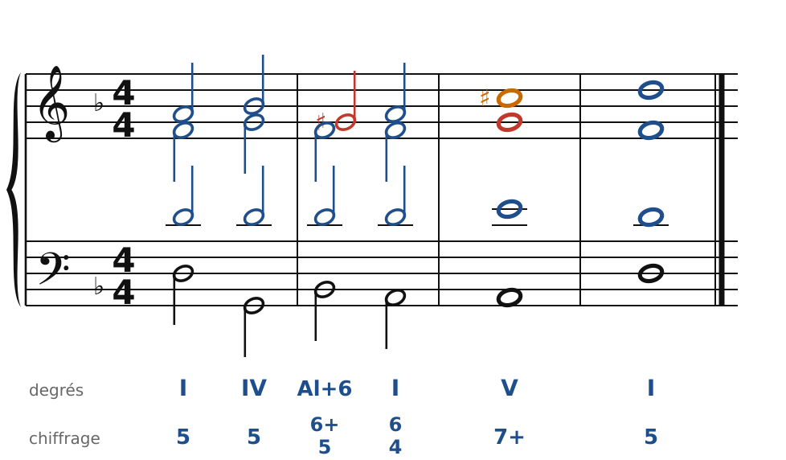

🔊 [Écouter](audio/c24-06-c.mp3) · [MIDI](audio/c24-06-c.mid)

**Exercice 24.7** : une solution parmi d'autres.

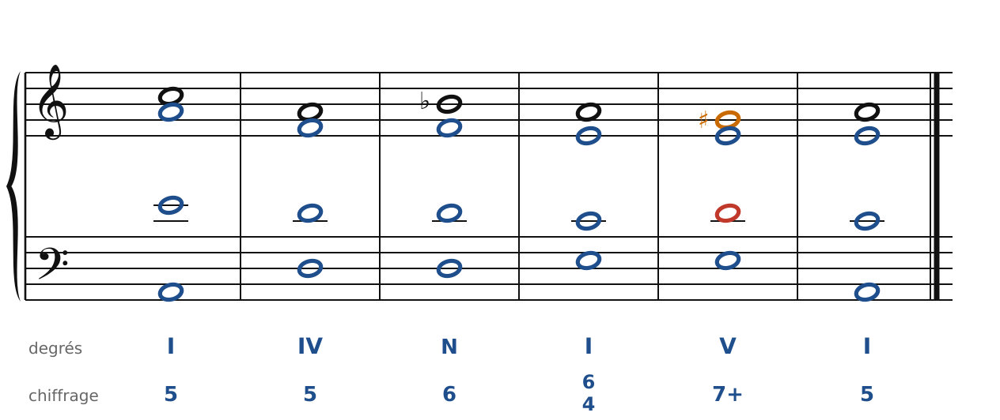

🔊 [Écouter](audio/c24-07-c.mp3) · [MIDI](audio/c24-07-c.mid)

---

[← Dominantes secondaires et modulation](21-dominantes-secondaires-et-modulation.md) · [Sommaire du cahier](README.md) · [Pédales et cadences classiques →](25-pedales-et-cadences.md)
