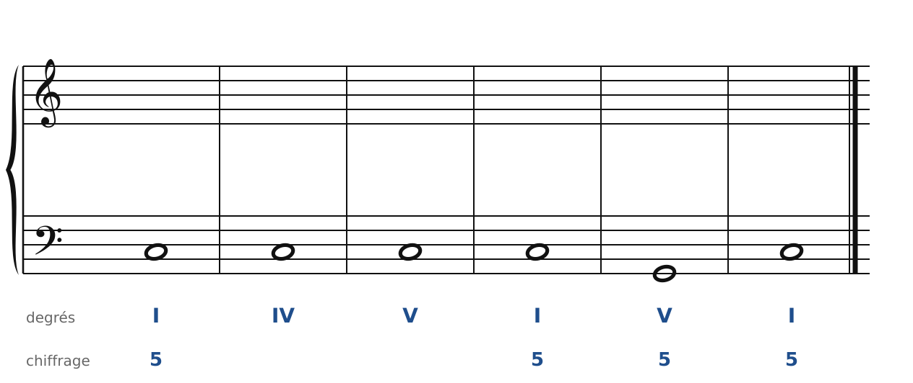
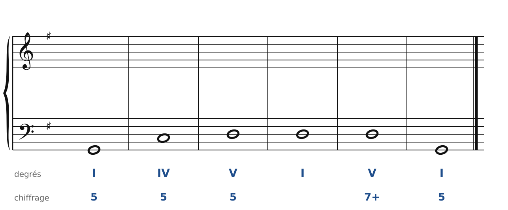
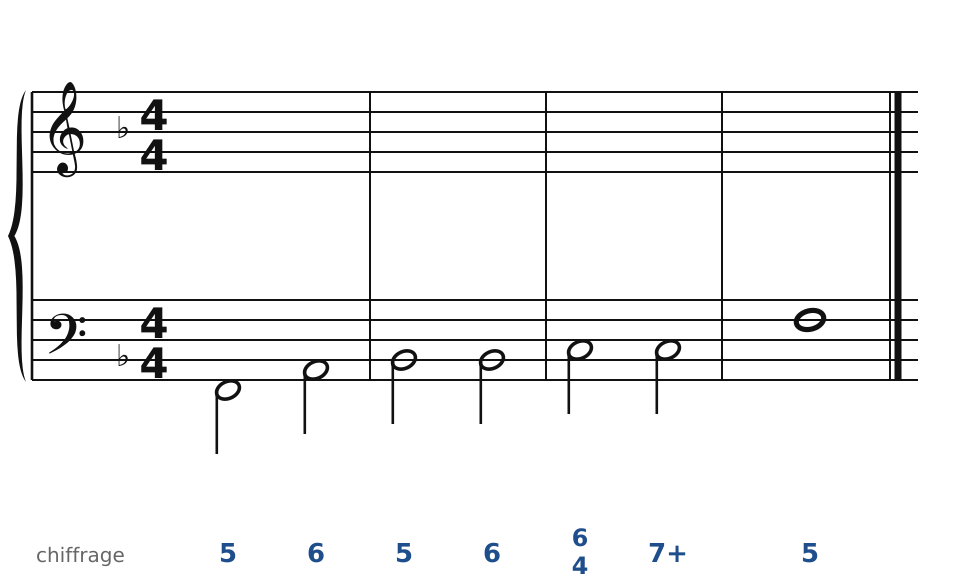
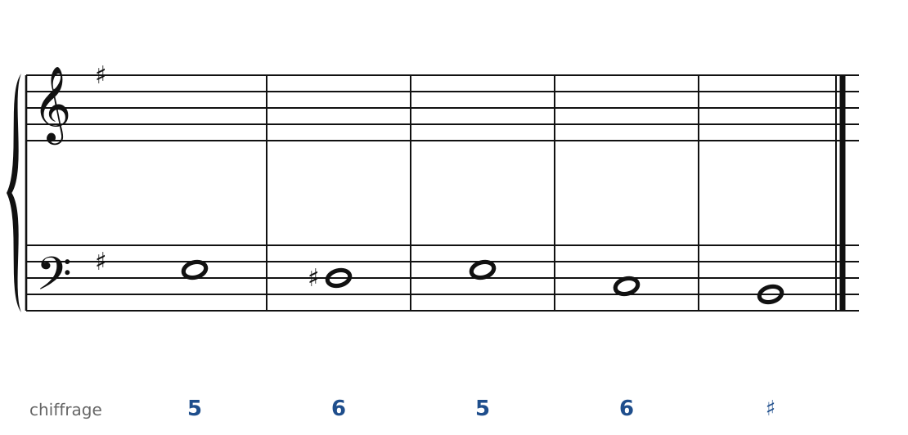
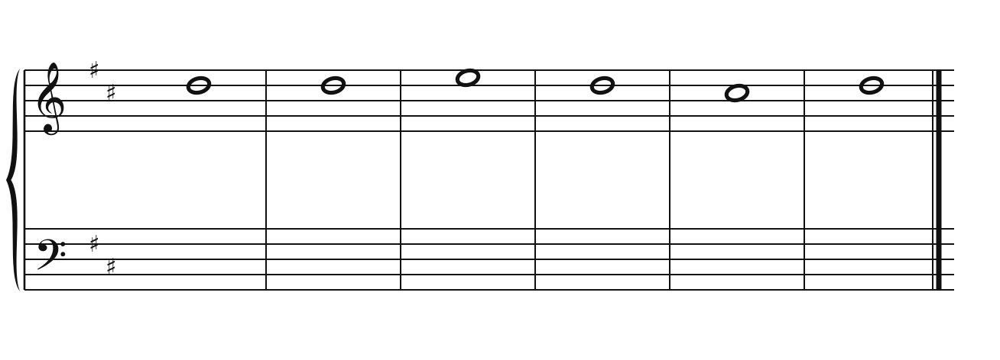
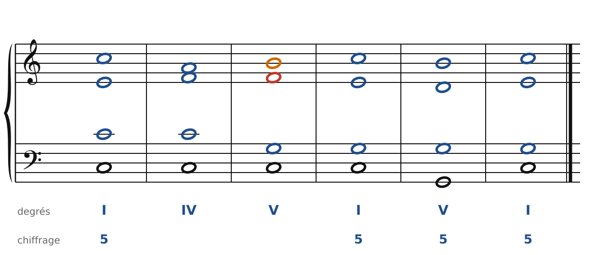
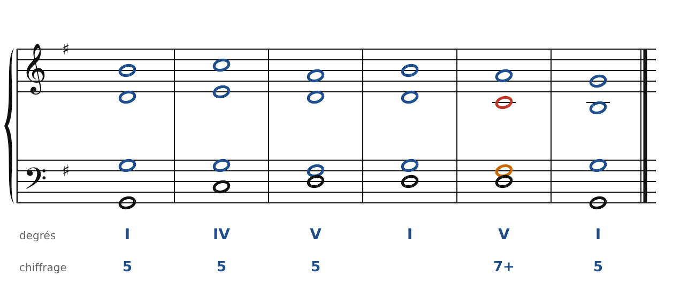
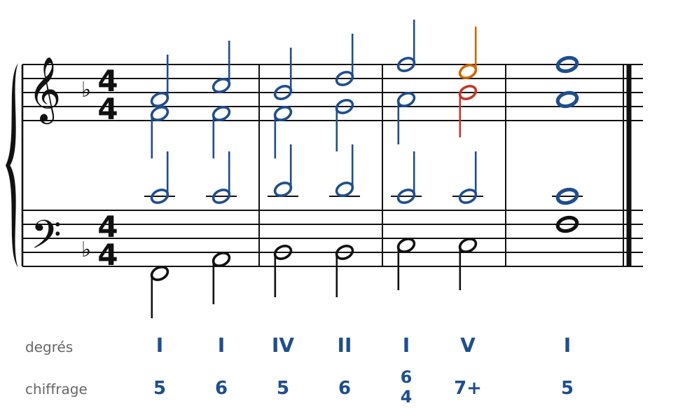
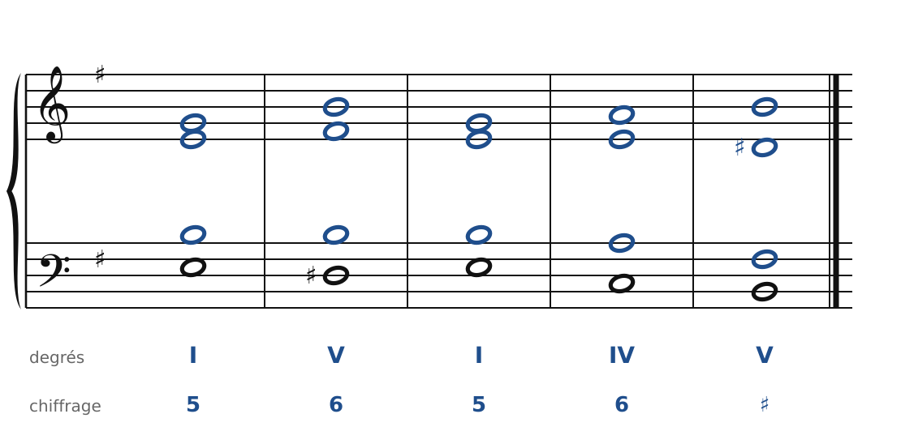
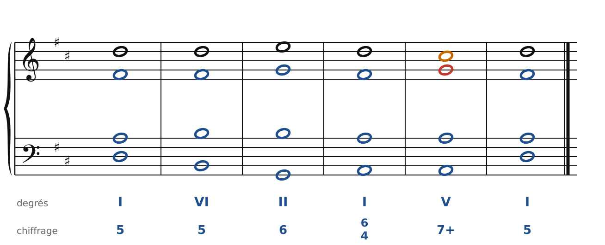

[← La sixte napolitaine et les sixtes augmentées](24-napolitaine-et-sixtes-augmentees.md) · [Sommaire du cahier](README.md) · [Écrire pour quatuor à cordes →](26-ecrire-pour-quatuor.md)

## Pédales et cadences classiques

Ces exercices accompagnent le [chapitre 25](../cours/25-pedales-et-formules-de-cadence.md) du cours.

Dans la version web (`cahier.html`), chaque exercice se fait **directement sur la portée**, avec les corrections au fur et à mesure. Le menu des accords propose aussi la sixte napolitaine (N) et les sixtes augmentées (It+6, Fr+6, Al+6).

### Exercice 25.1 · Basse donnée en Do majeur (pédale de tonique)

Basse donnée avec ses accords : écris le soprano, puis l'alto et le ténor.

### Exercice 25.2 · Basse donnée en Sol majeur (pédale de dominante)

Basse donnée avec ses accords : écris le soprano, puis l'alto et le ténor.

### Exercice 25.3 · Basse chiffrée en Fa majeur (la grande cadence)

Basse chiffrée : trouve les accords, écris le soprano, puis l'alto et le ténor.

### Exercice 25.4 · Basse chiffrée en mi mineur (demi-cadence phrygienne)

Basse chiffrée : trouve les accords, écris le soprano, puis l'alto et le ténor.

### Exercice 25.5 · Chant donné en Ré majeur

Chant donné : choisis les accords, écris la basse, puis l'alto et le ténor.

### Corrigés

**Exercice 25.1** : une solution parmi d'autres.

🔊 [Écouter](audio/c25-01-c.mp3) · [MIDI](audio/c25-01-c.mid)

**Exercice 25.2** : une solution parmi d'autres.

🔊 [Écouter](audio/c25-02-c.mp3) · [MIDI](audio/c25-02-c.mid)

**Exercice 25.3** : une solution parmi d'autres.

🔊 [Écouter](audio/c25-03-c.mp3) · [MIDI](audio/c25-03-c.mid)

**Exercice 25.4** : une solution parmi d'autres.

🔊 [Écouter](audio/c25-04-c.mp3) · [MIDI](audio/c25-04-c.mid)

**Exercice 25.5** : une solution parmi d'autres.

🔊 [Écouter](audio/c25-05-c.mp3) · [MIDI](audio/c25-05-c.mid)

---

[← La sixte napolitaine et les sixtes augmentées](24-napolitaine-et-sixtes-augmentees.md) · [Sommaire du cahier](README.md) · [Écrire pour quatuor à cordes →](26-ecrire-pour-quatuor.md)
