[← Pédales et cadences classiques](25-pedales-et-cadences.md) · [Sommaire du cahier](README.md) · [L'emprunt au mineur et les modulations par tierces →](30-emprunts-et-modulations-par-tierces.md)

## Écrire pour quatuor à cordes

Ces exercices accompagnent le [chapitre 26](../cours/26-ecrire-pour-quatuor-a-cordes.md) du cours.

Dans la version web (`cahier.html`), chaque exercice se fait **directement sur la portée**, avec les corrections au fur et à mesure. Le menu des accords propose aussi la sixte napolitaine (N) et les sixtes augmentées (It+6, Fr+6, Al+6).

Ici, on réalise d'abord l'exercice à quatre voix, sur la grande portée, comme d'habitude. Puis, **sur papier**, on le récrit pour quatuor à cordes avec la texture demandée (voir le [chapitre 26](../cours/26-ecrire-pour-quatuor-a-cordes.md)). Les corrigés montrent les deux versions.

### Exercice 26.1 · Basse chiffrée en Sol majeur (puis en batteries)

Basse chiffrée : trouve les accords, écris le soprano, puis l'alto et le ténor.

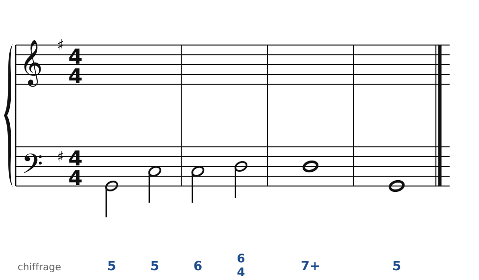

### Exercice 26.2 · Basse chiffrée en Ré majeur (puis avec une basse en octaves)

Basse chiffrée : trouve les accords, écris le soprano, puis l'alto et le ténor.

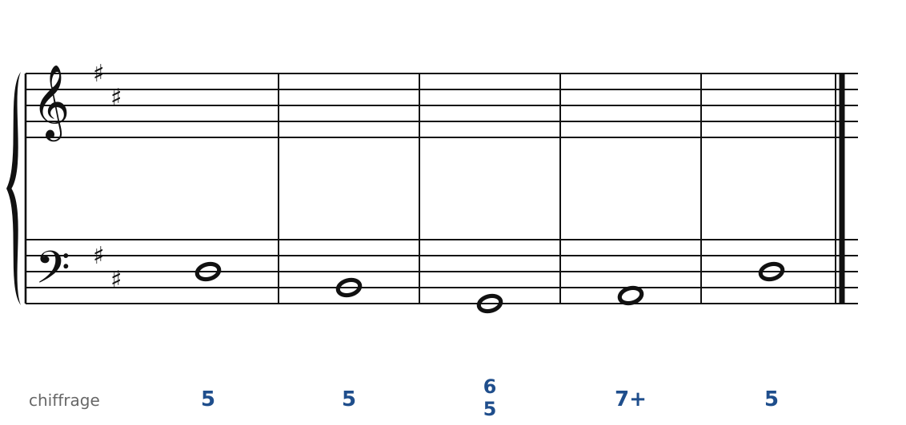

### Exercice 26.3 · Basse donnée en La majeur (puis en batteries)

Basse donnée avec ses accords : écris le soprano, puis l'alto et le ténor.

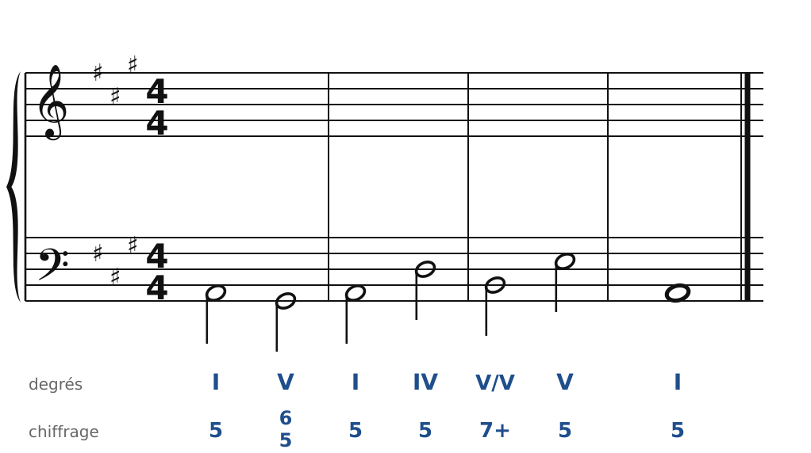

### Exercice 26.4 · Chant donné en Do majeur (puis en batteries)

Chant donné : choisis les accords, écris la basse, puis l'alto et le ténor.

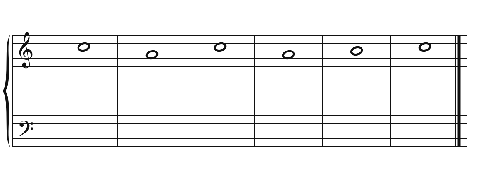

### Corrigés

**Exercice 26.1** : une solution parmi d'autres.

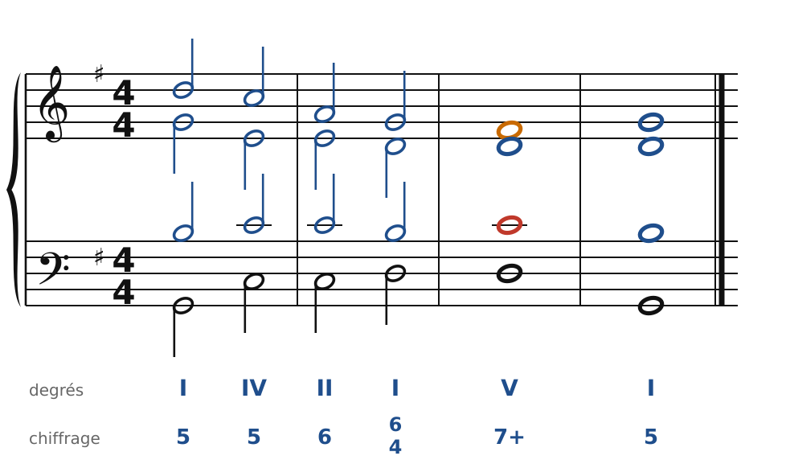

🔊 [Écouter](audio/c26-01-c.mp3) · [MIDI](audio/c26-01-c.mid)

Pour quatuor à cordes (en batteries) :

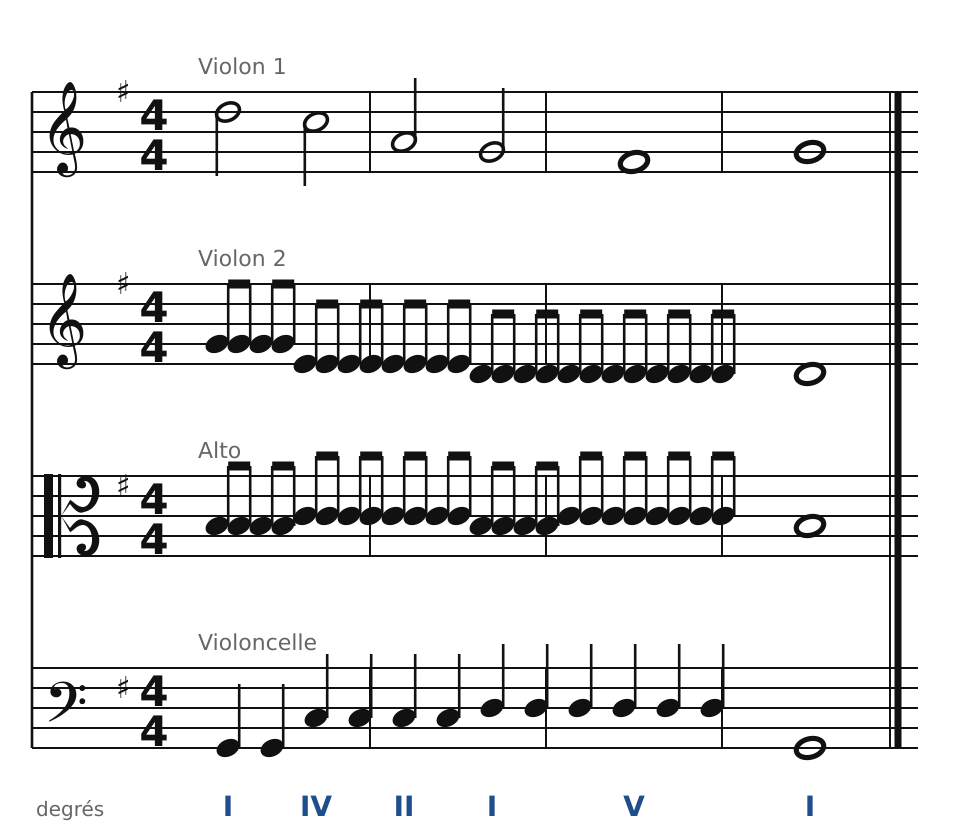

🔊 [Écouter](audio/c26-01-q.mp3) · [MIDI](audio/c26-01-q.mid)

**Exercice 26.2** : une solution parmi d'autres.

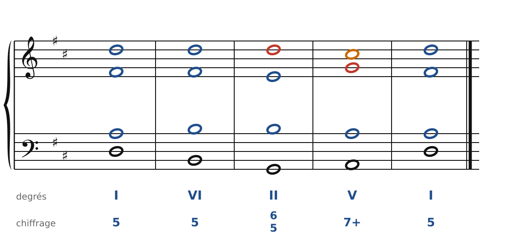

🔊 [Écouter](audio/c26-02-c.mp3) · [MIDI](audio/c26-02-c.mid)

Pour quatuor à cordes (avec une basse en octaves) :

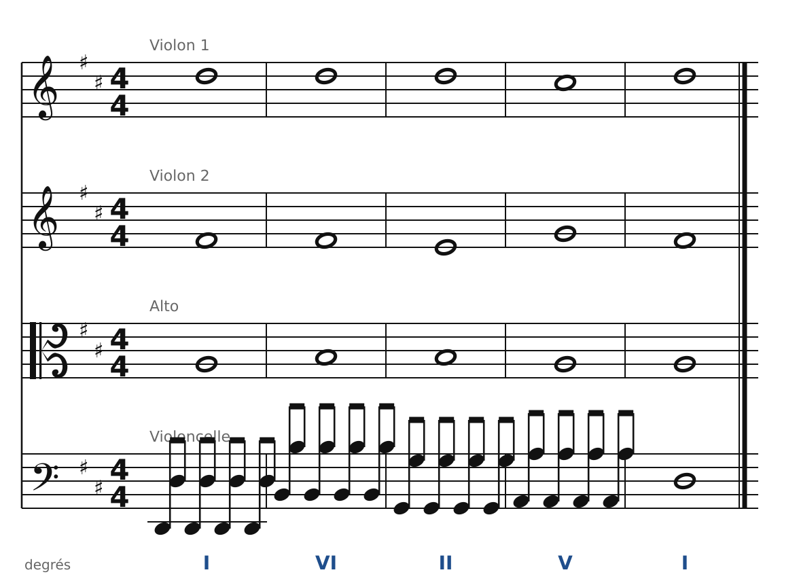

🔊 [Écouter](audio/c26-02-q.mp3) · [MIDI](audio/c26-02-q.mid)

**Exercice 26.3** : une solution parmi d'autres.

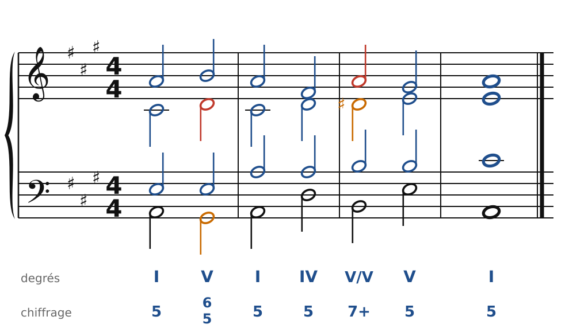

🔊 [Écouter](audio/c26-03-c.mp3) · [MIDI](audio/c26-03-c.mid)

Pour quatuor à cordes (en batteries) :

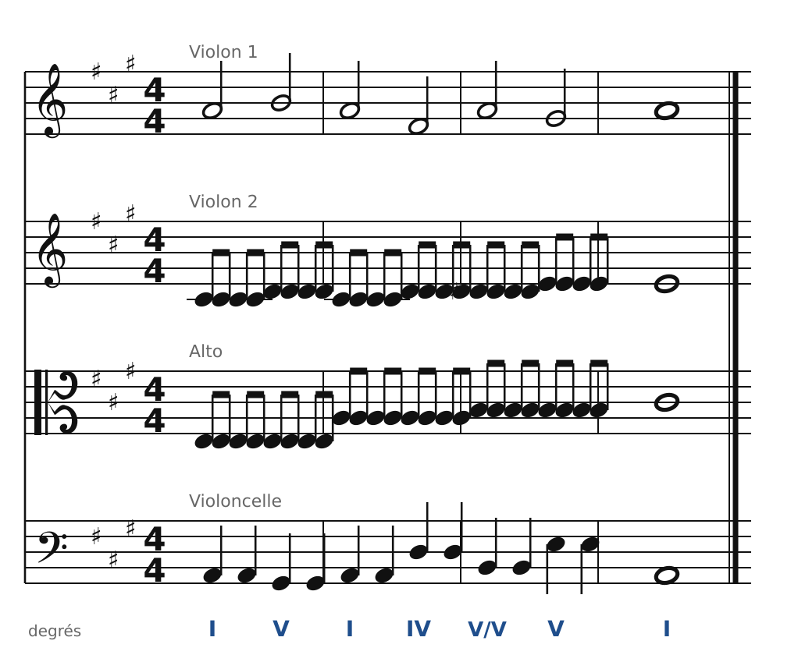

🔊 [Écouter](audio/c26-03-q.mp3) · [MIDI](audio/c26-03-q.mid)

**Exercice 26.4** : une solution parmi d'autres.

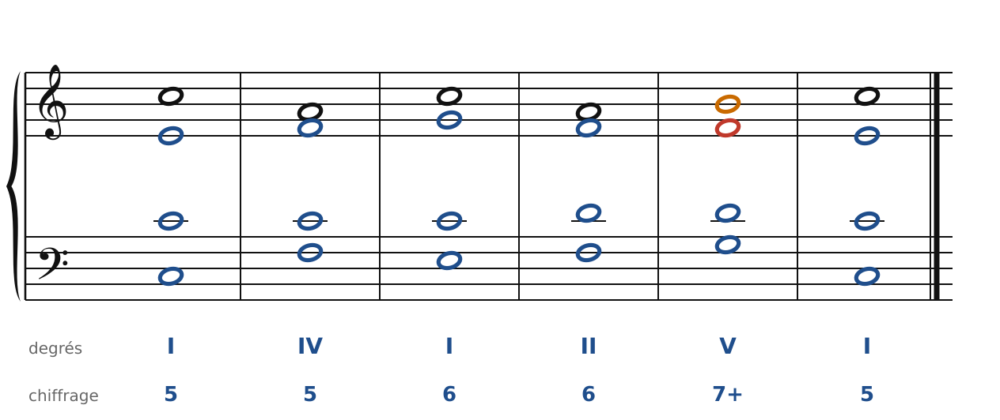

🔊 [Écouter](audio/c26-04-c.mp3) · [MIDI](audio/c26-04-c.mid)

Pour quatuor à cordes (en batteries) :

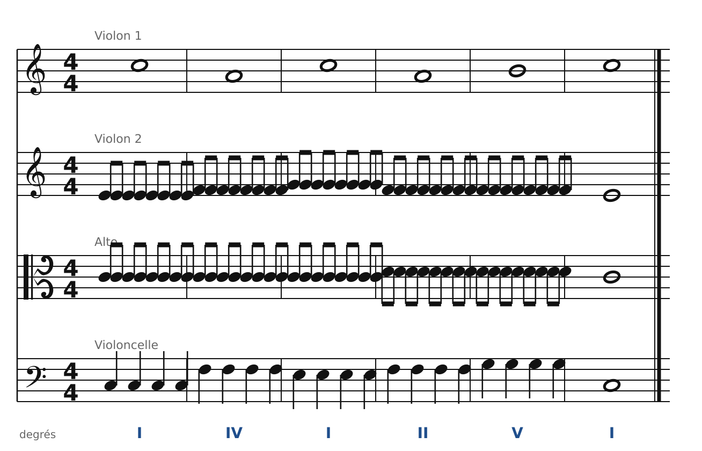

🔊 [Écouter](audio/c26-04-q.mp3) · [MIDI](audio/c26-04-q.mid)

---

[← Pédales et cadences classiques](25-pedales-et-cadences.md) · [Sommaire du cahier](README.md) · [L'emprunt au mineur et les modulations par tierces →](30-emprunts-et-modulations-par-tierces.md)
