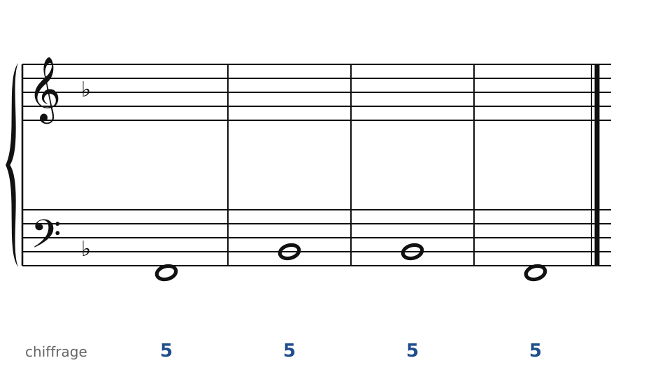
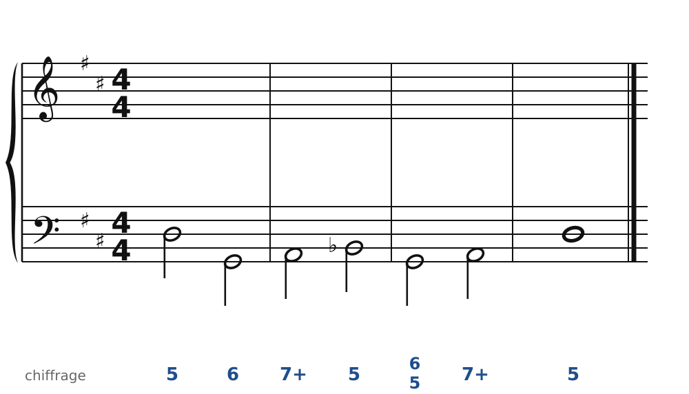
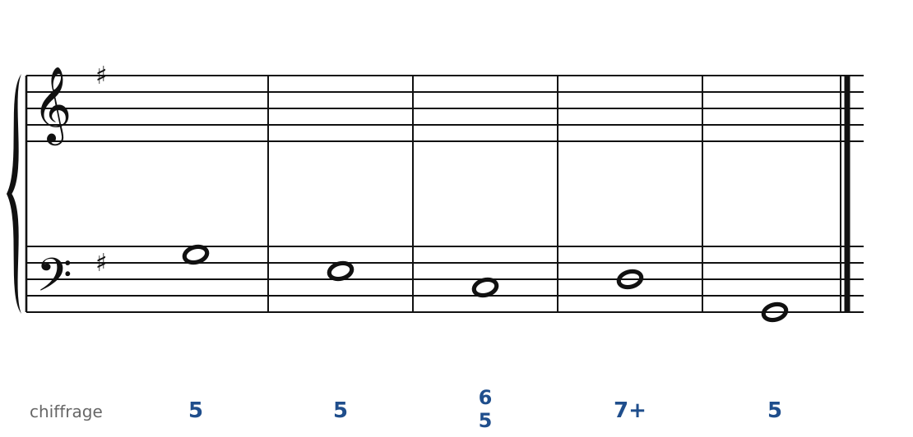
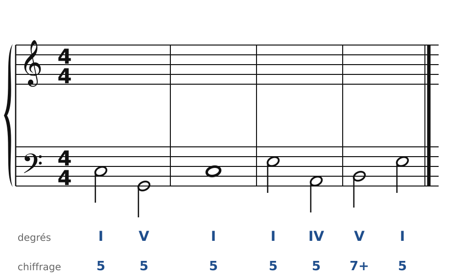
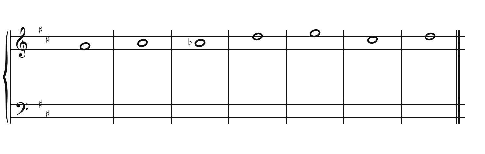
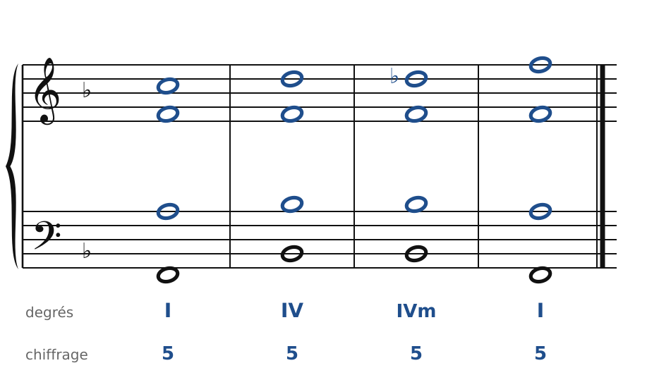
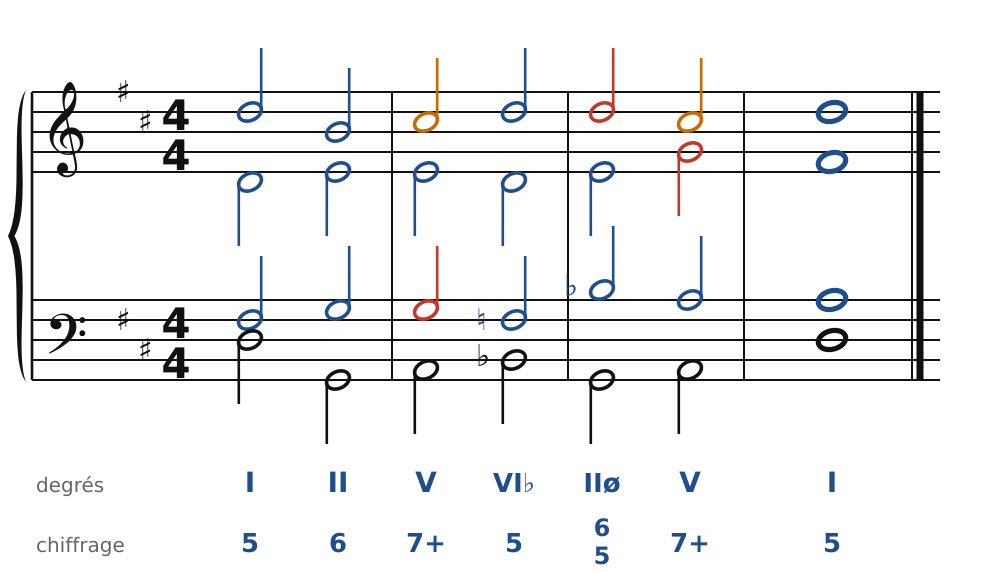
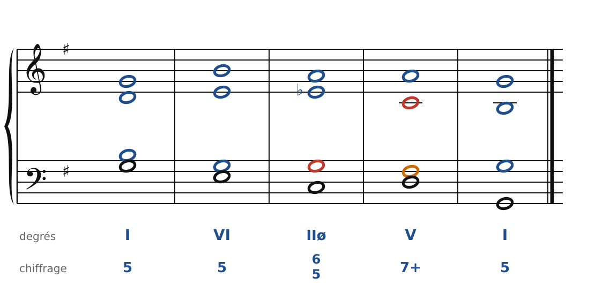
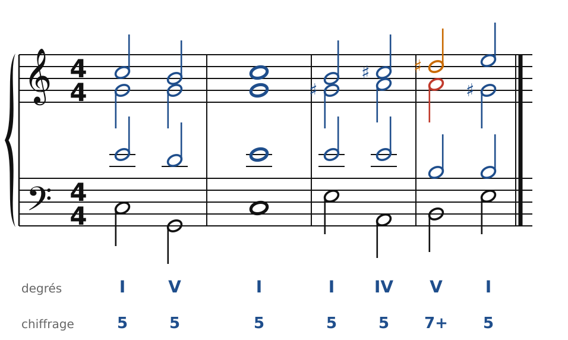
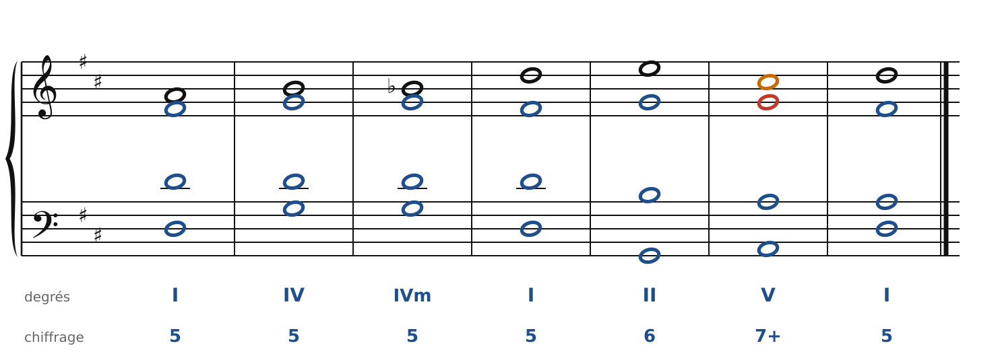

[← Écrire pour quatuor à cordes](26-ecrire-pour-quatuor.md) · [Sommaire du cahier](README.md) · [Le chromatisme →](31-le-chromatisme.md)

## L'emprunt au mineur et les modulations par tierces

Ces exercices accompagnent le [chapitre 30](../cours/30-l-emprunt-au-mode-mineur.md) du cours.

Dans la version web (`cahier.html`), chaque exercice se fait **directement sur la portée**, avec les corrections au fur et à mesure. Le menu des accords propose aussi les accords empruntés au mineur (IVm, VI♭, IIø7) et les dominantes secondaires. Attention aux **fausses relations** : une note altérée se prend dans la voix qui chantait la note naturelle.

### Exercice 30.1 · Basse chiffrée en Fa majeur (IV mineur)

Basse chiffrée : trouve les accords, écris le soprano, puis l'alto et le ténor.

### Exercice 30.2 · Basse chiffrée en Ré majeur (cadence rompue sur VI♭)

Basse chiffrée : trouve les accords, écris le soprano, puis l'alto et le ténor.

### Exercice 30.3 · Basse chiffrée en Sol majeur (IIø6/5)

Basse chiffrée : trouve les accords, écris le soprano, puis l'alto et le ténor.

### Exercice 30.4 · Basse donnée en Do majeur (modulation de Do à Mi majeur)

Basse donnée avec ses accords : écris le soprano, puis l'alto et le ténor.

### Exercice 30.5 · Chant donné en Ré majeur

Chant donné : choisis les accords, écris la basse, puis l'alto et le ténor.

### Corrigés

**Exercice 30.1** : une solution parmi d'autres.

🔊 [Écouter](audio/c30-01-c.mp3) · [MIDI](audio/c30-01-c.mid)

**Exercice 30.2** : une solution parmi d'autres.

🔊 [Écouter](audio/c30-02-c.mp3) · [MIDI](audio/c30-02-c.mid)

**Exercice 30.3** : une solution parmi d'autres.

🔊 [Écouter](audio/c30-03-c.mp3) · [MIDI](audio/c30-03-c.mid)

**Exercice 30.4** : une solution parmi d'autres.

🔊 [Écouter](audio/c30-04-c.mp3) · [MIDI](audio/c30-04-c.mid)

**Exercice 30.5** : une solution parmi d'autres.

🔊 [Écouter](audio/c30-05-c.mp3) · [MIDI](audio/c30-05-c.mid)

---

[← Écrire pour quatuor à cordes](26-ecrire-pour-quatuor.md) · [Sommaire du cahier](README.md) · [Le chromatisme →](31-le-chromatisme.md)
