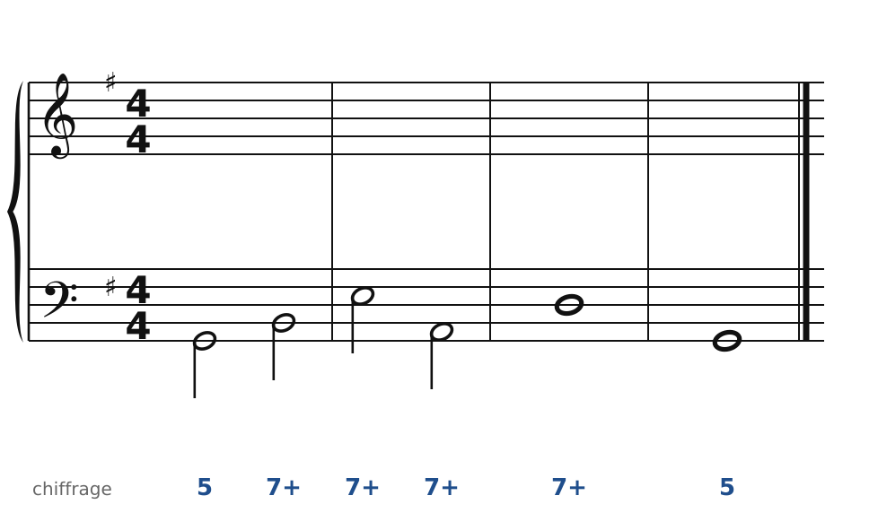
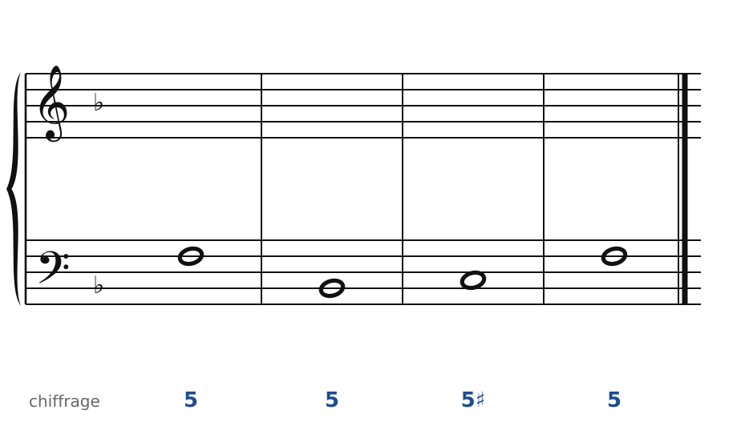
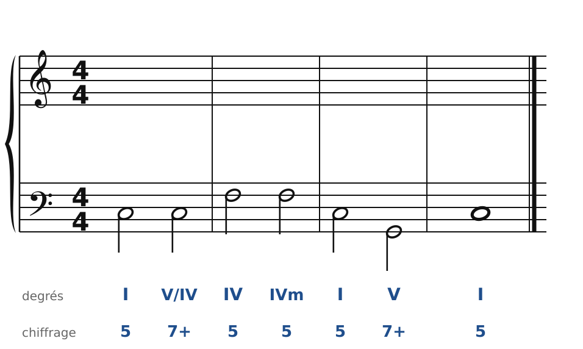
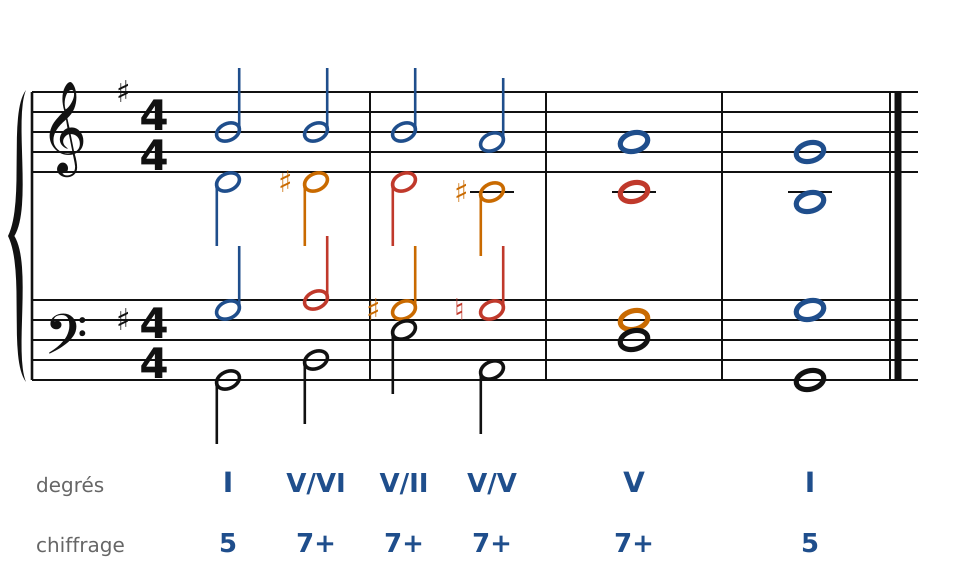
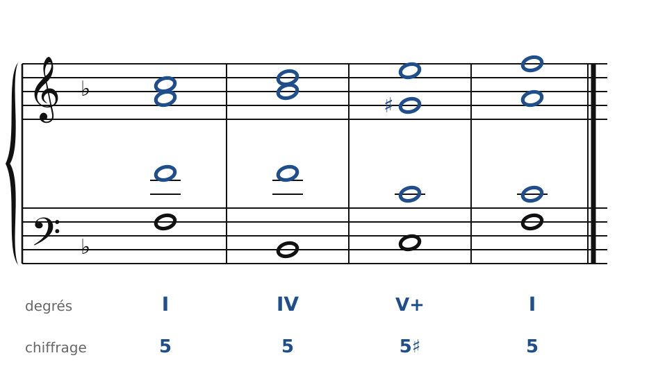
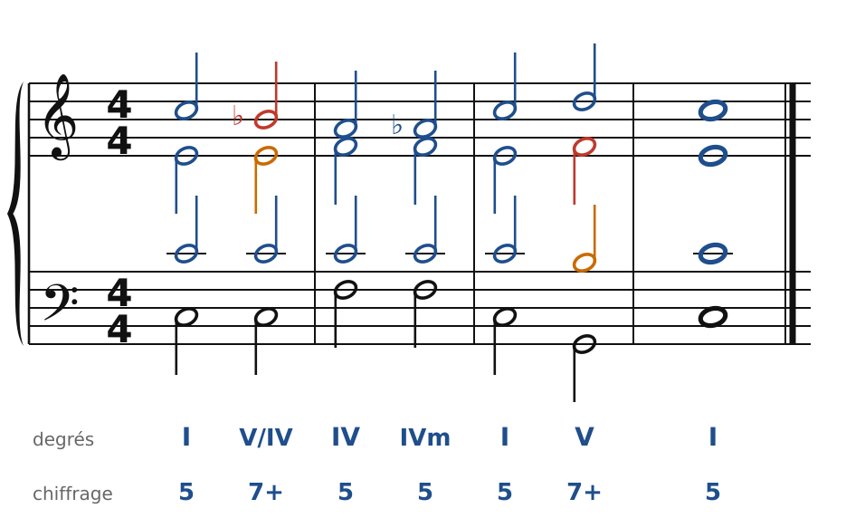

[← L'emprunt au mineur et les modulations par tierces](30-emprunts-et-modulations-par-tierces.md) · [Sommaire du cahier](README.md) · [Du piano aux quatre voix →](32-du-piano-aux-quatre-voix.md)

## Le chromatisme

Ces exercices accompagnent le [chapitre 31](../cours/31-le-chromatisme.md) du cours.

Dans la version web (`cahier.html`), chaque exercice se fait **directement sur la portée**, avec les corrections au fur et à mesure. Le menu des accords propose aussi les accords empruntés au mineur (IVm, VI♭, IIø7) et les dominantes secondaires. Attention aux **fausses relations** : une note altérée se prend dans la voix qui chantait la note naturelle.

### Exercice 31.1 · Basse chiffrée en Sol majeur (chaîne de dominantes)

Basse chiffrée : trouve les accords, écris le soprano, puis l'alto et le ténor.

### Exercice 31.2 · Basse chiffrée en Fa majeur (dominante à quinte augmentée)

Basse chiffrée : trouve les accords, écris le soprano, puis l'alto et le ténor.

### Exercice 31.3 · Basse donnée en Do majeur (V7/IV puis IV mineur)

Basse donnée avec ses accords : écris le soprano, puis l'alto et le ténor.

### Corrigés

**Exercice 31.1** : une solution parmi d'autres.

🔊 [Écouter](audio/c31-01-c.mp3) · [MIDI](audio/c31-01-c.mid)

**Exercice 31.2** : une solution parmi d'autres.

🔊 [Écouter](audio/c31-02-c.mp3) · [MIDI](audio/c31-02-c.mid)

**Exercice 31.3** : une solution parmi d'autres.

🔊 [Écouter](audio/c31-03-c.mp3) · [MIDI](audio/c31-03-c.mid)

---

[← L'emprunt au mineur et les modulations par tierces](30-emprunts-et-modulations-par-tierces.md) · [Sommaire du cahier](README.md) · [Du piano aux quatre voix →](32-du-piano-aux-quatre-voix.md)
