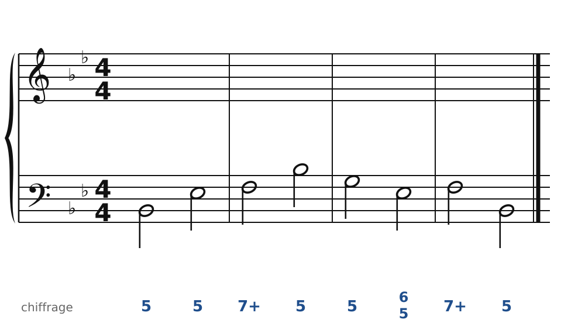
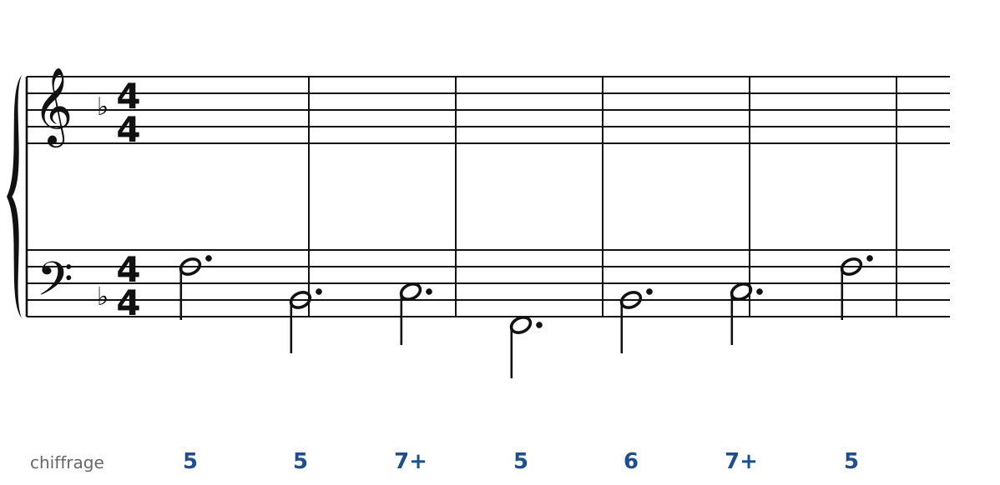
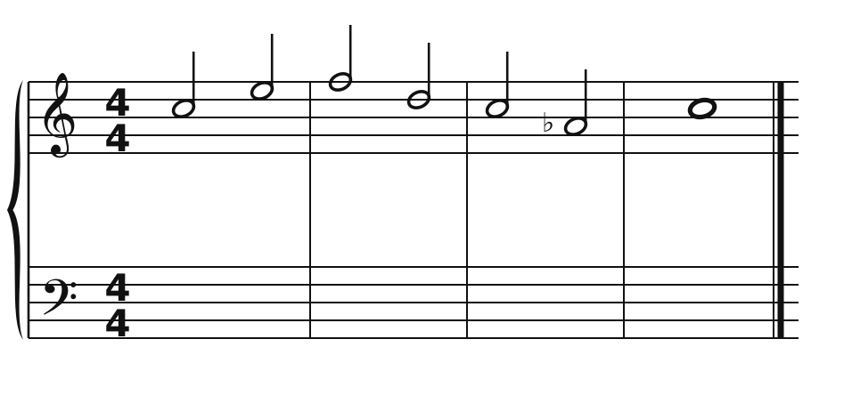
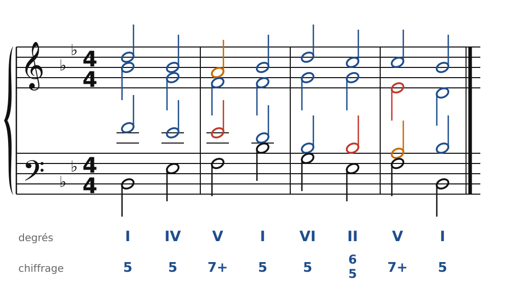
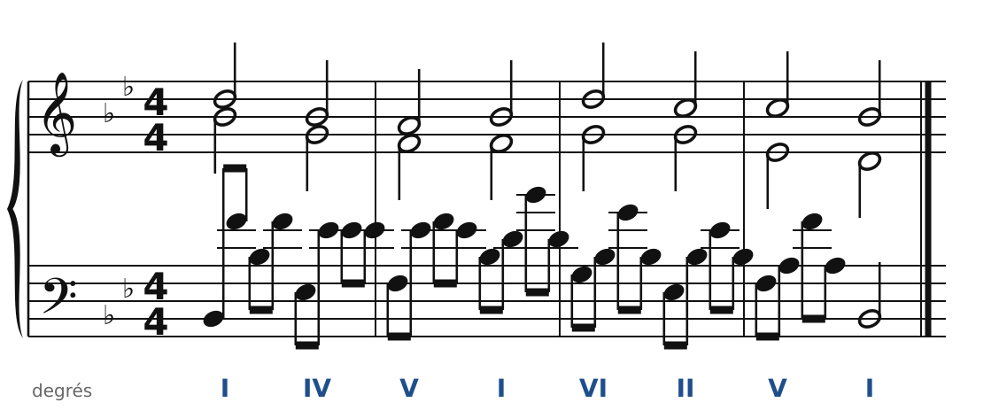
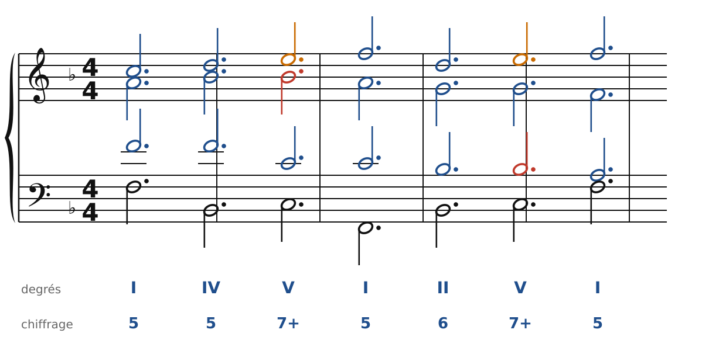
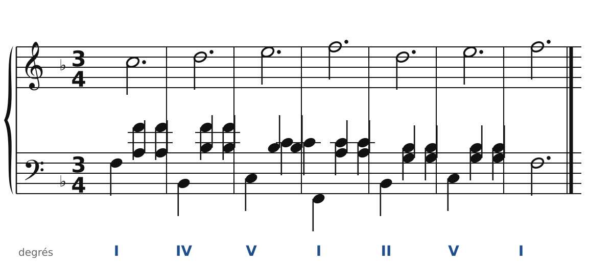
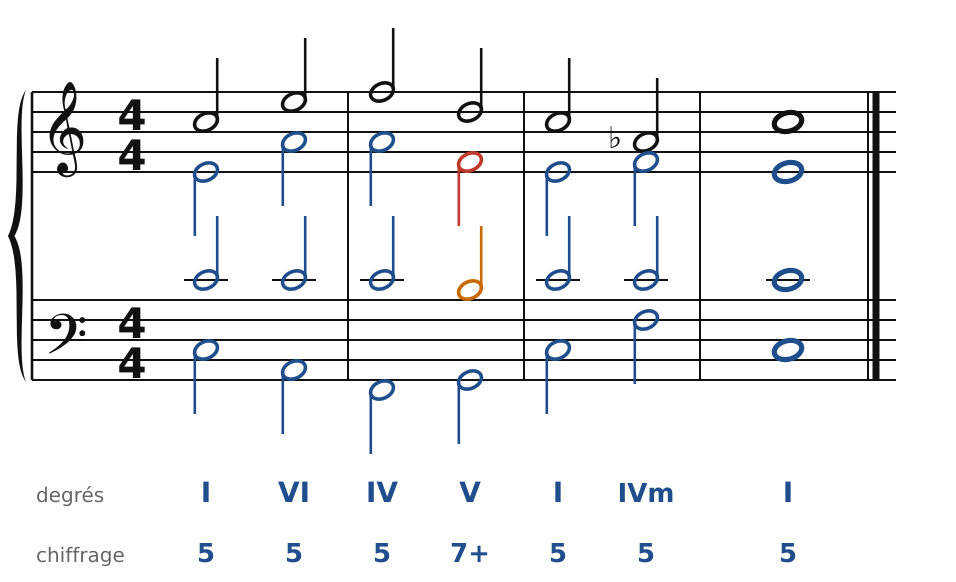
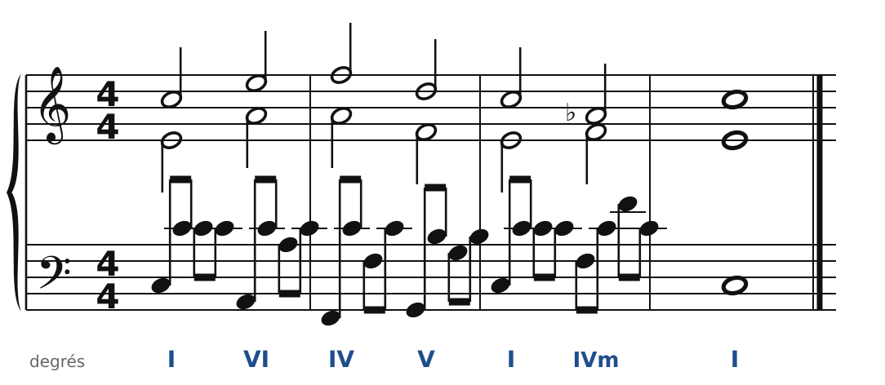

[← Le chromatisme](31-le-chromatisme.md) · [Sommaire du cahier](README.md) · [Enharmonie et modulations éloignées →](36-enharmonie.md)

## Du piano aux quatre voix

Ces exercices accompagnent le [chapitre 32](../cours/32-du-piano-aux-quatre-voix.md) du cours.

Dans la version web (`cahier.html`), chaque exercice se fait **directement sur la portée**, avec les corrections au fur et à mesure. Le menu des accords propose aussi les accords empruntés au mineur (IVm, VI♭, IIø7) et les dominantes secondaires. Attention aux **fausses relations** : une note altérée se prend dans la voix qui chantait la note naturelle.

Ici, on réalise d'abord l'exercice à quatre voix, sur la grande portée. Puis, **sur papier**, on le récrit pour piano avec la texture demandée (voir le [chapitre 32](../cours/32-du-piano-aux-quatre-voix.md)). Les corrigés montrent les deux versions.

### Exercice 32.1 · Basse chiffrée en Si♭ majeur (puis en arpèges)

Basse chiffrée : trouve les accords, écris le soprano, puis l'alto et le ténor.

### Exercice 32.2 · Basse chiffrée en Fa majeur (puis en valse)

Basse chiffrée : trouve les accords, écris le soprano, puis l'alto et le ténor.

### Exercice 32.3 · Chant donné en Do majeur (puis en arpèges)

Chant donné : choisis les accords, écris la basse, puis l'alto et le ténor.

### Corrigés

**Exercice 32.1** : une solution parmi d'autres.

🔊 [Écouter](audio/c32-01-c.mp3) · [MIDI](audio/c32-01-c.mid)

Pour piano (en arpèges) :

🔊 [Écouter](audio/c32-01-p.mp3) · [MIDI](audio/c32-01-p.mid)

**Exercice 32.2** : une solution parmi d'autres.

🔊 [Écouter](audio/c32-02-c.mp3) · [MIDI](audio/c32-02-c.mid)

Pour piano (en valse) :

🔊 [Écouter](audio/c32-02-p.mp3) · [MIDI](audio/c32-02-p.mid)

**Exercice 32.3** : une solution parmi d'autres.

🔊 [Écouter](audio/c32-03-c.mp3) · [MIDI](audio/c32-03-c.mid)

Pour piano (en arpèges) :

🔊 [Écouter](audio/c32-03-p.mp3) · [MIDI](audio/c32-03-p.mid)

---

[← Le chromatisme](31-le-chromatisme.md) · [Sommaire du cahier](README.md) · [Enharmonie et modulations éloignées →](36-enharmonie.md)
