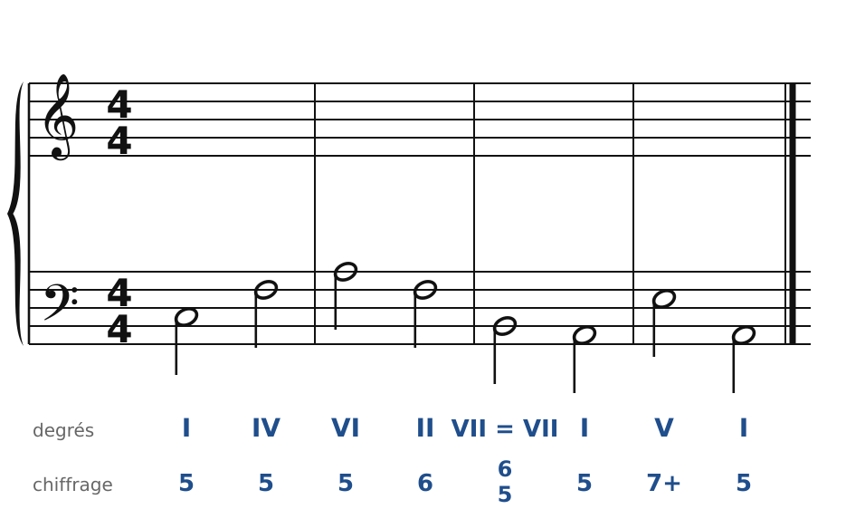
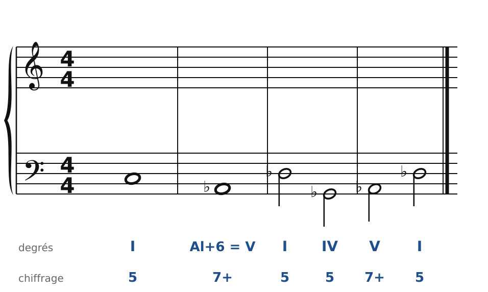
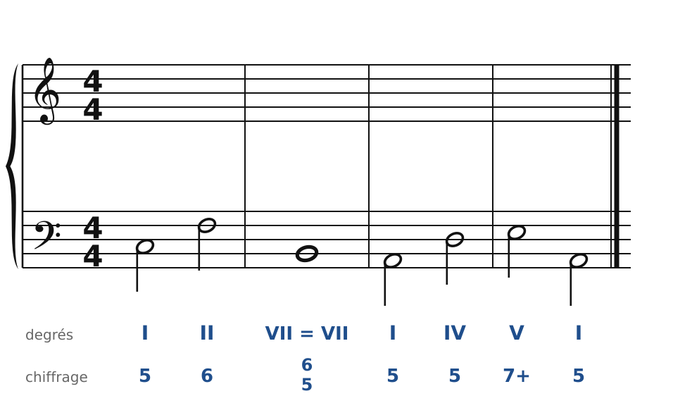
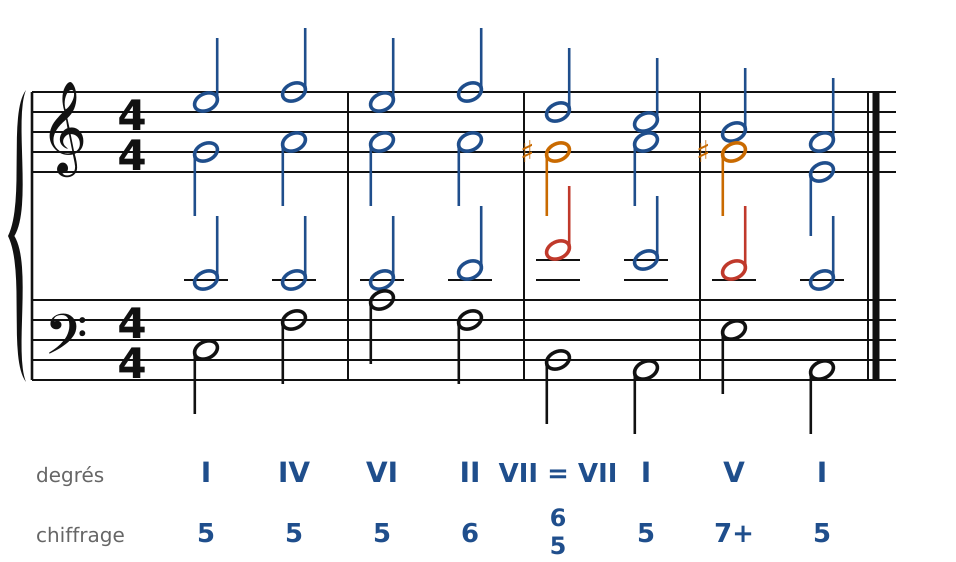
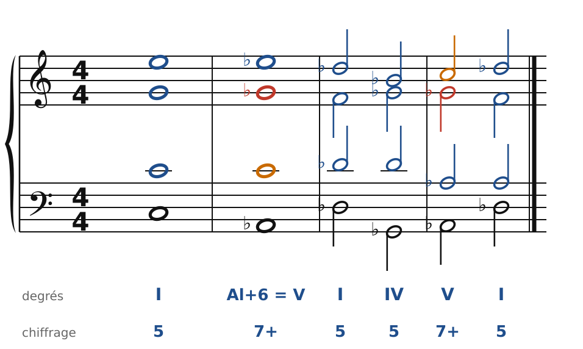
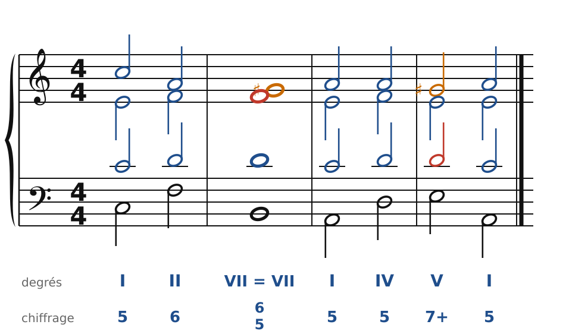

[← Du piano aux quatre voix](32-du-piano-aux-quatre-voix.md) · [Sommaire du cahier](README.md) · [L'accord augmenté et les tierces →](37-modulations-par-tierces.md)

## Enharmonie et modulations éloignées

Ces exercices accompagnent le [chapitre 36](../cours/36-enharmonie-et-modulations-eloignees.md) du cours.

Dans la version web (`cahier.html`), chaque exercice se fait **directement sur la portée**, avec les corrections au fur et à mesure. Dans les modulations, les altérations se font dans la même voix (pas de fausse relation), et la nouvelle sensible monte.

### Exercice 36.1 · Basse donnée en Do majeur (de Do majeur à la mineur par une 7e diminuée)

Basse donnée avec ses accords : écris le soprano, puis l'alto et le ténor.

### Exercice 36.2 · Basse donnée en Do majeur (de Do majeur à Ré♭ majeur : la sixte allemande devient V7)

Basse donnée avec ses accords : écris le soprano, puis l'alto et le ténor.

### Exercice 36.3 · Basse donnée en Do majeur (de Do majeur à la mineur)

Basse donnée avec ses accords : écris le soprano, puis l'alto et le ténor.

### Corrigés

**Exercice 36.1** : une solution parmi d'autres.

🔊 [Écouter](audio/c36-01-c.mp3) · [MIDI](audio/c36-01-c.mid)

**Exercice 36.2** : une solution parmi d'autres.

🔊 [Écouter](audio/c36-02-c.mp3) · [MIDI](audio/c36-02-c.mid)

**Exercice 36.3** : une solution parmi d'autres.

🔊 [Écouter](audio/c36-03-c.mp3) · [MIDI](audio/c36-03-c.mid)

---

[← Du piano aux quatre voix](32-du-piano-aux-quatre-voix.md) · [Sommaire du cahier](README.md) · [L'accord augmenté et les tierces →](37-modulations-par-tierces.md)
