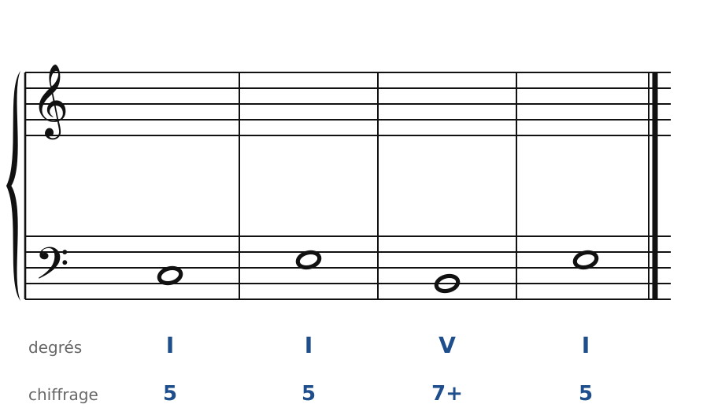
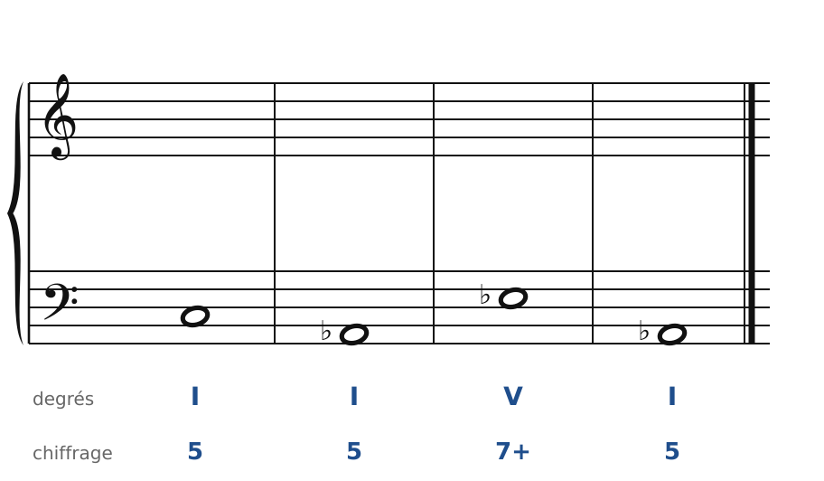
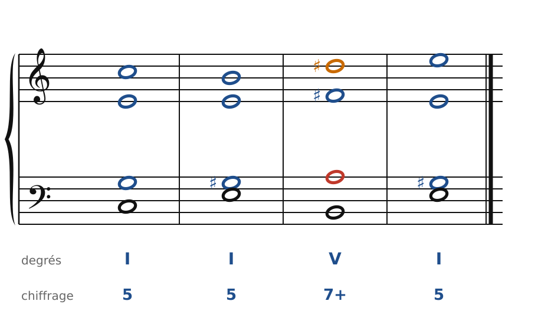
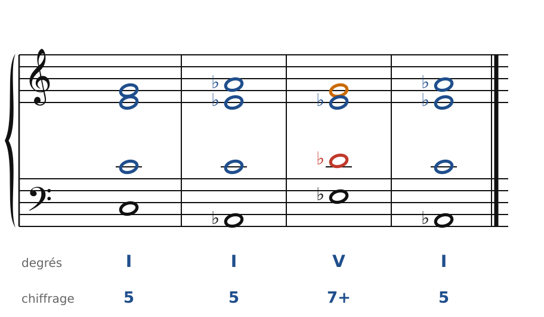

[← Enharmonie et modulations éloignées](36-enharmonie.md) · [Sommaire du cahier](README.md) · [Wagner : cadences évitées et glissements →](38-wagner.md)

## L'accord augmenté et les tierces

Ces exercices accompagnent le [chapitre 37](../cours/37-l-accord-augmente-et-les-tierces.md) du cours.

Dans la version web (`cahier.html`), chaque exercice se fait **directement sur la portée**, avec les corrections au fur et à mesure. Dans les modulations, les altérations se font dans la même voix (pas de fausse relation), et la nouvelle sensible monte.

### Exercice 37.1 · Basse donnée en Do majeur (de Do à Mi par une tierce)

Basse donnée avec ses accords : écris le soprano, puis l'alto et le ténor.

### Exercice 37.2 · Basse donnée en Do majeur (de Do à La♭ par une tierce)

Basse donnée avec ses accords : écris le soprano, puis l'alto et le ténor.

### Corrigés

**Exercice 37.1** : une solution parmi d'autres.

🔊 [Écouter](audio/c37-01-c.mp3) · [MIDI](audio/c37-01-c.mid)

**Exercice 37.2** : une solution parmi d'autres.

🔊 [Écouter](audio/c37-02-c.mp3) · [MIDI](audio/c37-02-c.mid)

---

[← Enharmonie et modulations éloignées](36-enharmonie.md) · [Sommaire du cahier](README.md) · [Wagner : cadences évitées et glissements →](38-wagner.md)
