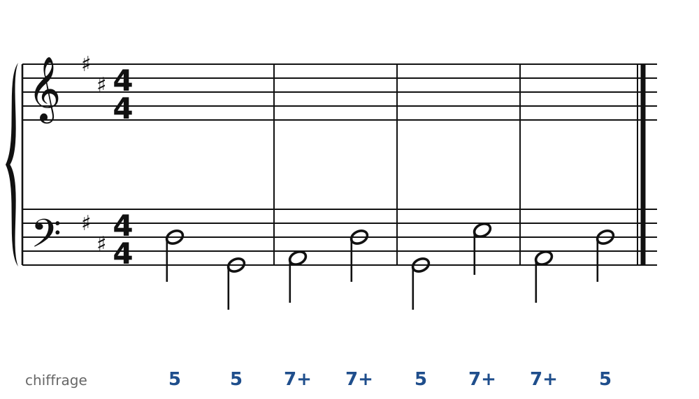
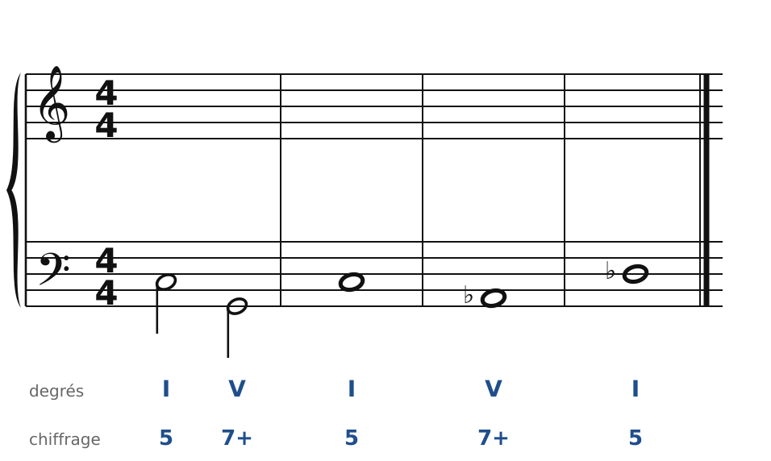
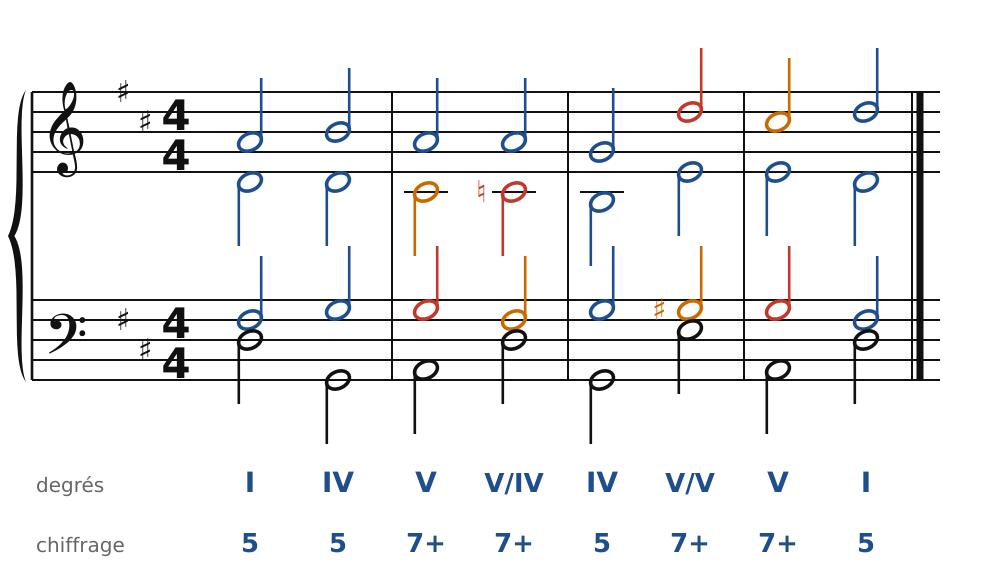
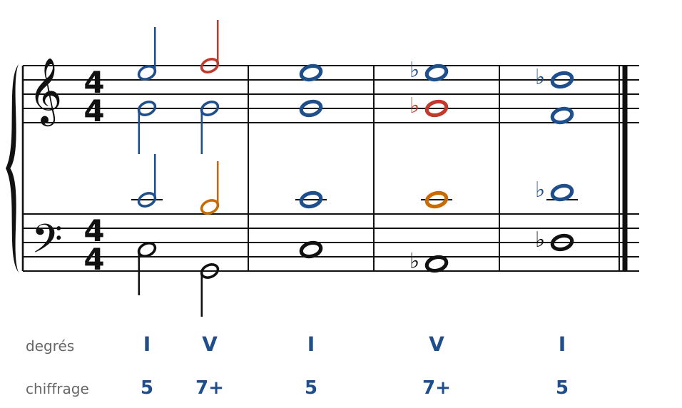

[← L'accord augmenté et les tierces](37-modulations-par-tierces.md) · [Sommaire du cahier](README.md) · [Franck et Mahler : majeur et mineur →](39-majeur-et-mineur.md)

## Wagner : cadences évitées et glissements

Ces exercices accompagnent le [chapitre 38](../cours/38-wagner-l-accord-de-tristan.md) du cours.

Dans la version web (`cahier.html`), chaque exercice se fait **directement sur la portée**, avec les corrections au fur et à mesure. Dans les modulations, les altérations se font dans la même voix (pas de fausse relation), et la nouvelle sensible monte.

### Exercice 38.1 · Basse chiffrée en Ré majeur (cadence évitée)

Basse chiffrée : trouve les accords, écris le soprano, puis l'alto et le ténor.

### Exercice 38.2 · Basse donnée en Do majeur (glissement d'un demi-ton)

Basse donnée avec ses accords : écris le soprano, puis l'alto et le ténor.

### Corrigés

**Exercice 38.1** : une solution parmi d'autres.

🔊 [Écouter](audio/c38-01-c.mp3) · [MIDI](audio/c38-01-c.mid)

**Exercice 38.2** : une solution parmi d'autres.

🔊 [Écouter](audio/c38-02-c.mp3) · [MIDI](audio/c38-02-c.mid)

---

[← L'accord augmenté et les tierces](37-modulations-par-tierces.md) · [Sommaire du cahier](README.md) · [Franck et Mahler : majeur et mineur →](39-majeur-et-mineur.md)
