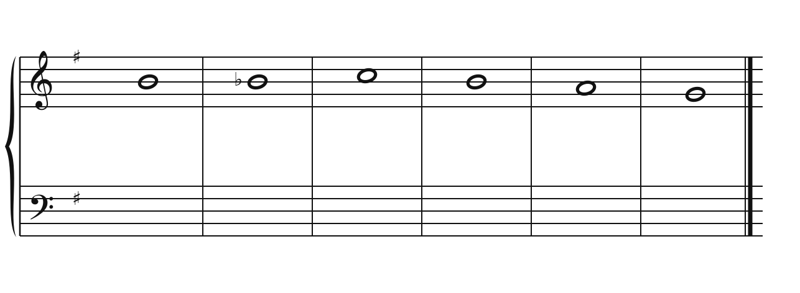
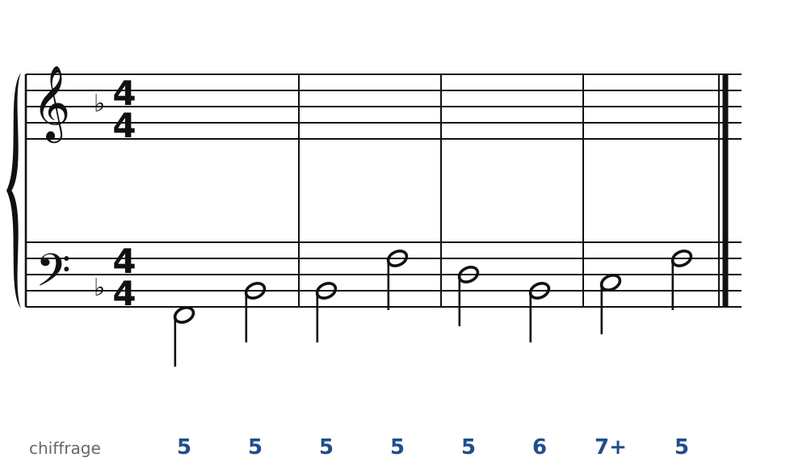
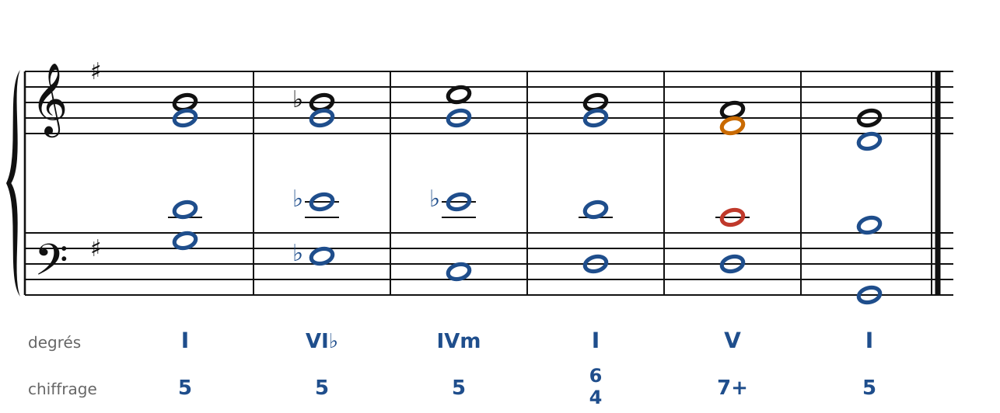
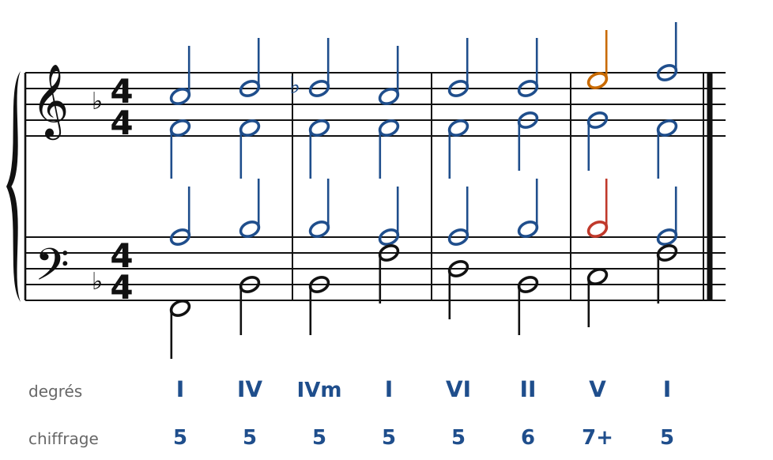

[← Wagner : cadences évitées et glissements](38-wagner.md) · [Sommaire du cahier](README.md) · [Fauré : modes et glissements →](43-faure.md)

## Franck et Mahler : majeur et mineur

Ces exercices accompagnent le [chapitre 39](../cours/39-franck-et-mahler.md) du cours.

Dans la version web (`cahier.html`), chaque exercice se fait **directement sur la portée**, avec les corrections au fur et à mesure. Dans les modulations, les altérations se font dans la même voix (pas de fausse relation), et la nouvelle sensible monte.

### Exercice 39.1 · Chant donné en Sol majeur (majeur et mineur mêlés)

Chant donné : choisis les accords, écris la basse, puis l'alto et le ténor.

### Exercice 39.2 · Basse chiffrée en Fa majeur (l'ombre du mineur)

Basse chiffrée : trouve les accords, écris le soprano, puis l'alto et le ténor.

### Corrigés

**Exercice 39.1** : une solution parmi d'autres.

🔊 [Écouter](audio/c39-01-c.mp3) · [MIDI](audio/c39-01-c.mid)

**Exercice 39.2** : une solution parmi d'autres.

🔊 [Écouter](audio/c39-02-c.mp3) · [MIDI](audio/c39-02-c.mid)

---

[← Wagner : cadences évitées et glissements](38-wagner.md) · [Sommaire du cahier](README.md) · [Fauré : modes et glissements →](43-faure.md)
