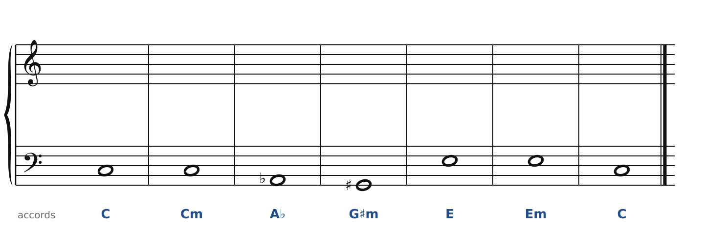
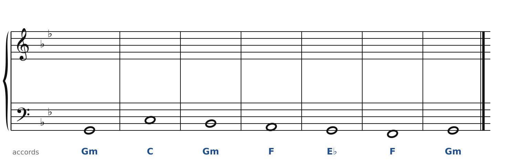
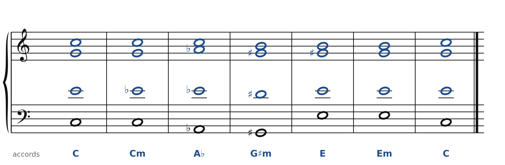
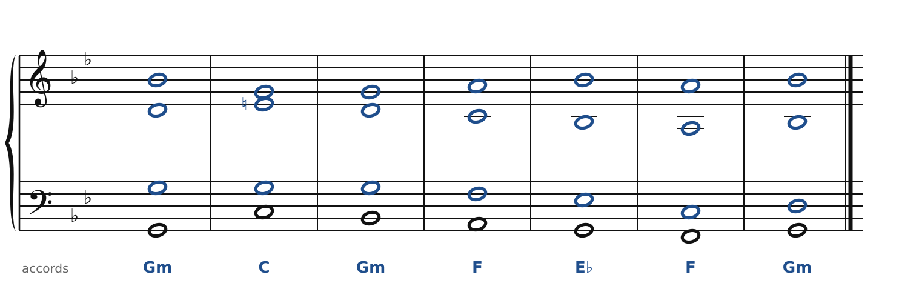

[← Franck et Mahler : majeur et mineur](39-majeur-et-mineur.md) · [Sommaire du cahier](README.md) · [Debussy : accords parallèles, gamme par tons →](44-debussy.md)

## Fauré : modes et glissements

Ces exercices accompagnent le [chapitre 43](../cours/43-faure-couleurs-modales.md) du cours.

Dans la version web (`cahier.html`), chaque exercice se fait **directement sur la portée**, avec les corrections au fur et à mesure. Ici, plus de règles d'enchaînement classiques (les quintes parallèles sont permises) : on vérifie que chaque accord contient les bonnes notes, sans croisement et dans la tessiture de chaque voix.

### Exercice 43.1 · les glissements (une voix bouge d'un demi-ton)

La basse et les accords sont donnés. Écris le soprano, l'alto et le ténor avec les trois notes de chaque accord. Le but : qu'à chaque changement, **une seule voix** bouge, d'un demi-ton (les autres restent ou changent seulement de nom, comme La♭ = Sol♯).

### Exercice 43.2 · sol dorien (Mi naturel)

La basse et les accords sont donnés. Écris le soprano, l'alto et le ténor : chaque accord doit contenir les notes indiquées entre parenthèses. Pas de règle d'enchaînement ici, mais cherche le chemin le plus court pour chaque voix.

### Corrigés

**Exercice 43.1** : une solution parmi d'autres.

🔊 [Écouter](audio/c43-01-c.mp3) · [MIDI](audio/c43-01-c.mid)

**Exercice 43.2** : une solution parmi d'autres.

🔊 [Écouter](audio/c43-02-c.mp3) · [MIDI](audio/c43-02-c.mid)

---

[← Franck et Mahler : majeur et mineur](39-majeur-et-mineur.md) · [Sommaire du cahier](README.md) · [Debussy : accords parallèles, gamme par tons →](44-debussy.md)
