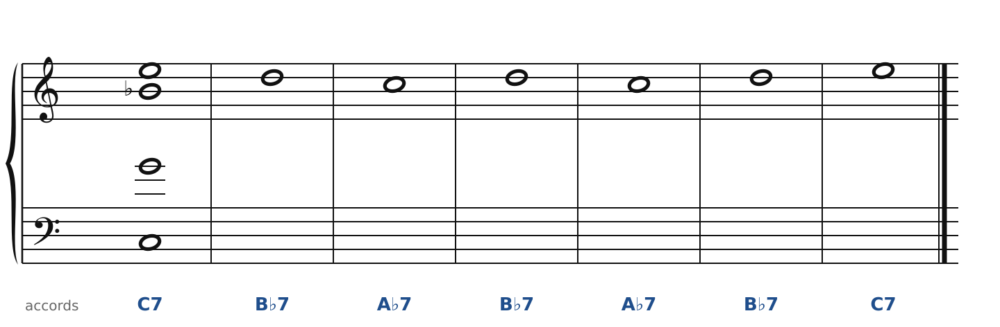
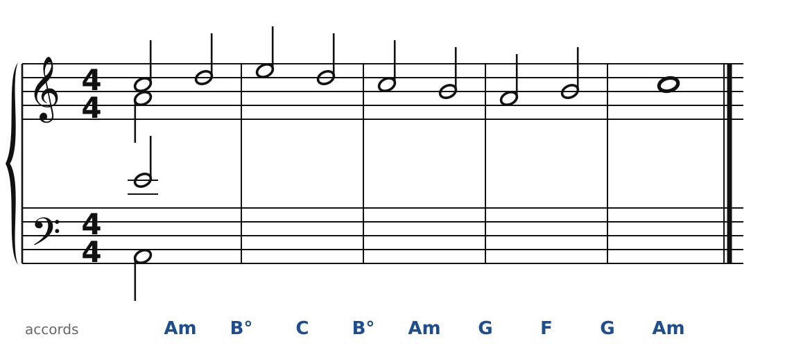
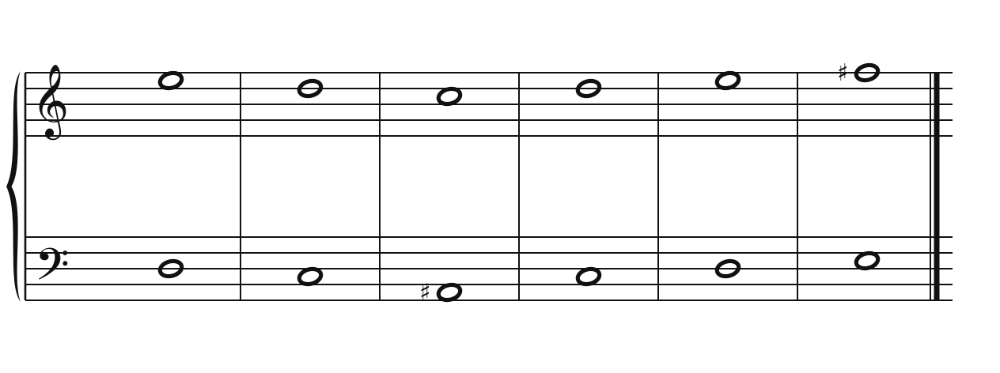
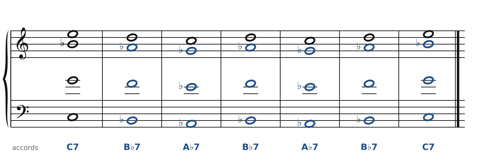
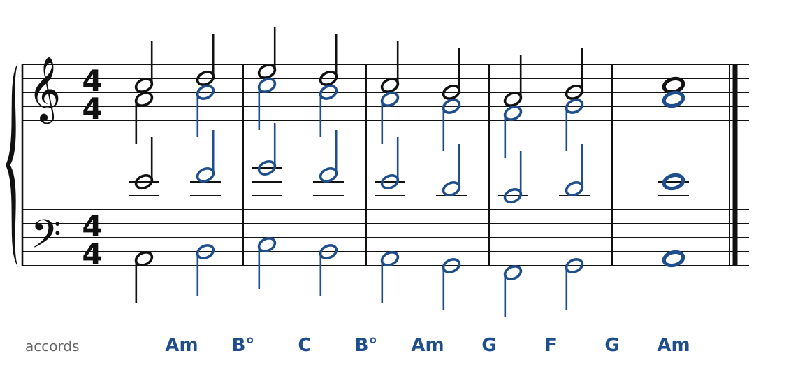
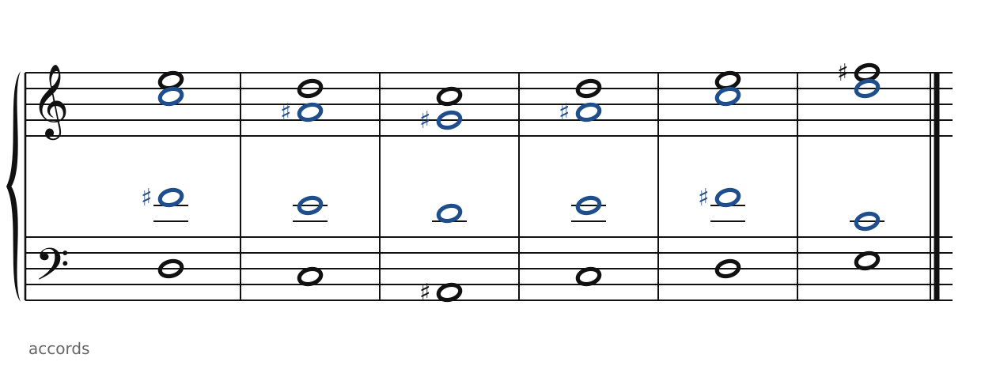

[← Fauré : modes et glissements](43-faure.md) · [Sommaire du cahier](README.md) · [Ravel : 7e, 9e et 13e →](45-ravel.md)

## Debussy : accords parallèles, gamme par tons

Ces exercices accompagnent le [chapitre 44](../cours/44-debussy.md) du cours.

Dans la version web (`cahier.html`), chaque exercice se fait **directement sur la portée**, avec les corrections au fur et à mesure. Ici, plus de règles d'enchaînement classiques (les quintes parallèles sont permises) : on vérifie que chaque accord contient les bonnes notes, sans croisement et dans la tessiture de chaque voix.

### Exercice 44.1 · accords de 7e parallèles

Le premier accord est donné, ainsi que la mélodie. Recopie la **même disposition** sous chaque note du soprano : chaque voix bouge exactement du même intervalle (accords parallèles « réels », à la Debussy).

### Exercice 44.2 · accords parallèles dans la gamme (la éolien)

Le premier accord est donné, ainsi que la mélodie. Les voix suivent le soprano **dans la gamme** (sans altération) : même nombre de degrés entre les voix, même si les tierces deviennent tantôt majeures, tantôt mineures.

### Exercice 44.3 · la gamme par tons

Le soprano et la basse sont donnés. Écris l'alto et le ténor avec des notes de la **gamme par tons** sur Do (Do, Ré, Mi, Fa♯, Sol♯, La♯). Toutes les combinaisons sonnent « en suspens » : il n'y a plus de tonique.

### Corrigés

**Exercice 44.1** : une solution parmi d'autres.

🔊 [Écouter](audio/c44-01-c.mp3) · [MIDI](audio/c44-01-c.mid)

**Exercice 44.2** : une solution parmi d'autres.

🔊 [Écouter](audio/c44-02-c.mp3) · [MIDI](audio/c44-02-c.mid)

**Exercice 44.3** : une solution parmi d'autres.

🔊 [Écouter](audio/c44-03-c.mp3) · [MIDI](audio/c44-03-c.mid)

---

[← Fauré : modes et glissements](43-faure.md) · [Sommaire du cahier](README.md) · [Ravel : 7e, 9e et 13e →](45-ravel.md)
