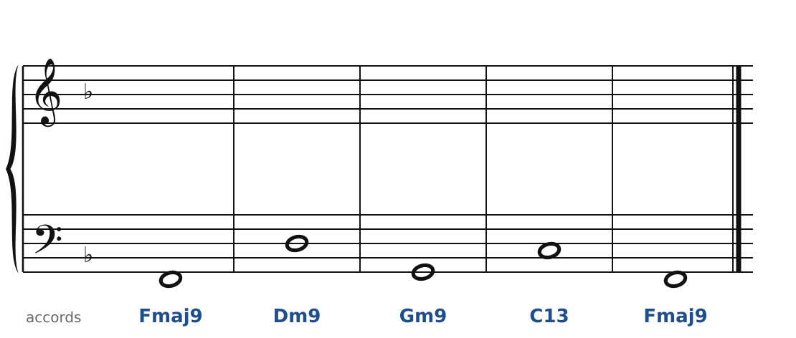
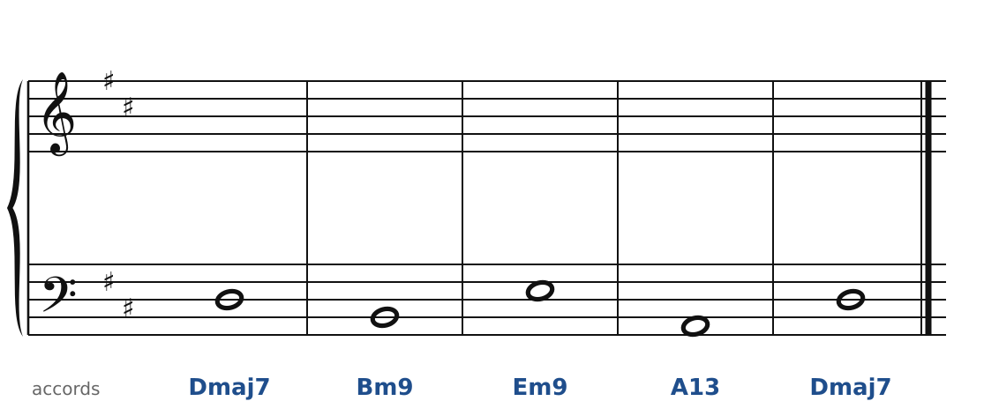
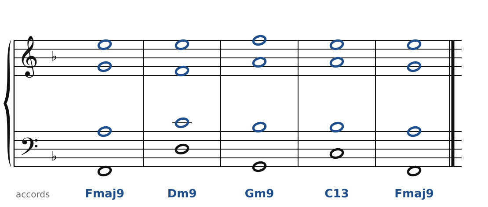
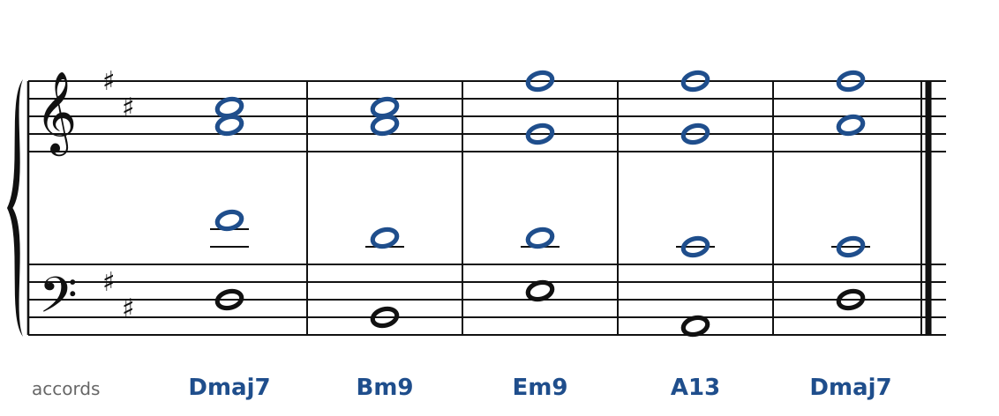

[← Debussy : accords parallèles, gamme par tons](44-debussy.md) · [Sommaire du cahier](README.md) · [Vers le jazz : II-V-I et substitutions →](46-vers-le-jazz.md)

## Ravel : 7e, 9e et 13e

Ces exercices accompagnent le [chapitre 45](../cours/45-ravel.md) du cours.

Dans la version web (`cahier.html`), chaque exercice se fait **directement sur la portée**, avec les corrections au fur et à mesure. Ici, plus de règles d'enchaînement classiques (les quintes parallèles sont permises) : on vérifie que chaque accord contient les bonnes notes, sans croisement et dans la tessiture de chaque voix.

### Exercice 45.1 · 9e et 13e

La basse et les accords sont donnés. Écris le soprano, l'alto et le ténor : chaque accord doit contenir les notes indiquées entre parenthèses. Pas de règle d'enchaînement ici, mais cherche le chemin le plus court pour chaque voix.

### Exercice 45.2 · septièmes majeures et 9e

La basse et les accords sont donnés. Écris le soprano, l'alto et le ténor : chaque accord doit contenir les notes indiquées entre parenthèses. Pas de règle d'enchaînement ici, mais cherche le chemin le plus court pour chaque voix.

### Corrigés

**Exercice 45.1** : une solution parmi d'autres.

🔊 [Écouter](audio/c45-01-c.mp3) · [MIDI](audio/c45-01-c.mid)

**Exercice 45.2** : une solution parmi d'autres.

🔊 [Écouter](audio/c45-02-c.mp3) · [MIDI](audio/c45-02-c.mid)

---

[← Debussy : accords parallèles, gamme par tons](44-debussy.md) · [Sommaire du cahier](README.md) · [Vers le jazz : II-V-I et substitutions →](46-vers-le-jazz.md)
