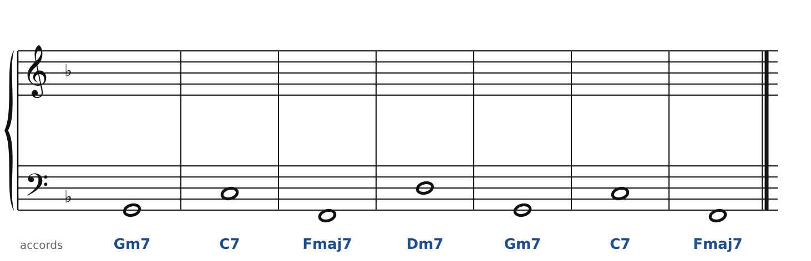
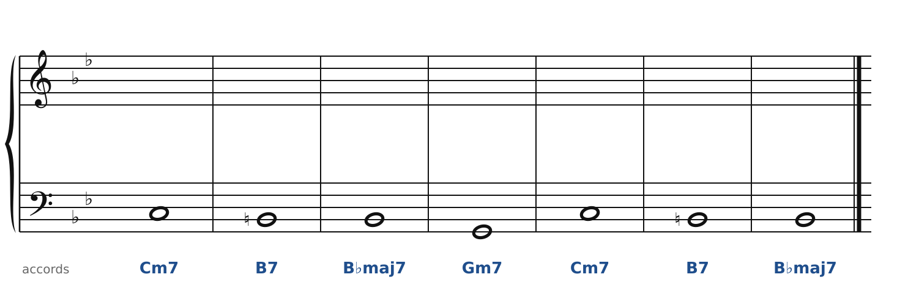
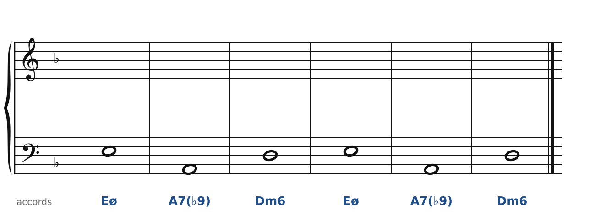
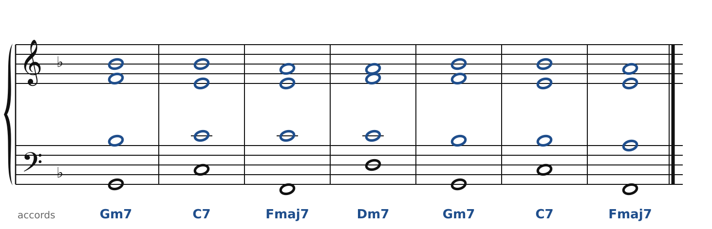
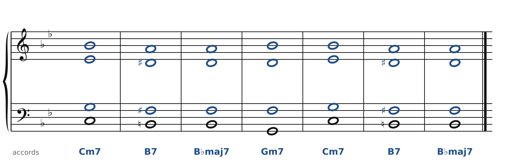
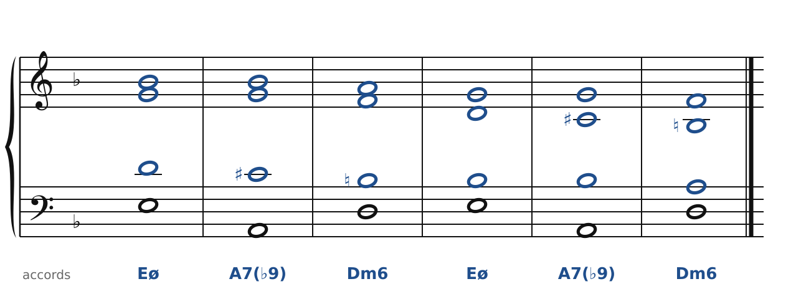

[← Ravel : 7e, 9e et 13e](45-ravel.md) · [Sommaire du cahier](README.md) · [Scriabine : l'accord mystique →](49-scriabine.md)

## Vers le jazz : II-V-I et substitutions

Ces exercices accompagnent le [chapitre 46](../cours/46-vers-le-jazz.md) du cours.

Dans la version web (`cahier.html`), chaque exercice se fait **directement sur la portée**, avec les corrections au fur et à mesure. Ici, plus de règles d'enchaînement classiques (les quintes parallèles sont permises) : on vérifie que chaque accord contient les bonnes notes, sans croisement et dans la tessiture de chaque voix.

### Exercice 46.1 · II-V-I, les notes guides

La basse et les accords sont donnés. Écris le soprano, l'alto et le ténor. Dans chaque accord, la **tierce** et la **septième** (les notes guides) sont obligatoires ; la troisième note est libre (fondamentale ou quinte).

### Exercice 46.2 · la substitution tritonique

La basse et les accords sont donnés : le V7 (F7) est remplacé par B7, à un triton. Écris le soprano, l'alto et le ténor sans la fondamentale : **tierce, quinte et septième**. Compare les notes guides de B7 (Ré♯ = Mi♭, La) avec celles de F7 (La, Mi♭).

### Exercice 46.3 · II-V-I mineur

La basse et les accords sont donnés. Écris le soprano, l'alto et le ténor : chaque accord doit contenir les notes indiquées entre parenthèses. Pas de règle d'enchaînement ici, mais cherche le chemin le plus court pour chaque voix.

### Corrigés

**Exercice 46.1** : une solution parmi d'autres.

🔊 [Écouter](audio/c46-01-c.mp3) · [MIDI](audio/c46-01-c.mid)

**Exercice 46.2** : une solution parmi d'autres.

🔊 [Écouter](audio/c46-02-c.mp3) · [MIDI](audio/c46-02-c.mid)

**Exercice 46.3** : une solution parmi d'autres.

🔊 [Écouter](audio/c46-03-c.mp3) · [MIDI](audio/c46-03-c.mid)

---

[← Ravel : 7e, 9e et 13e](45-ravel.md) · [Sommaire du cahier](README.md) · [Scriabine : l'accord mystique →](49-scriabine.md)
