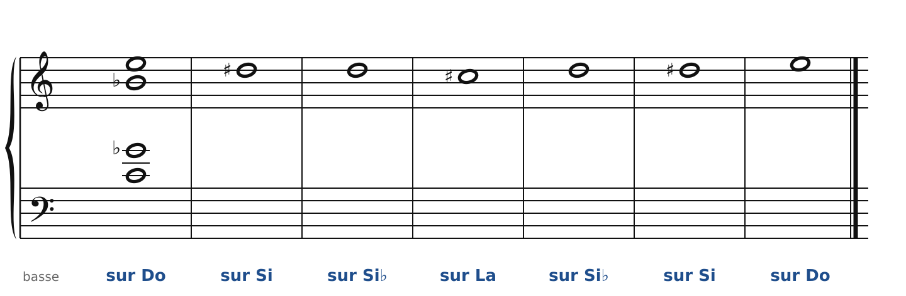
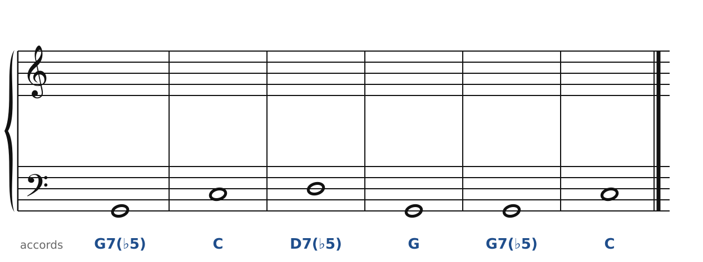
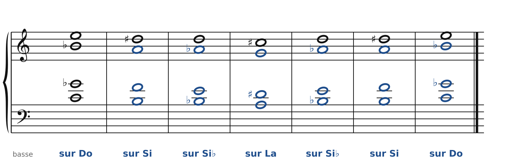
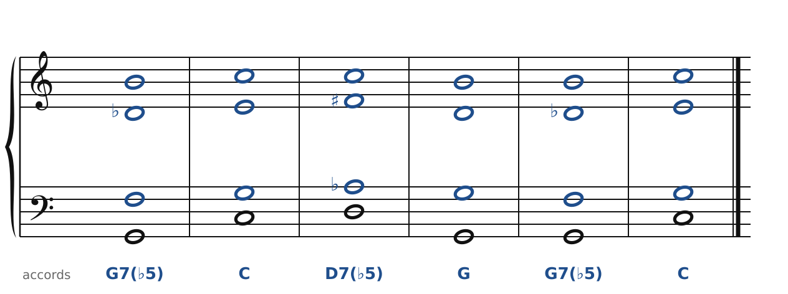

[← Vers le jazz : II-V-I et substitutions](46-vers-le-jazz.md) · [Sommaire du cahier](README.md) · [Bartók : miroirs et échelles →](50-bartok.md)

## Scriabine : l'accord mystique

Ces exercices accompagnent le [chapitre 49](../cours/49-scriabine.md) du cours.

Dans la version web (`cahier.html`), chaque exercice se fait **directement sur la portée**, avec les corrections au fur et à mesure. Ici, plus de règles d'enchaînement classiques (les quintes parallèles sont permises) : on vérifie que chaque accord contient les bonnes notes, sans croisement et dans la tessiture de chaque voix.

### Exercice 49.1 · l'accord de Scriabine glisse

Le premier accord (quatre notes de l'accord mystique : Do, Fa♯, Si♭, Mi) est donné, avec la mélodie. Recopie la **même disposition** sous chaque note du soprano : les quatre voix glissent ensemble, par demi-tons.

### Exercice 49.2 · dominantes à quinte abaissée

La basse et les accords sont donnés. Écris le soprano, l'alto et le ténor : chaque accord doit contenir les notes indiquées entre parenthèses. Pas de règle d'enchaînement ici, mais cherche le chemin le plus court pour chaque voix. Toutes les notes de chaque accord sont obligatoires.

### Corrigés

**Exercice 49.1** : une solution parmi d'autres.

🔊 [Écouter](audio/c49-01-c.mp3) · [MIDI](audio/c49-01-c.mid)

**Exercice 49.2** : une solution parmi d'autres.

🔊 [Écouter](audio/c49-02-c.mp3) · [MIDI](audio/c49-02-c.mid)

---

[← Vers le jazz : II-V-I et substitutions](46-vers-le-jazz.md) · [Sommaire du cahier](README.md) · [Bartók : miroirs et échelles →](50-bartok.md)
