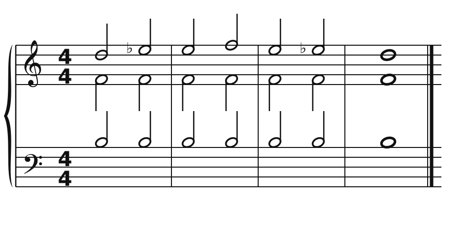
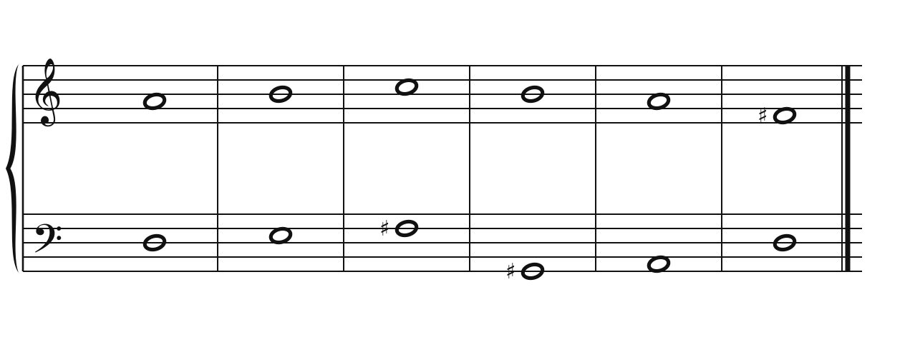
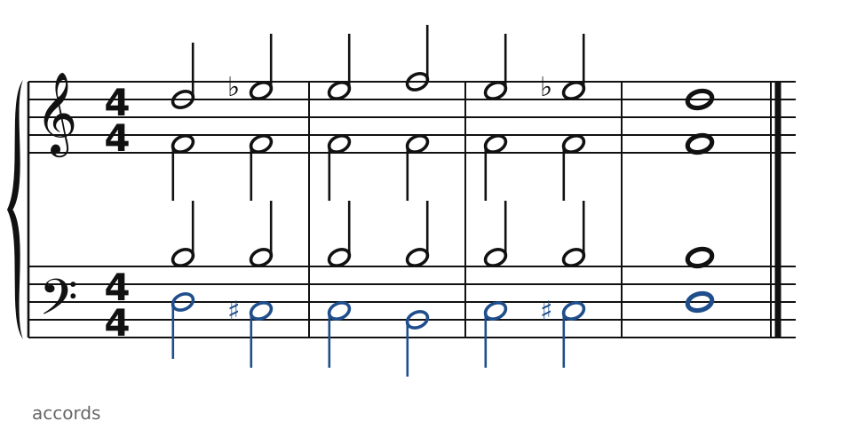
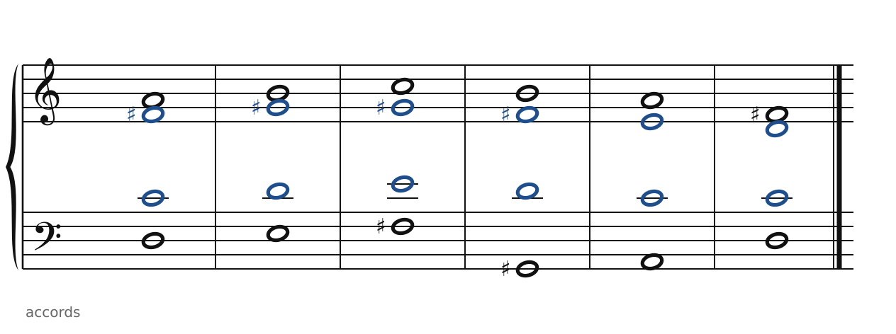

[← Scriabine : l'accord mystique](49-scriabine.md) · [Sommaire du cahier](README.md) · [Stravinsky : deux accords à un triton →](51-stravinsky.md)

## Bartók : miroirs et échelles

Ces exercices accompagnent le [chapitre 50](../cours/50-bartok-et-les-quatuors.md) du cours.

Dans la version web (`cahier.html`), chaque exercice se fait **directement sur la portée**, avec les corrections au fur et à mesure. Ici, plus de règles d'enchaînement classiques (les quintes parallèles sont permises) : on vérifie que chaque accord contient les bonnes notes, sans croisement et dans la tessiture de chaque voix.

### Exercice 50.1 · le miroir chromatique

Le soprano, l'alto et le ténor sont donnés. Écris la basse **en miroir** du soprano, autour de Ré : quand le soprano monte d'un demi-ton, la basse descend d'un demi-ton. Point de départ : Ré3.

### Exercice 50.2 · l'échelle acoustique sur Ré

Le soprano et la basse sont donnés. Écris l'alto et le ténor avec des notes de l'**échelle acoustique** sur Ré : Ré, Mi, Fa♯, Sol♯, La, Si, Do.

### Corrigés

**Exercice 50.1** : une solution parmi d'autres.

🔊 [Écouter](audio/c50-01-c.mp3) · [MIDI](audio/c50-01-c.mid)

**Exercice 50.2** : une solution parmi d'autres.

🔊 [Écouter](audio/c50-02-c.mp3) · [MIDI](audio/c50-02-c.mid)

---

[← Scriabine : l'accord mystique](49-scriabine.md) · [Sommaire du cahier](README.md) · [Stravinsky : deux accords à un triton →](51-stravinsky.md)
