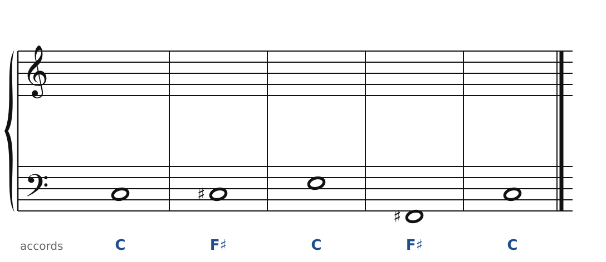
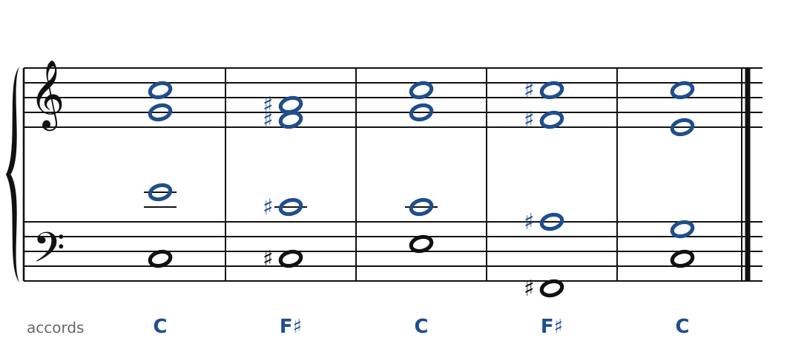

[← Bartók : miroirs et échelles](50-bartok.md) · [Sommaire du cahier](README.md) · [Prokofiev : les accords « à côté » →](52-prokofiev.md)

## Stravinsky : deux accords à un triton

Ces exercices accompagnent le [chapitre 51](../cours/51-stravinsky.md) du cours.

Dans la version web (`cahier.html`), chaque exercice se fait **directement sur la portée**, avec les corrections au fur et à mesure. Ici, plus de règles d'enchaînement classiques (les quintes parallèles sont permises) : on vérifie que chaque accord contient les bonnes notes, sans croisement et dans la tessiture de chaque voix.

### Exercice 51.1 · C et F♯, à un triton

La basse et les accords sont donnés. Écris le soprano, l'alto et le ténor : chaque accord doit contenir les notes indiquées entre parenthèses. Pas de règle d'enchaînement ici, mais cherche le chemin le plus court pour chaque voix. Les deux accords de *Petrouchka* alternent : cherche les déplacements les plus courts (chaque note de C est à un demi-ton d'une note de F♯).

### Corrigés

**Exercice 51.1** : une solution parmi d'autres.

🔊 [Écouter](audio/c51-01-c.mp3) · [MIDI](audio/c51-01-c.mid)

---

[← Bartók : miroirs et échelles](50-bartok.md) · [Sommaire du cahier](README.md) · [Prokofiev : les accords « à côté » →](52-prokofiev.md)
