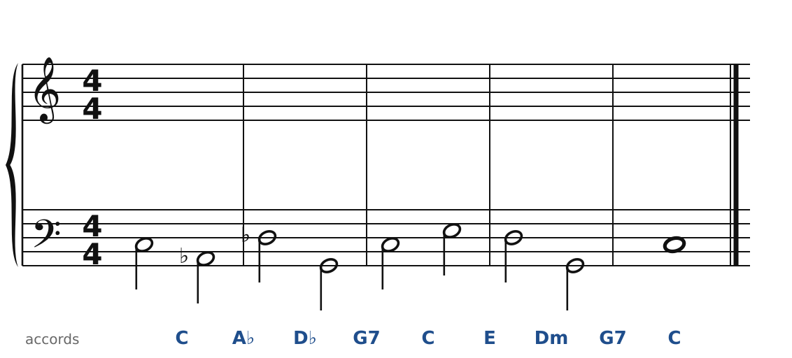
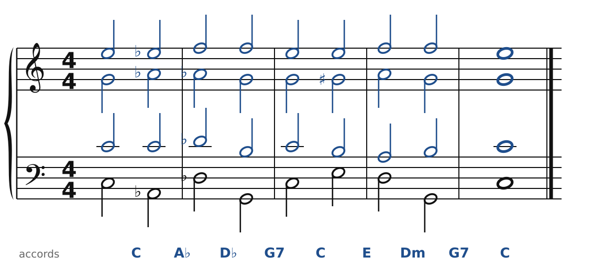

[← Stravinsky : deux accords à un triton](51-stravinsky.md) · [Sommaire du cahier](README.md) · [Messiaen : le mode 2 et son accord →](53-messiaen.md)

## Prokofiev : les accords « à côté »

Ces exercices accompagnent le [chapitre 52](../cours/52-prokofiev.md) du cours.

Dans la version web (`cahier.html`), chaque exercice se fait **directement sur la portée**, avec les corrections au fur et à mesure. Ici, plus de règles d'enchaînement classiques (les quintes parallèles sont permises) : on vérifie que chaque accord contient les bonnes notes, sans croisement et dans la tessiture de chaque voix.

### Exercice 52.1 · des accords « à côté »

La basse et les accords sont donnés. Écris le soprano, l'alto et le ténor : chaque accord doit contenir les notes indiquées entre parenthèses. Pas de règle d'enchaînement ici, mais cherche le chemin le plus court pour chaque voix.

### Corrigés

**Exercice 52.1** : une solution parmi d'autres.

🔊 [Écouter](audio/c52-01-c.mp3) · [MIDI](audio/c52-01-c.mid)

---

[← Stravinsky : deux accords à un triton](51-stravinsky.md) · [Sommaire du cahier](README.md) · [Messiaen : le mode 2 et son accord →](53-messiaen.md)
