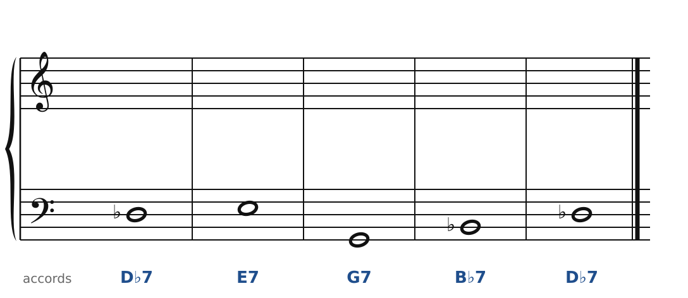
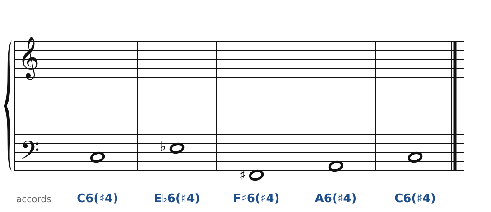
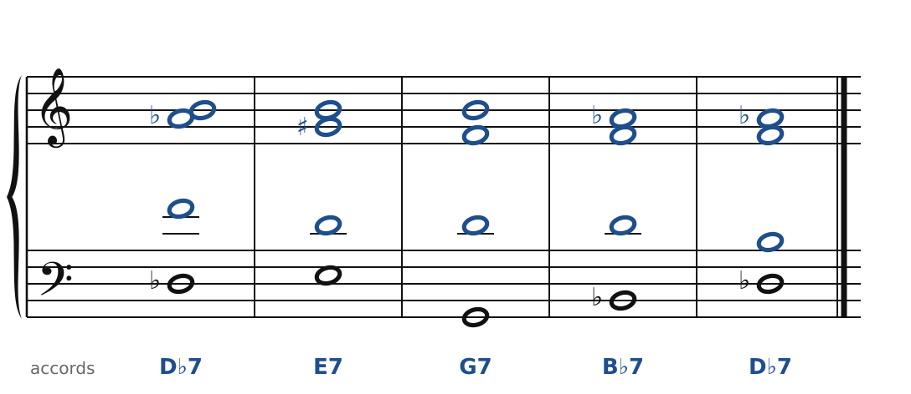
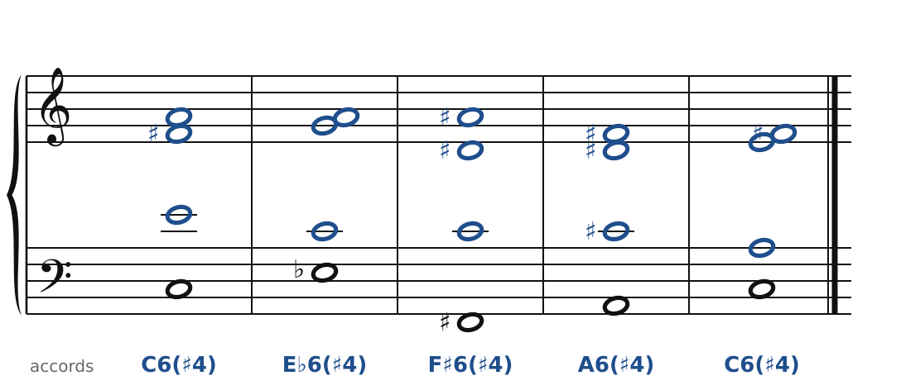

[← Prokofiev : les accords « à côté »](52-prokofiev.md) · [Sommaire du cahier](README.md) · [Dutilleux : la note pivot →](54-dutilleux.md)

## Messiaen : le mode 2 et son accord

Ces exercices accompagnent le [chapitre 53](../cours/53-messiaen.md) du cours.

Dans la version web (`cahier.html`), chaque exercice se fait **directement sur la portée**, avec les corrections au fur et à mesure. Ici, plus de règles d'enchaînement classiques (les quintes parallèles sont permises) : on vérifie que chaque accord contient les bonnes notes, sans croisement et dans la tessiture de chaque voix.

### Exercice 53.1 · les quatre 7e de dominante du mode 2

La basse et les accords sont donnés. Écris le soprano, l'alto et le ténor : chaque accord doit contenir les notes indiquées entre parenthèses. Pas de règle d'enchaînement ici, mais cherche le chemin le plus court pour chaque voix. Les quatre accords appartiennent au même mode 2 (Ré♭, Ré, Mi, Fa, Sol, La♭, Si♭, Si).

### Exercice 53.2 · l'accord de Messiaen

La basse et les accords sont donnés. Écris le soprano, l'alto et le ténor : chaque accord doit contenir les notes indiquées entre parenthèses. Pas de règle d'enchaînement ici, mais cherche le chemin le plus court pour chaque voix. Chaque accord : la tierce, la quarte augmentée et la sixte, au-dessus de la basse.

### Corrigés

**Exercice 53.1** : une solution parmi d'autres.

🔊 [Écouter](audio/c53-01-c.mp3) · [MIDI](audio/c53-01-c.mid)

**Exercice 53.2** : une solution parmi d'autres.

🔊 [Écouter](audio/c53-02-c.mp3) · [MIDI](audio/c53-02-c.mid)

---

[← Prokofiev : les accords « à côté »](52-prokofiev.md) · [Sommaire du cahier](README.md) · [Dutilleux : la note pivot →](54-dutilleux.md)
