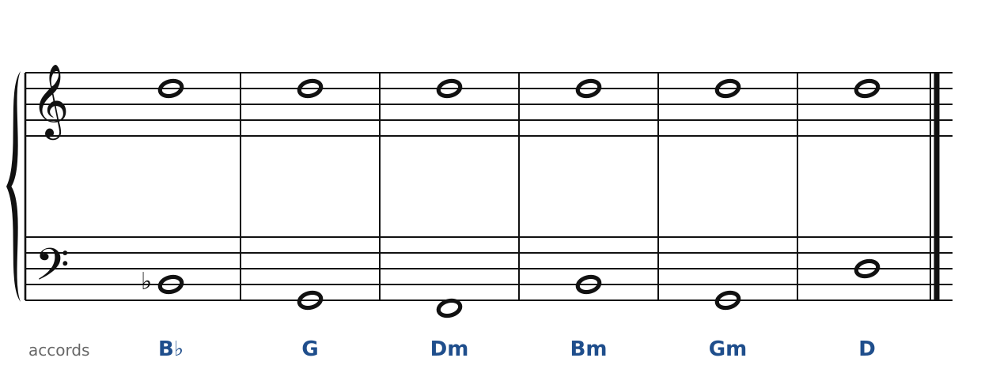
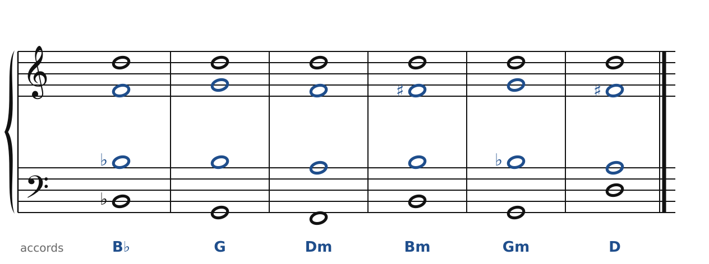

[← Messiaen : le mode 2 et son accord](53-messiaen.md) · [Sommaire du cahier](README.md)

## Dutilleux : la note pivot

Ces exercices accompagnent le [chapitre 54](../cours/54-dutilleux.md) du cours.

Dans la version web (`cahier.html`), chaque exercice se fait **directement sur la portée**, avec les corrections au fur et à mesure. Ici, plus de règles d'enchaînement classiques (les quintes parallèles sont permises) : on vérifie que chaque accord contient les bonnes notes, sans croisement et dans la tessiture de chaque voix.

### Exercice 54.1 · une note pivot

Le soprano tient **Ré** du début à la fin ; la basse et les accords sont donnés. Écris l'alto et le ténor : les couleurs changent autour de la note qui reste.

### Corrigés

**Exercice 54.1** : une solution parmi d'autres.

🔊 [Écouter](audio/c54-01-c.mp3) · [MIDI](audio/c54-01-c.mid)

---

[← Messiaen : le mode 2 et son accord](53-messiaen.md) · [Sommaire du cahier](README.md)
