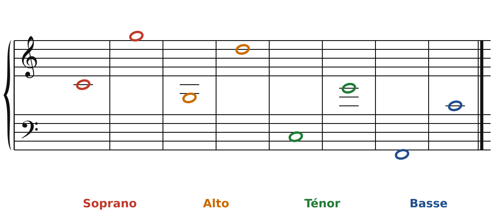
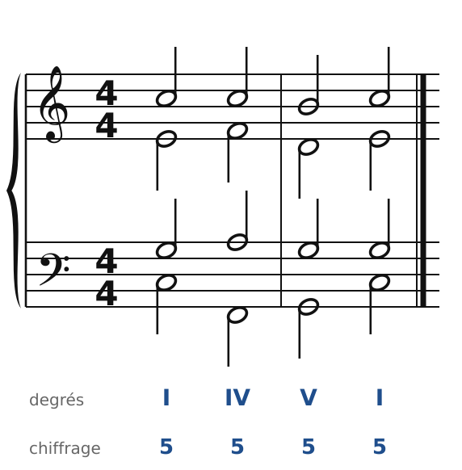
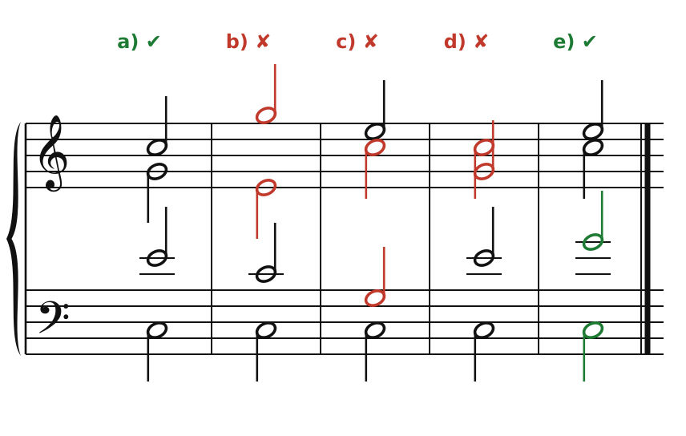
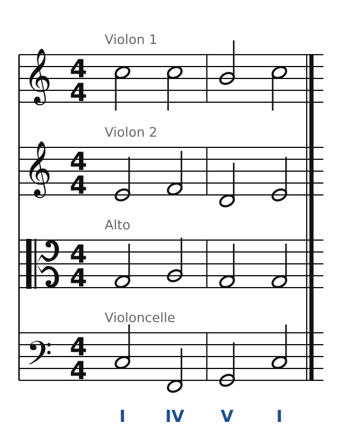

[Sommaire](../README.md#sommaire) · [2. L'accord parfait à quatre voix →](02-l-accord-parfait-a-quatre-voix.md)

## 1. Les quatre voix

En contrepoint, tu as appris à écrire des lignes qui avancent chacune de leur côté. En harmonie, on écrit **quatre lignes à la fois**, et à chaque instant elles forment un **accord**. Il faut donc penser dans les deux sens :

- **verticalement** : chaque accord doit être complet et bien réparti ;
- **horizontalement** : chaque voix doit rester une belle ligne, facile à chanter.

Tout le cours repose sur cet équilibre. On commence par le modèle de base : le **quatuor vocal**.

### Les quatre voix et leurs tessitures

| Voix | Du grave… | …à l'aigu |
| --- | --- | --- |
| **Soprano** (S) | Do central | Sol aigu |
| **Alto** (A) | Sol sous le Do central | Ré |
| **Ténor** (T) | Do une octave sous le Do central | Sol au-dessus du Do central |
| **Basse** (B) | Fa grave | Do central |

🔊 [Écouter](audio/h01-tessitures.mp3) · [MIDI](audio/h01-tessitures.mid)

**Pour retenir** : chaque voix couvre **une douzième** (une octave plus une quinte). Le soprano va de Do à Sol, et le ténor fait la même chose une octave plus bas. L'alto va de Sol à Ré, et la basse de Fa à Do. Ce sont les limites : au milieu de la tessiture, une voix sonne mieux et se fatigue moins. Évite de rester longtemps tout en haut ou tout en bas.

### Sur deux portées

On écrit le quatuor sur une **grande portée** :

- **soprano et alto** en clé de sol ;
- **ténor et basse** en clé de fa.

Quand les notes ont des hampes, elles indiquent à qui appartient chaque note : le **soprano** et le **ténor** ont la hampe **en haut**, l'**alto** et la **basse** l'ont **en bas**.

🔊 [Écouter](audio/h01-hampes.mp3) · [MIDI](audio/h01-hampes.mid)

Sous la portée, on note deux choses :

- le **degré** de chaque accord, en chiffres romains (I = accord construit sur la 1re note de la gamme, IV sur la 4e, etc.) ;
- le **chiffrage**, qui décrit l'accord à partir de la basse. Ici, « 5 » veut dire : accord parfait (3ce et 5te au-dessus de la basse), à l'état fondamental. C'est l'accord le plus simple ; on y reviendra au chapitre suivant.

Dans les premiers chapitres, on écrit surtout en rondes, une ronde par accord, comme en contrepoint de 1re espèce.

### L'ordre des voix et les écarts

1. **Pas de croisement** : le soprano reste la voix la plus aiguë, puis l'alto, puis le ténor, puis la basse. Une voix ne passe jamais au-dessus (ou au-dessous) de sa voisine.

2. **Écarts maximum** entre deux voix voisines :
   - soprano-alto : **une octave** ;
   - alto-ténor : **une octave** ;
   - ténor-basse : plus libre, **jusqu'à la douzième** (on peut aller un peu au-delà, mais rarement).

Pourquoi ? Les trois voix du haut forment un bloc qui doit rester soudé. La basse, elle, peut s'éloigner : dans le grave, les notes ont besoin de place pour sonner clairement.

🔊 [Écouter](audio/h01-ecarts.mp3) · [MIDI](audio/h01-ecarts.mid)

- **a)** Tout est en ordre.
- **b)** Du Sol du soprano au Mi de l'alto, il y a une 10e : trop loin.
- **c)** De l'alto (Do) au ténor (Sol), il y a une 11e : trop loin.
- **d)** Le soprano (Sol) est **sous** l'alto (Do) : c'est un croisement. Regarde les hampes : la hampe en haut (soprano) part d'une note plus grave que la hampe en bas (alto).
- **e)** Ténor et basse sont à une 12e : c'est permis, car l'écart entre ces deux voix est plus libre.

### Et le quatuor à cordes ?

Le quatuor à cordes reprend exactement les mêmes quatre rôles :

| Quatuor vocal | Quatuor à cordes | Clé |
| --- | --- | --- |
| Soprano | Violon 1 | Clé de sol |
| Alto | Violon 2 | Clé de sol |
| Ténor | **Alto** | **Clé d'ut 3e ligne** |
| Basse | Violoncelle | Clé de fa |

Attention au piège : dans le quatuor à cordes, l'**alto** est un instrument (un peu plus grand que le violon) qui joue la partie de **ténor**. Il se lit en **clé d'ut 3e ligne** : le Do central est sur la ligne du milieu.

🔊 [Écouter](audio/h01-quatuor.mp3) · [MIDI](audio/h01-quatuor.mid)

C'est exactement l'enchaînement de tout à l'heure. Compare les deux figures : seule la présentation change. Chaque instrument a sa portée, et l'alto lit en clé d'ut.

Les instruments à cordes vont beaucoup plus loin que les voix (le violon monte très haut, le violoncelle descend jusqu'au Do deux octaves sous le Do central). Mais pour apprendre, on garde les **tessitures vocales** : une écriture qui se chante se joue toujours bien. On profitera de la liberté des cordes à partir de la cinquième partie.

---

[Sommaire](../README.md#sommaire) · [2. L'accord parfait à quatre voix →](02-l-accord-parfait-a-quatre-voix.md)
