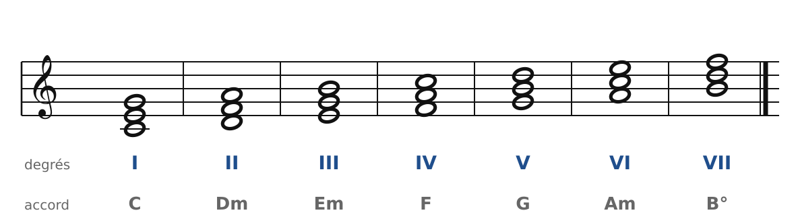
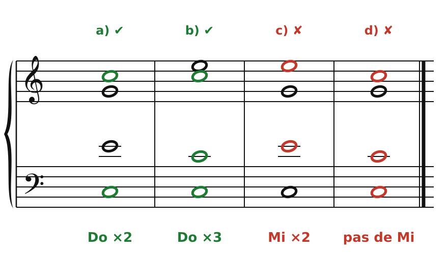
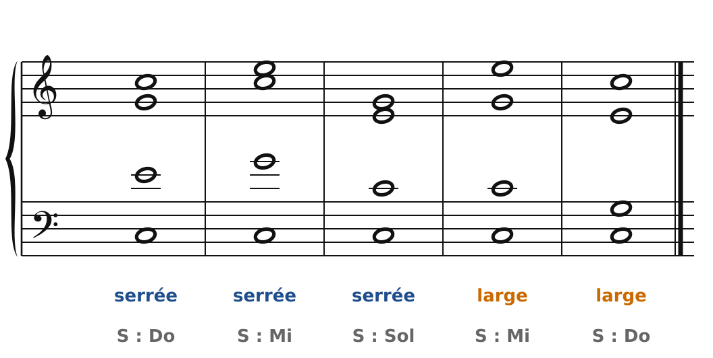

[← 1. Les quatre voix](01-les-quatre-voix.md) · [Sommaire](../README.md#sommaire) · [3. Enchaîner deux accords →](03-enchainer-deux-accords.md)

## 2. L'accord parfait à quatre voix

### L'accord parfait

Un **accord parfait** (on dit aussi « accord de 3 sons ») est fait de trois notes empilées en tierces :

- la **fondamentale**, la note qui donne son nom à l'accord ;
- la **tierce**, une 3ce au-dessus ;
- la **quinte**, une 5te au-dessus de la fondamentale.

Exemple : l'accord de C, c'est Do (fondamentale), Mi (tierce), Sol (quinte).

Quand la fondamentale est à la basse, l'accord est à l'**état fondamental**. Son chiffrage est **5** (on l'omet souvent, mais dans ce cours on l'écrit toujours). C'est le seul état qu'on utilise dans cette première partie.

### Un accord sur chaque degré

On peut construire un accord parfait sur chaque note de la gamme, en n'utilisant que les notes de la gamme. En Do majeur :

🔊 [Écouter](audio/h02-degres.mp3) · [MIDI](audio/h02-degres.mid)

- I, IV et V sont **majeurs** (C, F, G) : ce sont les **degrés principaux**, les piliers de la tonalité.
- II, III et VI sont **mineurs** (Dm, Em, Am).
- VII est **diminué** (B°, avec une 5te diminuée Si-Fa) : on le laisse de côté pour l'instant.

Le V (la **dominante**) contient la **sensible** (Si en Do majeur), la note qui « veut » monter vers la tonique. On en reparle au chapitre 3.

### Les doublures

Un accord parfait a trois notes, mais on écrit à quatre voix : il faut donc **doubler** une note (la faire chanter par deux voix, à l'unisson ou à l'octave). Laquelle ?

1. À l'état fondamental, on double **la fondamentale**. C'est la meilleure doublure.
2. On peut aussi **tripler la fondamentale** et supprimer la quinte. La quinte est la note la moins importante : sans elle, on reconnaît encore l'accord.
3. On évite de doubler **la tierce**.
4. On ne supprime **jamais la tierce** : c'est elle qui dit si l'accord est majeur ou mineur. Sans tierce, l'accord sonne vide.
5. On ne double **jamais la sensible**.

🔊 [Écouter](audio/h02-doublures.mp3) · [MIDI](audio/h02-doublures.mid)

- **a)** Do est doublé (soprano et basse) : c'est la doublure idéale.
- **b)** Do est triplé et il n'y a pas de Sol : c'est permis.
- **c)** Mi (la tierce) est doublé : à éviter, l'accord sonne lourd et déséquilibré.
- **d)** Pas de Mi : l'accord est vide. On ne sait plus s'il est majeur ou mineur.

### La disposition : serrée ou large

Regarde les **trois voix du haut** (soprano, alto, ténor) :

- **disposition serrée** : elles sont aussi proches que possible. On ne pourrait pas glisser une note de l'accord entre deux voix voisines ;
- **disposition large** : il y a de la place pour une note de l'accord entre le soprano et l'alto, ou entre l'alto et le ténor.

La basse ne compte pas : elle peut toujours être loin du ténor.

🔊 [Écouter](audio/h02-dispositions.mp3) · [MIDI](audio/h02-dispositions.mid)

Les trois premiers accords sont en disposition serrée. Ce qui change, c'est la note du soprano :

- soprano sur la fondamentale (Do) : **position d'octave** ;
- soprano sur la tierce (Mi) : **position de tierce** ;
- soprano sur la quinte (Sol) : **position de quinte**.

Les deux derniers accords sont en disposition large : entre le Mi du soprano et le Sol de l'alto, on pourrait placer un Do ; entre le Do du soprano et le Mi de l'alto, un Sol.

Les deux dispositions sont bonnes. Dans un enchaînement, on passe de l'une à l'autre quand c'est nécessaire, par exemple pour garder chaque voix dans sa tessiture.

### Méthode : écrire un accord seul

1. Écris la **basse** : la fondamentale.
2. Choisis la note du **soprano** : fondamentale, tierce ou quinte.
3. Complète l'**alto** et le **ténor** avec les notes qui manquent, en doublant la fondamentale.
4. Vérifie : tessitures, pas de croisement, écarts (S-A et A-T pas plus d'une octave), la tierce est bien là.

---

[← 1. Les quatre voix](01-les-quatre-voix.md) · [Sommaire](../README.md#sommaire) · [3. Enchaîner deux accords →](03-enchainer-deux-accords.md)
