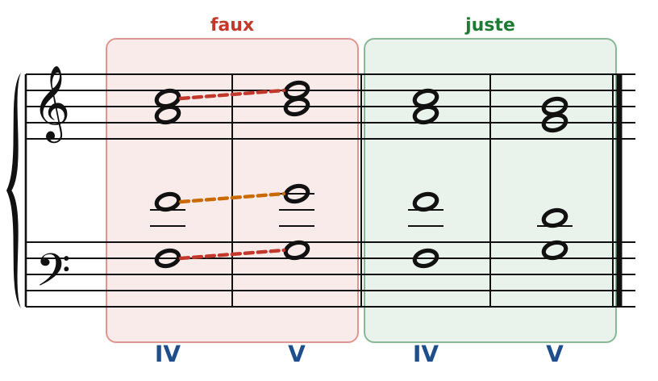
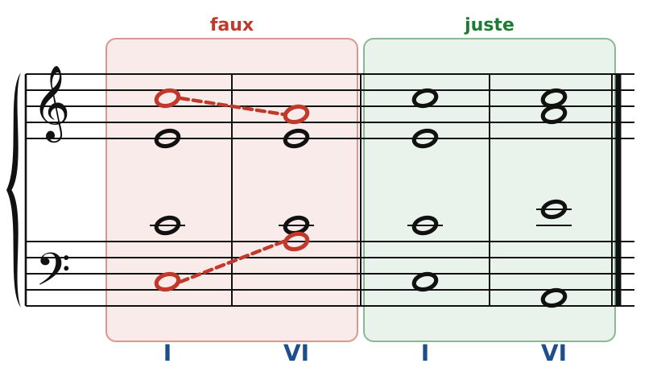
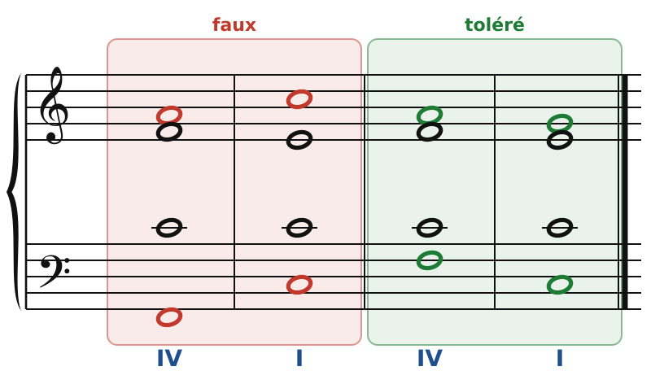
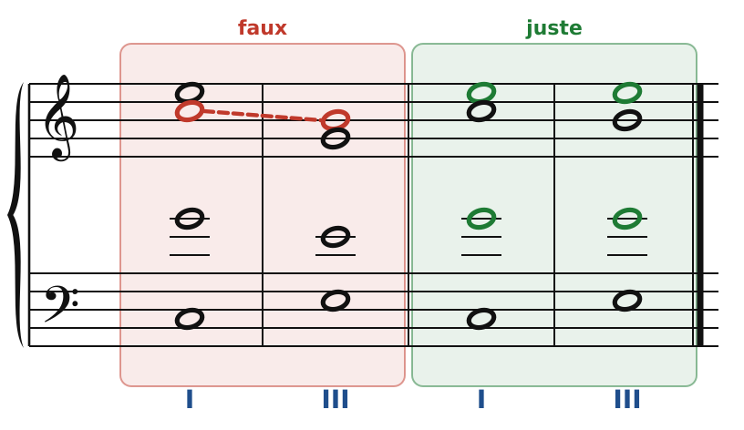
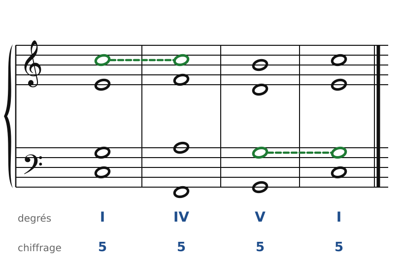

[← 2. L'accord parfait à quatre voix](02-l-accord-parfait-a-quatre-voix.md) · [Sommaire](../README.md#sommaire) · [4. Exercices →](04-exercices.md)

## 3. Enchaîner deux accords

Écrire un bel accord, c'est facile. Le vrai travail commence quand on **passe d'un accord à l'autre** : chaque voix doit bouger proprement, sans perdre son indépendance.

### Rappel : les quatre mouvements

Entre deux voix, tu connais déjà les quatre mouvements (voir le [Cours de contrepoint, partie 3](https://github.com/MLeVan8395/Cours-contrepoint/blob/main/cours/03-les-quatre-mouvements-entre-deux-voix.md)) :

- **contraire** : une voix monte, l'autre descend ;
- **oblique** : une voix reste sur place, l'autre bouge ;
- **direct** : les deux voix vont dans le même sens ;
- **parallèle** : les deux voix vont dans le même sens, du même intervalle.

À quatre voix, il y a **six paires** de voix à surveiller : S-A, S-T, S-B, A-T, A-B, T-B. Les règles qui suivent valent pour chacune.

### Règle 1 : pas de quintes ni d'octaves consécutives

Deux voix qui sont à la 5te (ou à l'octave) ne doivent pas aller **ensemble** à une autre 5te (ou une autre octave). C'est la règle la plus célèbre de l'harmonie, et la même qu'en contrepoint.

Pourquoi ? Deux voix en octaves parallèles se fondent en une seule : on n'entend plus quatre voix mais trois. Les quintes parallèles produisent le même effet, en un peu moins fort, et sonnent creux dans le style classique.

🔊 [Écouter](audio/h03-paralleles.mp3) · [MIDI](audio/h03-paralleles.mid)

**À gauche (faux)** : pour aller de IV à V, toutes les voix montent d'un degré. Résultat : 5tes consécutives entre soprano et basse (Do-Fa puis Ré-Sol), entre soprano et ténor (même chose), et octaves consécutives entre ténor et basse (Fa-Fa puis Sol-Sol). C'est la faute classique entre deux accords voisins (IV-V, V-VI…).

**À droite (juste)** : la basse monte, et les trois voix du haut **descendent** vers la note la plus proche du nouvel accord. Le mouvement contraire supprime toutes les fautes.

### Règle 2 : pas de quintes ni d'octaves par mouvement contraire

Passer d'une octave à une autre octave **en mouvement contraire** (une voix monte, l'autre descend) ne sauve rien : on a toujours deux voix qui chantent la même note. Dans le style d'école, c'est interdit aussi.

🔊 [Écouter](audio/h03-contraire.mp3) · [MIDI](audio/h03-contraire.mid)

**À gauche (faux)** : soprano et basse sont à l'octave sur Do, puis à l'octave sur La (le soprano descend, la basse monte).

**À droite (juste)** : le soprano garde son Do, la basse descend sur La. On arrive à une 10e, et l'accord de Am est bien rempli.

### Règle 3 : attention aux quintes et octaves directes

On arrive sur une 5te ou une octave **par mouvement direct** (les deux voix dans le même sens), sans y être avant : on parle de **5te directe** ou d'**octave directe** (on dit aussi « cachées »). L'oreille les entend surtout entre les **voix extrêmes** (soprano et basse). La règle :

- entre **soprano et basse**, une 5te ou une octave directe est **interdite si le soprano saute** ;
- elle est **tolérée si le soprano avance par degré conjoint** ;
- entre les autres voix, on la tolère.

🔊 [Écouter](audio/h03-directes.mp3) · [MIDI](audio/h03-directes.mid)

**À gauche (faux)** : le soprano saute de La à Do pendant que la basse monte de Fa à Do. On arrive à l'octave en mouvement direct, avec un saut au soprano : c'est l'octave directe interdite.

**À droite (toléré)** : soprano et basse descendent ensemble et arrivent sur une 5te (Sol au-dessus de Do). Mais le soprano ne fait qu'un pas (La-Sol) : c'est toléré.

### Règle 4 : pas de chevauchement

Une voix ne doit pas aller **plus loin que la note que sa voisine vient de quitter**. Le soprano ne descend pas plus bas que la note précédente de l'alto, l'alto ne monte pas plus haut que la note précédente du soprano, et ainsi de suite. Sinon l'oreille croit que les voix se sont échangées.

🔊 [Écouter](audio/h03-chevauchement.mp3) · [MIDI](audio/h03-chevauchement.mid)

**À gauche (faux)** : l'alto chante Do, puis le soprano descend sur Si, plus bas que ce Do. L'oreille entend la ligne Do-Si comme une seule voix.

**À droite (juste)** : on garde les notes communes (Mi au soprano, Sol au ténor). À part la basse, seul l'alto bouge, d'un demi-ton (Do-Si).

### Règle 5 : la sensible monte à la tonique

Dans l'enchaînement V-I, la **sensible** (Si en Do majeur) doit **monter d'un demi-ton vers la tonique**, surtout au soprano. C'est elle qui donne l'impression d'arriver.

### La méthode : comment enchaîner deux accords

C'est la méthode la plus sûre, et elle évite presque toutes les fautes d'un seul coup :

1. **La basse** va de fondamentale à fondamentale. Elle peut sauter (4te, 5te).
2. **Les notes communes** aux deux accords restent **à la même voix**, sur place.
3. **Les autres voix** vont vers la **note la plus proche** du nouvel accord (le plus court chemin).
4. **S'il n'y a pas de note commune** (IV-V, V-VI…), les trois voix du haut vont **en mouvement contraire à la basse**.

🔊 [Écouter](audio/h03-cadence.mp3) · [MIDI](audio/h03-cadence.mid)

- **I-IV** : Do est commun aux deux accords, le soprano le garde (en vert). L'alto monte de Mi à Fa, le ténor de Sol à La : chacun fait un pas.
- **IV-V** : aucune note commune. La basse monte (Fa-Sol), donc les trois voix du haut descendent : Do-Si, Fa-Ré, La-Sol.
- **V-I** : Sol est commun, le ténor le garde (en vert). La sensible Si monte sur Do au soprano, l'alto monte de Ré à Mi.

Résultat : aucune quinte ni octave consécutive, des voix qui bougent peu, et chaque accord complet.

### À vérifier après chaque enchaînement

1. Chaque accord : tessitures, pas de croisement, écarts, doublure de la fondamentale, tierce présente.
2. Chaque paire de voix (il y en a six !) : pas de 5tes ni d'octaves consécutives, ni par mouvement contraire.
3. Soprano et basse : pas de 5te ou d'octave directe avec un saut au soprano.
4. Pas de chevauchement.
5. La sensible monte à la tonique.
6. **Chante ou joue** chaque voix séparément : elle doit être agréable à chanter.

---

[← 2. L'accord parfait à quatre voix](02-l-accord-parfait-a-quatre-voix.md) · [Sommaire](../README.md#sommaire) · [4. Exercices →](04-exercices.md)
