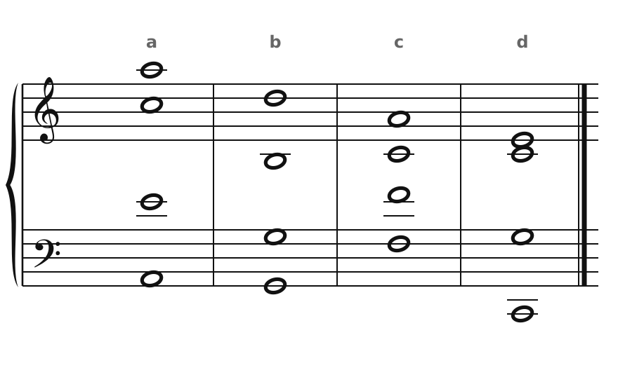
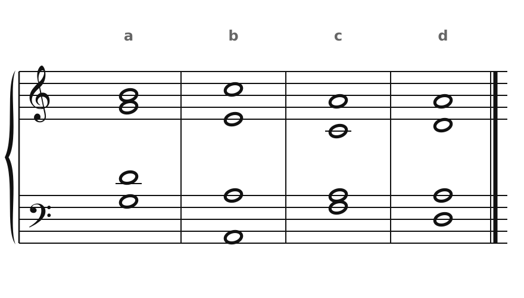
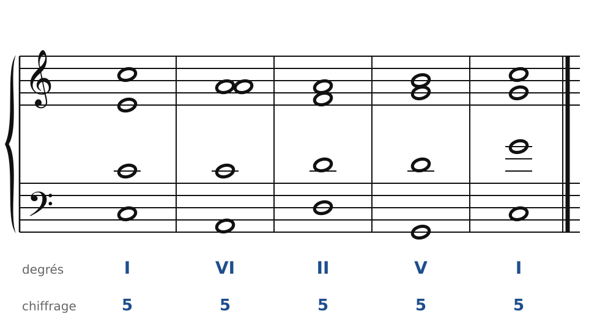
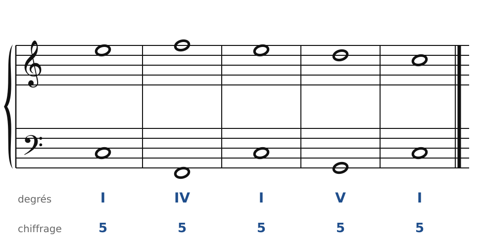
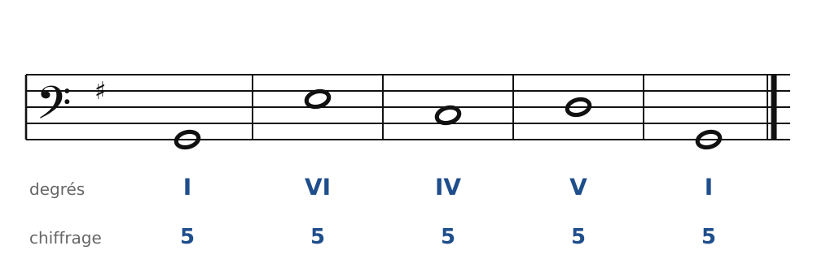

[← 3. Enchaîner deux accords](03-enchainer-deux-accords.md) · [Sommaire](../README.md#sommaire) · [5. Corrigés →](05-corriges.md)

## 4. Exercices

Fais les exercices dans l'ordre, au crayon. Joue ou chante chaque résultat avant de regarder le corrigé.

Dans la **version web** du cours, les exercices 3, 4 et 5 se font aussi directement sur la portée : bouton **✏️ Faire l'exercice ici**. Tu poses tes notes en cliquant, tu écoutes, et les corrections s'affichent au fur et à mesure, avec les mêmes règles que le cours.

### Exercice 1 : les voix à leur place

Chacun de ces accords contient **une faute** : une voix hors de sa tessiture, un écart trop grand ou un croisement. Trouve-la.

🔊 [Écouter](audio/h04-ex1.mp3) · [MIDI](audio/h04-ex1.mid)

### Exercice 2 : analyser des accords

Pour chaque accord (tous en Do majeur, à l'état fondamental) :

1. donne son nom (en lettres) et son degré ;
2. dis s'il est en disposition **serrée** ou **large** ;
3. dis quelle note est doublée, et si l'accord est correct.

🔊 [Écouter](audio/h04-ex2.mp3) · [MIDI](audio/h04-ex2.mid)

### Exercice 3 : chasse aux fautes

Cet enchaînement en Do majeur contient **trois fautes**. Trouve-les, puis corrige-les en changeant le moins de notes possible.

🔊 [Écouter](audio/h04-ex3.mp3) · [MIDI](audio/h04-ex3.mid)

### Exercice 4 : compléter l'alto et le ténor

Le soprano et la basse sont donnés. Écris l'alto et le ténor. Suis la méthode du chapitre 3 : garde les notes communes, va au plus près.

🔊 [Écouter](audio/h04-ex4.mp3) · [MIDI](audio/h04-ex4.mid)

**Indice** : dans le V, où est la sensible ? Où doit-elle aller ?

### Exercice 5 : basse donnée en Sol majeur

Voici une basse en **Sol majeur**, avec ses degrés. Écris les trois voix du haut. Commence le soprano sur **Si**.

🔊 [Écouter](audio/h04-ex5.mp3) · [MIDI](audio/h04-ex5.mid)

**Indices** : quelles sont les notes de l'accord de V en Sol majeur ? Quelle est la sensible ? Entre VI et IV, cherche la note commune.

### Exercice 6 : pour quatuor à cordes

Recopie ta réalisation de l'exercice 4 pour **quatuor à cordes** : violon 1, violon 2, alto, violoncelle. Attention : l'alto lit en **clé d'ut 3e ligne** (le Do central sur la ligne du milieu).

---

[← 3. Enchaîner deux accords](03-enchainer-deux-accords.md) · [Sommaire](../README.md#sommaire) · [5. Corrigés →](05-corriges.md)
