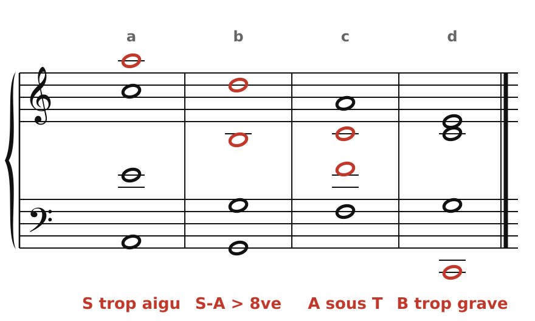
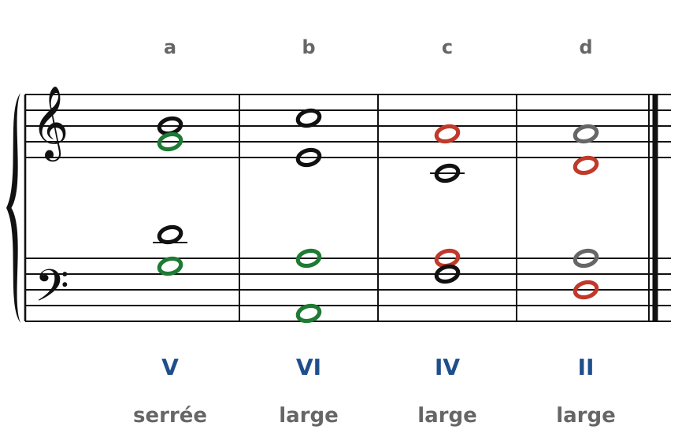
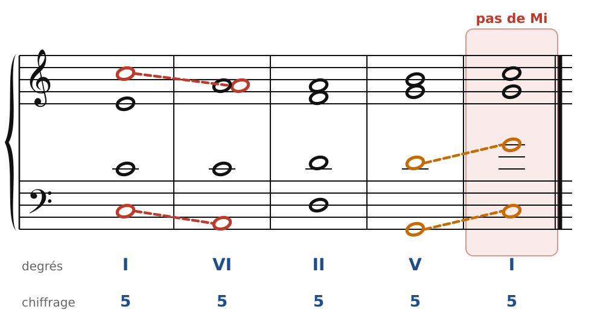
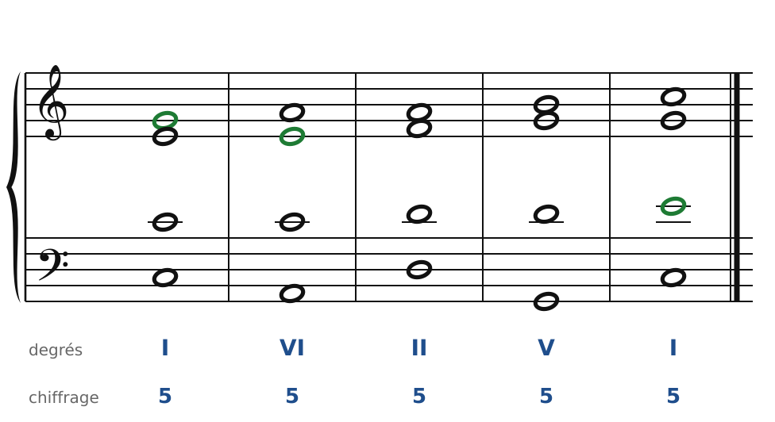
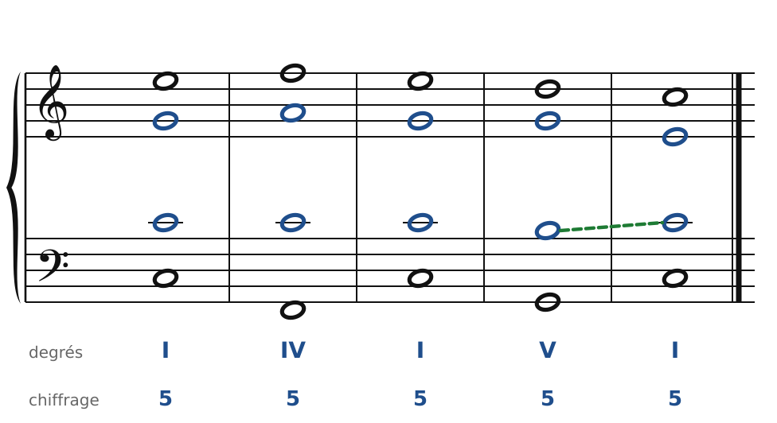
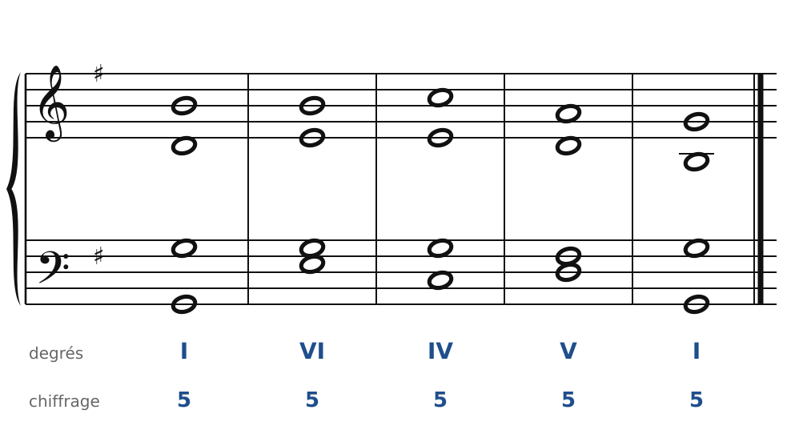
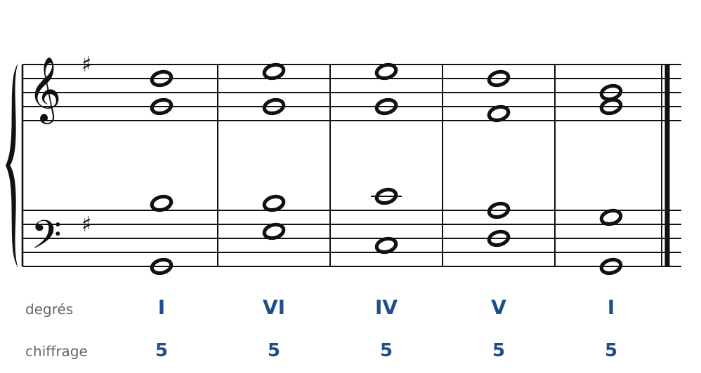
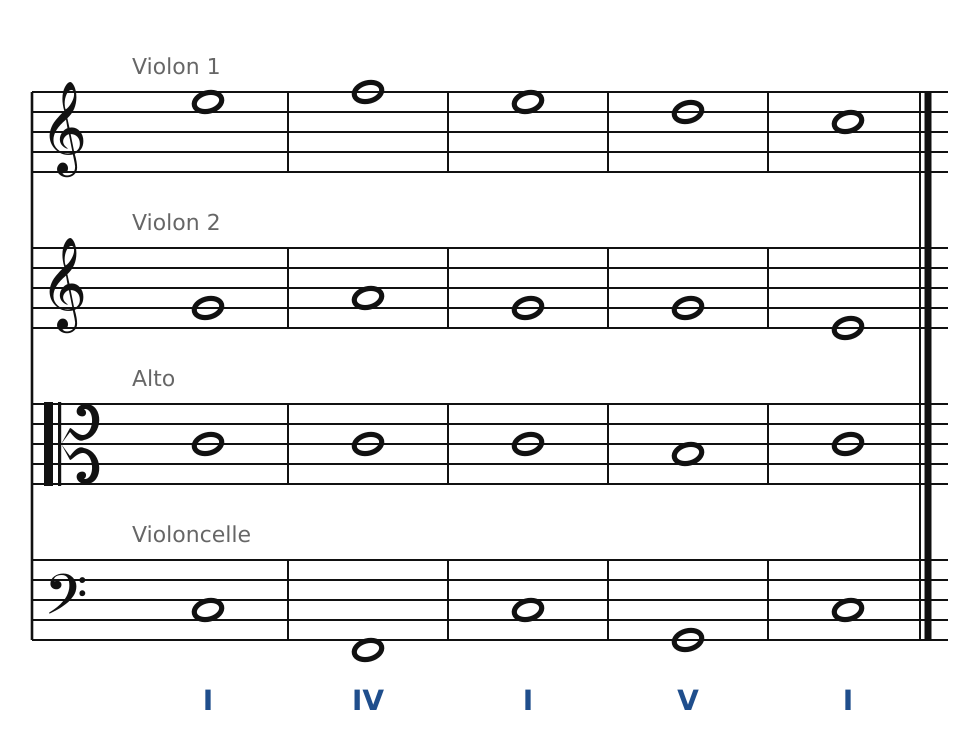

[← 4. Exercices](04-exercices.md) · [Sommaire](../README.md#sommaire) · [6. Le premier renversement →](06-le-premier-renversement.md)

## 5. Corrigés

### Exercice 1 : les voix à leur place

🔊 [Écouter](audio/h05-c1.mp3) · [MIDI](audio/h05-c1.mid)

- **a)** Le soprano chante La, au-dessus du Sol aigu : il sort de sa tessiture.
- **b)** Entre le Ré du soprano et le Si de l'alto, il y a une 10e : l'écart soprano-alto dépasse l'octave.
- **c)** L'alto (Do) est plus grave que le ténor (Fa) : c'est un croisement. Il suffit d'échanger les deux notes (alto Fa, ténor Do).
- **d)** La basse chante le Do deux octaves sous le Do central : c'est plus grave que le Fa, limite de la basse. Une octave plus haut, tout serait correct.

### Exercice 2 : analyser des accords

🔊 [Écouter](audio/h05-c2.mp3) · [MIDI](audio/h05-c2.mid)

| | Accord | Degré | Disposition | Doublure | Correct ? |
| --- | --- | --- | --- | --- | --- |
| **a)** | G | V | serrée | Sol, la fondamentale (en vert) | oui |
| **b)** | Am | VI | large (on pourrait placer un La entre le soprano et l'alto) | La, la fondamentale (en vert) | oui |
| **c)** | F | IV | large (un Fa tiendrait entre le soprano et l'alto) | La, la tierce (en rouge) | non : tierce doublée |
| **d)** | Dm | II | large (un Fa tiendrait entre le soprano et l'alto) | Ré et La sont doublés | non : pas de Fa, l'accord est vide |

Pour corriger **c)**, échange l'alto et le ténor et remplace un La par un Fa : soprano La, alto Fa, ténor Do, basse Fa. Pour corriger **d)**, remplace le La du ténor par un Fa : soprano La, alto Ré, ténor Fa, basse Ré. D'autres solutions sont possibles : vérifie simplement que la tierce est là et que la fondamentale est doublée.

### Exercice 3 : chasse aux fautes

🔊 [Écouter](audio/h05-c3a.mp3) · [MIDI](audio/h05-c3a.mid)

1. **I-VI** : **octaves consécutives** entre soprano et basse (Do-Do, puis La-La). Les deux voix descendent ensemble.
2. **V-I** : **quintes consécutives** entre ténor et basse (Ré au-dessus de Sol, puis Sol au-dessus de Do).
3. **Dernier accord** : il n'y a **pas de Mi**. L'accord final est vide.

Une correction possible :

🔊 [Écouter](audio/h05-c3b.mp3) · [MIDI](audio/h05-c3b.mid)

- Le soprano commence sur **Sol** au lieu de Do : soprano et basse ne sont plus à l'octave au premier accord, la faute 1 disparaît.
- Au deuxième accord, l'alto garde son **Mi** (note commune entre C et Am) : l'accord de Am devient complet.
- Le ténor finit sur **Mi** au lieu de Sol : il fait un simple pas (Ré-Mi), les quintes disparaissent et l'accord final retrouve sa tierce. Une seule note corrige deux fautes !

### Exercice 4 : compléter l'alto et le ténor

🔊 [Écouter](audio/h05-c4.mp3) · [MIDI](audio/h05-c4.mid)

L'alto et le ténor sont en bleu.

- Le **Do** est commun aux accords I, IV et I : le ténor le garde du début jusqu'au V. L'alto fait Sol-La-Sol, de simples pas.
- **I-V** : Sol est commun, l'alto le garde. Le ténor descend d'un degré sur Si, la tierce de G.
- **V-I** : le Si du ténor est la **sensible** : il monte sur Do (en vert). L'alto descend de Sol à Mi pour apporter la tierce.

L'accord final n'a pas de quinte (Do triplé, Mi) : c'est permis, et c'est souvent le prix à payer pour que la sensible monte. Si tu as gardé le Sol à l'alto et fait monter le ténor de Si à Mi, ton accord final est complet, mais la sensible ne monte plus vers la tonique : la première solution est préférable.

### Exercice 5 : basse donnée en Sol majeur

En Sol majeur, l'accord de V est D (Ré, Fa♯, La) et la **sensible** est **Fa♯** (déjà à l'armure). Entre VI (Em : Mi, Sol, Si) et IV (C : Do, Mi, Sol), les notes communes sont Mi et Sol.

Avec le soprano sur Si, comme demandé :

🔊 [Écouter](audio/h05-c5a.mp3) · [MIDI](audio/h05-c5a.mid)

- Soprano : Si-Si-Do-La-Sol, une ligne qui descend tranquillement vers la tonique.
- Le **Sol** du ténor est commun aux trois premiers accords : il reste sur place.
- **V-I** : la sensible Fa♯ est au ténor, elle monte sur Sol. L'accord final n'a pas de quinte.

Une autre solution, en partant plus haut :

🔊 [Écouter](audio/h05-c5b.mp3) · [MIDI](audio/h05-c5b.mid)

Ici le soprano chante Ré-Mi-Mi-Ré-Si, et c'est l'**alto** qui a la sensible : Fa♯ monte sur Sol. Compare les deux versions : même basse, même harmonie, mais une couleur différente parce que le soprano est plus aigu.

### Exercice 6 : pour quatuor à cordes

🔊 [Écouter](audio/h05-c6.mp3) · [MIDI](audio/h05-c6.mid)

Chaque voix devient un instrument : soprano → violon 1, alto → violon 2, ténor → alto, basse → violoncelle. Les notes ne changent pas. La seule difficulté est la clé d'ut : le **Do** que tient la partie d'alto est le Do central, sur la ligne du milieu.

---

[← 4. Exercices](04-exercices.md) · [Sommaire](../README.md#sommaire) · [6. Le premier renversement →](06-le-premier-renversement.md)
