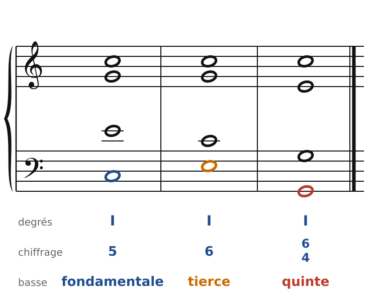
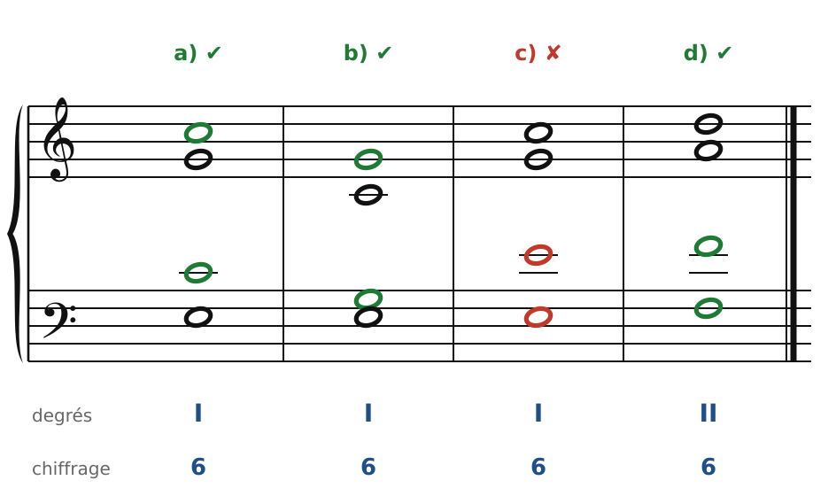
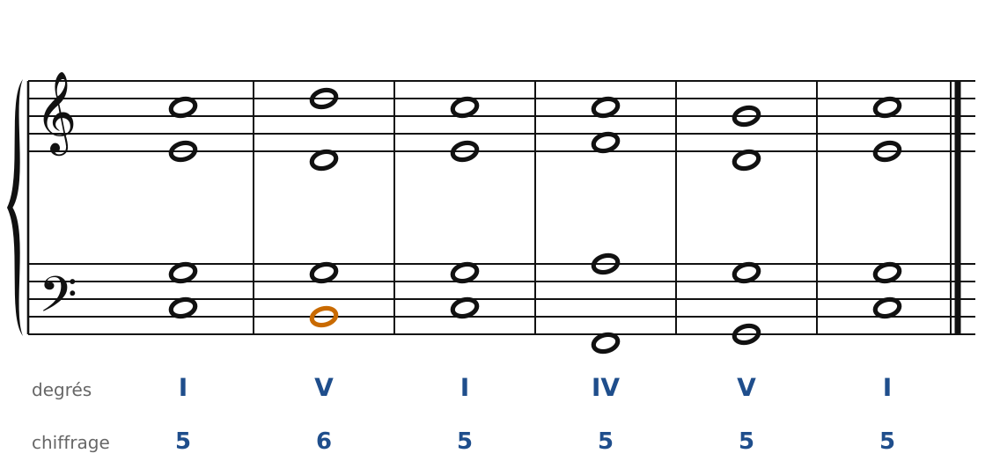
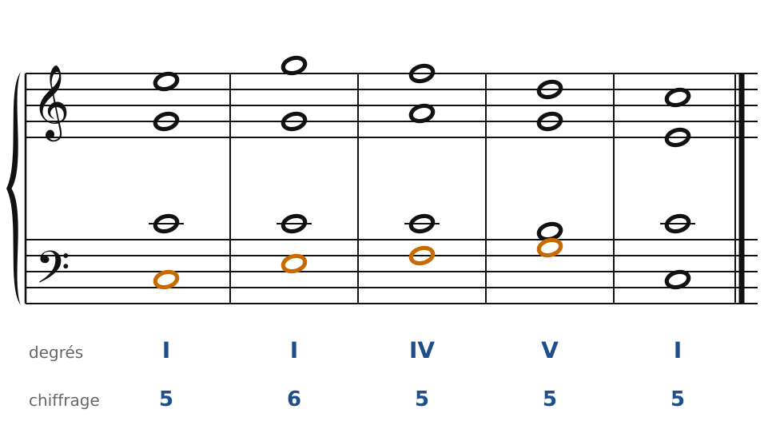

[← 5. Corrigés](05-corriges.md) · [Sommaire](../README.md#sommaire) · [7. Les cadences →](07-les-cadences.md)

## 6. Le premier renversement

Jusqu'ici, la basse chantait toujours la fondamentale. C'est solide, mais la basse saute beaucoup et toutes les phrases se ressemblent. Pour lui donner une vraie ligne mélodique, on va **renverser** les accords.

### Les trois états d'un accord

Un accord est **renversé** quand la basse chante une autre note que la fondamentale. Un accord parfait a donc trois états :

🔊 [Écouter](audio/h06-etats.mp3) · [MIDI](audio/h06-etats.mid)

| État | À la basse | Chiffrage | Nom |
| --- | --- | --- | --- |
| État fondamental | la fondamentale (Do) | **5** | accord parfait |
| 1er renversement | la tierce (Mi) | **6** | accord de sixte |
| 2e renversement | la quinte (Sol) | **6/4** | accord de quarte et sixte |

Le chiffrage décrit les intervalles **au-dessus de la basse** : avec Mi à la basse, on trouve Sol (une 3ce) et Do (une **6te**). On écrit seulement le chiffre qui compte : 6. Avec Sol à la basse, on trouve Do (une **4te**) et Mi (une **6te**) : on écrit 6/4.

**Le degré ne change pas** : Do-Mi-Sol reste l'accord de I, quel que soit son état. On écrit « I » et le chiffrage dit l'état. On lit souvent « I6 » (« un six ») ou « V6 ».

**Retrouver la fondamentale à partir du chiffrage** :

- **5** : la fondamentale est à la basse ;
- **6** : la fondamentale est une 6te au-dessus de la basse (donc une 3ce en dessous) ;
- **6/4** : la fondamentale est une 4te au-dessus de la basse.

### Les doublures de l'accord de sixte

À l'état fondamental, on doublait la fondamentale. Dans l'accord de sixte, c'est plus souple :

1. On double **la fondamentale ou la quinte**. Souvent, c'est la note du soprano qui est doublée.
2. Dans un accord **majeur** (I, IV, V), on évite de doubler **la basse** : c'est la tierce de l'accord, et la doubler alourdit l'accord.
3. Dans un accord **mineur** (II, VI), doubler la basse est permis, et même très courant pour le II6.
4. Dans le V6, la basse est la **sensible** : on ne la double **jamais**.

🔊 [Écouter](audio/h06-doublures.mp3) · [MIDI](audio/h06-doublures.mid)

- **a)** I6, Do doublé : très bien.
- **b)** I6, Sol doublé : très bien aussi.
- **c)** I6, Mi doublé (la basse d'un accord majeur) : à éviter.
- **d)** II6, Fa doublé (la basse d'un accord mineur) : correct.

### À quoi sert l'accord de sixte ?

**1. Rendre la basse conjointe.** Le V6 met la sensible à la basse : Do-Si-Do devient une petite broderie, beaucoup plus chantante que Do-Sol-Do.

🔊 [Écouter](audio/h06-v6.mp3) · [MIDI](audio/h06-v6.mid)

La sensible de la basse (en orange) **monte** sur la tonique, comme au soprano.

**2. Faire monter la basse par degrés.** Le I6 permet une basse qui monte d'un seul élan : Do-Mi-Fa-Sol.

🔊 [Écouter](audio/h06-i6.mp3) · [MIDI](audio/h06-i6.mid)

Après son départ (Mi-Sol), le soprano redescend (Sol-Fa-Ré-Do) pendant que la basse monte (Mi-Fa-Sol) : c'est le **mouvement contraire** entre voix extrêmes, celui qui sonne le mieux.

**3. Éviter des fautes.** Quand deux accords à l'état fondamental donnent forcément des quintes ou des octaves, renverser l'un des deux règle souvent le problème.

**4. Nuancer.** Un accord de sixte est moins stable, moins « posé » que l'état fondamental. On le garde pour le milieu des phrases ; pour conclure, on revient à l'état fondamental (voir le chapitre suivant).

### Les règles à retenir

- Chiffrage **6** = tierce à la basse.
- Doublure : fondamentale ou quinte ; jamais la basse du V6 ; pas la basse d'un accord majeur.
- La sensible à la basse monte à la tonique.
- Le I6, le V6 et le II6 sont les accords de sixte les plus utiles.

---

[← 5. Corrigés](05-corriges.md) · [Sommaire](../README.md#sommaire) · [7. Les cadences →](07-les-cadences.md)
