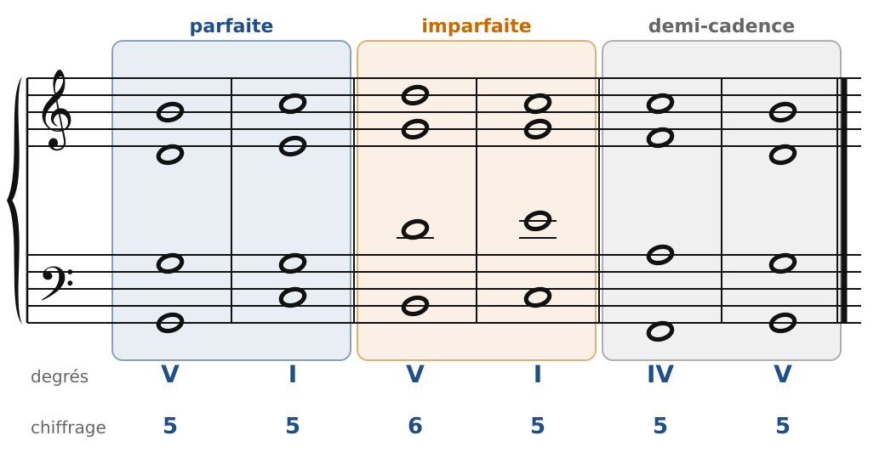
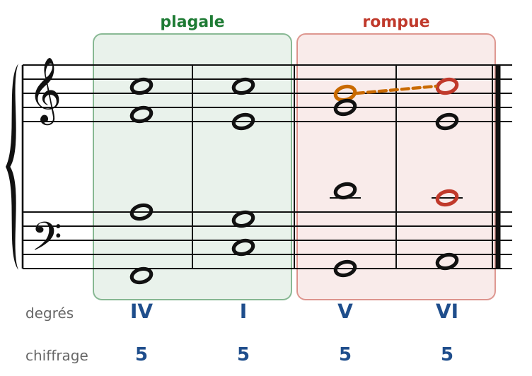
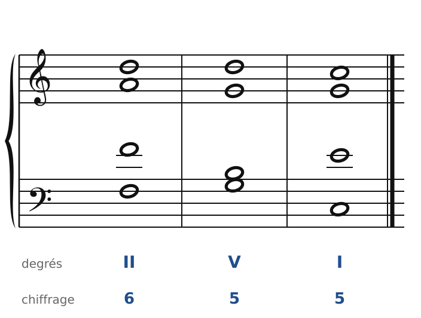

[← 6. Le premier renversement](06-le-premier-renversement.md) · [Sommaire](../README.md#sommaire) · [8. L'accord de quarte et sixte →](08-l-accord-de-quarte-et-sixte.md)

## 7. Les cadences

Une phrase musicale se termine comme une phrase écrite : par un point, une virgule ou un point d'interrogation. En harmonie, cette ponctuation s'appelle une **cadence** : les deux derniers accords d'une phrase.

### Les cinq cadences

🔊 [Écouter](audio/h07-cadences1.mp3) · [MIDI](audio/h07-cadences1.mid)

**Cadence parfaite (V-I)** : le **point final**. Les deux accords sont à l'**état fondamental**, et le I tombe sur un **temps fort**. Le plus souvent, le soprano finit sur la tonique, et la sensible monte (Si-Do).

**Cadence imparfaite (V-I avec un renversement)** : un point plus léger, comme un point-virgule. Ici le V est au 1er renversement (V6) : la sensible est à la basse et monte sur Do. On parle aussi de cadence imparfaite quand le soprano ne finit pas sur la tonique.

**Demi-cadence (… → V)** : la phrase **s'arrête sur V**. C'est une virgule, ou une question qui attend sa réponse. On y arrive souvent par IV-V, II-V ou I-V.

🔊 [Écouter](audio/h07-cadences2.mp3) · [MIDI](audio/h07-cadences2.mid)

**Cadence plagale (IV-I)** : une conclusion douce, celle de l'« Amen » à la fin des hymnes. Souvent, elle vient **après** une cadence parfaite, comme une signature.

**Cadence rompue (V-VI)** : la **surprise**. On attend I après V, et c'est VI (Am) qui arrive. La phrase n'est pas finie : il faudra une nouvelle cadence pour conclure.

### La règle de la cadence rompue

L'enchaînement V-VI est piégeux : la basse monte d'un degré (Sol-La), et si toutes les voix montent avec elle, c'est la catastrophe (5tes et 8ves consécutives). La règle :

1. La **sensible monte** sur la tonique (Si-Do, en orange).
2. Les **deux autres voix supérieures descendent** (Sol-Mi et Ré-Do).
3. Résultat : dans le VI, la **tierce (Do) est doublée** (en rouge). C'est la seule doublure de tierce qu'on recherche à l'état fondamental : elle est obligatoire ici.

### Préparer la cadence : le II6

Avant une cadence parfaite, on a besoin d'un accord qui « pousse » vers V. Le meilleur candidat est le **II6** (accord de II au 1er renversement) :

🔊 [Écouter](audio/h07-ii6.mp3) · [MIDI](audio/h07-ii6.mid)

- La basse fait Fa-Sol-Do, exactement la basse de IV-V-I, mais l'accord de II apporte le Ré, qui reste au soprano dans le V.
- Dans le II6, on double volontiers la basse (Fa) : c'est un accord mineur.
- Le IV peut jouer le même rôle (IV-V-I). Le II6 a simplement une couleur plus riche.

### Les règles à retenir

| Cadence | Accords | Effet |
| --- | --- | --- |
| Parfaite | V-I, état fondamental, I sur temps fort | point final |
| Imparfaite | V-I avec un renversement | point léger |
| Demi-cadence | … → V | virgule, question |
| Plagale | IV-I | « Amen » |
| Rompue | V-VI, tierce doublée dans VI | surprise, relance |

---

[← 6. Le premier renversement](06-le-premier-renversement.md) · [Sommaire](../README.md#sommaire) · [8. L'accord de quarte et sixte →](08-l-accord-de-quarte-et-sixte.md)
