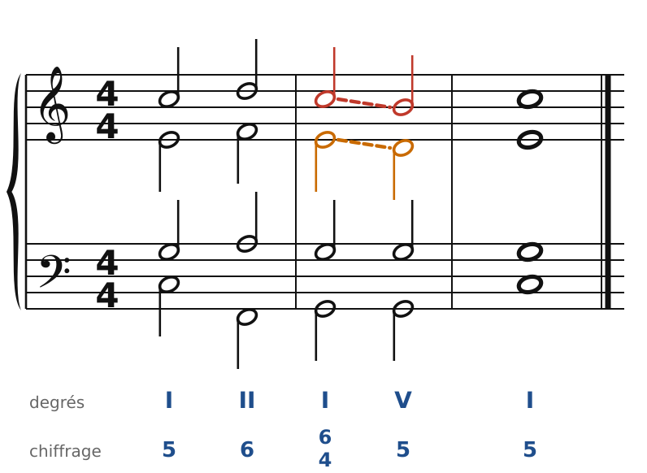
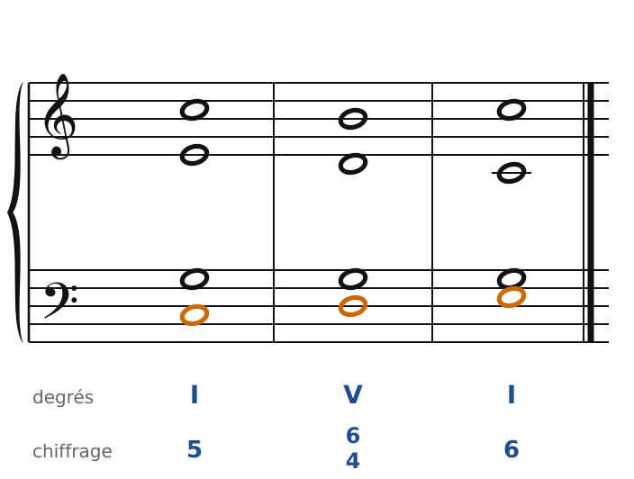
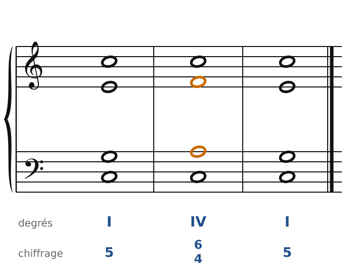

[← 7. Les cadences](07-les-cadences.md) · [Sommaire](../README.md#sommaire) · [9. Basse donnée et chant donné →](09-basse-donnee-et-chant-donne.md)

## 8. L'accord de quarte et sixte

Le 2e renversement met la **quinte à la basse** : chiffrage **6/4**. Dans le style classique, c'est un accord **instable**. La 4te au-dessus de la basse est traitée comme une dissonance, exactement comme en contrepoint, où la 4te avec la basse n'est pas une consonance.

On ne l'emploie donc pas librement. Il n'a que **trois usages**, et dans les trois on **double la basse**.

### 1. La quarte et sixte de cadence

C'est de loin la plus fréquente. Elle se place juste avant le V d'une cadence :

🔊 [Écouter](audio/h08-cadentielle.mp3) · [MIDI](audio/h08-cadentielle.mid)

- Le I6/4 tombe sur un **temps fort**, le V sur le temps faible qui suit.
- La **basse ne bouge pas** : c'est la dominante (Sol), pour les deux accords.
- Au-dessus, la **4te descend sur la 3ce** (Do-Si, en rouge) et la **6te descend sur la 5te** (Mi-Ré, en orange). Compte les intervalles depuis le Sol de la basse : Do est une 4te, Mi une 6te ; Si est une 3ce, Ré une 5te.

Tu reconnais le mécanisme du **retard** en 4e espèce : une note dissonante sur le temps fort, qui se résout en descendant. D'ailleurs, beaucoup de musiciens n'y entendent pas un vrai accord de I : pour eux, c'est **un V décoré de deux appoggiatures**. C'est pour ça qu'on le prépare comme un V, par II6 ou IV.

### 2. La quarte et sixte de passage

La basse monte (ou descend) par degrés conjoints entre deux positions du même accord, et le 6/4 se glisse au milieu, sur un temps faible :

🔊 [Écouter](audio/h08-passage.mp3) · [MIDI](audio/h08-passage.mid)

La basse fait Do-Ré-Mi (en orange) : I, puis V6/4 (Sol-Si-Ré avec Ré à la basse), puis I6. Le V6/4 n'est qu'un accord de passage, qui relie I et I6.

### 3. La quarte et sixte de broderie

La basse reste sur place, et deux voix font une **broderie** au-dessus d'elle :

🔊 [Écouter](audio/h08-broderie.mp3) · [MIDI](audio/h08-broderie.mid)

La basse tient Do. L'alto fait Mi-Fa-Mi, le ténor Sol-La-Sol : le IV6/4 apparaît au passage (en orange). On l'appelle aussi « quarte et sixte de pédale ».

### Les règles à retenir

- **Toujours doubler la basse** (la quinte de l'accord).
- Seulement trois usages : **de cadence** (sur le temps fort, avant V), **de passage** (basse conjointe, temps faible), **de broderie** (basse tenue).
- Dans la quarte et sixte de cadence, la 6te et la 4te **descendent** sur la 5te et la 3ce.
- En dehors de ces trois cas, un 6/4 est une faute.

---

[← 7. Les cadences](07-les-cadences.md) · [Sommaire](../README.md#sommaire) · [9. Basse donnée et chant donné →](09-basse-donnee-et-chant-donne.md)
