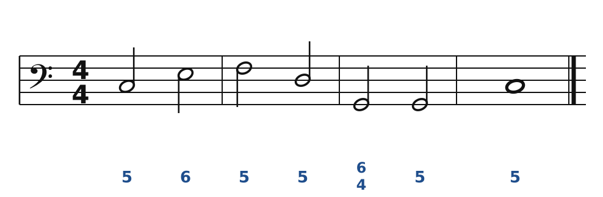
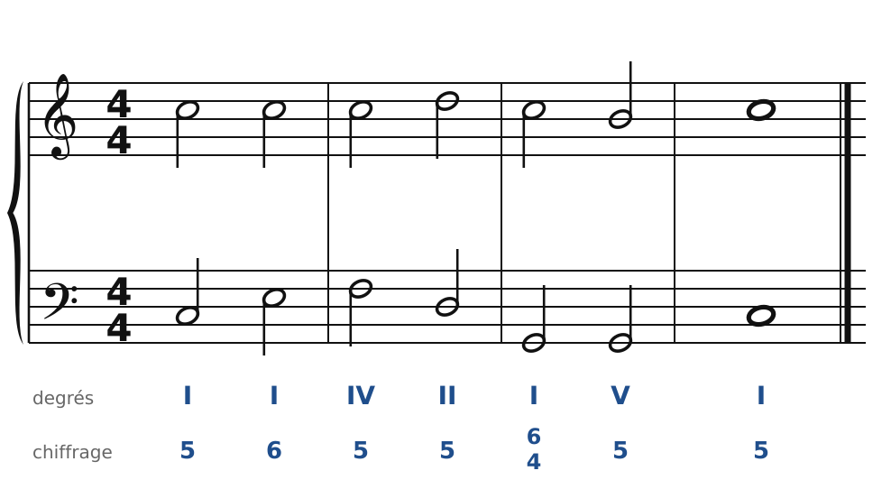
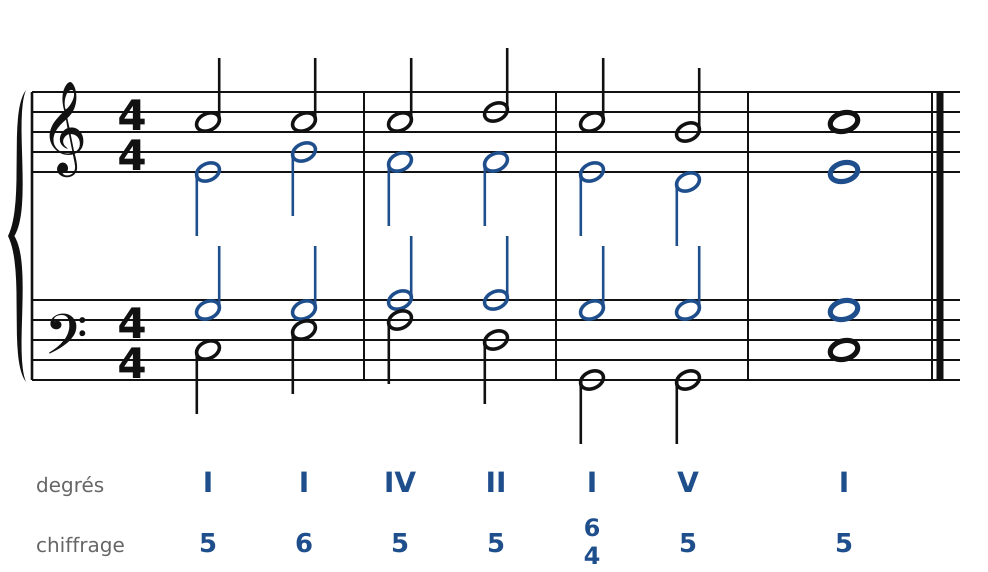
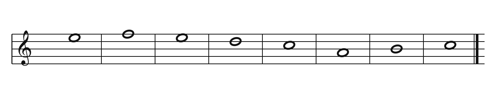
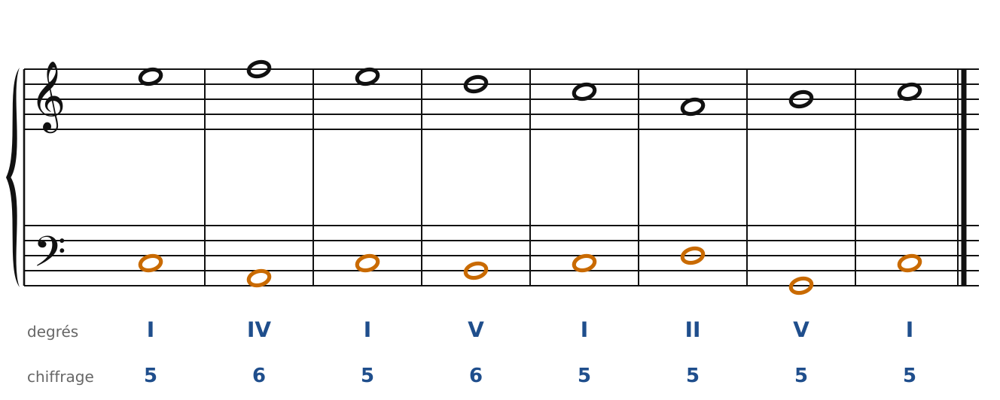
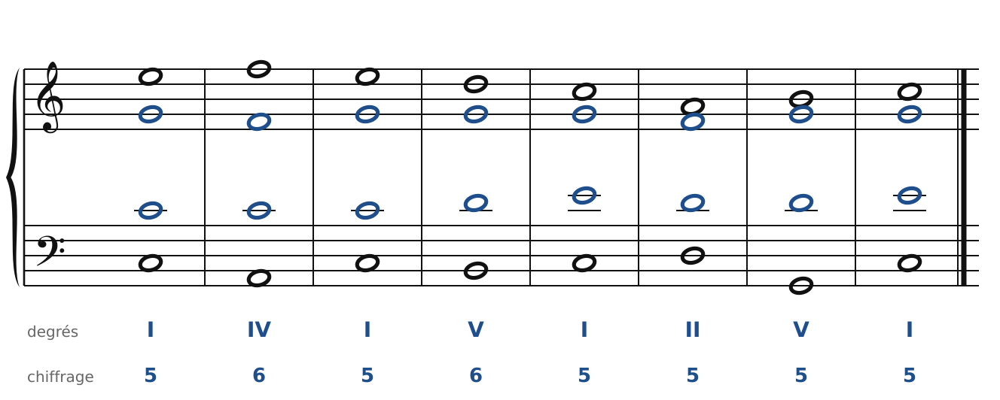

[← 8. L'accord de quarte et sixte](08-l-accord-de-quarte-et-sixte.md) · [Sommaire](../README.md#sommaire) · [10. Le mode mineur →](10-le-mode-mineur.md)

## 9. Basse donnée et chant donné

Tu as maintenant tous les outils pour écrire une vraie phrase. Il existe deux exercices classiques :

- la **basse donnée** : on te donne la basse (souvent chiffrée), tu écris les trois voix du haut ;
- le **chant donné** : on te donne la mélodie du soprano, tu choisis les accords et tu écris les trois autres voix.

### La basse donnée, pas à pas

Voici une basse chiffrée en Do majeur :

🔊 [Écouter](audio/h09-bc1.mp3) · [MIDI](audio/h09-bc1.mid)

**Étape 1 : trouver les accords.** Pour chaque note, lis le chiffrage et retrouve la fondamentale (voir le chapitre 6) :

| Basse | Chiffrage | Fondamentale | Accord | Degré |
| --- | --- | --- | --- | --- |
| Do | 5 | Do | C | I |
| Mi | 6 | Do (une 3ce sous Mi) | C | I6 |
| Fa | 5 | Fa | F | IV |
| Ré | 5 | Ré | Dm | II |
| Sol | 6/4 | Do (une 4te au-dessus de Sol) | C | I6/4 |
| Sol | 5 | Sol | G | V |
| Do | 5 | Do | C | I |

**Étape 2 : repérer la cadence.** Les deux dernières mesures forment la formule I6/4-V-I : la quarte et sixte de cadence, sur le temps fort, puis la cadence parfaite.

**Étape 3 : écrire le soprano.** Cherche une ligne simple, qui avance surtout par degrés conjoints et finit sur la tonique. Vérifie tout de suite les 5tes et les 8ves entre soprano et basse : c'est le couple qu'on entend le mieux.

🔊 [Écouter](audio/h09-bc2.mp3) · [MIDI](audio/h09-bc2.mid)

Ici, le soprano reste sur Do pendant que la basse bouge : c'est du **mouvement oblique**, qui ne risque aucune quinte ni octave. Puis Ré (au-dessus du II), et la cadence Do-Si-Do : dans le I6/4, le Do est la 4te au-dessus de la basse, qui descend sur la 3ce (Si).

**Étape 4 : compléter l'alto et le ténor** avec la méthode du chapitre 3 : notes communes, plus court chemin, doublures selon l'état de l'accord.

🔊 [Écouter](audio/h09-bc3.mp3) · [MIDI](audio/h09-bc3.mid)

**Étape 5 : vérifier**, avec la liste du chapitre 3, plus les règles des chapitres 6 à 8 (doublures des accords de sixte, quarte et sixte).

### Le chant donné, pas à pas

Voici une mélodie en Do majeur :

🔊 [Écouter](audio/h09-cd1.mp3) · [MIDI](audio/h09-cd1.mid)

**Étape 1 : lister les accords possibles.** Chaque note de la gamme appartient à plusieurs accords :

| Note | Accords qui la contiennent |
| --- | --- |
| Do | I, IV, VI |
| Ré | II, V |
| Mi | I, VI (III) |
| Fa | II, IV |
| Sol | I, V |
| La | II, IV, VI |
| Si | V (III) |

**Étape 2 : placer le début et la fin.** On commence sur I. On finit par une cadence : ici, Si-Do au soprano appelle V-I (cadence parfaite).

**Étape 3 : choisir les accords du milieu.** Préfère les enchaînements forts :

- **I** peut aller partout ;
- **IV** et **II** vont vers **V** (ou vers I) ;
- **V** va vers **I** (ou vers VI : cadence rompue) ;
- **VI** va vers **II**, **IV** ou **V**.

Évite **V-IV** et **II-IV**, qui sonnent comme un retour en arrière.

**Étape 4 : écrire la basse**, en mouvement contraire au soprano autant que possible. Utilise les accords de sixte pour la rendre conjointe.

🔊 [Écouter](audio/h09-cd2.mp3) · [MIDI](audio/h09-cd2.mid)

Pendant que le soprano fait Mi-Fa-Mi-Ré-Do, la basse fait Do-La-Do-Si-Do (en orange) : des broderies autour de Do, grâce au IV6 et au V6. Puis II-V-I pour la cadence.

**Étape 5 : compléter l'alto et le ténor**, puis vérifier.

🔊 [Écouter](audio/h09-cd3.mp3) · [MIDI](audio/h09-cd3.mid)

Il n'y a jamais une seule bonne réponse en chant donné. Sur la 5e note (Do), on aurait pu mettre VI au lieu de I : une petite cadence rompue au milieu de la phrase.

Pour t'entraîner, le **cahier d'exercices** propose de nombreuses basses données et de nombreux chants donnés, à faire pas à pas.

---

[← 8. L'accord de quarte et sixte](08-l-accord-de-quarte-et-sixte.md) · [Sommaire](../README.md#sommaire) · [10. Le mode mineur →](10-le-mode-mineur.md)
