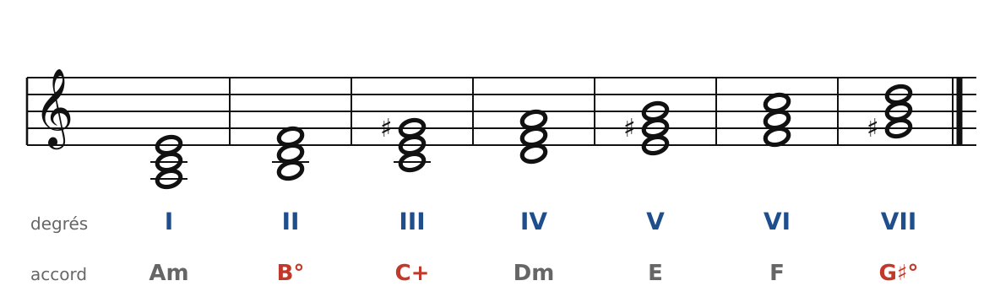
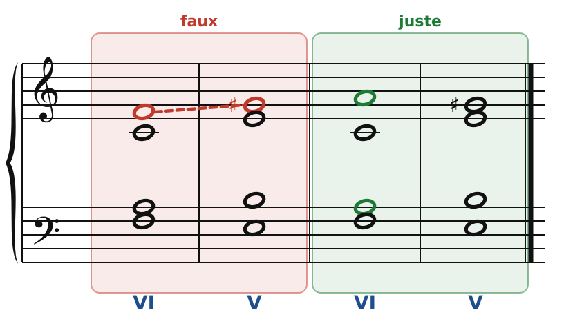
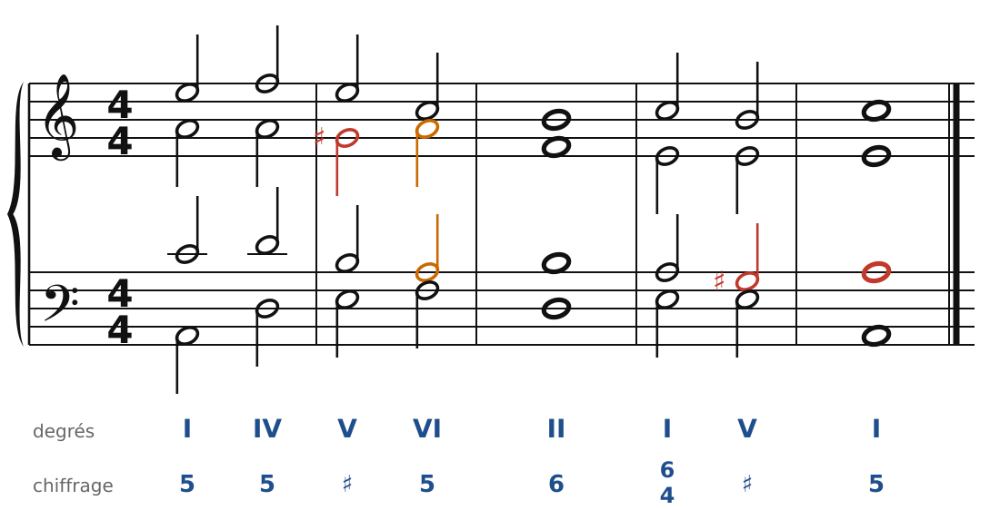

[← 9. Basse donnée et chant donné](09-basse-donnee-et-chant-donne.md) · [Sommaire](../README.md#sommaire) · [11. Exercices →](11-exercices.md)

## 10. Le mode mineur

Tout ce que tu as appris vaut aussi en mineur. Il y a juste un point délicat : la **sensible**.

### La gamme mineure harmonique

En la mineur, la gamme naturelle (La Si Do Ré Mi Fa Sol) n'a pas de sensible : Sol est un ton entier sous La, et le V (Em) est mineur. La cadence V-I perd alors toute sa force.

On **hausse donc le 7e degré** : Sol devient **Sol♯**. C'est la gamme **mineure harmonique** : La Si Do Ré Mi Fa Sol♯. Ce Sol♯ n'est pas à l'armure : on l'écrit à chaque fois devant la note.

### Les accords en la mineur

🔊 [Écouter](audio/h10-degres.mp3) · [MIDI](audio/h10-degres.mid)

- **I** (Am), **IV** (Dm) : mineurs.
- **V** (E) : **majeur**, grâce au Sol♯. C'est lui qui donne la cadence.
- **VI** (F) : majeur.
- **II** (B°) : **diminué** (Si-Ré-Fa). On l'emploie presque toujours au **1er renversement** (II6), avec Ré à la basse. On double alors la basse ou la fondamentale, jamais Fa.
- **III** (C+, Do-Mi-Sol♯) : **augmenté**. On l'évite.
- **VII** (G♯°) : diminué, on le verra avec les accords de 7e.

### Le chiffrage en mineur

Une altération seule sous la basse concerne la **tierce** de l'accord. Sous le Mi de la basse, **♯** veut dire : accord parfait avec la tierce haussée, Mi-**Sol♯**-Si. C'est le chiffrage habituel du V en mineur.

### Le piège : la seconde augmentée

Entre Fa (6e degré) et Sol♯ (7e degré), il y a une **seconde augmentée** (trois demi-tons). Mélodiquement, c'est un intervalle **interdit** dans le style choral : difficile à chanter, avec une couleur « orientale » qui n'a rien à faire ici.

Il apparaît surtout dans l'enchaînement **VI-V** (ou IV-V), quand une voix passe de Fa à Sol♯ :

🔊 [Écouter](audio/h10-seconde.mp3) · [MIDI](audio/h10-seconde.mid)

**À gauche (faux)** : le soprano monte de Fa à Sol♯.

**À droite (juste)** : dans le VI, on **double la tierce** (La, en vert). Le La du soprano descend d'un demi-ton sur Sol♯, l'alto va de Do à Mi, le ténor de La à Si. Personne ne fait Fa-Sol♯.

**Règle** : en mineur, quand VI est relié à V (dans un sens ou dans l'autre, et donc aussi dans la cadence rompue V-VI), on double la **tierce** de VI. Et la note Fa va vers Mi, jamais vers Sol♯.

### Une phrase en la mineur

🔊 [Écouter](audio/h10-phrase.mp3) · [MIDI](audio/h10-phrase.mid)

- La **sensible** (en rouge) monte toujours sur La.
- Mesure 2 : **cadence rompue** V-VI. Le VI double sa tierce (La, en orange).
- Mesure 3 : le **II6** (Si-Ré-Fa avec Ré à la basse) prépare la cadence.
- Mesures 4 et 5 : quarte et sixte de cadence, puis cadence parfaite. Le V est chiffré **♯**.

### Les règles à retenir

- Le 7e degré est haussé (Sol♯ en la mineur) : V est majeur.
- Jamais de **seconde augmentée** (Fa-Sol♯) dans une voix.
- VI relié à V : on double la tierce de VI.
- II est diminué : on l'emploie en II6. III augmenté : à éviter.

---

[← 9. Basse donnée et chant donné](09-basse-donnee-et-chant-donne.md) · [Sommaire](../README.md#sommaire) · [11. Exercices →](11-exercices.md)
