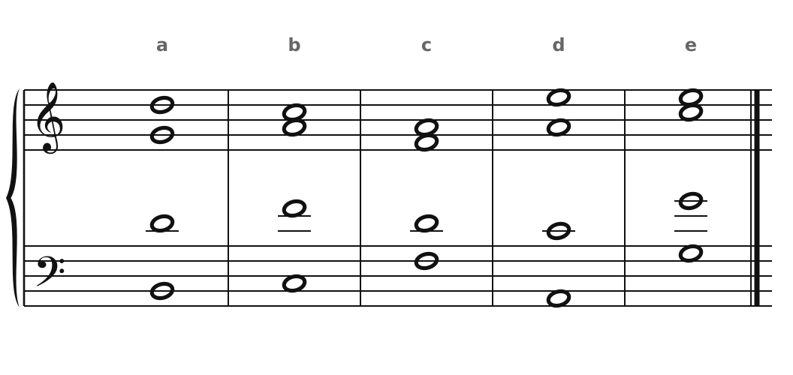
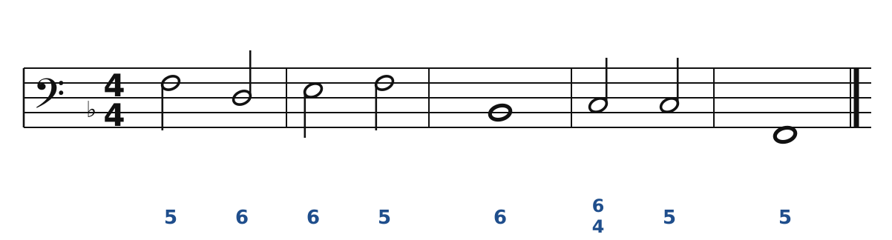
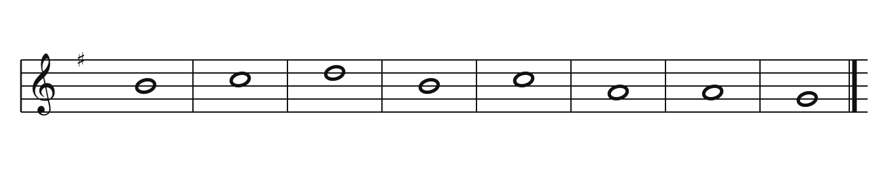
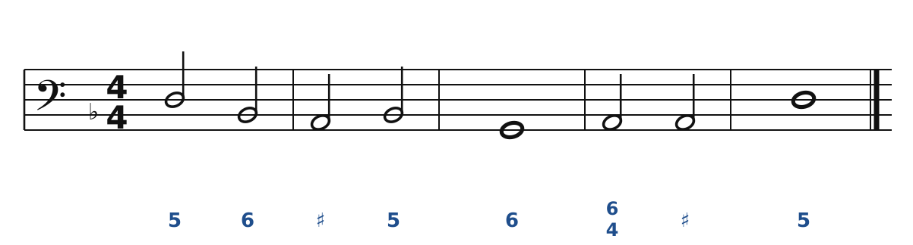
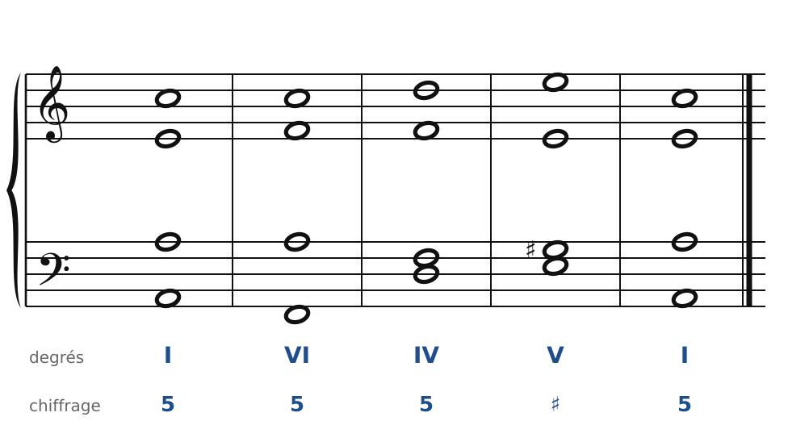

[← 10. Le mode mineur](10-le-mode-mineur.md) · [Sommaire](../README.md#sommaire) · [12. Corrigés →](12-corriges.md)

## 11. Exercices

Fais les exercices dans l'ordre, au crayon. Joue ou chante chaque résultat avant de regarder le corrigé.

Dans la **version web** du cours, les exercices 2, 3, 4 et 5 se font aussi directement sur la portée : bouton **✏️ Faire l'exercice ici**. Tu poses tes notes en cliquant, tu écoutes, et les corrections s'affichent au fur et à mesure, avec les mêmes règles que le cours.

### Exercice 1 : chiffrer des accords

Tous ces accords sont en Do majeur. Pour chacun, trouve la fondamentale, le degré, l'état et le chiffrage (5, 6 ou 6/4).

🔊 [Écouter](audio/h11-ex1.mp3) · [MIDI](audio/h11-ex1.mid)

### Exercice 2 : basse chiffrée en Fa majeur

Réalise cette basse à quatre voix. Commence le soprano sur **Do**.

🔊 [Écouter](audio/h11-ex2.mp3) · [MIDI](audio/h11-ex2.mid)

**Indices** : en Fa majeur, la sensible est Mi. Repère la quarte et sixte de cadence : que doivent faire la 6te et la 4te ?

### Exercice 3 : chant donné en Sol majeur

Harmonise cette mélodie. Commence sur I, finis par une cadence parfaite. Utilise au moins **un accord de sixte**.

🔊 [Écouter](audio/h11-ex3.mp3) · [MIDI](audio/h11-ex3.mid)

**Indice** : les deux La de la fin peuvent porter deux accords différents (II puis V).

### Exercice 4 : basse chiffrée en ré mineur

Réalise cette basse à quatre voix.

🔊 [Écouter](audio/h11-ex4.mp3) · [MIDI](audio/h11-ex4.mid)

**Indices** : en ré mineur, la sensible est **Do♯**. Le ♯ sous le La veut dire : accord de La avec la tierce haussée (La-Do♯-Mi). Mesure 2, tu trouveras une cadence rompue : quelle note doubler dans le VI ?

### Exercice 5 : chasse aux fautes en la mineur

Cet enchaînement contient **trois fautes**. Trouve-les, puis corrige-les en changeant **deux notes**.

🔊 [Écouter](audio/h11-ex5.mp3) · [MIDI](audio/h11-ex5.mid)

### Exercice 6 : pour quatuor à cordes

Recopie ta réalisation de l'exercice 2 pour quatuor à cordes. N'oublie pas l'armure (un bémol) sur les quatre portées, y compris en clé d'ut pour l'alto.

---

[← 10. Le mode mineur](10-le-mode-mineur.md) · [Sommaire](../README.md#sommaire) · [12. Corrigés →](12-corriges.md)
