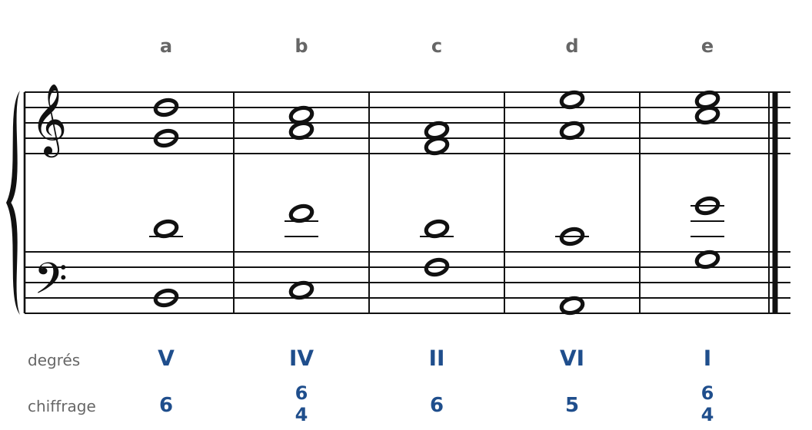
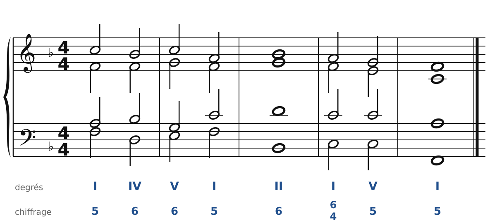
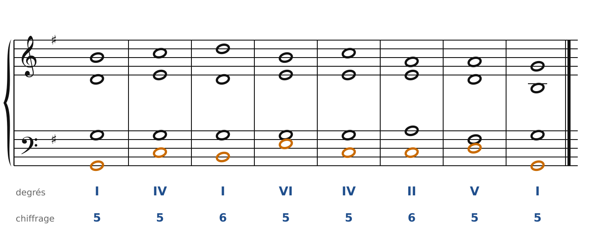
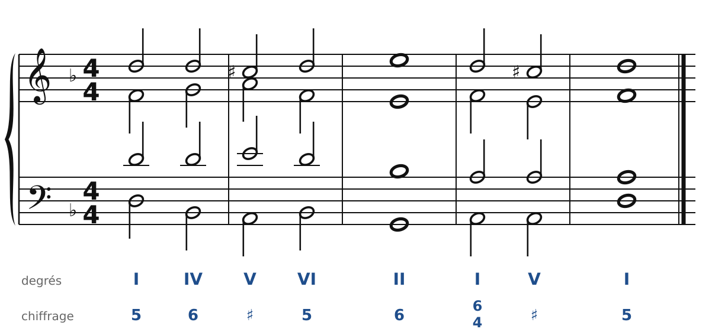
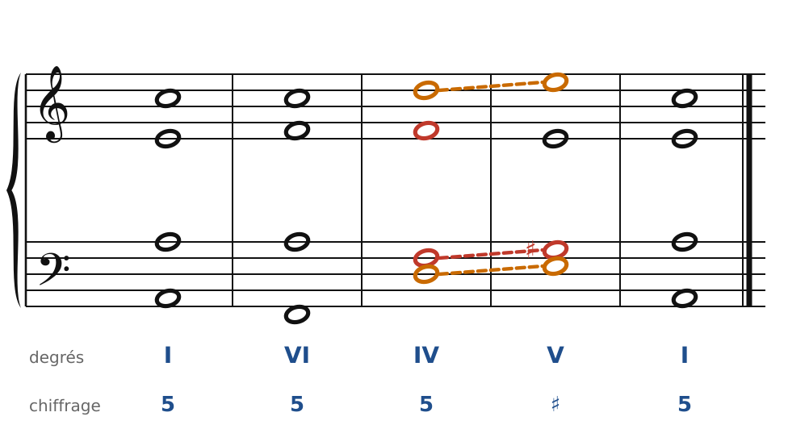
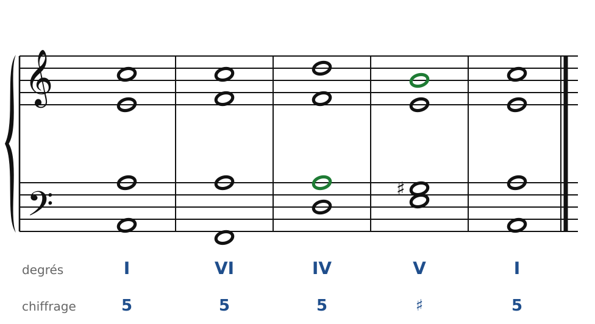
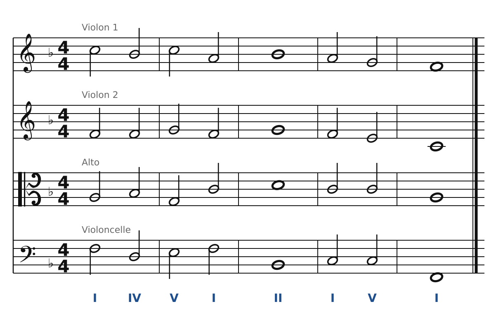

[← 11. Exercices](11-exercices.md) · [Sommaire](../README.md#sommaire) · [13. Les notes étrangères →](13-les-notes-etrangeres.md)

## 12. Corrigés

### Exercice 1 : chiffrer des accords

🔊 [Écouter](audio/h12-c1.mp3) · [MIDI](audio/h12-c1.mid)

| | Notes | Fondamentale | Accord | Degré | État | Chiffrage |
| --- | --- | --- | --- | --- | --- | --- |
| **a)** | Si (basse), Ré, Sol | Sol | G | V | 1er renversement | 6 |
| **b)** | Do (basse), Fa, La | Fa | F | IV | 2e renversement | 6/4 |
| **c)** | Fa (basse), Ré, La | Ré | Dm | II | 1er renversement | 6 |
| **d)** | La (basse), Do, Mi | La | Am | VI | état fondamental | 5 |
| **e)** | Sol (basse), Do, Mi | Do | C | I | 2e renversement | 6/4 |

Astuce : remets les notes en tierces empilées (Sol-Si-Ré, Fa-La-Do…). La note du bas de la pile est la fondamentale ; il suffit ensuite de regarder laquelle est à la basse.

### Exercice 2 : basse chiffrée en Fa majeur

🔊 [Écouter](audio/h12-c2.mp3) · [MIDI](audio/h12-c2.mid)

Les accords : I, IV6, V6, I, II6, I6/4, V, I.

- **IV6** (Sib-Ré-Fa avec Ré à la basse) : on double Sib, la fondamentale. Pas Ré : c'est la basse d'un accord majeur.
- **V6** (Do-Mi-Sol avec Mi à la basse) : Mi est la sensible de Fa majeur. On ne la double pas, et elle monte sur Fa.
- **II6** (Sol-Sib-Ré avec Sib à la basse) : accord mineur, on double la basse.
- **I6/4-V** : au-dessus du Do de la basse, La (la 6te) descend sur Sol (la 5te) au soprano, et Fa (la 4te) descend sur Mi (la 3ce) à l'alto.

Le soprano chante Do-Sib-Do-La-Sib-La-Sol-Fa : il descend tranquillement vers la tonique, souvent en mouvement contraire avec la basse.

### Exercice 3 : chant donné en Sol majeur

🔊 [Écouter](audio/h12-c3.mp3) · [MIDI](audio/h12-c3.mid)

Une solution : I, IV, I6, VI, IV, II6, V, I.

- La basse (en orange) fait Sol-Do-Si-Mi-Do-Do-Ré-Sol. Le **I6** met Si à la basse, en mouvement contraire avec le Ré du soprano.
- Le ténor garde Sol pendant cinq accords : c'est la note commune à I, IV, VI et I6.
- Sur les deux La : **II6** (La-Do-Mi avec Do à la basse) prépare **V** (Ré-Fa♯-La), puis cadence parfaite.
- L'accord final n'a pas de quinte (Sol triplé, Si) : le Fa♯ du ténor monte sur Sol.

D'autres solutions sont possibles. Par exemple, sur le 4e accord (Si), I à l'état fondamental au lieu de VI. Vérifie simplement les enchaînements avec la liste du chapitre 9.

### Exercice 4 : basse chiffrée en ré mineur

🔊 [Écouter](audio/h12-c4.mp3) · [MIDI](audio/h12-c4.mid)

Les accords : I, IV6, V, VI, II6, I6/4, V, I.

- **V** (La-Do♯-Mi, chiffré ♯) : la sensible Do♯ est au soprano, elle monte sur Ré.
- **V-VI** (mesure 2) : cadence rompue. Dans le VI (Sib-Ré-Fa), on double la **tierce**, Ré.
- **II6** (Mi-Sol-Sib avec Sol à la basse) : accord diminué, au 1er renversement. On double Mi, la fondamentale.
- **I6/4-V-I** : au-dessus du La de la basse, Ré (la 4te) descend sur Do♯ (la 3ce) et Fa (la 6te) sur Mi (la 5te).

### Exercice 5 : chasse aux fautes en la mineur

🔊 [Écouter](audio/h12-c5a.mp3) · [MIDI](audio/h12-c5a.mid)

1. **IV** (mesure 3) : l'alto et le ténor chantent tous les deux **Fa**, la tierce de Dm. La tierce est doublée et la fondamentale Ré n'est pas doublée.
2. **IV-V** : le ténor monte de Fa à Sol♯. C'est une **seconde augmentée**.
3. **IV-V** : soprano et basse vont de Ré-Ré à Mi-Mi. Ce sont des **octaves consécutives**.

Correction en deux notes :

🔊 [Écouter](audio/h12-c5b.mp3) · [MIDI](audio/h12-c5b.mid)

- Le ténor chante **La** au lieu de Fa dans le IV : la doublure est correcte (Ré doublé), et La descend d'un demi-ton sur Sol♯. Deux fautes corrigées d'un coup.
- Le soprano chante **Si** au lieu de Mi dans le V : les octaves disparaissent, et l'accord de V est complet.

### Exercice 6 : pour quatuor à cordes

🔊 [Écouter](audio/h12-c6.mp3) · [MIDI](audio/h12-c6.mid)

Les notes sont celles de l'exercice 2. Vérifie l'armure en clé d'ut : le bémol (Si♭) se place sur le **2e interligne** en partant du bas.

---

[← 11. Exercices](11-exercices.md) · [Sommaire](../README.md#sommaire) · [13. Les notes étrangères →](13-les-notes-etrangeres.md)
