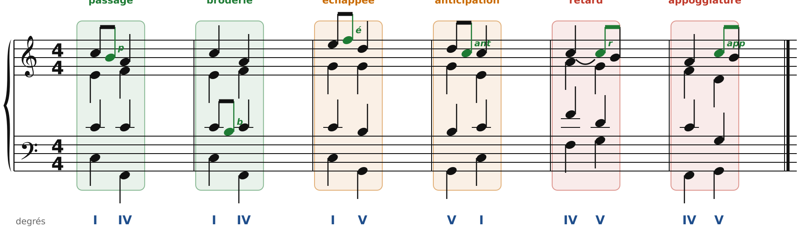
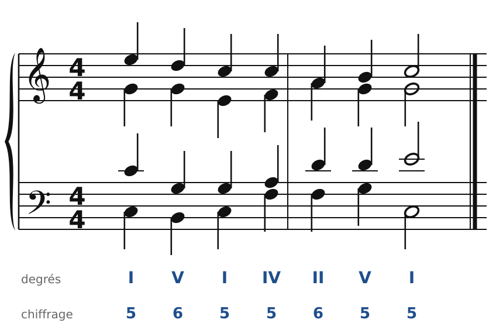
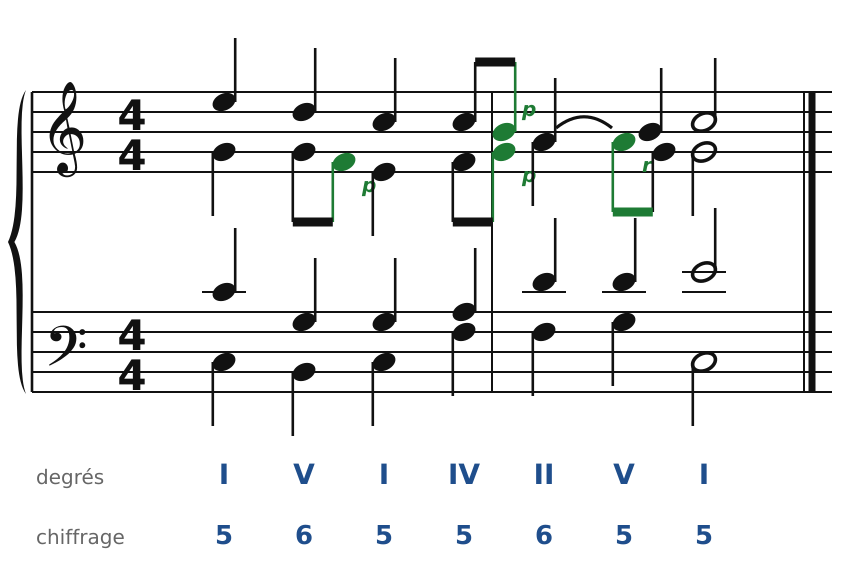

[← 12. Corrigés](12-corriges.md) · [Sommaire](../README.md#sommaire) · [14. Analyse : un choral de Bach →](14-analyse-un-choral-de-bach.md)

## 13. Les notes étrangères

Jusqu'ici, toutes nos notes appartenaient à l'accord : ce sont des **notes réelles**. Mais dans un vrai choral, les voix ne restent pas immobiles d'un accord à l'autre. Elles glissent, elles brodent, elles retardent leur arrivée. Ces notes qui n'appartiennent pas à l'accord s'appellent des **notes étrangères**.

Une note étrangère n'est jamais posée au hasard : elle arrive et elle repart d'une façon bien précise. Pour la reconnaître, pose-toi deux questions :

1. Est-elle sur un **temps fort** (là où l'accord commence) ou sur un **temps faible** (entre deux accords) ?
2. Comment arrive-t-elle et comment repart-elle : **par degré conjoint** ou **par saut** ?

### Les six sortes de notes étrangères

🔊 [Écouter](audio/h13-sortes.mp3) · [MIDI](audio/h13-sortes.mid)

| Nom | Place | Elle arrive… | Elle repart… |
| --- | --- | --- | --- |
| **Note de passage** (p) | temps faible | par degré | par degré, dans le même sens |
| **Broderie** (b) | temps faible | par degré | en revenant à la note de départ |
| **Échappée** (é) | temps faible | par degré | par saut, dans l'autre sens |
| **Anticipation** (ant) | temps faible | — | c'est déjà la note de l'accord suivant |
| **Retard** (r) | temps fort | **préparée** : c'est la même note, liée, qui appartenait à l'accord précédent | en descendant d'un degré |
| **Appoggiature** (app) | temps fort | sans préparation, souvent par saut | par degré, le plus souvent en descendant |

Dans la figure, les notes étrangères sont en vert :

- **Passage** : le soprano descend Do-Si-La. Le Si relie deux notes réelles.
- **Broderie** : le ténor fait Do-Si-Do, une petite « broderie » autour de sa note.
- **Échappée** : le soprano monte Mi-Fa, puis saute sur Ré : il « s'échappe » dans l'autre sens.
- **Anticipation** : le soprano chante le Do du dernier accord une croche trop tôt.
- **Retard** : le Do du soprano reste en place (il est lié) alors que l'accord change. Sur le temps fort du V, ce Do est une dissonance, qui se résout en descendant sur Si. C'est le mécanisme du retard de 4e espèce, en contrepoint.
- **Appoggiature** : le soprano saute sur Do, qui n'est pas dans l'accord de V, puis se résout sur Si.

Les trois premières (passage, broderie, échappée) et l'anticipation sont **non accentuées** : elles se glissent sur le temps faible, souvent en croches. Le retard et l'appoggiature sont **accentués** : ils tombent sur le temps fort et créent une tension plus forte.

### Les règles

1. Une note étrangère est **toujours amenée et résolue** comme dans le tableau. Une note qui n'appartient pas à l'accord et qui ne suit aucun de ces modèles est une faute.
2. On vérifie l'harmonie (doublures, enchaînements) sur les **notes réelles**. Pour un retard ou une appoggiature, la note réelle est la résolution.
3. Une note étrangère **ne doit pas créer de quintes ni d'octaves consécutives**. Les notes de passage sont les plus dangereuses : vérifie chaque croche avec les autres voix.
4. Dans le style du choral, la plupart des notes étrangères sont des **notes de passage en croches**, sur la deuxième moitié du temps.

### Avant, après

Voici une phrase écrite en noires, puis la même phrase ornée de notes étrangères :

🔊 [Écouter](audio/h13-avant.mp3) · [MIDI](audio/h13-avant.mid)

🔊 [Écouter](audio/h13-apres.mp3) · [MIDI](audio/h13-apres.mid)

Les harmonies n'ont pas changé : on a seulement rempli des tierces par des **notes de passage** (à l'alto et au soprano) et ajouté un **retard** à l'alto juste avant la cadence (La lié, qui descend sur Sol). Écoute la différence : les voix se mettent à chanter, et la cadence est plus expressive.

---

[← 12. Corrigés](12-corriges.md) · [Sommaire](../README.md#sommaire) · [14. Analyse : un choral de Bach →](14-analyse-un-choral-de-bach.md)
