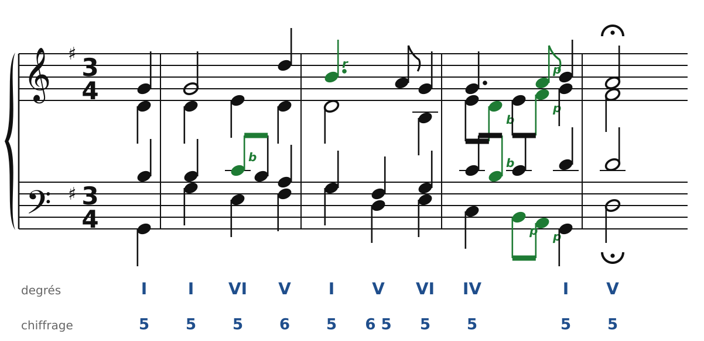
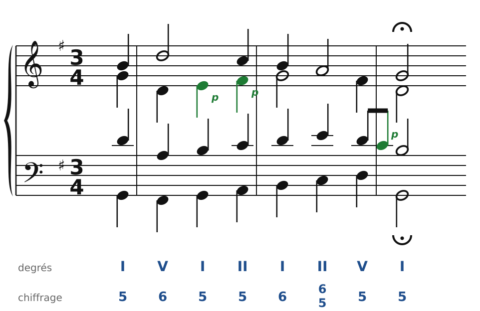

[← 13. Les notes étrangères](13-les-notes-etrangeres.md) · [Sommaire](../README.md#sommaire) · [15. Harmoniser une mélodie de choral →](15-harmoniser-une-melodie-de-choral.md)

## 14. Analyse : un choral de Bach

Jean-Sébastien Bach a harmonisé à quatre voix plusieurs centaines de **chorals**, les cantiques de l'Église luthérienne. Après sa mort, on en a réuni 371 dans un recueil qui sert depuis de modèle à tous les élèves d'harmonie.

Le premier de ce recueil est **« Aus meines Herzens Grunde »** (« Du fond de mon cœur », BWV 269), en Sol majeur, à 3/4. La mélodie commence par une **anacrouse** : un temps avant la première barre de mesure (on compte les mesures à partir de la première mesure complète). Chaque phrase se termine par un **point d'orgue** (𝄐), qui marque la cadence.

On analyse les deux premières phrases. Sous la portée : les degrés et le chiffrage, un accord par temps. Les notes étrangères sont en vert.

### Phrase 1 : une demi-cadence

🔊 [Écouter](audio/h14-phrase1.mp3) · [MIDI](audio/h14-phrase1.mid)

- **Anacrouse et mesure 1** : I, puis encore I. Sous le Sol tenu du soprano, Bach change d'accord : I, puis **VI** (Em). Une même note de la mélodie peut porter deux accords différents. Au ténor, Do-Si est une **broderie** (b). Puis **V6** : la basse Fa♯ (la sensible) monte vers Sol.
- **Mesure 2** : I, puis **V** avec un **retard** au soprano (r) : le Si tenu depuis le premier temps est étranger à l'accord de Ré, il descend sur La. Le chiffrage « 6 5 » montre cette résolution : la 6te au-dessus de la basse (Si) descend sur la 5te (La). Puis **VI**.
- **Mesure 3** : **IV** (C), animé par des croches. Alto et ténor font des **broderies** (Mi-Ré-Mi, Do-Si-Do). Ensuite, trois voix descendent ou montent ensemble en **notes de passage** (p) : le soprano Sol-La-Si, l'alto Mi-Fa♯-Sol, la basse Do-Si-La-Sol. Tout ce mouvement mène à **I**.
- **Mesure 4** : **V**, avec le point d'orgue : c'est une **demi-cadence**. La phrase s'arrête sur une question.

### Phrase 2 : une cadence parfaite

🔊 [Écouter](audio/h14-phrase2.mp3) · [MIDI](audio/h14-phrase2.mid)

- **Anacrouse** (fin de la mesure 4) : I. **Mesure 5** : **V6** (basse Fa♯), puis I et II. L'alto monte Ré-Mi-Fa♯-Sol : le Mi et le Fa♯ sont des **notes de passage**, qui tombent ici sur le temps (passages « accentués »).
- **Mesure 6** : **I6**, puis un accord qu'on étudiera dans la quatrième partie : **II6/5**, un accord de 7e (La-Do-Mi avec le Sol de l'alto, gardé de l'accord précédent). Puis **V** : au ténor, Ré-Do-Si est une note de passage. Le Do qu'on entend avec l'accord de V est sa 7e, une couleur que Bach adore.
- **Mesure 7** : **I**, point d'orgue : **cadence parfaite**.

### Ce qu'il faut retenir

1. **Un accord par temps**, presque toujours. Les croches sont des notes étrangères.
2. **La basse chante** : souvent par degrés conjoints, avec beaucoup d'accords de sixte (V6, I6).
3. **Une cadence à chaque point d'orgue** : ici une demi-cadence, puis une cadence parfaite.
4. **Les notes étrangères** sont surtout des notes de passage et des broderies en croches, plus un retard expressif à l'approche des cadences.
5. Tout ce que tu as appris (doublures, mouvement contraire, sensible qui monte) se retrouve chez Bach. Le chapitre suivant te montre comment harmoniser toi-même une mélodie de choral.

*Source : J.-S. Bach, choral BWV 269, regravé d'après le fichier du corpus music21 (domaine public).*

---

[← 13. Les notes étrangères](13-les-notes-etrangeres.md) · [Sommaire](../README.md#sommaire) · [15. Harmoniser une mélodie de choral →](15-harmoniser-une-melodie-de-choral.md)
