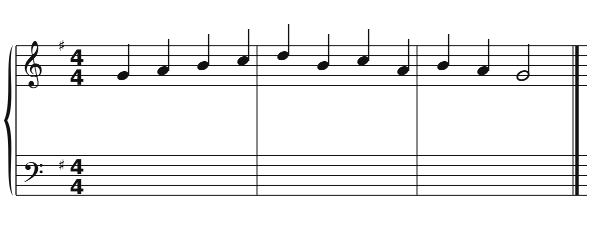
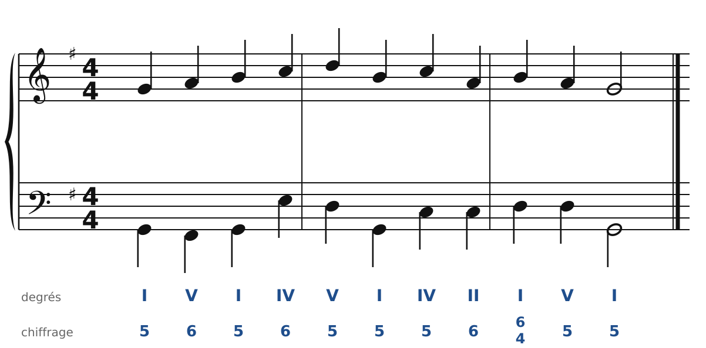
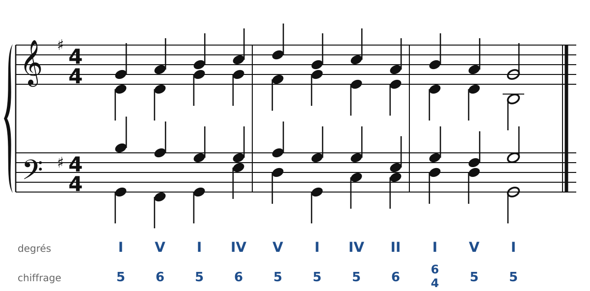
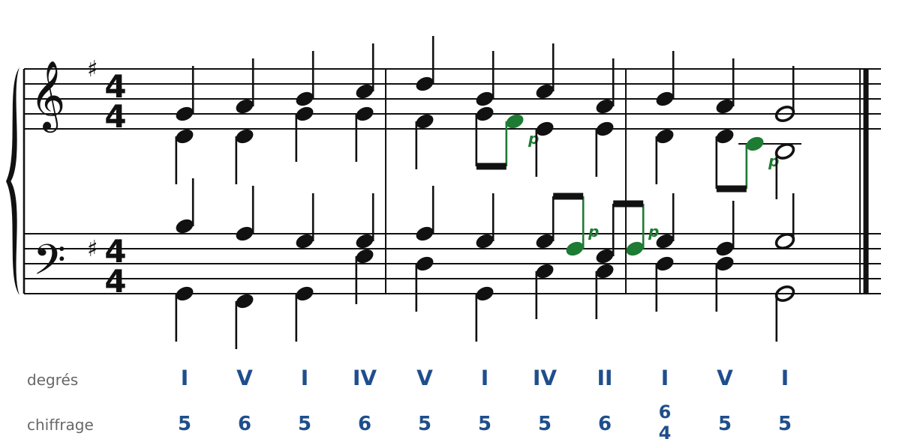

[← 14. Analyse : un choral de Bach](14-analyse-un-choral-de-bach.md) · [Sommaire](../README.md#sommaire) · [16. Exercices →](16-exercices.md)

## 15. Harmoniser une mélodie de choral

Harmoniser un choral, c'est un chant donné (chapitre 9) avec deux nouveautés : **un accord par temps** (en noires), et des **notes étrangères** pour faire chanter les voix (chapitre 13). On travaille dans l'ordre : d'abord les accords en noires, ensuite les ornements.

### La méthode en six étapes

1. **Repère les phrases** et leurs cadences (les points d'orgue). Chaque phrase finit par une cadence : parfaite, demi-cadence…
2. **Un accord par temps.** Sous chaque note réelle du soprano, choisis un accord qui la contient. Si la mélodie a une croche de passage ou un retard, ce n'est pas elle qui décide de l'accord.
3. **Prépare les cadences** : II6 ou IV avant V, et pourquoi pas une quarte et sixte de cadence (I6/4-V-I).
4. **Écris la basse**, en noires, en mouvement contraire avec le soprano autant que possible. Les accords de sixte la rendent conjointe.
5. **Complète l'alto et le ténor**, en noires : notes communes, plus court chemin, bonnes doublures. Vérifie tout.
6. **Ajoute des notes étrangères** : là où une voix fait une tierce, une croche de passage la remplit. Un retard peut rendre la cadence plus expressive. Vérifie que chaque croche ne crée ni quinte ni octave consécutive.

### Un exemple, étape par étape

La mélodie, en Sol majeur :

🔊 [Écouter](audio/h15-melodie.mp3) · [MIDI](audio/h15-melodie.mid)

**Étapes 1 à 4.** Une seule phrase, qui se termine par Si-La-Sol : c'est une cadence parfaite, préparée par une quarte et sixte de cadence (le Si sur le temps fort de la dernière mesure). Les accords : I, V6, I, IV6, V, I, IV, II6, I6/4, V, I. La basse, avec les accords de sixte, monte et descend surtout par degrés :

🔊 [Écouter](audio/h15-basse.mp3) · [MIDI](audio/h15-basse.mid)

**Étape 5.** L'alto et le ténor en noires :

🔊 [Écouter](audio/h15-complet.mp3) · [MIDI](audio/h15-complet.mid)

**Étape 6.** On remplit quelques tierces par des notes de passage, à l'alto et au ténor :

🔊 [Écouter](audio/h15-orne.mp3) · [MIDI](audio/h15-orne.mid)

Compare les deux dernières versions : mêmes accords, mais la seconde ressemble beaucoup plus à un choral de Bach. On n'ajoute pas des notes de passage partout : deux ou trois par phrase suffisent. On les place surtout aux voix intérieures et à la basse, pour que la mélodie reste bien claire.

---

[← 14. Analyse : un choral de Bach](14-analyse-un-choral-de-bach.md) · [Sommaire](../README.md#sommaire) · [16. Exercices →](16-exercices.md)
