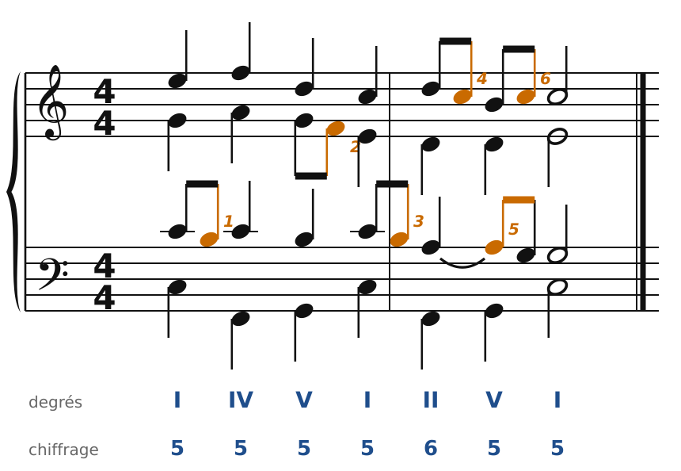
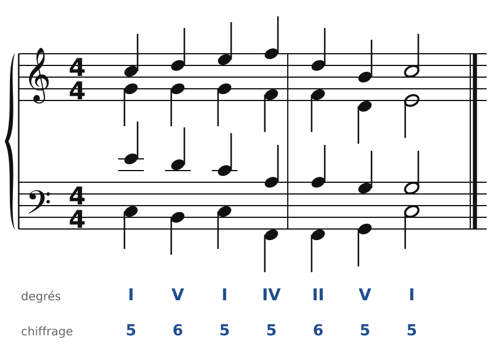
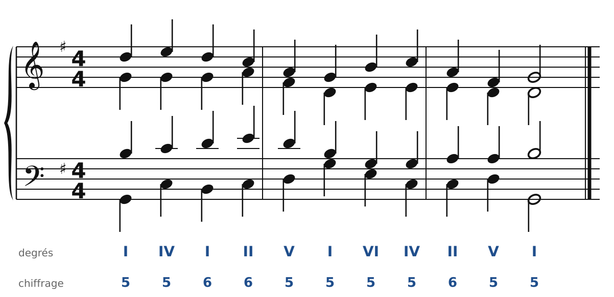
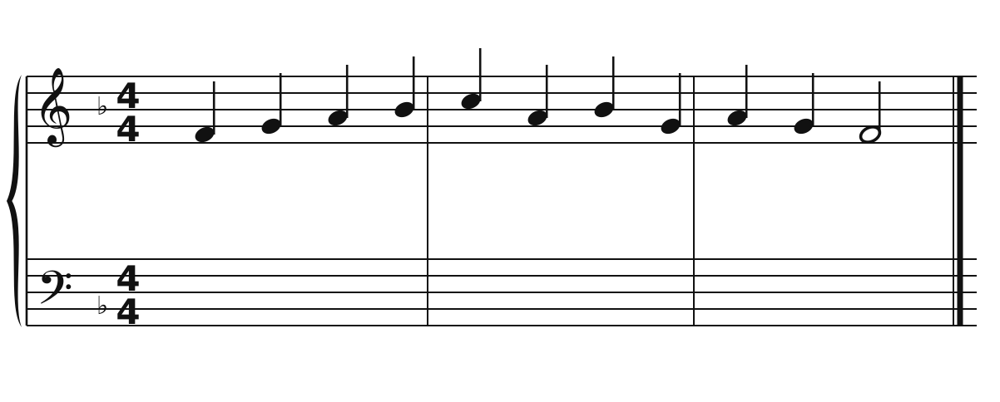
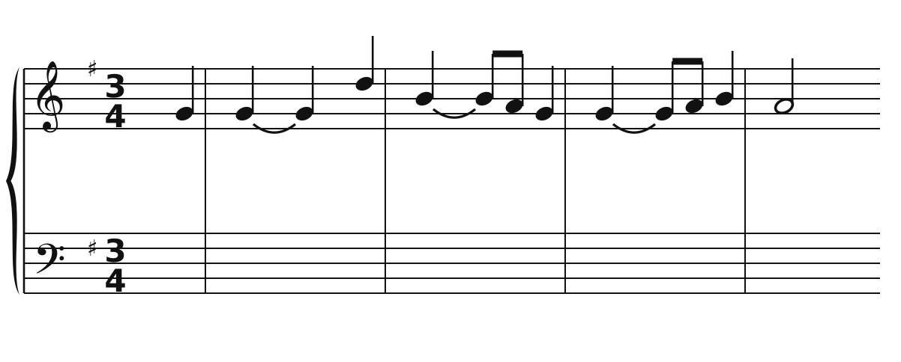

[← 15. Harmoniser une mélodie de choral](15-harmoniser-une-melodie-de-choral.md) · [Sommaire](../README.md#sommaire) · [17. Corrigés →](17-corriges.md)

## 16. Exercices

Dans la **version web** du cours, les exercices 2 à 5 se font directement sur la portée (bouton **✏️ Faire l'exercice ici**). Pour écrire deux croches à la place d'une noire, sélectionne la note et clique sur **♪♪ croches** (touche C). Pour préparer un retard, sélectionne la note et clique sur **⁀ lier** (touche L). Les notes étrangères reconnues s'affichent en vert avec leur nom (p, b, r…), et celles qui sont mal traitées en rouge.

### Exercice 1 : reconnaître les notes étrangères

Six notes étrangères sont numérotées. Pour chacune, donne son nom (passage, broderie, échappée, anticipation, retard, appoggiature) et explique comment tu l'as reconnue.

### Exercice 2 : des notes de passage

Ajoute au moins **trois notes de passage** à cette phrase en Do majeur, sans créer de quintes ni d'octaves.

**Indice** : cherche les voix qui font une tierce d'un accord à l'autre.

### Exercice 3 : un retard à la cadence

Dans cette phrase en Sol majeur, ajoute **un retard** juste avant la cadence finale, puis deux autres notes étrangères.

**Indice** : un retard se prépare. Cherche une voix qui descend d'un degré entre l'avant-dernier accord et celui d'avant : garde l'ancienne note (liée) et fais-la descendre à la croche suivante.

### Exercice 4 : harmoniser une mélodie de choral

Harmonise cette mélodie en Fa majeur, en suivant la méthode du chapitre 15 : accords, basse, alto et ténor en noires, puis au moins deux notes de passage.

### Exercice 5 : la mélodie du choral n°1

Voici la première phrase de « Aus meines Herzens Grunde », la mélodie que Bach harmonise au chapitre 14 (à 3/4, avec une anacrouse). **Sans regarder la version de Bach**, harmonise-la, puis compare.

**Indices** : le Sol tenu de la mesure 1 peut porter deux accords. Mesure 2, le Si lié qui descend sur La est un retard : l'accord de ce temps doit contenir La, pas Si. La phrase finit sur une demi-cadence.

---

[← 15. Harmoniser une mélodie de choral](15-harmoniser-une-melodie-de-choral.md) · [Sommaire](../README.md#sommaire) · [17. Corrigés →](17-corriges.md)
