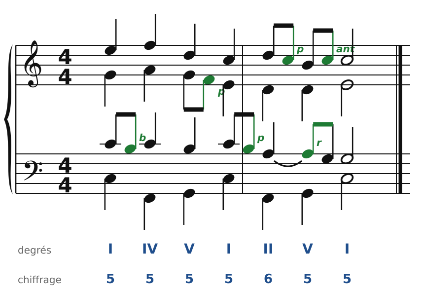
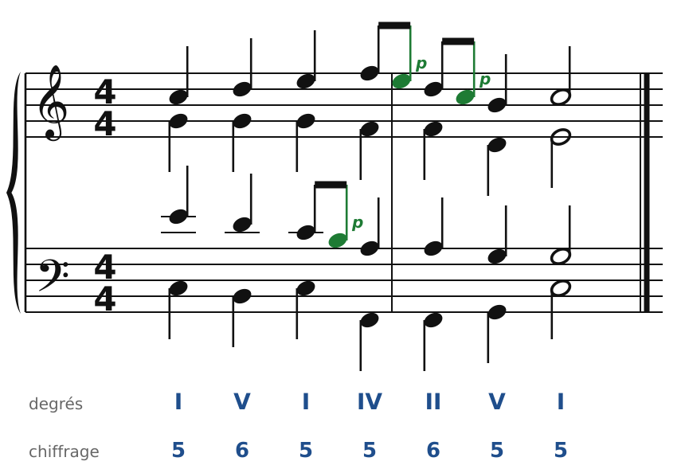
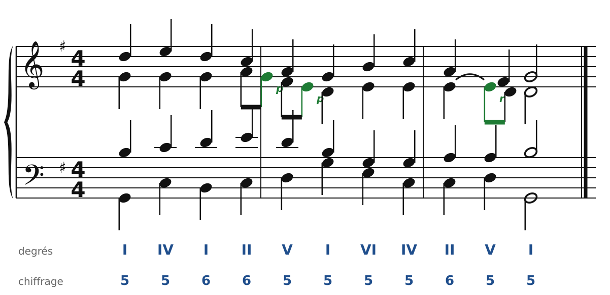
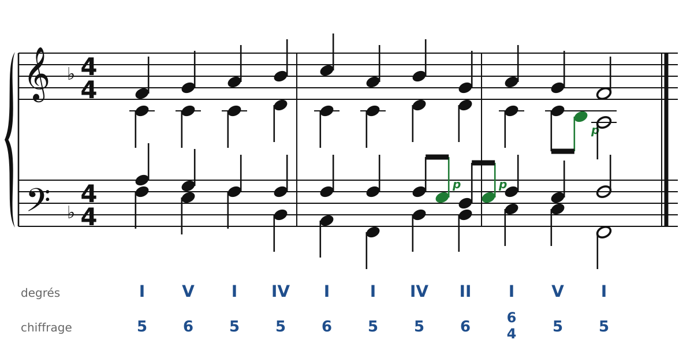
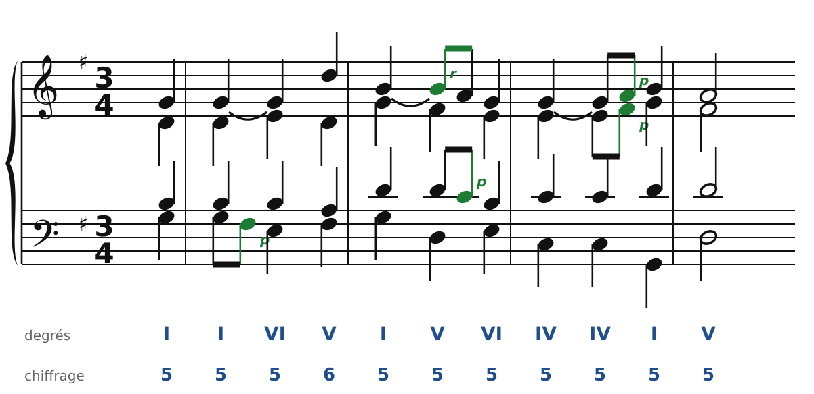
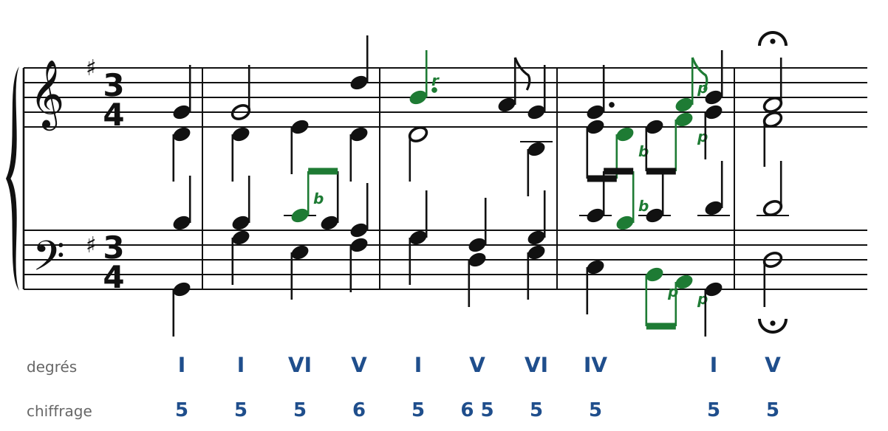

[← 16. Exercices](16-exercices.md) · [Sommaire](../README.md#sommaire)

## 17. Corrigés

### Exercice 1 : reconnaître les notes étrangères

🔊 [Écouter](audio/h17-c1.mp3) · [MIDI](audio/h17-c1.mid)

| N° | Voix | Nom | Comment la reconnaître |
| --- | --- | --- | --- |
| 1 | ténor | broderie | temps faible, elle descend d'un degré et revient à la même note |
| 2 | alto | note de passage | temps faible, elle relie deux notes réelles par degrés, dans le même sens |
| 3 | ténor | note de passage | même chose, au ténor |
| 4 | soprano | note de passage | même chose, au soprano |
| 5 | ténor | retard | temps fort, la note est liée depuis l'accord précédent et descend d'un degré |
| 6 | soprano | anticipation | temps faible, c'est déjà la note de l'accord suivant (la tonique) |

### Exercice 2 : des notes de passage

🔊 [Écouter](audio/h17-c2.mp3) · [MIDI](audio/h17-c2.mid)

Les notes de passage (en vert) remplissent des tierces. D'autres places étaient possibles : la version web vérifie la tienne.

### Exercice 3 : un retard à la cadence

🔊 [Écouter](audio/h17-c3.mp3) · [MIDI](audio/h17-c3.mid)

Le retard (r) garde la note de l'accord précédent, liée, sur le temps fort de l'accord de V, puis descend d'un degré. C'est la même tension expressive que chez Bach (chapitre 14, mesure 2).

### Exercice 4 : harmoniser une mélodie de choral

🔊 [Écouter](audio/h17-c4.mp3) · [MIDI](audio/h17-c4.mid)

Une solution parmi d'autres : I, V6, I, IV, I6, I, IV, II6, I6/4, V, I, avec une quarte et sixte de cadence sur le temps fort de la dernière mesure. Puis quelques notes de passage aux voix intérieures.

### Exercice 5 : la mélodie du choral n°1

🔊 [Écouter](audio/h17-c5.mp3) · [MIDI](audio/h17-c5.mid)

Cette réalisation suit les accords de Bach : I, puis I et VI sous le Sol tenu, V6, I, V (avec le retard Si-La de la mélodie), VI, IV pendant deux temps, I, et la demi-cadence sur V. Compare-la avec la version de Bach :

🔊 [Écouter](audio/h14-phrase1.mp3) · [MIDI](audio/h14-phrase1.mid)

Les accords sont les mêmes, mais Bach fait davantage chanter chaque voix : broderies à l'alto et au ténor, et trois notes de passage ensemble pour aller vers la cadence. Si tu as choisi d'autres accords, ce n'est pas forcément faux : la version web vérifie que ta réalisation respecte les règles.

---

[← 16. Exercices](16-exercices.md) · [Sommaire](../README.md#sommaire)
