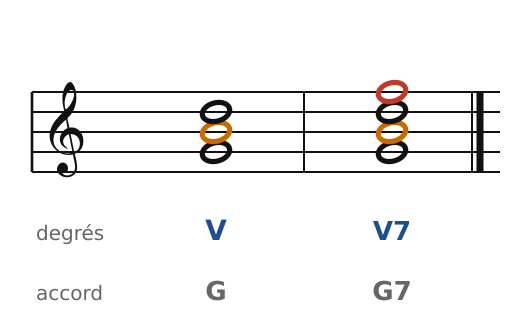
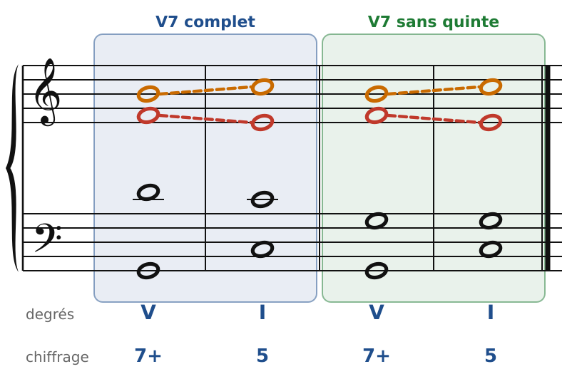
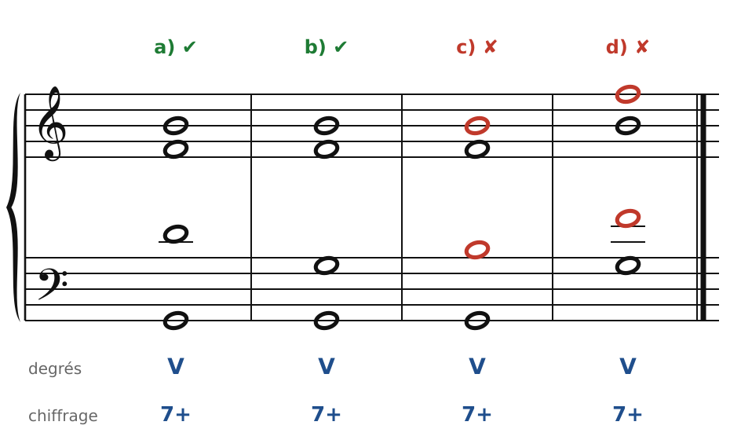
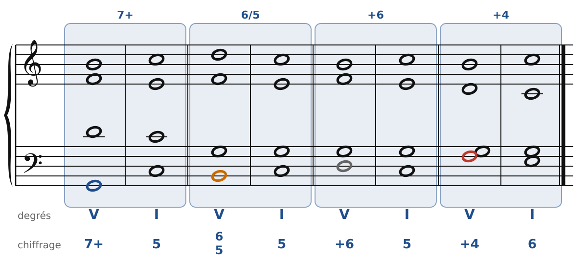
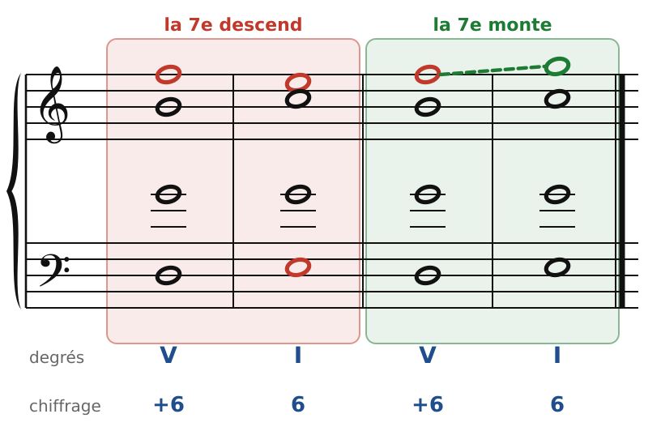
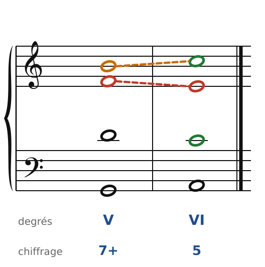
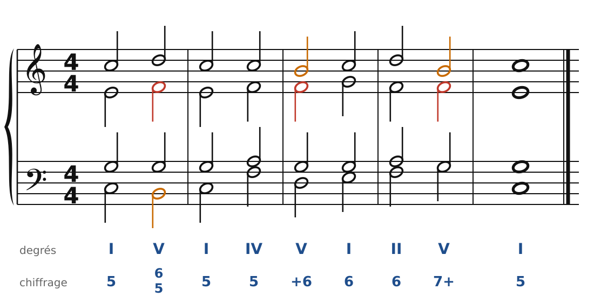
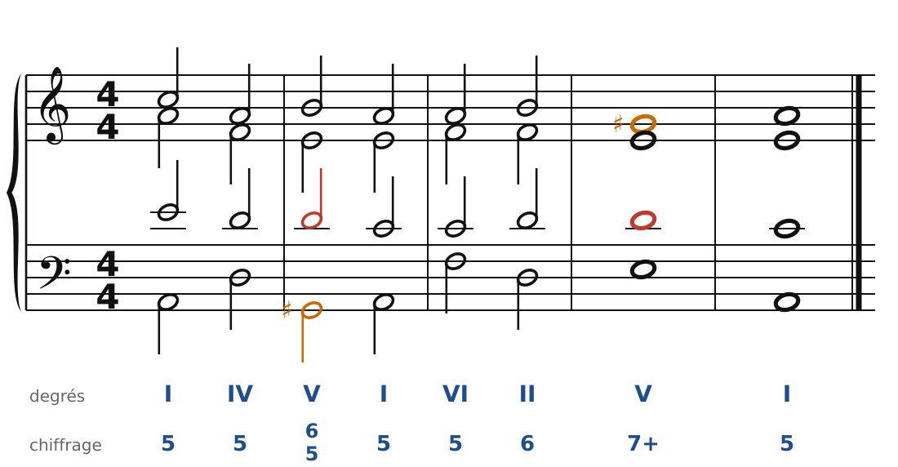

[← 17. Corrigés](17-corriges.md) · [Sommaire](../README.md#sommaire) · [19. Les septièmes d'espèce →](19-les-septiemes-d-espece-et-les-marches.md)

## 18. La septième de dominante

Jusqu'ici, tous nos accords avaient trois sons. On ajoute maintenant une quatrième note, une tierce au-dessus de la quinte : on obtient un **accord de septième**. Le plus important de tous est la **septième de dominante**, le V7. On l'entend partout, de Bach au jazz (c'est le G7 qui ramène à C).

### L'accord de 7e de dominante

🔊 [Écouter](audio/h18-accord.mp3) · [MIDI](audio/h18-accord.mid)

En Do majeur, le V est Sol-Si-Ré. On ajoute Fa, une 7e mineure au-dessus de Sol : **Sol-Si-Ré-Fa**, l'accord de G7.

Il contient deux notes qui « veulent » bouger :

- la **sensible** (Si, en orange), qui monte vers la tonique, comme dans le V ;
- la **septième** (Fa, en rouge), une dissonance, qui **descend d'un degré**.

Entre Si et Fa, il y a un **triton** (une quarte augmentée, ou une quinte diminuée). C'est ce triton qui donne au V7 sa tension, et qui rend sa résolution sur I si forte.

Chiffrage : **7+**. Le 7 indique la septième, le **+** indique la sensible.

### La résolution : la sensible monte, la septième descend

🔊 [Écouter](audio/h18-resolution.mp3) · [MIDI](audio/h18-resolution.mid)

C'est la règle d'or de ce chapitre :

1. La **sensible monte** d'un demi-ton sur la tonique (Si-Do).
2. La **septième descend** d'un degré (Fa-Mi).
3. Les autres voix vont au plus près.

Le triton Si-Fa se résout sur la tierce Do-Mi.

Regarde les deux cas de la figure :

- **V7 complet** (à gauche) : les quatre notes sont là. À la résolution, Ré descend sur Do, et le I n'a pas de quinte : la fondamentale est triplée. C'est normal, et c'est permis.
- **V7 sans quinte** (à droite) : on supprime Ré et on double la fondamentale (Sol). Le I qui suit est complet.

### Les doublures

🔊 [Écouter](audio/h18-doublures.mp3) · [MIDI](audio/h18-doublures.mid)

- **a)** Complet : une note par voix. C'est la disposition normale.
- **b)** Sans quinte, avec la fondamentale doublée : permis. La quinte est la note la moins importante.
- **c)** La sensible est doublée : interdit. Les deux Si devraient monter sur Do, ce qui donnerait des octaves.
- **d)** La septième est doublée : interdit, pour la même raison (deux Fa qui descendent sur Mi).

Retiens : **on ne double jamais la sensible ni la septième**. Si une note manque, c'est la quinte, et on double la fondamentale.

La 7e de dominante n'a **pas besoin d'être préparée** : elle peut arriver par saut, sans avoir été entendue dans l'accord d'avant. (Ce ne sera pas le cas des 7es d'espèce, au chapitre suivant.)

### Les renversements

🔊 [Écouter](audio/h18-renversements.mp3) · [MIDI](audio/h18-renversements.mid)

Un accord de quatre sons a **trois renversements**. On les chiffre d'après les intervalles au-dessus de la basse :

| Basse | Nom | Chiffrage du V7 | Résolution habituelle |
| --- | --- | --- | --- |
| fondamentale (Sol) | état fondamental | **7+** | V7 - I |
| tierce (Si) | 1er renversement | **6/5** (le 5 est souvent barré) | V6/5 - I |
| quinte (Ré) | 2e renversement | **+6** | V+6 - I ou I6 |
| septième (Fa) | 3e renversement | **+4** | V+4 - I6 |

Dans les renversements, l'accord est **complet** : on ne supprime aucune note.

Les règles ne changent pas : la sensible monte, la septième descend. Pour le **V+4**, c'est donc la basse qui descend (Fa-Mi), et on arrive sur un **I6**.

Les renversements rendent la basse **conjointe** : Do-Si-Do (I-V6/5-I), Do-Ré-Mi (I-V+6-I6), Do-Fa-Mi… C'est pour cela qu'on les aime.

### Un cas à connaître : la septième qui monte

🔊 [Écouter](audio/h18-monte.mp3) · [MIDI](audio/h18-monte.mid)

Dans l'enchaînement **V+6 - I6**, la basse monte (Ré-Mi). Si la septième (Fa) descend sur Mi, elle double la basse de l'accord de sixte : c'est la faute de la figure de gauche (tierce d'un accord majeur doublée). On permet alors à la septième de **monter** sur Sol, en dixièmes parallèles avec la basse. C'est la seule exception à la règle.

### Le V7 dans la cadence rompue

🔊 [Écouter](audio/h18-rompue.mp3) · [MIDI](audio/h18-rompue.mid)

La règle du chapitre 7 s'applique encore : la sensible monte (Si-Do), la 7e descend (Fa-Mi), Ré descend sur Do. Le VI a sa **tierce doublée** (en vert), comme dans toute cadence rompue.

### Une phrase avec des V7

🔊 [Écouter](audio/h18-phrase.mp3) · [MIDI](audio/h18-phrase.mid)

On utilise le V6/5 et le V+6 au milieu de la phrase, pour une basse chantante, et le V7 à l'état fondamental à la cadence finale. Les septièmes sont en rouge : chacune descend d'un degré dans l'accord suivant.

### En mineur

🔊 [Écouter](audio/h18-mineur.mp3) · [MIDI](audio/h18-mineur.mid)

En la mineur, le V7 est **Mi-Sol♯-Si-Ré** : un E7, avec la sensible haussée. Il est construit exactement comme en majeur, et se résout de la même façon (Sol♯-La, Ré-Do). Attention toujours à la seconde augmentée Fa-Sol♯.

### Les règles à retenir

- V7 = V + une 7e mineure. Chiffrage : **7+**, **6/5**, **+6**, **+4**.
- La **sensible monte**, la **7e descend** d'un degré.
- On ne double **ni la sensible ni la 7e**. À l'état fondamental, on peut supprimer la quinte (et doubler la fondamentale) ; dans les renversements, l'accord est complet.
- La 7e de dominante n'a pas besoin d'être préparée.
- Exception : dans V+6 - I6, la 7e peut monter.

---

[← 17. Corrigés](17-corriges.md) · [Sommaire](../README.md#sommaire) · [19. Les septièmes d'espèce →](19-les-septiemes-d-espece-et-les-marches.md)
